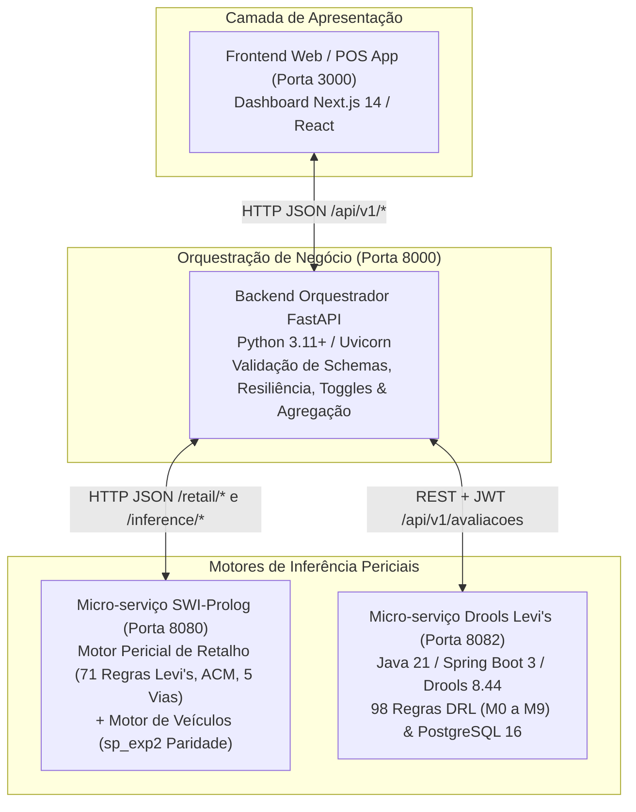

# Sistema Pericial de Diagnóstico para Devoluções e Trocas no Retalho
### *Retail Returns & Exchanges Diagnostic Expert System*

[](LICENSE)
[](https://fastapi.tiangolo.com/)
[](https://www.python.org/)
[](https://www.swi-prolog.org/)
[](https://openjdk.org/)
[](https://spring.io/projects/spring-boot)
[](https://www.drools.org/)


> **Mestrado em Engenharia de Inteligência Artificial (MEIA)** 
> **Unidades Curriculares:** Engenharia do Conhecimento em IA (ENGCIA) & Paradigmas de Programação em IA (PPROGIA) 
> **Desafio:** Challenges 4Teams — **Equipa 3** (Ano Letivo 2026/2027) 
> **Perito de Domínio:** Dustin Hopper (Especialista em fluxos operacionais e atendimento de retalho)

---

## 1. Visão Geral do Projeto

O objetivo deste projeto consiste em **incorporar conhecimento humano especializado em sistemas modernos de Inteligência Artificial**, traduzindo a experiência operacional de retalho na linha da frente em decisões de triagem de devoluções automatizadas, determinísticas, instantâneas e integralmente auditáveis.

O caso de uso modelado abrange o fluxo operacional de **Devoluções e Trocas no Retalho** (*Returns & Exchanges*), abordando os múltiplos fatores com que as equipas de loja lidam diariamente:
* **Elegibilidade do Artigo:** Categoria do produto, peças íntimas (*bodywear* / restrições de higiene e *biohazard*), estado de conservação (usado, lavado, com danos ou defeito de fabrico) e presença de etiquetas originais.
* **Comprovativo de Compra:** Recibo físico ou digital, devoluções sem comprovativo (*blind return*), compras em regime de presente (*gift receipt*).
* **Prazos Operacionais:** Janela padrão de devolução (ex.: 30 dias), janelas de ajuste de preço (*price adjustment*, ex.: 14 dias) e transações fora de prazo elegíveis para crédito de loja.
* **Canais de Venda:** Loja física, *outlet* ou comércio eletrónico (*online*).
* **Métodos de Pagamento (*Tenders*):** Dinheiro, cartão bancário, plataformas de pagamento diferido (*Afterpay*, *Klarna*), vales de loja ou *PayPal*.

### Requisito Primordial: Explicabilidade (*Explainability & Transparency*)
O sistema transcende o modelo de "caixa negra". Para além da ação ou desfecho categórico (`approved`, `rejected`, `store_credit_only`, `manager_override`), o sistema gera obrigatoriamente uma **cadeia de justificações explícita** (*Why / Why not*), detalhando as políticas e regras de negócio que fundamentaram a decisão para o cliente e operador de caixa.

---

## 2. Arquitetura da Solução Global

O sistema adota uma arquitetura modular de micro-serviços desacoplados, orquestrados via rede Docker:



* **Frontend:** Ponto de interação do utilizador (Dashboard Next.js na porta 3000), comunicando exclusivamente com a API pública do backend orquestrador.
* **Backend Orquestrador (FastAPI na porta 8000):** Valida schemas de entrada/saída (DTOs Pydantic v2), gere timeouts e pools de ligação HTTP assíncronos (`httpx`), expõe as APIs unificadas `/api/v1/retail/*` e `/api/v1/levis/*`, gere o toggle `PROLOG_ENGINE_MODE` e agrega justificações. **Regra de Ouro:** O orquestrador não embute regras de negócio de retalho.
* **Motor SWI-Prolog (Porta 8080):** Micro-serviço HTTP com Clean Architecture (`retail_engine/` vs `inference/`), executando o motor pericial de retalho da Levi's com 71 regras normativas em 9 famílias, interrogação dialógica com mecânica ACM (`obtem_facto/2`, `perguntavel/1`), explicabilidade nativa em 5 vias (*Como, Porquê da Pergunta, Porquê da Decisão, Porque Não e E Se Sandbox* transacional) e motor pedagógico de veículos preservado para paridade académica.
* **Motor Java Drools Levi's (Porta 8082):** Micro-serviço empresarial multi-módulo em Java 21, Spring Boot 3 e Apache KIE Drools 8.44. Avalia as 98 regras de produção oficiais de devoluções e trocas da marca Levi's em módulos M0 a M9, com persistência relacional em PostgreSQL 16 e explicabilidade em 5 vias (*Como, Porquê, Porque Não, E Se, O Que Falta*).

### 2.1 Mapeamento de Portas e Serviços

| Micro-serviço | Diretório / Componente | Runtime | Porta Interna | Porta Host | Finalidade Principal |
|:---|:---|:---|:---:|:---:|:---|
| **Dashboard Web** | `dashboard/` | Next.js 14 / React | `3000` | `3000` | Centro de diagnóstico pericial interativo |
| **Backend Orquestrador** | `backend_orchestrator/` | Python 3.11 / FastAPI | `8000` | `8000` | Gateway público, agregação e orquestração |
| **Motor Prolog** | `prolog_engine/` | SWI-Prolog 9.x | `8080` | `8080` | 71 regras retalho Levi's, mecânica ACM, 5 vias e paridade sp_exp2 |
| **Motor Drools Levi's** | `drools-engine-levis-devolucoes-java/` | Java 21 / Spring Boot 3 | `8082` | `8082` | 98 regras DRL Levi's (M0 a M9) e explicabilidade |
| **Base de Dados PostgreSQL** | Contentor Docker `levis-postgres` | PostgreSQL 16 | `5432` | `5432` | Histórico de avaliações e auditoria relacional |

---

## 3. Guia de Início Rápido (Quick Start)

Pode arrancar toda a stack com um único comando:

```bash
# 1. Iniciar toda a stack unificada (Postgres, Drools Levi's, Prolog, FastAPI e Dashboard)
./start_all.sh

# 2. Verificar a saúde dos serviços
curl -X GET http://localhost:8000/health
curl -X GET http://localhost:8080/health
curl -X GET http://localhost:8000/api/v1/levis/cenarios-exemplo

# 3. Executar uma avaliação no motor de retalho em Prolog via Orquestrador
curl -X POST http://localhost:8000/api/v1/retail/evaluate \
  -H "Content-Type: application/json" \
  -d '{"facts": [{"name": "in_item_category", "value": "clothing"}, {"name": "in_receipt_present", "value": "yes"}, {"name": "in_purchase_days", "value": 20}]}'

# 4. Executar uma avaliação de teste Levi's no motor Drools (Cenário 1)
curl -X POST http://localhost:8000/api/v1/levis/avaliar \
  -H "Content-Type: application/json" \
  -d @drools-engine-levis-devolucoes-java/backend/pericial-rules/src/test/resources/cenarios/cenario-01.json

# 5. Executar simulação contrafactual What-If em sandbox no Prolog
curl -X POST http://localhost:8000/api/v1/retail/whatif \
  -H "Content-Type: application/json" \
  -d '{"scenario": "standard_return", "override_facts": [{"name": "in_purchase_days", "value": 45}]}'

# 6. Executar o ciclo do motor pedagógico forward-chaining Prolog (veículos)
curl -X POST http://localhost:8000/api/v1/inference/run
```

A documentação interativa Swagger UI fica imediatamente acessível em: **[http://localhost:8000/docs](http://localhost:8000/docs)** (ou ReDoc em **[http://localhost:8000/redoc](http://localhost:8000/redoc)**).

Para parar o ecossistema:
```bash
docker compose down
```

---

## 4. Execução Local de Desenvolvimento (Sem Docker)

Caso pretenda executar os serviços nativamente na sua máquina local:

### 4.1 Pré-requisitos
* **Python 3.11+** e gestor de pacotes `pip`
* **SWI-Prolog 9.x ou 10.x** (64-bit) com executável `swipl` no PATH de sistema
* **Java JDK 21+** e **Maven 3.9+** (opcional, para execução nativa do motor Drools)

### 4.2 Terminal 1 — Iniciar o Motor SWI-Prolog (Porta 8080)
```bash
cd prolog_engine
swipl src/main.pl
```

### 4.3 Terminal 2 — Iniciar o Backend FastAPI (Porta 8000)
```bash
# Ativar o ambiente virtual
# No Windows (PowerShell):
.\.venv\Scripts\Activate.ps1
# No Linux / macOS (Bash):
source .venv/bin/activate

# Iniciar o servidor com Hot Reload
uvicorn app.main:app --app-dir backend_orchestrator --reload --port 8000
```

### 4.4 Terminal 3 — Iniciar o Motor Drools (Porta 8082)
```bash
cd drools_engine
mvn clean package -DskipTests
java -jar target/drools_engine-1.0.0.jar --server.port=8082
```

*(Consulte o [Guia de Primeiros Passos](docs/development/getting_started.md) para instruções detalhadas de setup).*

---

## 5. Suíte de Testes Automatizados

O projeto possui uma cobertura integral de testes automatizados unitários e de integração nos três componentes (totalizando **248 testes aprovados**):

### 5.1 Testes do Motor Prolog (81 Testes PLUnit — 100% Aprovados)
```bash
# Regras de retalho Levi's e precedências normativas (31 testes)
swipl -g "run_tests, halt" -s prolog_engine/tests/test_retail_rules.pl

# 5 vias de explicabilidade pericial (18 testes)
swipl -g "run_tests, halt" -s prolog_engine/tests/test_retail_explainability.pl

# Diálogo interativo e mecânica ACM (12 testes)
swipl -g "run_tests, halt" -s prolog_engine/tests/test_retail_interactive.pl

# Endpoints REST da API de retalho /retail/* (12 testes)
swipl -g "run_tests, halt" -s prolog_engine/tests/test_retail_api.pl

# Motor pedagógico de apoio sp_exp2 e regras base (8 testes)
swipl -g "run_tests, halt" -s prolog_engine/tests/test_inference_engine.pl
```

### 5.2 Testes do Backend Orquestrador (153 Testes Pytest — 100% Aprovados)
```bash
# Execução da suíte completa de testes assíncronos (inclui rotas e cliente de retalho Prolog)
pytest backend_orchestrator/tests -v
```

### 5.3 Testes do Motor Drools (14 Testes JUnit 5 / Spring Boot Test — 100% Aprovados)
```bash
# Execução dos testes unitários e de integração MockMvc
cd drools_engine
mvn test
```

*(Consulte o documento de [Estratégia e Execução de Testes](docs/development/testing.md) para detalhes da cobertura).*

---

## 6. Estrutura do Repositório

```text
meia-equipa3-challenge1-26_27/
├── .gitignore                      # Regras de exclusão Git (Python, Prolog, SO, IDEs)
├── docker-compose.yml              # Orquestração multi-contentor (Prolog :8080 + FastAPI :8000 + Drools :8082)
├── pyrightconfig.json              # Configuração de type checking rigoroso para Python
├── README.md                       # Apresentação do projeto e guia rápido de onboarding
│
├── backend_orchestrator/           # Backend Orquestrador (Python / FastAPI)
│   ├── Dockerfile                  # Contentorização baseada em python:3.11-slim
│   ├── .dockerignore               # Otimização de contexto de build Docker
│   ├── .env.example                # Template de variáveis de ambiente (PROLOG_ENGINE_MODE=retail)
│   ├── requirements.txt            # Dependências de produção e testes
│   ├── app/                        # Código fonte modular da aplicação
│   │   ├── main.py                 # Entry point, lifespan e configuração CORS
│   │   ├── api/v1/                 # Endpoints REST (/retail/*, /evaluate, /health)
│   │   ├── clients/                # Clientes HTTP assíncronos (PrologClient via httpx)
│   │   ├── core/                   # Definições centrais e Settings (Pydantic BaseSettings)
│   │   ├── schemas/                # Modelos de dados e validações (DTOs Pydantic v2)
│   │   └── services/               # Orquestração e coordenação de inferência
│   └── tests/                      # Suíte de testes Pytest (153 testes automatizados)
│
├── drools_engine/                  # Micro-serviço de Inferência em Regras de Produção (Java 21 / Spring Boot 3 / Drools 8.44)
│   ├── Dockerfile                  # Contentorização multi-stage (Maven build + JRE 21 runtime)
│   ├── .dockerignore               # Otimização de contexto de build Docker
│   ├── pom.xml                     # Configuração Maven, dependências Spring Boot e Drools KIE
│   ├── src/
│   │   ├── main/
│   │   │   ├── java/com/expert/drools/
│   │   │   │   ├── DroolsEngineApplication.java  # Bootstrap Spring Boot
│   │   │   │   ├── config/                       # KieContainer e inicialização
│   │   │   │   ├── controllers/                  # Endpoints REST (/health, /evaluate) e ExceptionHandler
│   │   │   │   ├── dtos/                         # DTOs de transporte com validação @Pattern
│   │   │   │   ├── models/                       # Factos de domínio Drools (Working Memory)
│   │   │   │   └── services/                     # Invocação KieSession e inferência
│   │   │   └── resources/                        # application.properties, kmodule.xml e regras DRL
│   │   └── test/                                 # Testes JUnit 5, MockMvc e contexto Spring Boot
│   └── README.md                   # Documentação técnica do micro-serviço Drools
│
├── prolog_engine/                  # Micro-serviço de Inferência Lógica (SWI-Prolog)
│   ├── Dockerfile                  # Contentorização baseada em swipl:latest
│   ├── .dockerignore               # Otimização de contexto de build Docker
│   ├── src/
│   │   ├── main.pl                 # Entry point, registo de rotas e ciclo de vida
│   │   ├── api/                    # Camada de transporte (retail_routes.pl e inference_routes.pl)
│   │   └── core/                   # Núcleo pericial (retail_engine/ e inference/)
│   └── tests/                      # Suíte de testes PLUnit (81 testes automatizados)
│
└── docs/                           # Documentação Técnica Profissional
    ├── README.md                   # Índice geral e mapa da documentação
    ├── domain/                     # Contexto de negócio, perito Dustin Hopper e explicabilidade (5 vias)
    ├── architecture/               # Arquitetura global, Clean Architecture Prolog, Drools e sequências
    ├── api/                        # Especificação de APIs, rotas /retail/*, OpenAPI v1 e schemas
    ├── deployment/                 # Dockerfiles, Docker Compose, variáveis e troubleshooting
    ├── development/                # Primeiros passos, testes automatizados e planos de engenharia
    └── history/                    # Planos de implementação faseados e relatórios de progresso
```

---

## 7. Documentação Técnica Completa

Para aprofundar qualquer aspeto do sistema, consulte a documentação dedicada em [`docs/`](docs/README.md):

* **Domínio de Negócio e Conhecimento:**
  * [Contexto de Negócio e Académico](docs/domain/business_context.md)
  * [Heurísticas do Perito Dustin Hopper](docs/domain/expert_knowledge.md)
  * [Requisito de Explicabilidade Multi-Via (5 Vias)](docs/domain/explainability.md)
* **Arquitetura de Software:**
  * [Visão Global do Sistema](docs/architecture/system_overview.md)
  * [Arquitetura do Motor Prolog](docs/architecture/prolog_engine.md)
  * [Arquitetura do Motor Drools](docs/architecture/drools_engine.md)
  * [Arquitetura do Orquestrador FastAPI](docs/architecture/fastapi_orchestrator.md)
  * [Interação entre Serviços e Fluxos de Dados](docs/architecture/service_interactions.md)
  * [Plano Mestre de Adaptação Prolog](docs/architecture/prolog_expert_system_adaptation.md)
* **Referência de APIs e Schemas:**
  * [API Pública v1 do Orquestrador](docs/api/orchestrator_api_v1.md)
  * [API Interna do Motor Prolog](docs/api/prolog_engine_api.md)
  * [API Interna do Motor Drools](docs/api/drools_engine_api.md)
  * [Catálogo de Modelos Pydantic e Schemas](docs/api/schemas.md)
* **Deploy e Operações:**
  * [Contentorização e Dockerfiles](docs/deployment/docker.md)
  * [Guia do Docker Compose](docs/deployment/docker_compose.md)
  * [Variáveis de Ambiente e Configuração](docs/deployment/environment_variables.md)
  * [Resolução de Problemas (Troubleshooting)](docs/deployment/troubleshooting.md)
* **Guias de Desenvolvimento:**
  * [Guia de Primeiros Passos (Getting Started)](docs/development/getting_started.md)
  * [Estratégia e Execução de Testes](docs/development/testing.md)
  * [Convenções de Código e Boas Práticas](docs/development/coding_conventions.md)
  * [Plano do Motor de Retalho Prolog](docs/development/retail_prolog_implementation_plan.md)
* **Arquivo Histórico:**
  * [Planos de Implementação Anteriores](docs/history/README.md)
  * [Plano do Motor Drools](docs/history/drools_implementation_plan.md)

---

## 8. Próximos Passos (Roadmap)

1. **Formalização das Regras de Retalho em Prolog (Concluído):** Transposição completa das 71 regras recolhidas com o perito Dustin Hopper para o motor dedutivo SWI-Prolog, com explicabilidade em 5 vias e interrogação ACM.
2. **Auditoria Cruzada e Modo Dual:** Execução de inferência comparativa dual (Prolog vs Drools) no endpoint de avaliação para garantia de consistência entre paradigmas.
3. **Frontend de Simulação Interativa:** Enriquecimento contínuo da aplicação web interativa para operadores de loja simularem devoluções complexas em tempo real com auditoria explicativa transparente.

---

## 9. Licença

Este projeto está licenciado sob os termos da licença **GNU General Public License v3.0 (GPL-3.0)**. Consulte o ficheiro [LICENSE](LICENSE) para obter o texto integral e condições legais de utilização e distribuição.

