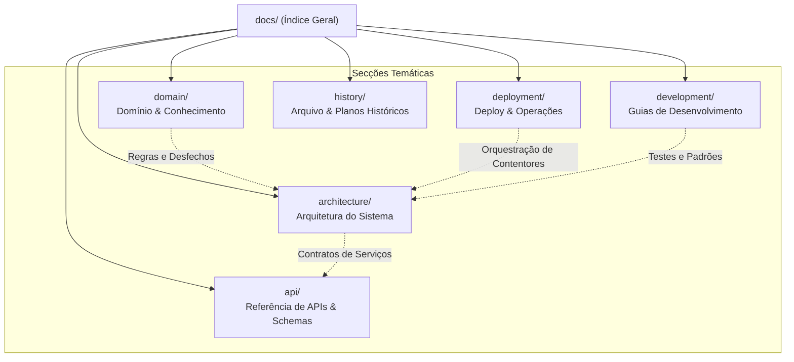
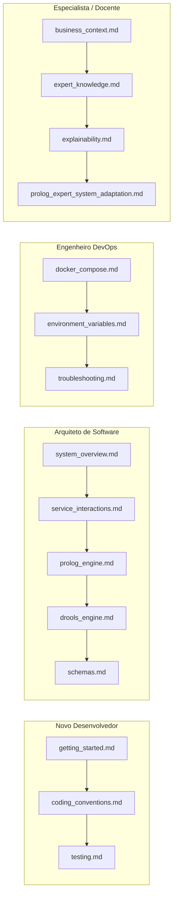

# Índice Geral da Documentação Técnica
### *Sistema Pericial de Diagnóstico para Devoluções e Trocas no Retalho*
#### *Mestrado em Engenharia de Inteligência Artificial (MEIA 2026/2027) — Challenges 4Teams, Equipa 3*

---

## 1. Visão Geral e Boas-Vindas

Bem-vindo ao repositório central de documentação técnica do **Retail Returns & Exchanges Diagnostic Expert System**. 

Este sistema foi concebido para resolver o problema de triagem e diagnóstico de devoluções e trocas no retalho, incorporando conhecimento humano especializado num ecossistema distribuído de micro-serviços. O projeto combina raciocínio dedutivo em lógica declarativa com Clean Architecture (**SWI-Prolog**), orquestração assíncrona orientada a serviços com resiliência (**Python / FastAPI**) e inferência empresarial baseada em regras de produção (**Java 21 / Spring Boot 3 / Apache KIE Drools 8+**).

O ecossistema integra dois motores periciais completos, auditáveis e validados:
* **Motor Declarativo em SWI-Prolog:** 71 regras normativas da Levi's organizadas em 9 famílias com precedência estrita de 7 níveis, mecânica dialógica interativa ACM (`obtem_facto/2`, `perguntavel/1` e gestão de `nao_sei`), e explicabilidade nativa completa em 5 vias (*Como, Porquê da Pergunta, Porquê da Decisão, Porque Não e E Se Sandbox* com isolamento transacional).
* **Motor Empresarial em Drools Levi's:** 98 regras de produção DRL (módulos M0 a M9), persistência relacional em PostgreSQL 16 e explicabilidade em 5 vias.
* **Orquestrador FastAPI:** Gateway unificado com feature toggles (`PROLOG_ENGINE_MODE`), tradução semântica de decisões e resiliência com pooling assíncrono.

O principal requisito não-funcional do sistema é a **Explicabilidade Nativa Multi-Via** (*Why / Why not*): nenhuma devolução é aprovada ou rejeitada sem uma cadeia estruturada de justificações auditáveis.

---

## 2. Mapa Estrutural da Documentação

A documentação está organizada em seis áreas temáticas perfeitamente delimitadas e desacopladas:



---

## 3. Catálogo Completo de Documentos

### 3.1 Domínio de Negócio e Conhecimento Pericial (`docs/domain/`)
*Diretório:* [`docs/domain/`](domain/README.md)

Documenta os fundamentos de negócio, enquadramento curricular e as regras empíricas fornecidas pelo perito humano de retalho.

| Documento | Ficheiro | Descrição e Propósito |
|:---|:---|:---|
| **Contexto de Negócio** | [`business_context.md`](domain/business_context.md) | Enquadramento académico no mestrado MEIA (ENGCIA & PPROGIA), desafio Challenges 4Teams (Equipa 3), caso de uso de retalho e papel do perito Dustin Hopper. |
| **Heurísticas do Perito** | [`expert_knowledge.md`](domain/expert_knowledge.md) | Mapeamento formal das 71 regras da Levi's em 9 famílias, hierarquia de precedência de 7 níveis, variáveis críticas e fontes normativas (RPAC e perito Dustin Hopper). |
| **Explicabilidade e Transparência** | [`explainability.md`](domain/explainability.md) | Modelo formal de explicabilidade em 5 vias para Prolog (*Como, Porquê da Pergunta, Porquê da Decisão, Porque Não, E Se Sandbox*) e Drools, estrutura de vetores de justificação e conformidade ética. |
| **Validação Cruzada Drools vs. Prolog** | [`validacao_motores_drools_prolog.md`](domain/validacao_motores_drools_prolog.md) | Validação empírica dos 10 cenários de teste reais do perito Dustin Hopper executados em Drools e Prolog via REST com análise exaustiva de paridade. |
| **Comparativo: Regras vs. Redes Semânticas** | [`comparativo_regras_vs_redes_semanticas.md`](domain/comparativo_regras_vs_redes_semanticas.md) | Análise comparativa entre Regras de Produção e Redes Semânticas, modelação no domínio Levi's, código comparativo em Prolog, proposta de arquitetura híbrida e guião de preparação para a defesa oral de MEIA. |

---

### 3.2 Arquitetura do Sistema (`docs/architecture/`)
*Diretório:* [`docs/architecture/`](architecture/README.md)

Documenta o desenho técnico da solução, princípios de engenharia (Clean Architecture) e o funcionamento interno de cada serviço.

| Documento | Ficheiro | Descrição e Propósito |
|:---|:---|:---|
| **Visão Global do Sistema** | [`system_overview.md`](architecture/system_overview.md) | Arquitetura macro em micro-serviços, princípios de desenho ("Regra de Ouro"), stack tecnológica (Prolog, FastAPI, Drools), dois motores de inferência em Prolog (retalho Levi's e académico), feature toggles e topologia de portas. |
| **Arquitetura do Motor Prolog** | [`prolog_engine.md`](architecture/prolog_engine.md) | Micro-serviço SWI-Prolog, Clean Architecture (`retail_engine/` vs `inference/`), princípio do isolamento por paridade, mecânica dialógica ACM, 5 vias de explicabilidade e ciclo de vida do pedido. |
| **Arquitetura do Orquestrador FastAPI** | [`fastapi_orchestrator.md`](architecture/fastapi_orchestrator.md) | Backend orquestrador Python, camadas de software, ciclo de vida (*lifespan*), connection pooling com `httpx.AsyncClient` e injeção de dependências. |
| **Arquitetura do Motor Drools** | [`drools_engine.md`](architecture/drools_engine.md) | Micro-serviço empresarial Java 21 / Spring Boot 3 / Drools 8.44 (Levi's Returns), arquitetura limpa em 7 módulos Maven, base de 98 regras DRL (M0 a M9), persistência em PostgreSQL 16 e explicabilidade pericial em 5 vias (*Como, Porquê, Porque Não, E Se, O Que Falta*). |
| **Interações e Fluxos de Dados** | [`service_interactions.md`](architecture/service_interactions.md) | Diagramas de sequência ponta-a-ponta (rotas `/retail/*` e Drools Levi's), interrogação dialógica interativa passo-a-passo (ACM), simulação contrafactual *What-If* em sandbox e mapeamento semântico no orquestrador. |
| **Análise do Motor sp_exp2** | [`sp_exp2_engine_analysis.md`](architecture/sp_exp2_engine_analysis.md) | Dissecação dos 6 blocos do motor dos docentes (`sp_exp2.pl`), ciclo forward-chaining, metaconhecimento, explicabilidade nativa e plano de adaptação pericial para retalho. |
| **Plano Mestre de Adaptação Prolog** | [`prolog_expert_system_adaptation.md`](architecture/prolog_expert_system_adaptation.md) | Plano mestre 100% implementado e validado de transposição do guia do Prof. ACM para as 71 regras da Levi's, arquitetura dual, mecânica `obtem_facto/2` e testes de paridade. |
| **Diferenças: sp_exp2 vs. retail_engine** | [`diferencas_motor_academico_vs_implementado.md`](architecture/diferencas_motor_academico_vs_implementado.md) | Guia intuitivo de diferenças para a defesa oral: dissecação das 5 mutações no código Prolog baseadas em `MI_Perguntas_ACM.md` (`obtem_facto/2`, `perguntavel/1`, gestão de "não sei", `Why Ask`), diagramas comparativos e guião de perguntas para a apresentação técnica. |

---

### 3.3 Referência de APIs e Schemas (`docs/api/`)
*Diretório:* [`docs/api/`](api/README.md)

Especificação exaustiva de endpoints, contratos JSON, modelos Pydantic, DTOs Java e matrizes de erros HTTP.

| Documento | Ficheiro | Descrição e Propósito |
|:---|:---|:---|
| **API Pública v1 do Orquestrador** | [`orchestrator_api_v1.md`](api/orchestrator_api_v1.md) | Endpoints públicos do FastAPI: rotas de retalho em Prolog (`/api/v1/retail/*`), suporte a query parameter `?mode=` (`retail`, `academic`, `dual`), motor Drools Levi's (`/api/v1/levis/*`), motor académico (`/api/v1/inference/*`) e exemplos cURL e PowerShell. |
| **API Interna do Motor Prolog** | [`prolog_engine_api.md`](api/prolog_engine_api.md) | Interface HTTP interna do daemon SWI-Prolog: 7 rotas dedicadas de retalho (`POST /retail/evaluate`, `interactive`, `whatif`, `how`, `whynot`, `facts`, `reset`), rotas académicas (`/inference/*`) e contratos JSON com exemplos práticos. |
| **API Interna do Motor Drools** | [`drools_engine_api.md`](api/drools_engine_api.md) | Interface REST interna do motor Drools: endpoints de avaliação de retalho da Levi's (`/api/v1/avaliacoes`, `/explicacoes/*`, `/simulacoes`), contratos de DTOs, segurança JWT e arquivo histórico da POC clínica. |
| **Modelos de Dados e Schemas** | [`schemas.md`](api/schemas.md) | Catálogo de modelos Pydantic v2 (DTOs Python) e contratos DTOs Java: contratos de retalho Prolog (`EvaluationResponse`, `InteractiveStepRequest/Response`, `WhatIfRequest/Response`, `HowExplanationResponse`), modelos Drools Levi's e motor pedagógico. |

---

### 3.4 Deploy, Contentorização e Operações (`docs/deployment/`)
*Diretório:* [`docs/deployment/`](deployment/README.md)

Instruções e guias operacionais para build, arranque de contentores Docker e manutenção do ecossistema.

| Documento | Ficheiro | Descrição e Propósito |
|:---|:---|:---|
| **Contentorização e Dockerfiles** | [`docker.md`](deployment/docker.md) | Análise dos Dockerfiles multi-stage (`drools_engine`) e single-stage (`prolog_engine` e `backend_orchestrator`), camadas de cache, utilizadores não-privilegiados, `.dockerignore` e compilação independente de imagens. |
| **Orquestração com Docker Compose** | [`docker_compose.md`](deployment/docker_compose.md) | Guia operacional completo de `docker-compose.yml` para os 3 serviços (`prolog-engine`, `orchestrator`, `drools-engine`), rede bridge `retail-network`, ordem de arranque (`depends_on`) e comandos operacionais. |
| **Variáveis de Ambiente** | [`environment_variables.md`](deployment/environment_variables.md) | Mapeamento exaustivo de variáveis suportadas (`PORT`, `PROLOG_ENGINE_URL`, `DROOLS_ENGINE_URL`, `PROLOG_ENGINE_MODE` com modos retail/academic/dual, `INFERENCE_ENGINE_ENABLED`), defaults e precedência. |
| **Resolução de Problemas** | [`troubleshooting.md`](deployment/troubleshooting.md) | Diagnóstico e resolução de incidentes comuns nos 3 serviços: portas em conflito (8000, 8080, 8082), troubleshooting do motor de retalho Prolog (loops dialógicos, mocks vazios, sandbox What-If), inicialização KieContainer e erros de CORS. |

---

### 3.5 Guias de Desenvolvimento e Testes (`docs/development/`)
*Diretório:* [`docs/development/`](development/README.md)

Manuais para novos contribuidores, configuração do ambiente local, convenções de código e execução da suíte de testes.

| Documento | Ficheiro | Descrição e Propósito |
|:---|:---|:---|
| **Primeiros Passos (Getting Started)** | [`getting_started.md`](development/getting_started.md) | Configuração do ambiente local (Python venv, SWI-Prolog, Java 21 / Maven, Docker), arranque nativo dos serviços, validação do motor de retalho Prolog e *smoke tests*. |
| **Estratégia e Execução de Testes** | [`testing.md`](development/testing.md) | Estratégia e pirâmide de testes do projeto: 81 testes PLUnit no Prolog (31 regras, 18 explicabilidade, 12 interativo, 12 API, 8 sp_exp2), 153 testes Pytest no orquestrador FastAPI e 14 testes JUnit 5 no motor Drools. |
| **Convenções de Código e Boas Práticas** | [`coding_conventions.md`](development/coding_conventions.md) | Padrões linguísticos (código em inglês, documentação em pt-PT), estrutura de módulos, tipagem estática, convenções de regras em Prolog (DSL declarativa, metaconhecimento obrigatório `perguntavel/1` e `facto_dispara_regras/2`) e práticas Git. |
| **Plano do Motor de Retalho Prolog** | [`retail_prolog_implementation_plan.md`](development/retail_prolog_implementation_plan.md) | Plano de implementação concluído a 100% (Fases 1 a 5) para adaptação do motor pericial da Levi's em Prolog com 71 regras, mecânica ACM e 5 vias de explicabilidade. |
| **Plano de Atualização da Documentação** | [`retail_prolog_documentation_update_plan.md`](development/retail_prolog_documentation_update_plan.md) | Plano mestre de sincronização da documentação técnica para o motor de retalho Prolog (Fases 0 a 7). |
| **Plano de Entregas Moodle e Produção** | [`plano_organizacao_entregas_moodle_e_prod.md`](development/plano_organizacao_entregas_moodle_e_prod.md) | Plano de engenharia em 5 fases para autonomização dos pacotes de entrega para ENGCIA e PPROGIA e estabilização para o Demo Day. |

---

### 3.6 Histórico e Planos de Implementação (`docs/history/`)
*Diretório:* [`docs/history/`](history/README.md)

Arquivo imutável com os planos de implementação faseados e relatórios de execução das etapas concluídas do projeto.

| Documento | Ficheiro | Descrição e Propósito |
|:---|:---|:---|
| **Plano do Micro-Serviço Prolog** | [`prolog_implementation_plan.md`](history/prolog_implementation_plan.md) | Roteiro de 4 fases concluídas: setup, motor core, camada HTTP e contentorização Docker. |
| **Plano do Orquestrador FastAPI** | [`fastapi_implementation_plan.md`](history/fastapi_implementation_plan.md) | Roteiro de 6 fases concluídas: configuração, schemas, cliente HTTP, rotas REST, suíte Pytest e Compose. |
| **Plano da Documentação Profissional** | [`documentation_implementation_plan.md`](history/documentation_implementation_plan.md) | Roteiro de reorganização e criação da estrutura hierárquica e profissional da documentação técnica. |
| **Plano do Motor de Inferência Pericial** | [`inference_engine_implementation_plan.md`](history/inference_engine_implementation_plan.md) | Roteiro de 5 fases concluídas: integração modular do motor pedagógico dos professores `sp_exp2.pl` do Moodle (`vehicles`), rotas Prolog, proxy FastAPI, suíte PLUnit + Pytest e documentação. |
| **Plano do Motor Drools** | [`drools_implementation_plan.md`](history/drools_implementation_plan.md) | Roteiro de 6 fases concluídas: setup Spring Boot 3, configuração KieContainer, modelos de domínio, base de regras DRL de hemorragia, API REST, testes e contentorização Docker. |
| **Plano de Integração Drools Levi's** | [`drools_levis_integration_plan.md`](history/drools_levis_integration_plan.md) | Roteiro mestre de 9 fases para integrar o motor de retalho Levi's (Java 21 / Drools 8.44 / PostgreSQL) no orquestrador FastAPI e Dashboard Next.js. |
| **Plano do Motor de Retalho Prolog** | [`retail_prolog_implementation_plan.md`](development/retail_prolog_implementation_plan.md) | Roteiro de 5 fases concluídas: isolamento por paridade, mecânica ACM, 71 regras Levi's, 5 vias de explicabilidade, API REST e integração FastAPI. |

---

## 4. Roteiros de Leitura Recomendados por Perfil

Dependendo do seu objetivo ao consultar esta documentação, sugerimos os seguintes percursos de leitura:



* **Novo Desenvolvedor:** Comece por [Primeiros Passos](development/getting_started.md), leia as [Convenções de Código](development/coding_conventions.md) e execute a suíte de [Testes Automatizados](development/testing.md) (81 testes PLUnit, 153 testes Pytest e 14 testes JUnit 5).
* **Arquiteto de Software:** Analise a [Visão Global do Sistema](architecture/system_overview.md), a [Arquitetura Prolog](architecture/prolog_engine.md), a [Arquitetura Drools](architecture/drools_engine.md), o fluxo de [Interações entre Serviços](architecture/service_interactions.md) e os [Modelos e Schemas](api/schemas.md).
* **Engenheiro DevOps / SysAdmin:** Consulte o guia do [Docker Compose](deployment/docker_compose.md) (orquestrando os 3 micro-serviços), configure as [Variáveis de Ambiente](deployment/environment_variables.md) e consulte o guia de [Resolução de Problemas](deployment/troubleshooting.md).
* **Especialista em Domínio / Avaliador Académico:** Explore o [Contexto de Negócio](domain/business_context.md), as [Heurísticas do Perito](domain/expert_knowledge.md), os requisitos de [Explicabilidade e Transparência](domain/explainability.md) e a [Adaptação do Sistema Pericial](architecture/prolog_expert_system_adaptation.md).

---

## 5. Resumo Rápido de Execução

Se pretender iniciar todo o sistema de imediato recorrendo ao Docker Compose:

```bash
# 1. Levantar o ecossistema completo (Prolog :8080 + FastAPI :8000 + Drools :8082)
docker compose up --build -d

# 2. Verificar a saúde dos serviços
curl -X GET http://localhost:8000/health
curl -X GET http://localhost:8080/health
curl -X GET http://localhost:8082/api/v1/inference/health

# 3. Executar uma avaliação no motor pericial de retalho em Prolog via Orquestrador
curl -X POST http://localhost:8000/api/v1/retail/evaluate \
  -H "Content-Type: application/json" \
  -d '{"facts": [{"name": "in_item_category", "value": "clothing"}, {"name": "in_receipt_present", "value": "yes"}, {"name": "in_purchase_days", "value": 20}]}'

# 4. Iniciar um diálogo interativo passo-a-passo no Prolog (mecânica ACM)
curl -X POST http://localhost:8000/api/v1/retail/interactive \
  -H "Content-Type: application/json" \
  -d '{"answers": {}}'

# 5. Executar simulação contrafactual What-If em sandbox no Prolog
curl -X POST http://localhost:8000/api/v1/retail/whatif \
  -H "Content-Type: application/json" \
  -d '{"scenario": "standard_return", "override_facts": [{"name": "in_purchase_days", "value": 45}]}'

# 6. Executar o ciclo do motor pedagógico forward-chaining Prolog (veículos)
curl -X POST http://localhost:8000/api/v1/inference/run

# 7. Executar uma avaliação de retalho no motor Drools Levi's (Cenário 1)
curl -X POST http://localhost:8000/api/v1/levis/avaliar \
  -H "Content-Type: application/json" \
  -d @drools-engine-levis-devolucoes-java/backend/pericial-rules/src/test/resources/cenarios/cenario-01.json
```

Para mais detalhes sobre endpoints, parâmetros e documentação interativa, aceda à interface Swagger em [http://localhost:8000/docs](http://localhost:8000/docs).

---

## 6. Documentos Relacionados

* [Visão Global do Sistema](architecture/system_overview.md) — Especificação macro dos micro-serviços e capacidades.
* [Arquitetura do Motor Prolog](architecture/prolog_engine.md) — Desenho modular do motor de retalho e paridade pedagógica.
* [Referência de APIs e Schemas](api/README.md) — Contratos e endpoints REST do ecossistema.
* [Estratégia e Execução de Testes](development/testing.md) — Especificação de testes unitários e de integração.
* [Histórico e Planos de Implementação](history/README.md) — Arquivo histórico de engenharia do projeto.
