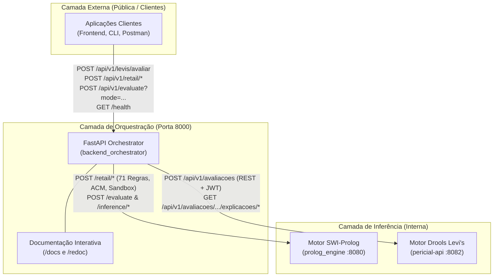

# Referência de APIs e Contratos de Comunicação
### *Sistema Pericial de Diagnóstico para Devoluções e Trocas no Retalho*

---

## 1. Visão Geral

Esta secção contém a documentação técnica de referência de todas as interfaces de programação (APIs) e contratos de dados (*schemas*) que compõem o sistema. 

O ecossistema adota uma abordagem orientada a micro-serviços com separação estrita entre a **camada de orquestração externa** e a **camada de inferência interna**:

---

## 2. Índice de Documentos da Secção

| Documento | Ficheiro | Descrição e Propósito |
|:---|:---|:---|
| **API Pública v1 do Orquestrador** | [`orchestrator_api_v1.md`](orchestrator_api_v1.md) | Especificação completa da API REST do FastAPI: endpoints `/api/v1/levis/*` (Drools), `/api/v1/retail/*` (Prolog - avaliação, diálogo ACM, What-If, How, Why Not), `/api/v1/evaluate?mode=...` (chaveamento dinâmico), exemplos cURL/PowerShell e matriz de erros HTTP. |
| **API Interna do Motor Prolog** | [`prolog_engine_api.md`](prolog_engine_api.md) | Especificação do contrato HTTP interno do micro-serviço SWI-Prolog: 7 endpoints de retalho `/retail/*` (71 regras da Levi's, máquina de estados ACM, simulação What-If), `/evaluate` e `/inference/*` (motor académico sp_exp2). |
| **API Interna do Motor Drools** | [`drools_engine_api.md`](drools_engine_api.md) | Especificação da API REST interna do motor Drools (Java 21 / Spring Boot 3): endpoints do motor de devoluções Levi's (`/api/v1/avaliacoes`, `/explicacoes/*`, `/simulacoes`, `/regras`) e arquivo histórico da POC clínica. |
| **Modelos de Dados, Schemas e DTOs** | [`schemas.md`](schemas.md) | Catálogo exaustivo de todos os modelos Pydantic v2 e DTOs Java / Spring Boot: contratos da Levi's (`EvaluationResponse`, `RetailReturnScenarioInput`, `InteractiveStepRequest`, `WhatIfRequest`), validações Bean Validation e factos de domínio. |

---

## 3. Resumo dos Endpoints Disponíveis

### 3.1 Backend Orquestrador (FastAPI — Porta 8000)

| Método | Endpoint | Acesso | Descrição |
|:---|:---|:---:|:---|
| `GET` | `/health` / `/api/v1/health` | Público | Verificação de estado operacional e sondagem de conectividade aos motores. |
| `POST` | `/api/v1/levis/avaliar` | Público | Avaliação completa de devoluções/trocas Levi's no motor Drools (98 regras DRL). |
| `GET` | `/api/v1/levis/avaliacoes/{id}` | Público | Consulta de histórico de avaliação por UUID persistido em PostgreSQL. |
| `GET` | `/api/v1/levis/avaliacoes/{id}/explicacoes/como` | Público | Explicação causal *Como?* (regras disparadas e módulos percorridos no Drools). |
| `GET` | `/api/v1/levis/avaliacoes/{id}/explicacoes/porque-nao` | Público | Análise contrafactual *Porque não?* (condições que falharam no Drools). |
| `GET` | `/api/v1/levis/avaliacoes/{id}/explicacoes/porque` | Público | Justificação *Porquê?* das questões requeridas ao operador de caixa. |
| `GET` | `/api/v1/levis/avaliacoes/{id}/explicacoes/o-que-falta` | Público | Identificação de atributos em falta para desbloquear aprovação. |
| `POST` | `/api/v1/levis/avaliacoes/{id}/simulacoes` | Público | Simulador inline *E se?* (*What-if*) sem persistência na base de dados. |
| `GET` | `/api/v1/levis/regras` | Público | Catálogo das 98 regras ativas na base de conhecimento Drools. |
| `GET` | `/api/v1/levis/cenarios-exemplo` | Público | Lista dos 10 cenários de teste reais pré-formatados da Levi's. |
| `POST` | `/api/v1/retail/evaluate` | Público | Avaliação em lote no motor Prolog Levi's com justificação causal. |
| `POST` | `/api/v1/retail/interactive` | Público | Diálogo interativo e aquisição de premissas (mecânica Prof. ACM). |
| `POST` | `/api/v1/retail/whatif` | Público | Simulação contrafactual *What-If* em sandbox com isolamento de memória volátil. |
| `POST` | `/api/v1/retail/how` | Público | Rasto causal dedutivo para um facto ou decisão (Via 1: Como?). |
| `POST` | `/api/v1/retail/whynot` | Público | Análise de árvore de falhas de regras para desfechos não alcançados (Via 4: Porque Não?). |
| `GET` | `/api/v1/retail/facts` | Público | Consulta dos factos correntemente assertados na memória de trabalho Prolog. |
| `POST` | `/api/v1/retail/reset` | Público | Reinicialização da memória de trabalho e estado interativo do motor Prolog. |
| `POST` | `/api/v1/evaluate` | Público | Avaliação no motor Prolog com suporte a feature toggle query param `?mode=retail\|academic\|dual`. |
| `GET` | `/docs` | Navegador | Interface Swagger UI OpenAPI 3.1 interativa. |
| `GET` | `/redoc` | Navegador | Interface de documentação técnica ReDoc. |

### 3.2 Motor de Inferência (SWI-Prolog — Porta 8080)

| Método | Endpoint | Acesso | Descrição |
|:---|:---|:---:|:---|
| `POST` | `/retail/evaluate` | **Interno** | Avaliação em lote direta no motor de retalho da Levi's (71 regras). |
| `POST` | `/retail/interactive` | **Interno** | Diálogo interativo passo-a-passo e interrogação dialógica (mecânica ACM). |
| `POST` | `/retail/whatif` | **Interno** | Simulação contrafactual em sandbox com `setup_call_cleanup/3`. |
| `POST` | `/retail/how` | **Interno** | Explicação causal dedutiva com identificadores de regras normativas `[ID]`. |
| `POST` | `/retail/whynot` | **Interno** | Análise de árvore de falhas de premissas para objetivos não alcançados. |
| `GET` | `/retail/facts` | **Interno** | Inspeção integral da memória de trabalho da sessão. |
| `POST` | `/retail/reset` | **Interno** | Limpeza determinística de memória volátil e estado interativo. |
| `POST` | `/evaluate` | **Interno** | Endpoint de avaliação POC / legado consumido pelo Orquestrador. |
| `POST` | `/inference/load` | **Interno** | Carregamento dinâmico de base de conhecimento em memória (académico). |
| `POST` | `/inference/run` | **Interno** | Execução do ciclo de encadeamento para a frente (*forward-chaining* académico). |
| `GET` | `/inference/facts` | **Interno** | Listagem de todos os factos ativos na memória de trabalho académica. |
| `POST` | `/inference/how` | **Interno** | Explicação causal de derivação de um facto (*How* académico). |
| `POST` | `/inference/whynot` | **Interno** | Explicação de ausência de derivação (*Why Not* académico). |
| `POST` | `/inference/reset` | **Interno** | Reposição e limpeza da sessão do motor pericial académico. |

### 3.3 Motor de Inferência Drools Levi's (Java 21 / Spring Boot 3 — Porta 8082)

| Método | Endpoint | Acesso | Descrição |
|:---|:---|:---:|:---|
| `POST` | `/api/v1/avaliacoes` | **Interno (JWT)** | Avaliação pericial Drools com persistência no PostgreSQL e auditoria de regras. |
| `GET` | `/api/v1/avaliacoes/{id}/explicacoes/como` | **Interno (JWT)** | Devolve o rasto sequencial das regras disparadas para a avaliação. |
| `GET` | `/api/v1/avaliacoes/{id}/explicacoes/porque-nao` | **Interno (JWT)** | Devolve análise contrafactual de antecedentes não cumpridos. |
| `POST` | `/api/v1/avaliacoes/{id}/simulacoes` | **Interno (JWT)** | Executa simulação *What-if* sobre o pedido em memória. |
| `GET` | `/api/v1/regras` | **Interno (JWT)** | Catálogo e metadados das 98 regras DRL ativas. |
| `POST` | `/api/v1/dev/tokens` | **Interno (Dev)** | Emissão imediata de tokens JWT de teste para desenvolvimento. |

---

## 4. Convenções e Normas Técnicas

1. **Formatos de Dados:** Todos os endpoints com corpo de pedido ou resposta utilizam estritamente `application/json` codificado em UTF-8.
2. **Explicabilidade por Desenho:** Toda a resposta de avaliação inclui rastreabilidade: lista `justification` no motor Prolog e lista `firedRules` no motor Drools.
3. **Validação Rigorosa:** Incompatibilidades de tipos são intercetadas na fronteira: `HTTP 422 Unprocessable Entity` no FastAPI e `HTTP 400 Bad Request` no Spring Boot.
4. **Isolamento de Memória:** Sessões de inferência Drools (`KieSession`) são efémeras e descartadas (`dispose()`) após cada pedido para evitar retenção indesejada de factos e fugas de memória.

---

## 5. Documentos Relacionados

* [Visão Geral da Arquitetura](../architecture/system_overview.md) — Diagrama e posicionamento de cada serviço.
* [Arquitetura do Motor Drools](../architecture/drools_engine.md) — Camadas internas, ciclo de vida da KieSession e regras DRL.
* [Arquitetura do Motor Prolog](../architecture/prolog_engine.md) — Camadas de transporte e prova lógica do Prolog.
* [Interação e Fluxos entre Serviços](../architecture/service_interactions.md) — Diagrama de sequência ponta-a-ponta e fluxos de dados.
* [Explicabilidade e Transparência](../domain/explainability.md) — Requisitos de justificação das decisões.
* [Ambiente e Variáveis de Configuração](../deployment/environment_variables.md) — Configuração de portas, timeouts e URLs.

