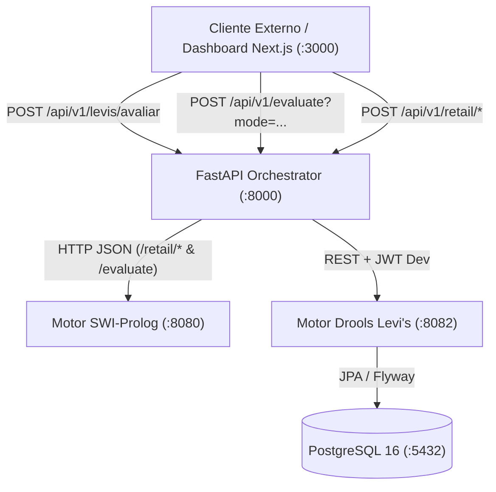

# API Pública v1 do Orquestrador (FastAPI)
### *Sistema Pericial de Diagnóstico para Devoluções e Trocas no Retalho*

---

## 1. Visão Geral

A camada de orquestração do sistema é exposta através de uma API REST desenvolvida em **FastAPI** (Python 3.11+). Esta API funciona como ponto de contacto único para clientes externos, dashboards web e interfaces de ponto de venda (*Frontends* e terminais POS), ocultando a complexidade dos motores de inferência subjacentes:
* **Motor SWI-Prolog (:8080):** Dedução lógica declarativa e inferência causal (*How / Why Not*).
* **Motor Drools Levi's (:8082):** Motor empresarial de regras de produção Rete-OO (Java 21 / Spring Boot 3 / Apache KIE Drools 8.44) com 98 regras DRL para triagem oficial de devoluções e trocas da marca Levi's, persistência em PostgreSQL e explicabilidade em 5 vias.



### 1.1 Configuração Base e URLs

| Ambiente | Host / Base URL | Descrição |
|:---|:---|:---|
| **Desenvolvimento Local (Host)** | `http://localhost:8000` | Acesso direto quando executado no host |
| **Produção / Domínio Público** | `https://challenge1.smbitsolutions.pt` | Instância pública com SSL/TLS |
| **Rede Docker Compose** | `http://orchestrator:8000` | Acesso inter-contentor dentro da rede `retail-network` |
| **Documentação Interativa (Swagger UI)** | `http://localhost:8000/docs` | Interface OpenAPI interativa sob as tags dedicadas |
| **Documentação Alternativa (ReDoc)** | `http://localhost:8000/redoc` | Interface de documentação técnica detalhada |
| **Especificação OpenAPI JSON** | `http://localhost:8000/openapi.json` | Schema JSON nativo OpenAPI 3.1 |

---

## 2. Endpoints de Diagnóstico e Monitorização

### 2.1 `GET /health` e `GET /api/v1/health`

Verifica a saúde operacional do serviço orquestrador e testa ativamente a conectividade com os motores de inferência.

* **Método HTTP:** `GET`
* **Caminho:** `/health` ou `/api/v1/health`
* **Autenticação:** Nenhuma
* **Resposta de Sucesso (`200 OK`):**
```json
{
  "status": "healthy",
  "prolog_engine": "connected",
  "timestamp": "2026-10-13T15:00:00.123456Z"
}
```

---

## 3. Endpoints do Motor Pericial de Devoluções Levi's (Drools)

Tag Swagger: **`Levi's Returns Expert Engine (Drools)`**  
Prefixo de Rota: **`/api/v1/levis`**

Estes endpoints expõem a base pericial de retalho da Levi's, integrando avaliação de cenários, motor de explicabilidade em 5 vias (*Como*, *Porquê*, *Porque Não*, *E Se*, *O Que Falta*), catálogo de regras e cenários de teste pré-formatados.

### 3.1 Resumo dos Endpoints da Levi's

| Método | Caminho | Resumo e Propósito |
|:---|:---|:---|
| `POST` | `/api/v1/levis/avaliar` | Submete um pedido de devolução/troca ao Drools e devolve o veredito completo. |
| `GET` | `/api/v1/levis/avaliacoes/{id}` | Recupera uma avaliação persistida por UUID no PostgreSQL. |
| `GET` | `/api/v1/levis/avaliacoes` | Lista o histórico de avaliações com suporte a paginação e ordenação. |
| `GET` | `/api/v1/levis/avaliacoes/{id}/explicacoes/como` | Explicação causal **Como?**: rasto ordenado das regras disparadas e módulos. |
| `GET` | `/api/v1/levis/avaliacoes/{id}/explicacoes/como/{codigo}` | Detalhes de disparo e fundamentação de uma regra específica. |
| `GET` | `/api/v1/levis/avaliacoes/{id}/explicacoes/porque-nao` | Análise contrafactual **Porque não?**: por que razão outros desfechos não foram atingidos. |
| `GET` | `/api/v1/levis/avaliacoes/{id}/explicacoes/porque-nao/{codigo}` | Análise contrafactual para um código de conclusão específico. |
| `GET` | `/api/v1/levis/avaliacoes/{id}/explicacoes/porque` | Explicação **Porquê?**: justifica as perguntas feitas ao operador de caixa. |
| `GET` | `/api/v1/levis/avaliacoes/{id}/explicacoes/o-que-falta` | Análise **O que falta?**: indica dados omissos para desbloquear aprovação. |
| `POST` | `/api/v1/levis/avaliacoes/{id}/simulacoes` | Simulador **E se?** (*What-If*): avalia variações hipotéticas sem alterar a base de dados. |
| `GET` | `/api/v1/levis/regras` | Lista o catálogo das 98 regras ativas na base de conhecimento. |
| `GET` | `/api/v1/levis/regras/{codigo}` | Detalhe exaustivo de uma regra DRL pelo seu código (ex.: `PT-003`). |
| `GET` | `/api/v1/levis/colaboradores` | Lista de colaboradores de loja pré-configurados para contexto operacional. |
| `GET` | `/api/v1/levis/cenarios-exemplo` | Lista os 10 cenários de teste oficiais da Levi's com payloads prontos. |
| `GET` | `/api/v1/levis/cenarios-exemplo/{numero}` | Devolve um cenário de teste específico (1 a 10) pelo número de índice. |

---

### 3.2 Avaliar Pedido (`POST /api/v1/levis/avaliar`)

Submete um pedido para inferência Drools. O endpoint aceita tanto o objeto `PedidoAvaliacaoRequest` direto como o objeto completo de um cenário de teste (`CenarioExemploResponse`), facilitando testes imediatos.

#### Exemplo de Pedido (`POST /api/v1/levis/avaliar`):
```json
{
  "tipoPedido": "DEVOLUCAO",
  "canal": "LOJA_FISICA",
  "tipoLoja": "MAINLINE",
  "dataPedido": "2026-10-13",
  "colaborador": {
    "id": "COLAB-001",
    "nome": "Dustin Hopper",
    "cargo": "COLABORADOR",
    "lojaId": "STORE-101"
  },
  "comprovativo": {
    "tipo": "RECIBO_ORIGINAL",
    "numeroRecibo": "REC-98213",
    "dataCompra": "2026-09-14",
    "valido": true
  },
  "artigos": [
    {
      "sku": "501-ORIGINAL-FIT-001",
      "categoria": "JEANS",
      "precoPago": 120.00,
      "precoAtual": 120.00,
      "estado": "NOVO",
      "etiqueta": "SOLTA",
      "personalizado": false,
      "pecaIntima": false
    }
  ],
  "pagamentos": [
    {
      "meio": "CARTAO_CREDITO",
      "valor": 120.00
    }
  ]
}
```

#### Exemplo de Resposta de Sucesso (`HTTP 200 OK`):
```json
{
  "id": "3fa85f64-5717-4562-b3fc-2c963f66afa6",
  "dataAvaliacao": "2026-10-13T15:20:00Z",
  "elegibilidade": "REVER",
  "motivoRecusa": null,
  "valorReembolso": 120.00,
  "meioLiquidacao": "VALE_COMPRAS",
  "requerAprovacaoGerente": true,
  "artigos": [
    {
      "sku": "501-ORIGINAL-FIT-001",
      "elegivel": true,
      "destino": "AREA_VENDA",
      "valorAprovado": 120.00,
      "justificacao": "Etiqueta solta requer verificação física e reaplicação antes de reposição."
    }
  ],
  "regrasAcionadas": [
    "M0-001 Autenticação do colaborador",
    "M2-001 Canal loja física validado",
    "M3-010 Etiqueta solta requer revisão gerencial",
    "M4-002 Comprovativo apresentado no 29º dia",
    "M7-005 Meio de liquidação ajustado para vale"
  ],
  "perguntasPendentes": []
}
```

#### Valores Possíveis para Campos Críticos:
* **`elegibilidade`:** `PERMITIR`, `RECUSAR`, `REVER`, `ENCAMINHAR`.
* **`meioLiquidacao`:** `ORIGINAL`, `VALE_COMPRAS`, `DINHEIRO`, `CARTAO_CREDITO`, `AFTERPAY`, `PAYPAL`, `SEM_REEMBOLSO`.
* **`destino` do artigo:** `AREA_VENDA`, `RISCO_BIOLOGICO`, `DEFEITO_FABRICO`, `DANIFICADO`, `ARMAZEM_CENTRAL`.

---

### 3.3 Explicabilidade: Como? (`GET /api/v1/levis/avaliacoes/{id}/explicacoes/como`)

Retorna a cadeia cronológica de deduções que fundamentaram o veredito.

#### Exemplo de Resposta (`HTTP 200 OK`):
```json
{
  "avaliacaoId": "3fa85f64-5717-4562-b3fc-2c963f66afa6",
  "totalRegrasDisparadas": 5,
  "passos": [
    {
      "ordem": 1,
      "regraId": "M0-001",
      "modulo": "M0-AUTORIZACAO",
      "descricao": "Colaborador autenticado com permissão de registo de devoluções.",
      "efeito": "Sessão validada"
    },
    {
      "ordem": 3,
      "regraId": "M3-010",
      "modulo": "M3-ELEGIBILIDADE",
      "descricao": "Artigo com etiquetas soltas exige inspeção do gerente de loja.",
      "efeito": "Decisão marcada como REVER"
    }
  ]
}
```

---

### 3.4 Explicabilidade: Porque Não? (`GET /api/v1/levis/avaliacoes/{id}/explicacoes/porque-nao`)

Explica por que razão conclusões mais favoráveis (como `PERMITIR` imediato ou `REEMBOLSO_DINHEIRO`) não foram atingidas, identificando os antecedentes que falharam:

#### Exemplo de Resposta (`HTTP 200 OK`):
```json
{
  "avaliacaoId": "3fa85f64-5717-4562-b3fc-2c963f66afa6",
  "conclusoesNaoAtingidas": [
    {
      "conclusaoAlvo": "PERMITIR",
      "regraCandidata": "PT-003",
      "descricao": "Devolução automática até 30 dias com etiquetas intactas",
      "condicoesFalhadas": [
        "Artigo.etiqueta == INTACTA (Valor atual: SOLTA)"
      ]
    }
  ]
}
```

---

### 3.5 Simulação Contrafactual *E Se?* (`POST /api/v1/levis/avaliacoes/{id}/simulacoes`)

Permite a um operador testar alterações pontuais sobre o pedido avaliado (por exemplo, assumir que a etiqueta foi encontrada intacta ou que o gerente autorizou a exceção) para verificar a decisão resultante **sem alterar a base de dados**.

#### Exemplo de Pedido (`POST /api/v1/levis/avaliacoes/{id}/simulacoes`):
```json
{
  "alteracoesArtigos": [
    {
      "sku": "501-ORIGINAL-FIT-001",
      "etiqueta": "INTACTA"
    }
  ]
}
```

#### Exemplo de Resposta (`HTTP 200 OK`):
```json
{
  "avaliacaoOriginalId": "3fa85f64-5717-4562-b3fc-2c963f66afa6",
  "elegibilidadeOriginal": "REVER",
  "elegibilidadeSimulada": "PERMITIR",
  "diferencas": [
    "A elegibilidade passou de REVER para PERMITIR.",
    "A aprovação gerencial deixou de ser necessária.",
    "O meio de liquidação mudou para CARTAO_CREDITO (meio original)."
  ]
}
```

---

### 3.6 Catálogo de Cenários de Teste (`GET /api/v1/levis/cenarios-exemplo`)

Devolve os 10 cenários de teste reais compilados a partir da base de conhecimento da Levi's, prontos para execução imediata no Dashboard ou via API:

1. **Cenário 1:** Troca ao 29.º dia com etiquetas soltas (`REVER`).
2. **Cenário 2:** Devolução com recibo e etiquetas intactas dentro de 30 dias (`PERMITIR`).
3. **Cenário 3:** Devolução fora do prazo de 30 dias com recibo (`REVER` / Vale de loja).
4. **Cenário 4:** Artigo personalizado embainhado (`RECUSAR`).
5. **Cenário 5:** Devolução sem comprovativo (*blind return*) dentro do limite (`REVER`).
6. **Cenário 6:** Artigo com defeito de fabrico comprovado (`PERMITIR` / Destino Defeito).
7. **Cenário 7:** Compra online devolvida em loja física Mainline (`PERMITIR`).
8. **Cenário 8:** Ajuste de preço no 10.º dia dentro do limite de 14 dias (`PERMITIR`).
9. **Cenário 9:** Bodywear / peça íntima sem embalagem selada (`RECUSAR` / Risco Biológico).
10. **Cenário 10:** Devolução paga por Afterpay com estorno digital (`PERMITIR`).

---

---

## 4. Endpoints do Motor de Retalho em Prolog (/api/v1/retail/*)

Tag Swagger: **`Levi's Retail Returns Expert Engine (Prolog)`**  
Prefixo de Rota: **`/api/v1/retail`**

Estes endpoints expõem publicamente a base pericial declarativa da Levi's no micro-serviço SWI-Prolog através do orquestrador FastAPI, incluindo avaliação em lote de 71 regras em 9 famílias, diálogo interativo passo-a-passo (mecânica ACM), simulação contrafactual *What-If* em sandbox e explicações causais (*How* e *Why Not*).

### 4.1 Resumo dos Endpoints de Retalho em Prolog

| Método | Caminho | Resumo e Propósito |
|:---|:---|:---|
| `POST` | `/api/v1/retail/evaluate` | Avaliação em lote de devoluções/trocas contra as 71 regras da Levi's em Prolog. |
| `POST` | `/api/v1/retail/interactive` | Diálogo interativo passo-a-passo e aquisição de premissas (mecânica Prof. ACM). |
| `POST` | `/api/v1/retail/whatif` | Simulação contrafactual *What-If* em sandbox com isolamento de memória volátil. |
| `POST` | `/api/v1/retail/how` | Rasto causal dedutivo para um facto ou decisão (Via 1: Como?). |
| `POST` | `/api/v1/retail/whynot` | Análise de árvore de falhas de regras para desfechos não alcançados (Via 4: Porque Não?). |
| `GET` | `/api/v1/retail/facts` | Consulta de todos os factos atualmente assertados na sessão de memória de trabalho. |
| `POST` | `/api/v1/retail/reset` | Reinicialização da memória de trabalho e estado interativo do motor Prolog. |

---

### 4.2 Avaliar Cenário em Lote (`POST /api/v1/retail/evaluate`)

Submete os factos de um cenário de devolução diretamente ao motor pericial Prolog da Levi's. Suporta atributos estruturados de retalho ou lista explícita de termos em `facts`.

#### 4.2.1 Exemplo de Pedido (`POST /api/v1/retail/evaluate`)
```json
{
  "colaborador_autorizado": true,
  "canal_compra": "mainline",
  "categoria_produto": "vestuario",
  "estado_produto": "nao_usado_com_etiquetas",
  "comprovativo": "recibo_impresso",
  "dias_desde_compra": 18,
  "meio_pagamento": "credito"
}
```

#### 4.2.2 Exemplo de Resposta de Sucesso (`HTTP 200 OK`)
```json
{
  "status": "success",
  "decision": "approved",
  "retail_decision": "permitir",
  "justification": [
    "[PC-001] Artigo elegivel para devolucao por apresentar etiquetas intactas e estado nao usado.",
    "[PT-003] Devolucao aceite dentro do prazo de 30 dias com recibo original de compra."
  ],
  "initial_facts_count": 7,
  "derived_facts_count": 2,
  "total_facts": 9,
  "derived_facts": [
    {
      "id": 8,
      "fact": "elegibilidade_produto(elegivel)",
      "rule_id": "PC-001",
      "justified_by": [4]
    },
    {
      "id": 9,
      "fact": "decisao(permitir)",
      "rule_id": "PT-003",
      "justified_by": [5, 6, 8]
    }
  ]
}
```

#### 4.2.3 Exemplos de Execução

**Em Bash / cURL:**
```bash
curl -X POST http://localhost:8000/api/v1/retail/evaluate \
  -H "Content-Type: application/json" \
  -d '{
    "colaborador_autorizado": true,
    "canal_compra": "mainline",
    "categoria_produto": "vestuario",
    "estado_produto": "nao_usado_com_etiquetas",
    "comprovativo": "recibo_impresso",
    "dias_desde_compra": 18
  }'
```

**Em PowerShell (Windows — `Invoke-RestMethod`):**
```powershell
$body = @{
    colaborador_autorizado = $true
    canal_compra = "mainline"
    categoria_produto = "vestuario"
    estado_produto = "nao_usado_com_etiquetas"
    comprovativo = "recibo_impresso"
    dias_desde_compra = 18
} | ConvertTo-Json

Invoke-RestMethod -Uri http://localhost:8000/api/v1/retail/evaluate -Method Post -ContentType "application/json" -Body $body
```

---

### 4.3 Diálogo Interativo Passo-a-Passo (`POST /api/v1/retail/interactive`)

Executa o ciclo de raciocínio passo-a-passo. Se o motor deparar com atributos omissos marcados como `perguntavel/1` em `retail_rules.pl`, suspende o avanço e formula a próxima questão pendente com o motivo normativo da regra ativa (`why`).

#### 4.3.1 Exemplo de Pedido Inicial ou Incremental
```json
{
  "initial_facts": [
    "colaborador_autorizado(true)"
  ],
  "answers": {
    "canal_compra": "mainline"
  }
}
```

Para responder especificamente ao atributo perguntado:
```json
{
  "answer": {
    "attribute": "estado_produto",
    "value": "nao_usado_com_etiquetas"
  }
}
```

#### 4.3.2 Exemplo de Resposta — Pergunta Pendente (`HTTP 200 OK`, `status: "question"`)
```json
{
  "status": "question",
  "decision": "nao_concluido",
  "question": {
    "attribute": "comprovativo(X)",
    "prompt": "Qual e o tipo de comprovativo de compra apresentado pelo cliente?",
    "rule_active": "PT-003",
    "objective": "decisao(permitir)",
    "why": "A regra PT-003 investiga este atributo para aferir se existe suporte documental valido dentro da janela legal."
  },
  "justification": [],
  "dialogue_log": [
    {
      "type": "asked",
      "attribute": "comprovativo(X)",
      "question": "Qual e o tipo de comprovativo de compra apresentado pelo cliente?"
    }
  ],
  "total_facts": 2
}
```

#### 4.3.3 Exemplos de Execução

**Em Bash / cURL:**
```bash
curl -X POST http://localhost:8000/api/v1/retail/interactive \
  -H "Content-Type: application/json" \
  -d '{"initial_facts": ["colaborador_autorizado(true)"], "answers": {"canal_compra": "mainline"}}'
```

**Em PowerShell (Windows — `Invoke-RestMethod`):**
```powershell
$body = @{
    initial_facts = @("colaborador_autorizado(true)")
    answers = @{ canal_compra = "mainline" }
} | ConvertTo-Json

Invoke-RestMethod -Uri http://localhost:8000/api/v1/retail/interactive -Method Post -ContentType "application/json" -Body $body
```

---

### 4.4 Simulação Contrafactual What-If em Sandbox (`POST /api/v1/retail/whatif`)

Permite a um operador de caixa ou gerente simular variações sobre premissas (`add` e `remove`), calculando a decisão de base contra a simulada sem alterar a memória persistente da sessão.

#### 4.4.1 Exemplo de Pedido (`POST /api/v1/retail/whatif`)
```json
{
  "base_facts": {
    "colaborador_autorizado": true,
    "canal_compra": "mainline",
    "estado_produto": "claramente_usado",
    "comprovativo": "recibo_impresso",
    "dias_desde_compra": 18
  },
  "add": [
    "estado_produto(nao_usado_com_etiquetas)"
  ],
  "remove": [
    "estado_produto(claramente_usado)"
  ]
}
```

#### 4.4.2 Exemplo de Resposta (`HTTP 200 OK`)
```json
{
  "status": "success",
  "baseline_decision": "rever",
  "simulated_decision": "permitir",
  "decision_changed": true,
  "added_facts": [
    "estado_produto(nao_usado_com_etiquetas)"
  ],
  "removed_facts": [
    "estado_produto(claramente_usado)"
  ],
  "baseline_justification": [
    "[PC-004] Artigo com sinais evidentes de uso requer avaliacao presencial do gerente de loja."
  ],
  "simulated_justification": [
    "[PC-001] Artigo elegivel para devolucao por apresentar etiquetas intactas e estado nao usado.",
    "[PT-003] Devolucao aceite dentro do prazo de 30 dias com recibo original de compra."
  ],
  "impact_summary": "A decisão mudou de 'rever' para 'permitir' com a simulação contrafactual.",
  "simulated_facts_count": 8
}
```

#### 4.4.3 Exemplos de Execução

**Em Bash / cURL:**
```bash
curl -X POST http://localhost:8000/api/v1/retail/whatif \
  -H "Content-Type: application/json" \
  -d '{
    "base_facts": {"colaborador_autorizado": true, "estado_produto": "claramente_usado", "comprovativo": "recibo_impresso", "dias_desde_compra": 18},
    "add": ["estado_produto(nao_usado_com_etiquetas)"],
    "remove": ["estado_produto(claramente_usado)"]
  }'
```

**Em PowerShell (Windows — `Invoke-RestMethod`):**
```powershell
$body = @{
    base_facts = @{
        colaborador_autorizado = $true
        estado_produto = "claramente_usado"
        comprovativo = "recibo_impresso"
        dias_desde_compra = 18
    }
    add = @("estado_produto(nao_usado_com_etiquetas)")
    remove = @("estado_produto(claramente_usado)")
} | ConvertTo-Json

Invoke-RestMethod -Uri http://localhost:8000/api/v1/retail/whatif -Method Post -ContentType "application/json" -Body $body
```

---

### 4.5 Explicabilidade Causal: Como? e Porque Não? (`POST /api/v1/retail/how` e `POST /api/v1/retail/whynot`)

#### 4.5.1 Explicação Dedutiva *Como?* (`POST /api/v1/retail/how`)
Rastreia a proveniência dos factos (operador vs regras com prefixo normativo `[ID]`):

```bash
curl -X POST http://localhost:8000/api/v1/retail/how \
  -H "Content-Type: application/json" \
  -d '{"fact": "decisao(permitir)"}'
```

Resposta de exemplo (`HTTP 200 OK`):
```json
{
  "status": "success",
  "fact": "decisao(permitir)",
  "explanation": [
    "Fact 8 -> decisao(permitir) concluded by rule [PT-003]",
    "Based on facts: [5, 6, 7]",
    "Fact 5 -> comprovativo(recibo_impresso) was provided by user (operador)",
    "Fact 6 -> dias_desde_compra(18) was provided by user (operador)",
    "Fact 7 -> elegibilidade_produto(elegivel) concluded by rule [PC-001]",
    "Based on facts: [4]",
    "Fact 4 -> estado_produto(nao_usado_com_etiquetas) was provided by user (operador)"
  ]
}
```

#### 4.5.2 Análise de Falhas *Porque Não?* (`POST /api/v1/retail/whynot`)
Analisa por que razão uma decisão não foi tomada:

```bash
curl -X POST http://localhost:8000/api/v1/retail/whynot \
  -H "Content-Type: application/json" \
  -d '{"decision": "permitir"}'
```

Resposta de exemplo (`HTTP 200 OK`):
```json
{
  "status": "success",
  "fact": "decisao(permitir)",
  "explanation": [
    "Because by rule [PT-003]:",
    "  Condition comprovativo(recibo_impresso) is false",
    "Because by rule [PT-005]:",
    "  Condition comprovativo(cartao_lealdade) is false"
  ]
}
```

---

### 4.6 Inspeção e Limpeza de Memória (`GET /api/v1/retail/facts` e `POST /api/v1/retail/reset`)

* **Consultar Factos Correntes:**
  ```bash
  curl -X GET http://localhost:8000/api/v1/retail/facts
  ```
  Devolve a contagem e lista de todos os factos na memória ativa do motor Prolog.

* **Repor Sessão Limpa:**
  ```bash
  curl -X POST http://localhost:8000/api/v1/retail/reset -H "Content-Type: application/json" -d '{}'
  ```
  Elimina o registo de diálogo, premissas voláteis e respostas simuladas.

---

### 4.7 Endpoint Principal de Avaliação com Feature Toggle (`POST /api/v1/evaluate?mode=...`)

O endpoint principal de avaliação suporta o parâmetro query opcional `?mode=` para alternar dinamicamente entre os motores de inferência Prolog:

| Valor do Parâmetro `mode` | Comportamento Operacional |
|:---|:---|
| `retail` (Predefinido) | Avalia o cenário contra as 71 regras da Levi's no motor `retail_engine` (`POST /retail/evaluate`). |
| `academic` | Encaminha o cenário para o motor académico sp_exp2 / POC (`POST /evaluate`). |
| `dual` | Executa concorrentemente o motor de retalho e o motor académico, devolvendo a decisão canónica de retalho e sintetizando o veredito académico na cadeia de justificação (`dual_academic`). |

Se o parâmetro `?mode=` não for especificado, o orquestrador assume o valor definido na variável de ambiente `PROLOG_ENGINE_MODE` (cujo padrão de produção é `"retail"`).

#### 4.7.1 Exemplo de Avaliação no Modo Retail (`POST /api/v1/evaluate?mode=retail`)

**Em Bash / cURL:**
```bash
curl -X POST "http://localhost:8000/api/v1/evaluate?mode=retail" \
  -H "Content-Type: application/json" \
  -d '{
    "scenario": "retail_return",
    "item": {
      "category": "vestuario",
      "is_underwear": false,
      "has_tags": true,
      "condition": "unworn_clean"
    },
    "purchase": {
      "has_receipt": true,
      "is_gift_receipt": false,
      "days_since_purchase": 18,
      "channel": "mainline",
      "payment_method": "credit_card"
    }
  }'
```

**Em PowerShell (Windows — `Invoke-RestMethod`):**
```powershell
$body = @{
    scenario = "retail_return"
    item = @{
        category = "vestuario"
        is_underwear = $false
        has_tags = $true
        condition = "unworn_clean"
    }
    purchase = @{
        has_receipt = $true
        is_gift_receipt = $false
        days_since_purchase = 18
        channel = "mainline"
        payment_method = "credit_card"
    }
} | ConvertTo-Json

Invoke-RestMethod -Uri "http://localhost:8000/api/v1/evaluate?mode=retail" -Method Post -ContentType "application/json" -Body $body
```

#### 4.7.2 Resposta Canónica `EvaluationResponse` (`HTTP 200 OK`):
```json
{
  "status": "success",
  "decision": "approved",
  "justification": [
    "[PC-001] Artigo elegivel para devolucao por apresentar etiquetas intactas e estado nao usado.",
    "[PT-003] Devolucao aceite dentro do prazo de 30 dias com recibo original de compra."
  ],
  "engine": "prolog",
  "timestamp": "2026-10-14T17:00:00.123456Z",
  "message": null
}
```

---

## 5. Matriz Global de Códigos de Estado HTTP

| Código HTTP | Significado | Causa Principal | Formato da Resposta |
|:---|:---|:---|:---|
| **`200 OK`** | Sucesso | Avaliação processada com sucesso, consulta de histórico ou simulação concluída. | Schema tipado correspondente (`EvaluationResponse`, `DecisaoResponse`, etc.) |
| **`400 Bad Request`** | Pedido Inválido | Violação semântica de regras, rejeição pelo Prolog (`PrologResponseError`) ou Bean Validation no Drools. | `{"detail": "..."}` |
| **`404 Not Found`** | Recurso Inexistente | UUID de avaliação inexistente no PostgreSQL ou código de regra não encontrado. | `{"detail": "Not Found"}` |
| **`422 Unprocessable Entity`** | Validação Falhou | Campos obrigatórios em falta ou formato JSON inválido intercetado pelo Pydantic v2. | Matriz de erros nativa Pydantic v2 |
| **`502 Bad Gateway`** | Falha de Terceiros | Erro interno ou exceção não tratada devolvida pelo Drools ou PostgreSQL. | `{"detail": "..."}` |
| **`503 Service Unavailable`** | Motor Inacessível | O orquestrador não conseguiu contactar o motor Drools ou SWI-Prolog (`PrologConnectionError`, timeout). | `{"detail": "Service Unavailable: ..."}` |

---

## 6. Documentos Relacionados

* [Catálogo de Schemas Pydantic](schemas.md) — Definição dos modelos Pydantic v2 (`EvaluationResponse`, `RetailReturnScenarioInput`).
* [API Interna do Motor Prolog](prolog_engine_api.md) — Especificação técnica dos 7 endpoints `/retail/*` do micro-serviço SWI-Prolog.
* [Arquitetura do Motor Drools Levi's](../architecture/drools_engine.md) — Funcionamento dos 7 módulos e 98 regras empresariais.
* [Interações entre Serviços](../architecture/service_interactions.md) — Diagramas de sequência ponta-a-ponta e fluxos de dados.
* [Variáveis de Ambiente](../deployment/environment_variables.md) — Documentação da variável `PROLOG_ENGINE_MODE` e portas de rede.

