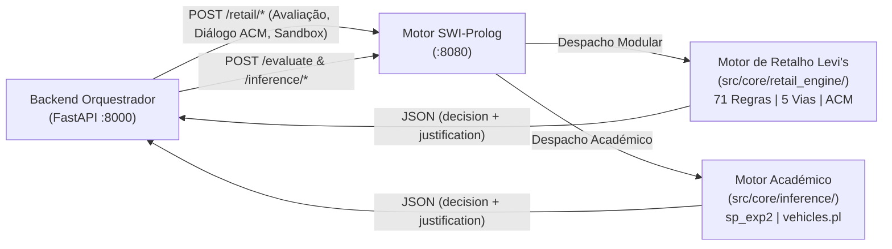
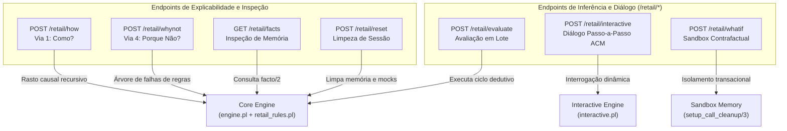

# API Interna do Motor de Inferência (SWI-Prolog)
### *Sistema Pericial de Diagnóstico para Devoluções e Trocas no Retalho*

---

## 1. Visão Geral e Natureza da API

O micro-serviço **Prolog Engine** disponibiliza uma API HTTP/JSON mínima e especializada para execução de inferência dedutiva e geração de justificações lógicas (*Why / Why not*).

> [!IMPORTANT]
> **API Exclusivamente Interna:** Este serviço não deve ser exposto diretamente a clientes externos ou ao *Frontend*. Apenas o **Backend Orquestrador (FastAPI)** comunica com este micro-serviço. O orquestrador atua como fachada, camada de validação e agregador.



### 1.1 Configuração Base e Resolução de Rede

| Ambiente | URL Base | Contexto de Execução |
|:---|:---|:---|
| **Ambiente Local (Host)** | `http://localhost:8080` | Executado diretamente na máquina host via `swipl src/main.pl` |
| **Ambiente Docker (Inter-contentor)** | `http://prolog-engine:8080` | Resolução de nome de serviço interna na rede `retail-network` |

O servidor é implementado em SWI-Prolog utilizando as bibliotecas nativas `library(http/thread_httpd)` e `library(http/http_dispatch)`, operando em modo multi-threaded.

---

## 2. Endpoint de Avaliação de Regras

### 2.1 `POST /evaluate`

Avalia um conjunto de factos contra a base de conhecimento dedutiva carregada no motor lógico e devolve uma decisão determinística acompanhada pela respetiva cadeia de justificação.

* **Método HTTP:** `POST`
* **Caminho:** `/evaluate`
* **Headers Obrigatórios:**
  * `Content-Type: application/json`
  * `Accept: application/json`

---

## 3. Especificação do Contrato POC Inicial

### 3.1 Pedido (Request Body)

O payload submetido deve ser um objeto JSON com o cenário de teste e o valor numérico a testar pelas regras lógicas de demonstração:

```json
{
  "scenario": "test",
  "value": 42
}
```

#### Tabela de Campos do Pedido:

| Campo | Tipo JSON | Unificação Prolog | Obrigatório | Descrição |
|:---|:---|:---|:---:|:---|
| `scenario` | `string` | Átomo ou String Prolog (`Request.scenario`) | **Sim** | Identificador do tipo de cenário a processar (ex.: `"test"`). |
| `value` | `number` / `integer` | Número Prolog (`Request.value`) | **Sim** | Valor numérico sujeito às cláusulas e predicados de validação. |

---

### 3.2 Respostas do Motor

#### 3.2.1 Resposta de Sucesso — Aprovação (`HTTP 200 OK`)

Quando os factos unificam com uma regra positiva de decisão (ex.: `value =:= 42`):

```json
{
  "status": "success",
  "decision": "approved",
  "justification": [
    "Value is 42",
    "Dummy rule matched"
  ]
}
```

#### 3.2.2 Resposta de Sucesso — Rejeição / Fallback (`HTTP 200 OK`)

Quando a condição de aprovação falha, o predicado `evaluate_scenario/3` dispara a regra alternativa de salvaguarda (*fallback rule*):

```json
{
  "status": "success",
  "decision": "rejected",
  "justification": [
    "Value is not 42",
    "Default fallback rule applied"
  ]
}
```

#### Tabela de Campos da Resposta de Sucesso:

| Campo | Tipo JSON | Mapeamento Prolog | Descrição |
|:---|:---|:---|:---|
| `status` | `string` | Átomo `"success"` | Indica que a inferência foi executada sem erros no motor. |
| `decision` | `string` | Átomo (`approved` ou `rejected`) | Veredito final determinado pelas regras lógicas. |
| `justification` | `array[string]` | Lista de termos convertida para JSON | Lista sequencial dos passos de prova e regras aplicadas (*Explainability*). |

---

### 3.3 Respostas de Erro

#### 3.3.1 Payload Inválido ou Parâmetros Ausentes (`HTTP 400 Bad Request`)

Gerado quando o leitor JSON do Prolog (`http_read_json_dict/3`) falha ao descodificar o payload ou quando a estrutura de dados não contém as chaves exigidas:

```json
{
  "status": "error",
  "message": "Invalid JSON payload or missing required parameters",
  "decision": "error",
  "justification": []
}
```

#### 3.3.2 Erro Interno do Motor (`HTTP 500 Internal Server Error`)

Ocorre caso seja gerada uma exceção lógica não capturada durante o ciclo de prova no predicado Prolog. O servidor SWI-Prolog devolve uma resposta de erro HTTP com a descrição da anomalia.

---

---

## 4. Endpoints do Motor Pericial de Retalho da Levi's (/retail/*)

O módulo [`prolog_engine/src/api/retail_routes.pl`](../../prolog_engine/src/api/retail_routes.pl) expõe a API REST para o **Motor Pericial de Devoluções e Trocas da Levi's**. Este subsistema implementa as 71 regras de negócio distribuídas por 9 famílias normativas, suporta a interrogação dialógica com a mecânica ACM de `obtem_facto/2` e fornece as 5 vias completas de explicabilidade pericial.



---

### 4.1 `POST /retail/evaluate` — Avaliação em Lote com Justificação Normativa

Executa o encadeamento para a frente (*forward-chaining*) sobre os factos submetidos, avalia as 71 regras da Levi's por ordem de precedência estrita e devolve o veredito canónico e a cadeia de justificação.

* **Método HTTP:** `POST`
* **Caminho:** `/retail/evaluate`
* **Headers:**
  * `Content-Type: application/json`
  * `Accept: application/json`

#### 4.1.1 Pedido (Request Body)

O endpoint aceita objetos JSON estruturados (com atributos individuais em snake_case ou camelCase) ou uma lista explícita de termos no campo `facts` / `initial_facts`:

```json
{
  "colaborador_autorizado": true,
  "canal_compra": "mainline",
  "categoria_produto": "vestuario",
  "estado_produto": "nao_usado_com_etiquetas",
  "comprovativo": "recibo_impresso",
  "dias_desde_compra": 18,
  "meio_pagamento": "credito"
}
```

Em alternativa, com lista de factos explícita:

```json
{
  "facts": [
    "colaborador_autorizado(true)",
    "canal_compra(mainline)",
    "categoria_produto(vestuario)",
    "estado_produto(nao_usado_com_etiquetas)",
    "comprovativo(recibo_impresso)",
    "dias_desde_compra(18)",
    "meio_pagamento(credito)"
  ]
}
```

#### Tabela de Parâmetros do Pedido:

| Parâmetro | Tipo | Mapeamento Prolog | Obrigatório | Descrição |
|:---|:---|:---|:---:|:---|
| `colaborador_autorizado` | `boolean` | `colaborador_autorizado(true/false)` | Sim | Credenciação do operador de balcão (família `HS`). |
| `canal_compra` / `channel` | `string` | `canal_compra(mainline/outlet/online)` | Sim | Canal onde foi efetuada a venda original. |
| `categoria_produto` / `category` | `string` | `categoria_produto(vestuario/acessorio/bodywear)` | Sim | Categoria da mercadoria devolvida. |
| `estado_produto` / `condition` | `string` | `estado_produto(...)` | Sim | Condição física (ex.: `nao_usado_com_etiquetas`, `com_defeito_fabrico`). |
| `comprovativo` / `receipt` | `string` | `comprovativo(...)` | Sim | Tipo de suporte probatório (`recibo_impresso`, `cartao_lealdade`, `nenhum`). |
| `dias_desde_compra` / `days_since_purchase` | `integer` | `dias_desde_compra(N)` | Sim | Intervalo de dias decorrido desde a compra. |
| `meio_pagamento` / `payment_method` | `string` | `meio_pagamento(...)` | Não | Método original de pagamento (`credito`, `debito`, `dinheiro`, `cartao_oferta`). |
| `facts` | `array[string]` | Lista de termos unificáveis | Opcional | Lista alternativa direta de predicados Prolog. |

#### 4.1.2 Resposta de Sucesso (`HTTP 200 OK`)

```json
{
  "status": "success",
  "decision": "approved",
  "retail_decision": "permitir",
  "justification": [
    "[PC-001] Artigo elegivel para devolucao por apresentar etiquetas intactas e estado nao usado.",
    "[PT-003] Devolucao aceite dentro do prazo de 30 dias com recibo original de compra."
  ],
  "initial_facts_count": 7,
  "derived_facts_count": 2,
  "total_facts": 9,
  "derived_facts": [
    {
      "id": 8,
      "fact": "elegibilidade_produto(elegivel)",
      "rule_id": "PC-001",
      "justified_by": [4]
    },
    {
      "id": 9,
      "fact": "decisao(permitir)",
      "rule_id": "PT-003",
      "justified_by": [5, 6, 8]
    }
  ]
}
```

#### Tabela de Campos da Resposta:

| Campo | Tipo | Descrição |
|:---|:---|:---|
| `status` | `string` | Estado do processamento (`"success"` ou `"error"`). |
| `decision` | `string` | Decisão canónica mapeada (`"approved"`, `"rejected"`, `"manager_override"`, `"store_credit_only"`). |
| `retail_decision` | `string` | Átomo nativo de decisão em português (`"permitir"`, `"recusar"`, `"rever"`, `"vale_loja"`). |
| `justification` | `array[string]` | Lista de justificações formatadas com identificadores normativos `[ID]`. |
| `initial_facts_count` | `integer` | Número de premissas assertadas no início da inferência. |
| `derived_facts_count` | `integer` | Número de factos deduzidos pelo motor de inferência. |
| `total_facts` | `integer` | Total de factos na memória de trabalho no término da execução. |
| `derived_facts` | `array[object]` | Detalhe estruturado de cada facto deduzido, respetiva regra e premissas de suporte. |

#### 4.1.3 Exemplos de Execução

**Em Bash / cURL:**
```bash
curl -X POST http://localhost:8080/retail/evaluate \
  -H "Content-Type: application/json" \
  -d '{
    "colaborador_autorizado": true,
    "canal_compra": "mainline",
    "categoria_produto": "vestuario",
    "estado_produto": "nao_usado_com_etiquetas",
    "comprovativo": "recibo_impresso",
    "dias_desde_compra": 18,
    "meio_pagamento": "credito"
  }'
```

**Em PowerShell (Windows — `Invoke-RestMethod`):**
```powershell
$body = @{
    colaborador_autorizado = $true
    canal_compra = "mainline"
    categoria_produto = "vestuario"
    estado_produto = "nao_usado_com_etiquetas"
    comprovativo = "recibo_impresso"
    dias_desde_compra = 18
    meio_pagamento = "credito"
} | ConvertTo-Json

Invoke-RestMethod -Uri http://localhost:8080/retail/evaluate -Method Post -ContentType "application/json" -Body $body
```

---

### 4.2 `POST /retail/interactive` — Diálogo Interativo Passo-a-Passo (Mecânica ACM)

Coordena o raciocínio dialógico interativo de acordo com a mecânica de interrogação do Prof. ACM (`obtem_facto/2` e `perguntavel/1`). Caso o motor necessite de um facto ainda não conhecido para continuar a dedução, a execução devolve uma pergunta pendente estruturada com a justificação da regra ativa (`why`). Suporta submissão incremental de respostas, tratamento de `"nao_sei"` e simulação por mocks.

* **Método HTTP:** `POST`
* **Caminho:** `/retail/interactive`
* **Headers:** `Content-Type: application/json`

#### 4.2.1 Pedido com Cenário Parcial e Respostas Incrementais

```json
{
  "initial_facts": [
    "colaborador_autorizado(true)",
    "canal_compra(mainline)"
  ],
  "answers": {
    "estado_produto": "nao_usado_com_etiquetas"
  }
}
```

Para responder especificamente à pergunta pendente:

```json
{
  "answer": {
    "attribute": "comprovativo",
    "value": "recibo_impresso"
  }
}
```

Para responder que o dado é desconhecido (`não sei`):

```json
{
  "answer": {
    "attribute": "dias_desde_compra",
    "value": "nao_sei"
  }
}
```

#### 4.2.2 Resposta — Pergunta Pendente (`HTTP 200 OK`, `status: "question"`)

```json
{
  "status": "question",
  "decision": "nao_concluido",
  "question": {
    "attribute": "comprovativo(X)",
    "prompt": "Qual e o tipo de comprovativo de compra apresentado pelo cliente?",
    "rule_active": "PT-003",
    "objective": "decisao(permitir)",
    "why": "A regra PT-003 investiga este atributo para aferir se existe suporte documental valido dentro da janela legal."
  },
  "justification": [],
  "dialogue_log": [
    {
      "type": "asked",
      "attribute": "estado_produto(X)",
      "question": "Qual e o estado fisico do produto devolvido?"
    },
    {
      "type": "answered",
      "attribute": "estado_produto(X)",
      "answer": "nao_usado_com_etiquetas"
    },
    {
      "type": "asked",
      "attribute": "comprovativo(X)",
      "question": "Qual e o tipo de comprovativo de compra apresentado pelo cliente?"
    }
  ],
  "total_facts": 3
}
```

#### 4.2.3 Resposta — Diálogo Concluído (`HTTP 200 OK`, `status: "completed"`)

Quando todas as premissas essenciais foram adquiridas e uma regra terminal disparou:

```json
{
  "status": "completed",
  "decision": "approved",
  "retail_decision": "permitir",
  "justification": [
    "[PC-001] Artigo elegivel para devolucao por apresentar etiquetas intactas e estado nao usado.",
    "[PT-003] Devolucao aceite dentro do prazo de 30 dias com recibo original de compra."
  ],
  "dialogue_log": [
    {"type": "asked", "attribute": "comprovativo(X)", "question": "Qual e o tipo de comprovativo..."},
    {"type": "answered", "attribute": "comprovativo(X)", "answer": "recibo_impresso"}
  ],
  "total_facts": 7,
  "derived_facts": [
    {"id": 6, "fact": "elegibilidade_produto(elegivel)", "rule_id": "PC-001", "justified_by": [3]},
    {"id": 7, "fact": "decisao(permitir)", "rule_id": "PT-003", "justified_by": [4, 5, 6]}
  ]
}
```

#### 4.2.4 Exemplos de Execução

**Em Bash / cURL:**
```bash
curl -X POST http://localhost:8080/retail/interactive \
  -H "Content-Type: application/json" \
  -d '{"initial_facts": ["colaborador_autorizado(true)"], "answers": {"canal_compra": "mainline"}}'
```

**Em PowerShell (Windows — `Invoke-RestMethod`):**
```powershell
$body = @{
    initial_facts = @("colaborador_autorizado(true)")
    answers = @{ canal_compra = "mainline" }
} | ConvertTo-Json

Invoke-RestMethod -Uri http://localhost:8080/retail/interactive -Method Post -ContentType "application/json" -Body $body
```

---

### 4.3 `POST /retail/whatif` — Simulação Contrafactual What-If em Sandbox

Executa uma simulação isolada e transacional através do padrão de sandbox dinâmico (`setup_call_cleanup/3`). Permite testar premissas alternativas (`add` e `remove`) sem modificar o estado persistido na sessão em curso.

* **Método HTTP:** `POST`
* **Caminho:** `/retail/whatif`
* **Headers:** `Content-Type: application/json`

#### 4.3.1 Pedido (Request Body)

```json
{
  "base_facts": {
    "colaborador_autorizado": true,
    "canal_compra": "mainline",
    "estado_produto": "claramente_usado",
    "comprovativo": "recibo_impresso",
    "dias_desde_compra": 18
  },
  "add": [
    "estado_produto(nao_usado_com_etiquetas)"
  ],
  "remove": [
    "estado_produto(claramente_usado)"
  ]
}
```

#### 4.3.2 Resposta de Sucesso (`HTTP 200 OK`)

```json
{
  "status": "success",
  "baseline_decision": "rever",
  "simulated_decision": "permitir",
  "decision_changed": true,
  "added_facts": [
    "estado_produto(nao_usado_com_etiquetas)"
  ],
  "removed_facts": [
    "estado_produto(claramente_usado)"
  ],
  "baseline_justification": [
    "[PC-004] Artigo com sinais evidentes de uso requer avaliacao presencial do gerente de loja."
  ],
  "simulated_justification": [
    "[PC-001] Artigo elegivel para devolucao por apresentar etiquetas intactas e estado nao usado.",
    "[PT-003] Devolucao aceite dentro do prazo de 30 dias com recibo original de compra."
  ],
  "impact_summary": "A decisão mudou de 'rever' para 'permitir' com a simulação contrafactual.",
  "simulated_facts_count": 8
}
```

#### Tabela de Campos do Resultado What-If:

| Campo | Tipo | Descrição |
|:---|:---|:---|
| `baseline_decision` | `string` | Veredito apurado com os factos de base originais. |
| `simulated_decision` | `string` | Veredito apurado com as premissas hipoteticamente alteradas. |
| `decision_changed` | `boolean` | `true` se as alterações originaram uma divergência no desfecho; `false` caso contrário. |
| `added_facts` | `array[string]` | Termos hipoteticamente introduzidos na simulação. |
| `removed_facts` | `array[string]` | Termos hipoteticamente revogados na simulação. |
| `baseline_justification` | `array[string]` | Justificações correspondentes ao cenário de base. |
| `simulated_justification` | `array[string]` | Justificações apuradas no cenário simulado. |
| `impact_summary` | `string` | Resumo analítico em linguagem natural sobre o efeito da mutação contrafactual. |
| `simulated_facts_count` | `integer` | Total de factos derivados durante a simulação isolada. |

#### 4.3.3 Exemplos de Execução

**Em Bash / cURL:**
```bash
curl -X POST http://localhost:8080/retail/whatif \
  -H "Content-Type: application/json" \
  -d '{
    "base_facts": {"colaborador_autorizado": true, "estado_produto": "claramente_usado", "comprovativo": "recibo_impresso", "dias_desde_compra": 18},
    "add": ["estado_produto(nao_usado_com_etiquetas)"],
    "remove": ["estado_produto(claramente_usado)"]
  }'
```

**Em PowerShell (Windows — `Invoke-RestMethod`):**
```powershell
$body = @{
    base_facts = @{
        colaborador_autorizado = $true
        estado_produto = "claramente_usado"
        comprovativo = "recibo_impresso"
        dias_desde_compra = 18
    }
    add = @("estado_produto(nao_usado_com_etiquetas)")
    remove = @("estado_produto(claramente_usado)")
} | ConvertTo-Json

Invoke-RestMethod -Uri http://localhost:8080/retail/whatif -Method Post -ContentType "application/json" -Body $body
```

---

### 4.4 `POST /retail/how` — Explicabilidade Dedutiva Causal (Via 1: How)

Gera a árvore causal de prova retrospetiva para qualquer facto da memória de trabalho, distinguindo se a evidência adveio do utilizador (`operador`), de uma premissa inicial ou do disparo de uma regra formal com prefixo normativo entre parêntesis retos (ex.: `[PC-001]`).

* **Método HTTP:** `POST`
* **Caminho:** `/retail/how`
* **Headers:** `Content-Type: application/json`

#### 4.4.1 Pedido (Request Body)

Aceita o identificador numérico do facto (`fact_id`) ou a expressão do facto (`fact`):

```json
{
  "fact": "decisao(permitir)"
}
```

Ou por ID:

```json
{
  "fact_id": 8
}
```

#### 4.4.2 Resposta de Sucesso (`HTTP 200 OK`)

```json
{
  "status": "success",
  "fact": "decisao(permitir)",
  "explanation": [
    "Fact 8 -> decisao(permitir) concluded by rule [PT-003]",
    "Based on facts: [5, 6, 7]",
    "Fact 5 -> comprovativo(recibo_impresso) was provided by user (operador)",
    "Fact 6 -> dias_desde_compra(18) was provided by user (operador)",
    "Fact 7 -> elegibilidade_produto(elegivel) concluded by rule [PC-001]",
    "Based on facts: [4]",
    "Fact 4 -> estado_produto(nao_usado_com_etiquetas) was provided by user (operador)"
  ]
}
```

#### 4.4.3 Exemplos de Execução

**Em Bash / cURL:**
```bash
curl -X POST http://localhost:8080/retail/how \
  -H "Content-Type: application/json" \
  -d '{"fact": "decisao(permitir)"}'
```

**Em PowerShell (Windows — `Invoke-RestMethod`):**
```powershell
$body = @{ fact = "decisao(permitir)" } | ConvertTo-Json
Invoke-RestMethod -Uri http://localhost:8080/retail/how -Method Post -ContentType "application/json" -Body $body
```

---

### 4.5 `POST /retail/whynot` — Análise de Árvore de Falhas (Via 4: Why Not)

Inspeciona recursivamente por que razão um objetivo ou desfecho normativo não foi concluído pelo motor. Decompõe as regras candidatas e isola as condições e antecedentes não satisfeitos.

* **Método HTTP:** `POST`
* **Caminho:** `/retail/whynot`
* **Headers:** `Content-Type: application/json`

#### 4.5.1 Pedido (Request Body)

```json
{
  "decision": "permitir"
}
```

Ou com o predicado completo:

```json
{
  "fact": "decisao(permitir)"
}
```

#### 4.5.2 Resposta de Sucesso (`HTTP 200 OK`)

```json
{
  "status": "success",
  "fact": "decisao(permitir)",
  "explanation": [
    "Because by rule [PT-003]:",
    "  Condition comprovativo(recibo_impresso) is false",
    "Because by rule [PT-005]:",
    "  Condition comprovativo(cartao_lealdade) is false"
  ]
}
```

#### 4.5.3 Exemplos de Execução

**Em Bash / cURL:**
```bash
curl -X POST http://localhost:8080/retail/whynot \
  -H "Content-Type: application/json" \
  -d '{"decision": "permitir"}'
```

**Em PowerShell (Windows — `Invoke-RestMethod`):**
```powershell
$body = @{ decision = "permitir" } | ConvertTo-Json
Invoke-RestMethod -Uri http://localhost:8080/retail/whynot -Method Post -ContentType "application/json" -Body $body
```

---

### 4.6 `GET /retail/facts` — Inspeção da Memória de Trabalho

Devolve a listagem de todos os factos correntes presentes na memória de trabalho do motor de retalho, permitindo auditoria detalhada do estado da sessão.

* **Método HTTP:** `GET`
* **Caminho:** `/retail/facts`

#### 4.6.1 Resposta de Sucesso (`HTTP 200 OK`)

```json
{
  "status": "success",
  "facts_count": 5,
  "facts": [
    {"id": 1, "fact": "colaborador_autorizado(true)"},
    {"id": 2, "fact": "canal_compra(mainline)"},
    {"id": 3, "fact": "estado_produto(nao_usado_com_etiquetas)"},
    {"id": 4, "fact": "elegibilidade_produto(elegivel)"},
    {"id": 5, "fact": "decisao(permitir)"}
  ]
}
```

#### 4.6.2 Exemplos de Execução

**Em Bash / cURL:**
```bash
curl -X GET http://localhost:8080/retail/facts
```

**Em PowerShell (Windows — `Invoke-RestMethod`):**
```powershell
Invoke-RestMethod -Uri http://localhost:8080/retail/facts -Method Get
```

---

### 4.7 `POST /retail/reset` — Reposição e Limpeza da Sessão

Efetua a limpeza determinística de toda a memória de trabalho do motor de retalho (`facto/2`, `ultimo_facto/1`, `justifica/3`), repõe o estado da máquina de diálogo em `interactive.pl` e recarrega a base oficial `retail_rules.pl`.

* **Método HTTP:** `POST`
* **Caminho:** `/retail/reset`
* **Headers:** `Content-Type: application/json`

#### 4.7.1 Resposta de Sucesso (`HTTP 200 OK`)

```json
{
  "status": "success",
  "message": "Retail inference engine session reset"
}
```

#### 4.7.2 Exemplos de Execução

**Em Bash / cURL:**
```bash
curl -X POST http://localhost:8080/retail/reset \
  -H "Content-Type: application/json" \
  -d '{}'
```

**Em PowerShell (Windows — `Invoke-RestMethod`):**
```powershell
Invoke-RestMethod -Uri http://localhost:8080/retail/reset -Method Post -ContentType "application/json" -Body "{}"
```

---

## 5. Endpoints do Motor Académico de Veículos (`sp_exp2.pl` do Moodle — `/inference/*`)

O módulo [`prolog_engine/src/api/inference_routes.pl`](../../prolog_engine/src/api/inference_routes.pl) expõe a API REST para o **motor pericial de exemplo dos professores (`sp_exp2.pl`)** fornecido no Moodle (`prolog_engine/Ficheiros de Apoio Sistemas Periciais_ sp_exp1.pl, sp_exp2.pl e base de conhecimento-20260928/`). 

Este subsistema opera sobre bases de conhecimento de teste (como `vehicles`, adaptada de `veiculos2.txt`), disponibilizando operações de *forward-chaining*, metaconhecimento e explicabilidade bidirecional (*How* / *Why Not*), mantendo-se perfeitamente isolado do motor de avaliação do retalho ([Secção 4](#4-endpoints-do-motor-pericial-de-retalho-da-levis-retail)).

### 5.1 `POST /inference/load`
Carrega e compila uma base de conhecimento em memória dinâmica.

* **Método:** `POST`
* **Caminho:** `/inference/load`
* **Pedido (JSON):** `{"knowledge_base": "vehicles"}`
* **Resposta (`HTTP 200 OK`):**
  ```json
  {
    "status": "success",
    "message": "Knowledge base 'vehicles' loaded successfully",
    "initial_facts_count": 3
  }
  ```

---

### 5.2 `POST /inference/run`
Executa o ciclo de encadeamento para a frente (*forward-chaining*) sobre os factos correntes da base académica.

* **Método:** `POST`
* **Caminho:** `/inference/run`
* **Pedido (JSON):** `{}` ou corpo vazio
* **Resposta (`HTTP 200 OK`):**
  ```json
  {
    "status": "success",
    "initial_facts_count": 3,
    "derived_facts_count": 2,
    "total_facts": 5,
    "derived_facts": [
      {
        "id": 4,
        "fact": "classe(meu_veiculo,pesado)",
        "rule_id": 6,
        "justified_by": [2]
      },
      {
        "id": 5,
        "fact": "pesado(meu_veiculo,camiao)",
        "rule_id": 2,
        "justified_by": [3, 4]
      }
    ]
  }
  ```

---

### 5.3 `GET /inference/facts`
Devolve a listagem integral de todos os factos atualmente presentes na memória de trabalho académica.

* **Método:** `GET`
* **Caminho:** `/inference/facts`
* **Resposta (`HTTP 200 OK`):**
  ```json
  {
    "status": "success",
    "facts_count": 5,
    "facts": [
      {"id": 1, "fact": "lotacao(meu_veiculo,3)"},
      {"id": 2, "fact": "peso(meu_veiculo,4500)"},
      {"id": 3, "fact": "tipo(meu_veiculo,mercadorias)"},
      {"id": 4, "fact": "classe(meu_veiculo,pesado)"},
      {"id": 5, "fact": "pesado(meu_veiculo,camiao)"}
    ]
  }
  ```

---

### 5.4 `POST /inference/how`
Explica o raciocínio causal de derivação de um facto académico (*How*).

* **Método:** `POST`
* **Caminho:** `/inference/how`
* **Pedido (JSON):** `{"fact_id": 4}`
* **Resposta (`HTTP 200 OK`):**
  ```json
  {
    "status": "success",
    "fact_id": 4,
    "explanation": [
      "Fact 4 -> classe(meu_veiculo,pesado) concluded by rule 6",
      "Based on facts: [2]",
      "Fact 2 -> peso(meu_veiculo,4500) was an initial fact"
    ]
  }
  ```

---

### 5.5 `POST /inference/whynot`
Explica por que razão um determinado facto não foi deduzido na base académica (*Why Not*).

* **Método:** `POST`
* **Caminho:** `/inference/whynot`
* **Pedido (JSON):** `{"fact": "classe(meu_veiculo,ligeiro)"}`
* **Resposta (`HTTP 200 OK`):**
  ```json
  {
    "status": "success",
    "fact": "classe(meu_veiculo,ligeiro)",
    "explanation": [
      "Investigating why 'classe(meu_veiculo,ligeiro)' was not concluded:",
      "Rule 7 could conclude 'classe(meu_veiculo,ligeiro)':",
      "  Failed premise: avalia(peso(meu_veiculo,=<,3500))"
    ]
  }
  ```

---

### 5.6 `POST /inference/reset`
Limpa toda a memória de trabalho do motor pericial académico.

* **Método:** `POST`
* **Caminho:** `/inference/reset`
* **Pedido (JSON):** `{}` ou corpo vazio
* **Resposta (`HTTP 200 OK`):**
  ```json
  {
    "status": "success",
    "message": "Inference engine session reset"
  }
  ```

---

## 6. Serialização, Normalização de Factos e Aliases em Prolog Dicts

O módulo [`prolog_engine/src/api/retail_routes.pl`](../../prolog_engine/src/api/retail_routes.pl) implementa uma camada resiliente de ingestão JSON (`dict_to_retail_facts/2` e `pairs_to_facts/2`) que converte tanto payloads estruturados (DTOs Pydantic) como pares chave-valor planos em termos Prolog unificáveis.

### 6.1 Matriz de Mapeamento de Atributos

| Chave JSON Recebida (Inglês ou Alternativa) | Termo Prolog Normalizado | Descrição |
|:---|:---|:---|
| `days_since_purchase`, `dayssincepurchase` | `dias_desde_compra(N)` | Número de dias transcorridos desde a aquisição. |
| `payment_method`, `paymentmethod` | `meio_pagamento(Termo)` | Modalidade original de liquidação financeira. |
| `channel`, `canal` | `canal_compra(Termo)` | Canal de compra (`mainline`, `outlet`, `online`). |
| `category`, `categoria` | `categoria_produto(Termo)` | Categoria de produto (`vestuario`, `acessorio`, `bodywear`). |
| `condition`, `estado` | `estado_produto(Termo)` | Condição física do artigo devolvido. |
| `proof`, `receipt` | `comprovativo(Termo)` | Documento comprovativo apresentado. |
| `transaction_value` | `valor_transacao(N)` | Montante numérico envolvido na transação. |
| `has_tags` | `etiquetas_preservadas(true/false)` | Existência de etiquetas de fábrica intactas. |
| `is_underwear` | `categoria_produto_bodywear(true/false)` | Identificador de artigo íntimo/higiénico. |

### 6.2 Matriz de Mapeamento de Valores de Domínio

| Valor JSON Recebido | Valor Normalizado no Termo Prolog | Contexto de Regra |
|:---|:---|:---|
| `"recibo_original"`, `"recibooriginal"` | `recibo_impresso` | Comprovativo preferencial (30 dias). |
| `"cartao_credito"`, `"credit_card"` | `credito` | Reembolso na forma de pagamento original. |
| `"cartao_debito"`, `"debit_card"` | `debito` | Reembolso em débito ou numerário. |
| `"sem_comprovativo"`, `"no_receipt"` | `nenhum` | Ativa família `BW` (*Blind Returns*). |

### 6.3 Resolução Canónica de Decisões

As decisões lógicas derivadas no Prolog são traduzidas para a convenção canónica da API:

| Átomo Prolog | Decisão Canónica (`decision`) | Regra / Justificação |
|:---|:---|:---|
| `permitir` | `"approved"` | Devolução aprovada com estorno no método original. |
| `permitir` (com `meio_reembolso(vale_loja)`) | `"store_credit_only"` | Devolução permitida mas restrita a crédito/vale de loja. |
| `recusar` | `"rejected"` | Recusa formal por infração de política. |
| `rever` / `encaminhar` | `"manager_override"` | Exceção que requer validação presencial da gerência. |
| `vale_loja` | `"store_credit_only"` | Concessão de crédito não monetário. |

---

## 7. Exemplos Práticos de Teste do Endpoint Académico (/evaluate)

Estes comandos destinam-se a testes rápidos do endpoint `/evaluate` do micro-serviço Prolog na porta 8080:

### 7.1 Teste de Aprovação (`value = 42`)

**Em Bash / cURL:**
```bash
curl -X POST http://localhost:8080/evaluate \
  -H "Content-Type: application/json" \
  -d '{"scenario": "test", "value": 42}'
```

**Em PowerShell (Windows — `Invoke-RestMethod`):**
```powershell
$body = @{ scenario = "test"; value = 42 } | ConvertTo-Json
Invoke-RestMethod -Uri http://localhost:8080/evaluate -Method Post -ContentType "application/json" -Body $body
```

### 7.2 Teste de Rejeição (`value = 15`)

**Em Bash / cURL:**
```bash
curl -X POST http://localhost:8080/evaluate \
  -H "Content-Type: application/json" \
  -d '{"scenario": "test", "value": 15}'
```

**Em PowerShell (Windows — `Invoke-RestMethod`):**
```powershell
$body = @{ scenario = "test"; value = 15 } | ConvertTo-Json
Invoke-RestMethod -Uri http://localhost:8080/evaluate -Method Post -ContentType "application/json" -Body $body
```

---

## 8. Documentos Relacionados

* [Arquitetura do Motor Prolog](../architecture/prolog_engine.md) — Camadas de transporte (`api/`) e motor pericial (`core/retail_engine/`).
* [API Pública v1 do Orquestrador](orchestrator_api_v1.md) — Endpoints públicos do FastAPI que consomem o micro-serviço Prolog.
* [Catálogo de Schemas Pydantic](schemas.md) — DTOs Python correspondentes a estes contratos de dados.
* [Requisito de Explicabilidade](../domain/explainability.md) — Modelo formal das 5 vias de explicabilidade implementadas no Prolog.
* [Regras do Perito e Domínio](../domain/expert_knowledge.md) — Formalização das 71 regras da Levi's e precedências normativas.

