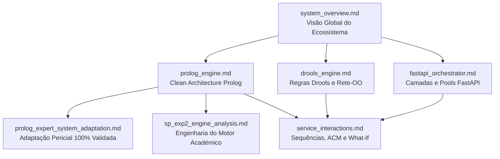

# Arquitetura do Sistema
### *Sistema Pericial de Diagnóstico para Devoluções e Trocas no Retalho*

---

## 1. Visão Geral da Secção

Esta secção contém a documentação técnica aprofundada da arquitetura da solução, cobrindo o ecossistema global de micro-serviços, o desenho interno dos motores de raciocínio simbólico (SWI-Prolog com o motor pericial de 71 regras da Levi's e motor pedagógico de veículos; e Apache KIE Drools com as 98 regras de produção oficiais de devoluções da Levi's), a camada de orquestração assíncrona em FastAPI e os fluxos detalhados de dados entre componentes.

O sistema baseia-se em princípios sólidos de engenharia de software: **Clean Architecture**, **separação estrita de responsabilidades**, **princípio do isolamento por paridade**, **desacoplamento de protocolos de transporte**, **tolerância a falhas** e **explicabilidade nativa em 5 vias** (*How*, *Why Ask*, *Why Decision*, *Why Not*, *What-If*).

---

## 2. Índice de Documentos de Arquitetura

| Documento | Propósito | Conteúdo Central |
|:---|:---|:---|
| [Visão Global do Sistema (`system_overview.md`)](system_overview.md) | Visão macro e ecossistema | Diagrama de arquitetura global, descrição das camadas, princípios de desenho ("Regra de Ouro"), stack tecnológica completa e portas de serviço. |
| [Arquitetura do Motor Prolog (`prolog_engine.md`)](prolog_engine.md) | Desenho do micro-serviço SWI-Prolog | Clean Architecture, isolamento por paridade entre o motor de retalho Levi's (71 regras, ACM, 5 vias) e o motor de veículos, ciclo de vida do pedido e DTOs via *Prolog Dicts*. |
| [Arquitetura do Motor Drools (`drools_engine.md`)](drools_engine.md) | Desenho do micro-serviço Drools Engine (Levi's) | Arquitetura modular em 7 módulos Maven (Java 21 / Spring Boot 3 / Drools 8.44), Rete-OO, base de 98 regras DRL (M0 a M9), explicabilidade em 5 vias, persistência em PostgreSQL e segurança JWT. |
| [Arquitetura do Orquestrador FastAPI (`fastapi_orchestrator.md`)](fastapi_orchestrator.md) | Desenho do backend orquestrador | Arquitetura em camadas (core, schemas, clients, services, api), gestão de ciclo de vida (*lifespan*), connection pooling com `httpx`, CORS, injeção de dependências e feature toggles. |
| [Interações entre Serviços e Fluxos de Dados (`service_interactions.md`)](service_interactions.md) | Comunicação e integração ponta-a-ponta | Diagramas de sequência detalhados para `/retail/*`, diálogo interativo ACM, sandbox contrafactual *What-If*, fluxo Drools Levi's, mapeamento semântico de decisões e matriz de erros. |
| [Análise Aprofundada do Motor sp_exp2 (`sp_exp2_engine_analysis.md`)](sp_exp2_engine_analysis.md) | Dissecação e adaptação do motor académico | Análise detalhada dos 6 blocos do `sp_exp2.pl`, ciclo de inferência, metaconhecimento, explicabilidade e roteiro de adaptação pericial para retalho. |
| [Plano Mestre de Adaptação em Prolog (`prolog_expert_system_adaptation.md`)](prolog_expert_system_adaptation.md) | Adaptação pericial da Levi's (100% Concluída) | Da teoria das perguntas de PPROGIA (ACM) às 71 regras da Levi's (RPAC-Team3): arquitetura dual, `obtem_facto/2`, precedência, validação com 81 testes PLUnit e 153 testes Pytest. |
| [Diferenças: sp_exp2 vs. retail_engine (`diferencas_motor_academico_vs_implementado.md`)](diferencas_motor_academico_vs_implementado.md) | Guia intuitivo de diferenças para a defesa oral | Dissecação didática das 5 mutações no código Prolog baseadas em `MI_Perguntas_ACM.md` (`obtem_facto/2`, `perguntavel/1`, gestão de "não sei", `Why Ask`), diagramas de fluxo comparativos e guião de perguntas para a apresentação técnica. |

---

## 3. Mapa Visual de Componentes e Documentos

---

## 4. Navegação no Repositório de Documentação

* **Domínio & Conhecimento:** [Conhecimento de Negócio e Heurísticas](../domain/README.md)
* **APIs & Contratos:** [Referência de APIs e Schemas](../api/README.md)
* **Deploy & Operações:** [Guia de Deploy e Docker](../deployment/README.md)
* **Desenvolvimento:** [Guias de Desenvolvimento e Testes](../development/README.md)
* **Histórico:** [Planos e Histórico de Implementação](../history/README.md)

