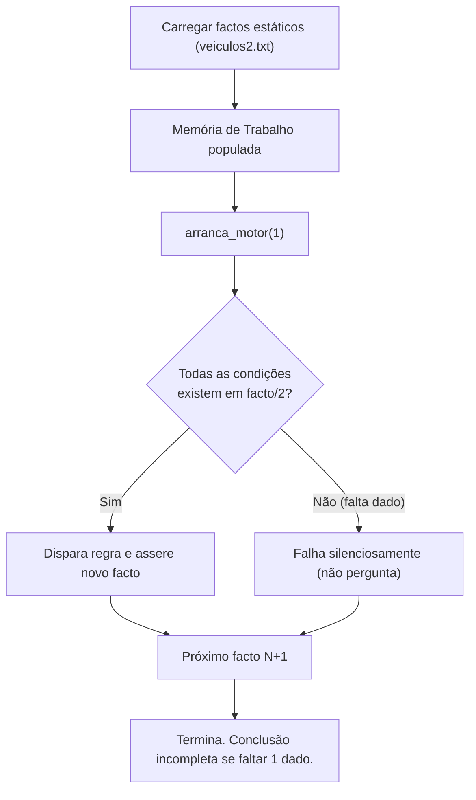
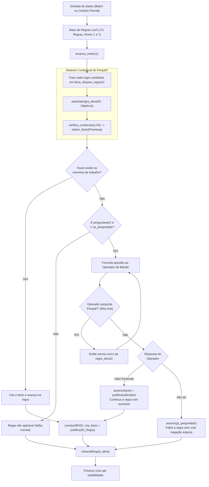

# Do Motor Académico ao Motor de Retalho: Análise Comparativa e Guia de Evolução
### *Dissecação das Diferenças Entre o sp_exp2.pl (Veículos) e o retail_engine (Levi's Returns)*
#### *ISEP · MEIA 2026/2027 · Engenharia do Conhecimento (ENGCIA) & Paradigmas de Programação em IA (PPROGIA)*

---

## 1. Resumo Executivo para a Equipa ("O Que Dizer na Apresentação Técnica")

Se o corpo docente perguntar na apresentação oral:  
> *"Vocês dizem que adaptaram o motor dos veículos (sp_exp2.pl) fornecido nas aulas... O que é que mudaram concretamente no código do motor e porquê?"*

A resposta estruturada da equipa deve ser:

> *"Partimos da estrutura declarativa canónica do `sp_exp2.pl` (o motor de encadeamento para a frente com metaconhecimento e operadores DSL) e evoluímo-lo seguindo rigorosamente o roteiro pedagógico da aula do Prof. ACM documentado em `MI_Perguntas_ACM.md`.  
> O motor original dos carros era **estático e fechado**: exigia que todos os factos estivessem na memória antes de arrancar e, se faltasse um dado, a regra falhava silenciosamente sem fazer perguntas.  
> Nós transformámos o motor num **sistema pericial dialógico e auditável**:  
> 1. Substituímos a leitura cega de factos pela interceção dinâmica com `obtem_facto/2` e `perguntavel/1`;  
> 2. Tratámos de forma segura a resposta `'não sei'` com `ja_perguntado/1`, evitando criar negações lógicas espúrias;  
> 3. Implementámos a interrogação contextual bidirecional (*'Porquê da Pergunta?'* via `regra_ativa/2`);  
> 4. Expandimos a explicabilidade para as **5 Vias completas** (*Como, Porquê Perguntar, Porquê Decidir, Porque Não e E Se Sandbox*);  
> 5. Desacoplámos o motor numa arquitetura modular limpa (*Clean Architecture*) com suporte a API REST HTTP JSON, mantendo o motor académico original intacto para testes de paridade e não-regressão."*

---

## 2. Matriz Global de Diferenças: sp_exp2.pl vs. retail_engine

A tabela seguinte sintetiza todas as discrepâncias estruturais, algorítmicas e operacionais entre o código fornecido pelos docentes e o código implementado pelo grupo:

| Dimensão de Comparação | Motor Fornecido (`sp_exp2.pl` / Veículos) | Motor Implementado (`retail_engine` / Levi's) | Fonte / Justificação Pedagógica |
|:---|:---|:---|:---|
| **Paradigma Base** | Encadeamento para a frente (*Forward Chaining*) com metaconhecimento. | Encadeamento para a frente com metaconhecimento e interrogação a pedido. | Mantém o núcleo algorítmico do professor (`arranca_motor`). |
| **Aquisição de Factos** | **Estática:** todos os factos têm de constar no ficheiro (`veiculos2.txt`) antes do arranque. | **Dialógica a Pedido:** factos podem vir no arranque (batch) ou ser interrogados interativamente ao operador. | `MI_Perguntas_ACM.md`, Secções 1 a 6 e 14 (Estratégia B). |
| **Verificação de Condições** | `verifica_condicoes/2` consulta cegamente `facto(N, Condicao)`. | `verifica_condicoes/2` invoca `obtem_facto(Condicao, N)`. | `MI_Perguntas_ACM.md`, Secção 15 e 16. |
| **Metaconhecimento de Recolha** | Não existia. O sistema não sabia que dados eram observáveis. | Declaração formal de `perguntavel/1` para atributos do balcão de retalho. | `MI_Perguntas_ACM.md`, Secção 9 ("Factos perguntáveis vs. inferíveis"). |
| **Tratamento de Dados em Falta** | A regra simplesmente **não disparava** e o motor terminava sem aviso. | O motor deteta a ausência, formula pergunta dirigida e aguarda resposta. | `MI_Perguntas_ACM.md`, Secção 2 e 7. |
| **Tratamento da Resposta "Não Sei"** | Inexistente (desconhecido equivalia a falso, gerando falhas lógicas). | Regista em `ja_perguntado/1` sem asserir facto negativo, explorando outras vias. | `MI_Perguntas_ACM.md`, Secção 8 ("'Não sei' não é o mesmo que 'não'"). |
| **Pergunta "Porquê?" pelo Utilizador** | Inexistente (o utilizador era passivo). | Suporte total (*Why Ask*): explica a regra candidata ativa em `regra_ativa/2`. | `MI_Perguntas_ACM.md`, Secção 12 e 18 (Estilo clássico MYCIN). |
| **Rastreio de Proveniência** | `justifica(ID, Regra, [Premissas])` apenas para deduções. | Distingue factos iniciais, regras normativas e `justifica(ID, utilizador, [])`. | `MI_Perguntas_ACM.md`, Secção 17 (`regista_resposta/1`). |
| **Explicabilidade** | Apenas 2 vias básicas em consola de terminal (`como/1` e `whynot/1`). | **5 Vias Completas:** *Como, Porquê Perguntar, Porquê da Decisão, Porque Não e E Se Sandbox*. | Requisito de transparência pericial e auditoria ética. |
| **Complexidade da Base** | 7 regras de teste para classificar camiões e carros. | **71 regras normativas** em 9 famílias com **7 níveis de precedência estrita**. | RPAC Levi's e perito Dustin Hopper. |
| **Arquitetura de Software** | Script Prolog monolítico executado na consola SWI-Prolog. | Módulos desacoplados (`engine.pl`, `interactive.pl`, `retail_rules.pl`, `retail_routes.pl`). | Clean Architecture e micro-serviços via REST API (JSON). |
| **Modos de Execução** | Apenas interativo de linha de comando. | **Dual:** Modo Batch automatizado (API REST) e Modo Dialógico interativo (Consola/Mock). | Requisito do ecossistema distribuído FastAPI + Next.js. |

---

## 3. As 5 Grandes Mutações no Código Prolog

Para qualquer membro da equipa poder explicar o código com confiança, analisamos as cinco mudanças cirúrgicas efetuadas relativamente ao `sp_exp2.pl`.

### 3.1 Mutação 1: A Troca Nuclear em `verifica_condicoes` (`obtem_facto/2`)

No motor original que o professor entregou, o predicado `verifica_condicoes` dependia exclusivamente da presença prévia do facto na memória dinâmica:

```prolog
% ==============================================================================
% CÓDIGO ORIGINAL (sp_exp2.pl - O que o professor deu)
% ==============================================================================
verifica_condicoes([X e Y], [N|LF]) :- !,
    facto(N, X),                        % Se não existir facto N com valor X, FALHA logo!
    verifica_condicoes([Y], LF).
verifica_condicoes([X], [N]) :-
    facto(N, X).
```

Na versão adaptada pelo grupo em [`prolog_engine/src/core/retail_engine/engine.pl`](file:///root/meia-equipa3-challenge1-26_27/prolog_engine/src/core/retail_engine/engine.pl#L858-L865), intercetamos a condição com `obtem_facto/2`:

```prolog
% ==============================================================================
% CÓDIGO EVOLUÍDO (retail_engine/engine.pl - O que nós implementámos)
% ==============================================================================
verifica_condicoes([X e Y], [N|LF]) :- !,
    obtem_facto(X, N),                  % Procura na memória; se não existir, PERGUNTA!
    verifica_condicoes([Y], LF).
verifica_condicoes([X], [N]) :-
    obtem_facto(X, N).
```

#### O que faz o `obtem_facto/2` por baixo do capô?
Seguindo a especificação exata da Secção 16 do documento do professor ACM:
```prolog
% 1. O facto já existe na memória de trabalho? Se sim, usa-o imediatamente!
obtem_facto(F, N) :-
    facto(N, F),
    !.

% 2. Se não existe: é perguntável? E ainda não foi perguntado nesta sessão?
obtem_facto(F, N) :-
    e_perguntavel(F, Template),
    \+ ja_perguntado(Template),
    assertz(ja_perguntado(Template)),    % Marca para nunca repetir a pergunta!
    solicita_facto(Template, F, Resp),   % Faz a pergunta ao operador
    Resp \== nao_sei,                   % Valida que não respondeu "não sei"
    regista_resposta(Resp, N),          % Assere na memória com proveniência 'utilizador'
    facto(N, F).
```

---

### 3.2 Mutação 2: Metaconhecimento de Perguntas (`perguntavel/1`)

O motor original dos veículos não tinha qualquer noção de que factos pertenciam ao mundo observável e quais eram conclusões internas do sistema.

Seguindo a **Regra de Ouro da Secção 9 de ACM**:
> *"Perguntar evidências observáveis no balcão; inferir classificações e decisões periciais."*

Definimos formalmente em [`prolog_engine/src/core/retail_engine/engine.pl`](file:///root/meia-equipa3-challenge1-26_27/prolog_engine/src/core/retail_engine/engine.pl#L761-L777) quais são os predicados observáveis:

```prolog
% FACTOS PERGUNTÁVEIS (Observáveis pelo operador no balcão da loja)
perguntavel(colaborador_autorizado(_)).
perguntavel(sku_reconhecido(_)).
perguntavel(categoria_produto(_)).
perguntavel(estado_produto(_)).
perguntavel(embalagem_selada(_)).
perguntavel(comprovativo(_)).
perguntavel(dias_desde_compra(_)).
perguntavel(canal_compra(_)).
perguntavel(metodo_pagamento_original(_)).

% FACTOS NUNCA PERGUNTÁVEIS (Conclusões periciais que o sistema TEM de deduzir)
% - decisao(_)           <- É o desfecho do diagnóstico!
% - destino_produto(_)   <- Decidido pelas regras de quarentena/stock!
% - meio_reembolso(_)    <- Decidido pela matriz de conciliação financeira!
% - controlo(_)          <- Decidido pelo risco operacional!
```

---

### 3.3 Mutação 3: Gestão Segura do "Não Sei" (`ja_perguntado/1`)

Na Secção 8 de `MI_Perguntas_ACM.md`, o professor alerta para um erro clássico em Prolog:
> *"Se o utilizador responder 'não sei', não se pode criar um facto negativo (ex.: `nao comprovativo`), caso contrário uma regra com negação por falha dispararia indevidamente."*

No motor implementado:
1. Quando o operador responde `nao_sei`, o predicado `obtem_facto/2` **falha graciosamente** (devido a `Resp \== nao_sei`);
2. **Nenhum facto** é adicionado à base dinâmica com valor falso;
3. O predicado dinâmico `ja_perguntado(Template)` impede que a mesma pergunta volte a surgir quando outras regras candidatas forem avaliadas;
4. O motor continua o encadeamento para a frente, tentando caminhos alternativos (por exemplo, regras de "devolução às cegas / sem recibo").

---

### 3.4 Mutação 4: A Pergunta "Porquê?" pelo Utilizador (*Why Ask*)

No `sp_exp2.pl` dos carros, a explicabilidade funcionava apenas no final da execução (`como/1` ou `whynot/1`). Durante o raciocínio, o sistema era uma "caixa negra".

O professor ACM propôs (Secção 12):
> *"Quando o sistema pergunta, o utilizador pode perguntar 'Porquê?'. O sistema deve responder indicando que regra está a tentar provar."*

No nosso motor, em [`prolog_engine/src/core/retail_engine/engine.pl`](file:///root/meia-equipa3-challenge1-26_27/prolog_engine/src/core/retail_engine/engine.pl#L816-L826), envolvemos a verificação de condições num bloco com `setup_call_cleanup/3`:

```prolog
dispara_regras(N, Facto, [ID|LRegras]) :-
    regra ID se LHS entao RHS,
    facto_esta_numa_condicao(Facto, LHS),
    extrai_objetivo(RHS, Objetivo),
    setup_call_cleanup(
        asserta(regra_ativa(ID, Objetivo)),   % Regista dinamicamente qual regra está a tentar provar
        (
            verifica_condicoes(LHS, LFactos), % Se disparar uma pergunta aqui, sabemos a regra ativa!
            member(N, LFactos)
        ),
        retractall(regra_ativa(ID, _))        % Limpa sempre a regra ativa no final do teste
    )
    ->  concluir(RHS, ID, LFactos)
    ;   true.
```

Quando o operador invoca `why_ask/1` ou `POST /retail/why-ask`, o sistema consulta `regra_ativa(ID, Obj)` e devolve a justificação da política Levi's associada a essa regra!

---

### 3.5 Mutação 5: Rastreio Causal e Proveniência em `justifica/3`

No `sp_exp2.pl`, o `justifica/3` registava apenas regras:
`justifica(ID_Facto, ID_Regra, [ListaIDsPremissas])`.

No motor do retalho, expandimos este mecanismo para suportar **três tipos de proveniência**:
1. **Factos Iniciais:** `facto(1, mercado(eua))` $\rightarrow$ sem cláusula de justificativa (identificado como facto base);
2. **Dados Fornecidos pelo Operador:** registados com etiqueta especial `justifica(N, utilizador, [])`;
3. **Conclusões Normativas:** registadas com o identificador formal da regra: `justifica(N, 'PC-005', [1, 2])`.

Isto permite que o predicado `como/1` produza relatórios transparentes distinguidos por cor e tipo na consola e no dashboard.

---

## 4. Comparação Visual de Fluxos

### 4.1 O Ciclo Cego do sp_exp2.pl Original (Veículos)



### 4.2 O Ciclo Inteligente do retail_engine (Levi's + ACM)



---

## 5. Mapeamento 1-para-1 com o Guião do Professor ACM

Para máxima autoridade técnica na apresentação, a tabela seguinte mapeia cada secção de [`docs/material_aulas/MI_Perguntas_ACM.md`](file:///root/meia-equipa3-challenge1-26_27/docs/material_aulas/MI_Perguntas_ACM.md) para o ficheiro e predicado correspondente na nossa implementação:

| Secção em `MI_Perguntas_ACM.md` | Conceito Pedagógico | Onde Está no Nosso Código | Predicado / Mecanismo |
|:---|:---|:---|:---|
| **Secção 1 & 2** | O sistema original não faz perguntas; o perito pergunta à medida que precisa. | [`retail_engine/engine.pl`](file:///root/meia-equipa3-challenge1-26_27/prolog_engine/src/core/retail_engine/engine.pl#L751-L767) | Substituição de `facto/2` por `obtem_facto/2`. |
| **Secção 4** | Arquitetura: Interface pergunta, motor decide o que falta saber. | [`retail_engine/interactive.pl`](file:///root/meia-equipa3-challenge1-26_27/prolog_engine/src/core/retail_engine/interactive.pl#L1-L20) | Desacoplamento entre `engine.pl` e `interactive.pl`. |
| **Secção 7 & 8** | Tratamento seguro de `"não sei"` sem poluir com negação falsa. | [`retail_engine/engine.pl`](file:///root/meia-equipa3-challenge1-26_27/prolog_engine/src/core/retail_engine/engine.pl#L762-L765) | `\+ ja_perguntado(Template)`, `Resp \== nao_sei`. |
| **Secção 9 & 10** | Factos perguntáveis vs. inferíveis (perguntar dados, inferir decisões). | [`retail_engine/engine.pl`](file:///root/meia-equipa3-challenge1-26_27/prolog_engine/src/core/retail_engine/engine.pl#L761-L777) | Declaração de `perguntavel/1` e guarda `e_perguntavel/2`. |
| **Secção 11** | Não perguntar tudo: usar metaconhecimento de relevância. | [`retail_engine/retail_rules.pl`](file:///root/meia-equipa3-challenge1-26_27/prolog_engine/src/core/retail_engine/retail_rules.pl) | Mapeamento `facto_dispara_regras/2` para as 71 regras. |
| **Secção 12** | Utilizador pergunta "Porquê?" durante a interrogação (estilo MYCIN). | [`retail_engine/engine.pl`](file:///root/meia-equipa3-challenge1-26_27/prolog_engine/src/core/retail_engine/engine.pl#L819-L826) | Rastreio dinâmico com `regra_ativa(ID, Objetivo)` e `why_ask/1`. |
| **Secção 14** | Duas estratégias: Batch inicial (A) vs. A pedido (B). | [`retail_engine/engine.pl`](file:///root/meia-equipa3-challenge1-26_27/prolog_engine/src/core/retail_engine/engine.pl#L215-L235) | Suporte simultâneo a `evaluate_facts/2` e `run_interactive/1`. |
| **Secção 16 & 17** | Implementação canónica de `obtem_facto/2` e `regista_resposta/1`. | [`retail_engine/engine.pl`](file:///root/meia-equipa3-challenge1-26_27/prolog_engine/src/core/retail_engine/engine.pl#L751-L792) | Implementação fidedigna das linhas propostas pelo Prof. ACM. |
| **Secção 18** | Rasto causal no `como/1` com distinção de resposta do utilizador. | [`retail_engine/engine.pl`](file:///root/meia-equipa3-challenge1-26_27/prolog_engine/src/core/retail_engine/engine.pl#L347-L350) | `justifica(N, utilizador, _)` impresso no `como/1`. |

---

## 6. Guião Rápido de Bolso para a Apresentação Técnica

Quando os professores de ENGCIA ou PPROGIA colocarem questões técnicas afiadas, consultem estas respostas:

### Pergunta 1: *"O motor sp_exp2 original é forward-chaining. Como é que o vosso motor consegue fazer perguntas a meio da inferência sem ser backward-chaining?"*
> **Resposta:**  
> *"Seguimos a **Estratégia B da Secção 14 do documento do Prof. ACM**: intercetamos a verificação das premissas no predicado `verifica_condicoes/2`. Quando uma regra de encadeamento para a frente é selecionada via metaconhecimento (`facto_dispara_regras/2`), o motor tenta provar as suas premissas. Se uma premissa estiver ausente mas for declarada em `perguntavel/1`, o motor suspende momentaneamente a avaliação, recolhe o facto junto do operador através de `obtem_facto/2`, assere-o na memória e retoma o encadeamento para a frente sem necessidade de reiniciar o ciclo."*

### Pergunta 2: *"Como garantem que o sistema não entra em loops infinitos de perguntas?"*
> **Resposta:**  
> *"Utilizamos o predicado dinâmico `ja_perguntado(Template)`. Antes de formular qualquer questão, o predicado `obtem_facto/2` verifica `\+ ja_perguntado(Template)`. Quer o utilizador forneça um valor válido, quer responda `não sei`, o template é marcado na sessão dinâmica. Se outra regra subsequente necessitar do mesmo facto, não voltará a incomodar o operador."*

---

## 7. Documentos Relacionados

* [Análise Estrutural do Motor sp_exp2 (`sp_exp2_engine_analysis.md`)](sp_exp2_engine_analysis.md)
* [Plano Mestre de Adaptação Pericial em Prolog (`prolog_expert_system_adaptation.md`)](prolog_expert_system_adaptation.md)
* [Arquitetura do Micro-serviço Prolog (`prolog_engine.md`)](prolog_engine.md)
* [Explicabilidade e Modelo das 5 Vias (`../domain/explainability.md`)](../domain/explainability.md)
* [Comparativo: Regras de Produção vs. Redes Semânticas (`../domain/comparativo_regras_vs_redes_semanticas.md`)](../domain/comparativo_regras_vs_redes_semanticas.md)
