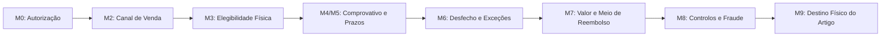
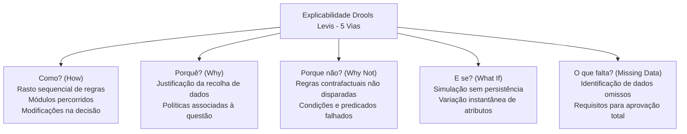
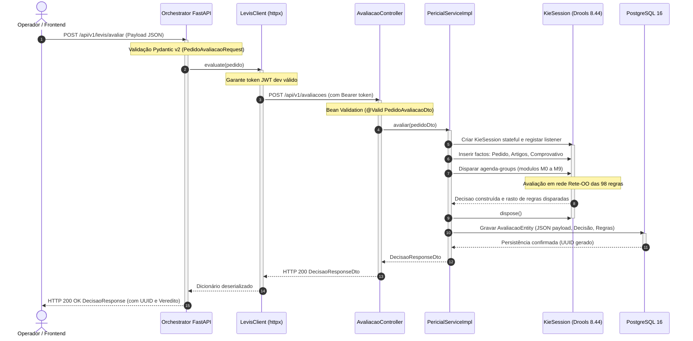

# Arquitetura Interna: Micro-serviço Drools Engine (Devoluções Levi's)
### *Motor Pericial de Regras de Produção (Rete-OO) para Retalho*

---

## 1. Visão Geral e Papel no Sistema

O micro-serviço **Drools Engine** ([`drools-engine-levis-devolucoes-java/`](../../drools-engine-levis-devolucoes-java)) constitui o motor de inferência pericial baseado em **regras de produção** (*Production Rules*) do sistema, implementando a totalidade das políticas operacionais de devoluções, trocas e ajustes de preço da **Levi Strauss & Co.** (lojas Mainline e Outlet, EUA e Canadá).

O motor assenta no algoritmo **Rete-OO** fornecido pelo **Apache KIE Drools 8.44**, integrado numa aplicação modular empresarial desenvolvida em **Java 21**, **Spring Boot 3.3** e persistência relacional em **PostgreSQL 16**.

Enquanto o micro-serviço SWI-Prolog explora o paradigma declarativo puro de primeira ordem com encadeamento causal, o Drools Engine aplica correspondência de padrões de alto desempenho em memória de trabalho (*Working Memory*), avaliando simultaneamente **98 regras de produção DRL** distribuídas por múltiplos módulos sequenciais (*agenda-groups* M0 a M9).

### 1.1 Objetivos Centrais de Engenharia
1. **Determinismo e Rigor:** Cada decisão de triagem (aprovação, rejeição, revisão gerencial, encaminhamento físico) é obtida estritamente a partir das políticas oficiais da marca.
2. **Explicabilidade Nativa em 5 Vias:** O motor fornece nativamente justificações completas:
   - **Como?** (*How*): Rasto ordenado das regras disparadas e módulos percorridos.
   - **Porquê?** (*Why*): Fundamentação das perguntas ou dados pedidos ao operador.
   - **Porque não?** (*Why Not*): Análise contrafactual detalhada explicando por que razão determinadas conclusões mais favoráveis não foram atingidas.
   - **E se?** (*What If*): Simulador de cenários hipotéticos sem persistência na base de dados.
   - **O que falta?** (*Missing Data*): Identificação proativa dos atributos necessários para desbloquear um desfecho positivo.
3. **Persistência e Auditoria Integral:** Todas as avaliações são persistidas em PostgreSQL com histórico completo dos factos submetidos, versão do KJAR de regras executado e rasto de regras acionadas.
4. **Segurança por Token JWT:** Autenticação e autorização por papéis de operador de retalho, com suporte a tokens de desenvolvimento rápido e fornecedores OIDC corporativos.

---

## 2. Arquitetura Modular em Camadas (Multi-Módulo Maven)

O projeto está estruturado segundo os princípios de **Clean Architecture** e **Ports & Adapters (Hexagonal)**, repartido por 7 módulos Maven desacoplados, garantindo isolamento estrito entre o domínio de negócio, as regras Drools, a persistência e a camada REST:

```text
drools-engine-levis-devolucoes-java/
├── backend/
│   ├── pericial-model/         # Factos de domínio puros (POJO, sem Spring/JPA/Drools)
│   ├── pericial-rules/         # KJAR versionado: 98 regras DRL, kmodule.xml e cenários de teste
│   ├── pericial-explanation/   # Algoritmos de explicabilidade (Como, Porquê, Porque não, E se)
│   ├── pericial-dto/           # Contratos públicos da API (records Java com Bean Validation)
│   ├── pericial-persistence/   # Entidades JPA, repositórios Spring Data e migrações Flyway
│   ├── pericial-service/       # Orquestração do motor, portas e adaptadores externos
│   └── pericial-api/           # Aplicação Spring Boot, controladores REST e segurança JWT
├── frontend/                   # Interface web Angular complementar
├── docker-compose.yml          # Orquestração local (PostgreSQL 16 + pericial-api)
└── pom.xml                     # Maven root agregador (Java 21, Spring Boot 3.3, Drools 8.44)
```

### 2.1 Papel e Responsabilidades por Módulo

| Módulo Maven | Papel Arquitetural | Tecnologias Chave | Responsabilidades |
|:---|:---|:---|:---|
| **`pericial-model`** | Domínio do Problema | Java 21, Lombok, Jackson | Define os factos de domínio puro (`Pedido`, `Artigo`, `Comprovativo`, `Decisao`, etc.). Não possui dependências do Spring nem da JPA. |
| **`pericial-rules`** | Base de Conhecimento Drools | Drools 8.44, KIE API | Contém as 98 regras DRL organizadas em ficheiros por módulo funcional, o ficheiro `kmodule.xml` e suíte de testes de aceitação com os 10 cenários reais. |
| **`pericial-explanation`** | Motor de Explicabilidade | Java 21, Drools SPI | Implementa o motor de transparência algorítmica, inspecionando a agenda, factos avaliados e condições não satisfeitas. |
| **`pericial-dto`** | Contratos de Transporte | Java Records, Jakarta Validation | DTOs imutáveis de entrada e saída para a API REST, com validações Bean Validation rigorosas. |
| **`pericial-persistence`** | Auditoria e Armazenamento | Spring Data JPA, Hibernate, Flyway | Entidades relacionais separadas dos factos Drools, histórico das transações, idempotência e auditoria de auditoria. |
| **`pericial-service`** | Serviços Aplicacionais | Spring Boot Service, Portas & Adaptadores | Orquestra a execução da `KieSession`, gere o ciclo de vida transacional e isola integrações com POS, BackPocket, Afterpay e PayPal atrás de adaptadores. |
| **`pericial-api`** | Camada de Entrada REST | Spring Web, Spring Security, Swagger | Disponibiliza os endpoints `/api/v1/avaliacoes`, `/api/v1/regras`, `/explicacoes/*`, controlo de acessos JWT e documentação OpenAPI. |

---

## 3. Modelo de Domínio e Factos de Trabalho (`pericial-model`)

Os factos inseridos na memória de trabalho (*Working Memory*) do Drools são classes Java limpas que modelam a realidade física e transacional de uma loja de retalho:

```mermaid
classDiagram
    direction TB
    class Pedido {
        +UUID id
        +CanalVenda canal
        +TipoLoja tipoLoja
        +LocalDate dataPedido
        +Colaborador colaborador
        +List~Artigo~ artigos
        +Comprovativo comprovativo
        +List~PagamentoOriginal~ pagamentos
    }

    class Artigo {
        +String sku
        +CategoriaArtigo categoria
        +BigDecimal precoPago
        +EstadoArtigo estado
        +EstadoEtiqueta etiqueta
        +boolean personalizado
        +boolean pecaIntima
        +DestinoArtigo destino
    }

    class Comprovativo {
        +TipoComprovativo tipo
        +String numeroRecibo
        +LocalDate dataCompra
        +boolean valido
    }

    class Decisao {
        +UUID avaliacaoId
        +ResultadoElegibilidade elegibilidade
        +BigDecimal valorReembolso
        +MeioReembolso meioLiquidacao
        +boolean requerAprovacaoGerente
        +List~String~ rastreioRegras
        +boolean terminal
    }

    Pedido "1" *-- "1..*" Artigo : artigos
    Pedido "1" *-- "1" Comprovativo : comprovativo
    Pedido "1" --> "1" Decisao : decisao
```



* **`Pedido`:** Representa a transação de retorno global submetida pelo cliente à caixa.
* **`Artigo`:** Cada peça individual sujeita a devolução, com o seu estado de conservação, presença de etiquetas, categoria e destino físico atribuído pelo motor.
* **`Comprovativo`:** Dados do comprovativo de compra (recibo em papel, fatura eletrónica, *gift receipt* ou devolução sem recibo).
* **`Decisao`:** Objeto central acumulador de inferência onde as regras depositam as conclusões parciais e finais (`terminal = true` quando atinge um desfecho imperativo).

---

## 4. Base de Regras de Produção DRL (`pericial-rules`)

A base de conhecimento pericial conta com **98 regras de produção DRL**, distribuídas por ficheiros modulares no classpath `com/levis/devolucoes/regras/`:

```text
com/levis/devolucoes/regras/
├── m0-autorizacao.drl           # Permissões do operador e tipo de loja
├── m2-canal.drl                 # Validações de proveniência (Mainline, Outlet, Online)
├── m3-elegibilidade.drl         # Condições físicas do produto, etiquetas e higiene
├── m4-m5-comprovativo-prazo.drl # Prazos operacionais (30 dias devolução, 14 dias ajuste)
├── m6-resultado-excecoes.drl    # Desfechos principais e exceções gerenciais
├── m7-valor.drl                 # Cálculo do montante a liquidar (preço pago vs atual)
├── m7-meio-reembolso.drl        # Determinação do método de liquidação (dinheiro, cartão, vale)
├── m8-controlos.drl             # Controlos operacionais, limites e anti-fraude
├── m9-destino.drl               # Destino físico do artigo (vendas, armazém, destruição)
├── online.drl                   # Especificidades de devoluções com origem Levi's.com
├── transversais.drl             # Regras de orquestração e propagação de estado
└── consultas.drl                # Drools Queries para extração rápida de conclusões
```

### 4.1 Sequenciação por Agenda Groups e Salience

Para assegurar que o raciocínio humano do perito Dustin Hopper é reproduzido fielmente, a inferência Drools progride através de **Agenda Groups** encadeados, com desempate fino via `salience`:



### 4.2 Anatomia de uma Regra Levi's DRL

Todas as regras seguem uma convenção estrita de nomenclatura e metadados declarativos para alimentar diretamente o motor de explicabilidade:

```java
rule "PT-003 Devolução verificada até 30 dias com etiquetas intactas"
    agenda-group "M4-M5"
    salience 80
    @id("PT-003")
    @modulo("M4-M5")
    @descricao("Transação com recibo válido efetuada dentro do prazo normal de 30 dias com etiquetas originais intactas.")
    @conclusoes("OUT-001=PERMITIR,OUT-002=REEMBOLSO_INTEGRAL")
when
    $pedido : Pedido( tipoPedido == TipoPedido.DEVOLUCAO )
    $comp   : Comprovativo( valido == true, diasDesdeCompra <= 30 )
    $artigo : Artigo( etiqueta == EstadoEtiqueta.INTACTA, estado == EstadoArtigo.NOVO )
    $dec    : Decisao( terminal == false )
then
    modify($dec) {
        setElegibilidade(ResultadoElegibilidade.PERMITIR),
        adicionarRegraAcionada("PT-003")
    };
end
```

---

## 5. Motor de Explicabilidade em 5 Vias (`pericial-explanation`)

O requisito fundamental do sistema é a transparência. O módulo `pericial-explanation` analisa a execução da sessão e gera 5 perspetivas analíticas:



### 5.1 O Mecanismo *Why Not* (Porque Não?)
Quando o operador questiona por que razão o pedido não resultou em `PERMITIR` direto ou por que razão não foi concedido reembolso monetário em dinheiro:
1. O motor localiza todas as regras que poderiam ter produzido o desfecho pretendido (via metadado `@conclusoes`).
2. Compara os padrões dessas regras com o estado dos factos presentes na memória de trabalho.
3. Devolve uma estrutura tipada identificando exatamente que condição ou predicado falhou (ex.: `"Artigo apresenta etiquetas soltas em vez de intactas"` ou `"Dias desde a compra (45) excedem o limite de 30 dias"`).

---

## 6. Ciclo de Vida do Pedido (Request-Response Lifecycle)

O diagrama abaixo detalha a cadeia completa de processamento de uma avaliação de devolução entre o Frontend, o FastAPI Orchestrator e o Drools Engine:



---

## 7. Persistência Relacional e Auditoria (`pericial-persistence`)

O módulo de persistência utiliza **Spring Data JPA**, **Hibernate** e **Flyway** para garantir conformidade e histórico auditável de retalho sobre a base de dados PostgreSQL:

* **Tabela `avaliacoes`:** Regista cada pedido submetido, timestamp UTC, identificador do colaborador, canal, payload JSON integral e desfecho (`PERMITIR`, `RECUSAR`, `REVER`, `ENCAMINHAR`).
* **Tabela `artigos_avaliacao`:** Registo detalhado por artigo com indicação do destino físico atribuído (`Área de Vendas`, `Risco Biológico`, `Danificado / Return to Vendor`, `Armazém Central`).
* **Tabela `auditoria_regras`:** Lista sequencial das regras disparadas durante a inferência, indexada por `avaliacao_id`, permitindo reconstrução forense exata do raciocínio.

---

## 8. Segurança e Gestão de Sessão (JWT)

A API do motor de regras está protegida por **Spring Security 6** com tokens JWT:

1. **Ambiente de Desenvolvimento (`dev`):**
   * Endpoint `GET /api/v1/dev/colaboradores` fornece perfis pré-configurados (Operador de Caixa, Gerente de Loja, Supervisor).
   * Endpoint `POST /api/v1/dev/tokens` gera instantaneamente um token JWT válido assinado para testes rápidos.
   * O cliente `LevisClient` no FastAPI adquire e renova automaticamente este token de desenvolvimento em segundo plano.
2. **Ambiente de Produção (`prod`):**
   * Validação de tokens emitidos pelo fornecedor OIDC corporativo da cadeia de retalho, inspecionando assinaturas RSA e claims de autorização.

---

## 9. Tratamento Global de Erros e Resiliência

O componente `GlobalExceptionHandler` no módulo `pericial-api` intercepta exceções e mapeia-as em contratos padronizados:

| Exceção | Origem | Código HTTP | Significado |
|:---|:---|:---:|:---|
| `MethodArgumentNotValidException` | Bean Validation nos DTOs | `400 Bad Request` | Formato de campos, datas ou valores monetários inválidos. |
| `AvaliacaoNaoEncontradaException` | Consulta por ID inexistente | `404 Not Found` | O UUID da avaliação não existe no histórico da base de dados. |
| `RegraNaoEncontradaException` | Consulta de regra inválida | `404 Not Found` | O código de regra DRL solicitado não existe na base de conhecimento. |
| `DroolsExecutionException` | Falha interna do motor KIE | `500 Internal Error` | Inconsistência na execução da memória de trabalho. |

---

## 10. Referência Histórica: Arquivo do Modelo Clínico

Antes da implementação do domínio completo de retalho da Levi's, a Prova de Conceito (POC) do motor Drools correu uma base de regras académica para diagnóstico diferencial de hemorragias (`drools_engine/src/main/resources/rules/haemorrhage_rules.drl`). Esse protótipo inicial encontra-se arquivado e documentado em [`docs/history/drools_implementation_plan.md`](../history/drools_implementation_plan.md) para fins de comparação pedagógica entre sistemas periciais médicos e de retalho.

---

## 11. Documentos Relacionados

* [Visão Global da Arquitetura do Sistema](system_overview.md) — Posicionamento do Drools Engine no ecossistema global.
* [Interações entre Serviços e Fluxos de Dados](service_interactions.md) — Diagramas de sequência e topologia de rede.
* [Referência da API do Orquestrador](../api/orchestrator_api_v1.md) — Endpoints públicos `/api/v1/levis/*`.
* [Plano de Integração Drools Levi's](../history/drools_levis_integration_plan.md) — Roteiro de desenvolvimento e critérios de aceitação.
