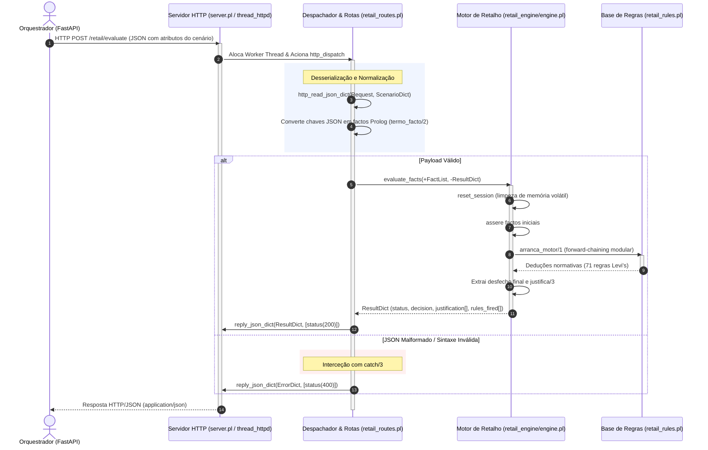
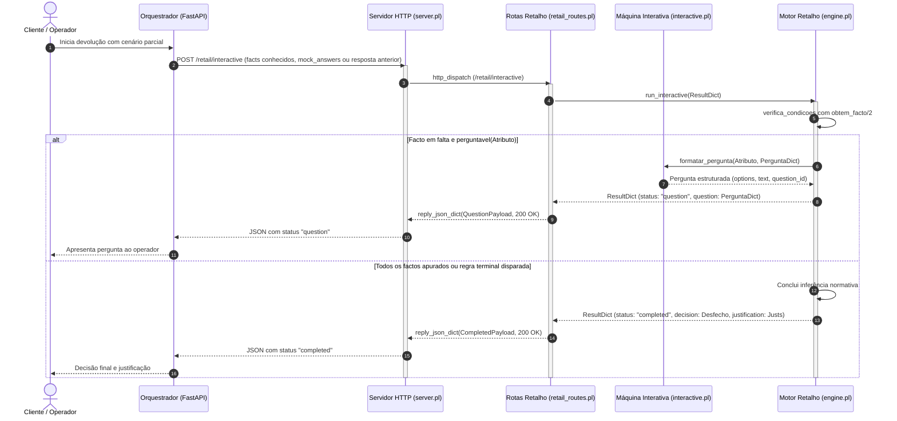

# Arquitetura Interna: Micro-serviço SWI-Prolog
### *Sistema Pericial de Diagnóstico para Devoluções e Trocas no Retalho*

---

## 1. Visão Geral e Papel no Sistema

O micro-serviço **SWI-Prolog** ([`prolog_engine/`](../../prolog_engine)) constitui o motor de inferência pericial baseado em lógica declarativa de primeira ordem.

A sua responsabilidade primordial consiste em receber representações factuais de cenários de devolução e troca, submetê-las à base de regras de negócio e deduzir deterministicamente o desfecho normativo acompanhado de uma cadeia estruturada de justificações (*Explicabilidade / Transparência*).

---

## 2. Princípios de Clean Architecture e Organização do Código

Para assegurar independência de protocolos de transporte, facilidade de manutenção e suporte a testes unitários ultrarrápidos, o micro-serviço adota os princípios de **Clean Architecture**:

```text
prolog_engine/
├── Dockerfile                  # Contentorização baseada na imagem oficial swipl:latest
├── .dockerignore               # Otimização do contexto de build da imagem Docker
├── src/
│   ├── api/                    # Camada de Transporte HTTP / Rede (I/O)
│   │   ├── server.pl           # Gestão do daemon HTTP multi-threaded (thread_httpd)
│   │   ├── routes.pl           # Endpoints REST e serialização/desserialização JSON (POC legada)
│   │   ├── inference_routes.pl # Endpoints REST do motor académico de inferência (/inference/*)
│   │   └── retail_routes.pl    # Endpoints REST do motor pericial de retalho (/retail/*)
│   ├── core/                   # Camada de Domínio / Regras de Negócio Puras
│   │   ├── rules.pl            # Base de conhecimento declarativa e motor de inferência (POC legada)
│   │   ├── inference/          # Motor pericial forward-chaining académico original (sp_exp2)
│   │   │   ├── engine.pl       # Motor sp_exp2 adaptado (não-interativo, dados estruturados)
│   │   │   └── kb/             # Bases de conhecimento declarativas de veículos
│   │   │       └── vehicles.pl # Base de veículos com metaconhecimento
│   │   └── retail_engine/      # Motor pericial de retalho avançado (71 regras Levi's)
│   │       ├── engine.pl       # Motor forward-chaining modular com 5 vias de explicabilidade
│   │       ├── interactive.pl  # Máquina de estados dialógica e formulação de perguntas ACM
│   │       └── kb/             # Base de conhecimento normativa de retalho
│   │           └── retail_rules.pl # As 71 regras Levi's em 9 famílias com precedência estrita
│   └── main.pl                 # Entry point, bootstrapping e leitura de ambiente
└── tests/                      # Suíte de Testes Automatizados (PLUnit - 81 testes)
    ├── test_rules.pl           # Testes unitários do core de regras da POC (7 cenários)
    ├── test_api.pl             # Testes de integração HTTP da POC (5 cenários)
    ├── test_inference_engine.pl# Testes unitários do motor de veículos (8 cenários)
    ├── test_retail_rules.pl    # Testes unitários das 71 regras Levi's e prioridades (31 cenários)
    ├── test_retail_explainability.pl # Testes unitários das 5 vias de explicabilidade (18 cenários)
    ├── test_retail_interactive.pl    # Testes do fluxo dialógico ACM e interrogação (12 cenários)
    ├── test_retail_api.pl      # Testes de integração HTTP dos endpoints /retail/* (12 cenários)
    └── test_retail_engine_phase1.pl  # Teste de isolamento de paridade e coexistência
```

### 2.1 Camada de Domínio / Lógica Pura (`src/core/`)
* **Isolamento Total:** A camada Core desconhece por completo a existência de sockets TCP, portas de rede, servidores HTTP ou formatos de transmissão como JSON.
* **Prolog Declarativo Puro:** Opera unicamente com termos nativos do Prolog e dicionários abstratos (*Prolog Dicts*).
* **Módulos:**
  * `rules.pl`: Regras determinísticas da POC inicial (`evaluate_scenario/3`).
  * `inference/engine.pl`: Motor de inferência pericial baseado em encadeamento para a frente (*forward-chaining*), não-interativo e desacoplado de I/O (base académica `sp_exp2`).
  * `inference/kb/vehicles.pl`: Base de conhecimento de teste contendo factos, regras e metaconhecimento de disparo para classificação de veículos.
  * `retail_engine/engine.pl`: Motor pericial de retalho avançado com encadeamento para a frente modular, suporte a interrogação dinâmica ACM, isolamento transacional de sessões e 5 vias completas de explicabilidade.
  * `retail_engine/interactive.pl`: Máquina de estados não-bloqueante para interrogação dialógica com geração dinâmica de enunciados textuais em pt-PT para 41 atributos observáveis.
  * `retail_engine/kb/retail_rules.pl`: Base de conhecimento normativa com as 71 regras da Levi's divididas em 9 famílias temáticas com 7 níveis estritos de precedência.
* **Testabilidade:** Pode ser testada diretamente na consola interativa `swipl` ou através de testes unitários PLUnit sem necessidade de iniciar o servidor web.

### 2.2 Camada de Transporte e Rede (`src/api/`)
* **Isolamento de I/O:** É a única secção do serviço com conhecimento de rede, protocolos HTTP e formatação de dados.
* **Módulos:**
  * `server.pl`: Inicializa o servidor HTTP concorrente através das bibliotecas nativas `library(http/thread_httpd)` e `library(http/http_dispatch)`.
  * `routes.pl`: Mapeia o caminho `/evaluate` legado da POC.
  * `inference_routes.pl`: Mapeia a família de rotas REST `/inference/*` (`load`, `run`, `facts`, `how`, `whynot`, `reset`), gerindo a desserialização segura e resposta em JSON.
  * `retail_routes.pl`: Mapeia os 7 endpoints de retalho `/retail/*` (`evaluate`, `interactive`, `whatif`, `how`, `whynot`, `facts`, `reset`), integrando com o motor pericial de retalho e serialização em JSON.
* **Regra Fundamental:** A camada de API **não** aplica nem contém regras de negócio; a sua única função é o transporte e adaptação de dados.

### 2.3 Ponto de Entrada (`src/main.pl`)
* Responsável pelo carregamento de todos os módulos (`api/server`, `api/routes`, `api/inference_routes`, `api/retail_routes`, `core/rules`, `core/inference/engine`, `core/retail_engine/engine`).
* Lê a variável de ambiente `PORT` (por omissão `8080`).
* Inicializa o daemon na porta configurada e bloqueia a thread principal para manter o contentor Docker em execução contínua.

### 2.4 Princípio do Isolamento por Paridade
O micro-serviço SWI-Prolog implementa intencionalmente o **Princípio do Isolamento por Paridade**:
* **Coexistência Pacífica em Namespaces Distintos:** O motor de veículos (`src/core/inference/`) e o motor de retalho (`src/core/retail_engine/`) residem em módulos Prolog estanques, com predicados dinâmicos e bases de regras completamente segregadas.
* **Demonstração Académica:** Permite apresentar aos docentes e avaliadores a paridade direta entre a linha de base académica original fornecida no Moodle (`sp_exp2.pl`) e a evolução avançada desenvolvida para o domínio de retalho da Levi's.
* **Garantia Anti-Regressão:** Alterações e otimizações efetuadas no motor de retalho nunca afetam a integridade ou o funcionamento do motor académico, cujos testes unitários continuam a validar a conformidade com as especificações da cadeira.

### 2.5 Motor Pericial de Retalho Adaptado (`src/core/retail_engine/`)
O motor de retalho introduz refinamentos cruciais sobre a mecânica de inferência tradicional:
* **Mecânica ACM de `obtem_facto/2` vs. `facto(N, X)`:** Em vez de depender exclusivamente de factos previamente asseridos na base dinâmica, o predicado `obtem_facto/2` consulta ativamente a base; perante a ausência de um facto, verifica se o atributo é perguntável (`perguntavel/1`), despoletando o diálogo estruturado em vez de falhar abruptamente.
* **Rastreamento Contextual com `regra_ativa/2` e `setup_call_cleanup/3`:** Durante a avaliação de premissas de uma regra, o identificador da regra em teste é registado dinamicamente em `regra_ativa/2`. A primitiva segura `setup_call_cleanup/3` garante a limpeza determinística do registo, mesmo na ocorrência de cortes, falhas ou exceções.
* **Gestão Defensiva de `nao_sei` com `ja_perguntado/1`:** Quando um utilizador responde `nao_sei` a uma questão, o motor assenta o facto `ja_perguntado(Attr)` para prevenir loops infinitos e explora ramos dedutivos alternativos.
* **Cinco Vias Nativas de Explicabilidade:**
  1. *How?* (`como/1`, `explain_how/2`): Reconstrução causal recursiva da cadeia de inferência;
  2. *Why Ask?* (`why_ask/1..2`): Justificação contextual do motivo pelo qual o sistema solicita determinada informação no momento exato;
  3. *Why Decision?* (`output_why/1`, `decision_justification/2`): Síntese formal das premissas verificadas que culminaram na decisão final;
  4. *Why Not?* (`whynot/1`, `explain_whynot/2`): Análise de objetivos falhados com identificação precisa das condições não satisfeitas;
  5. *What-If Sandbox* (`what_if/3`): Simulação contrafactual em memória volátil isolada, calculando o impacto sem poluir o estado da sessão.
* **Transações em Memória Volátil:** Operações de simulação *What-If* utilizam transações protegidas, garantindo a restauração do estado original sem efeitos colaterais.

---

## 3. O Papel dos *Prolog Dicts* como DTOs Internos

A fronteira entre a Camada de Transporte (`src/api/routes.pl`) e a Camada de Domínio (`src/core/rules.pl`) assenta exclusivamente no uso de **Prolog Dicts** (dicionários nativos com tag, ex.: `json{scenario: "test", value: 42}`):

1. **Desserialização Segura:**  
   A camada de rotas recorre ao predicado nativo `http_read_json_dict/3` da biblioteca `library(http/http_json)`. O stream de bytes do corpo HTTP é imediatamente transformado num dicionário estruturado.
2. **Acesso Declarativo e Defensivo:**  
   Na camada de regras, a inspeção dos dados faz-se com `is_dict/1` e `get_dict/3`:
   ```prolog
   get_dict(value, ScenarioDict, Value)
   ```
   Caso uma chave obrigatória esteja ausente, o operador de unificação falha graciosamente, acionando de forma determinística os predicados de fallback sem lançar erros fatais de execução.
3. **Serialização Limpa:**  
   Após a conclusão da inferência, a camada de transporte constrói um novo dicionário de resposta e emite-o via `reply_json_dict/1` ou `reply_json_dict/2` com os cabeçalhos HTTP adequados (`application/json; charset=UTF-8`).

---

## 4. Ciclo de Vida do Pedido (Request-Response Lifecycle)

O micro-serviço Prolog processa pedidos em lote (*batch*) e sessões dialógicas interativas (*ACM*). Os diagramas abaixo ilustram o ciclo de vida dos endpoints centrais `/retail/evaluate` e `/retail/interactive`.

### 4.1 Avaliação Canónica em Lote (`POST /retail/evaluate`)



### 4.2 Fluxo Dialógico Interativo ACM (`POST /retail/interactive`)



### 4.3 Tratamento Defensivo de Erros de Sintaxe
A leitura do fluxo de entrada em `retail_routes.pl` e `routes.pl` está protegida por blocos `catch/3` robustos:
```prolog
catch(
    http_read_json_dict(Request, DictIn),
    _Error,
    (
        reply_json_dict(json{
            status: "error",
            decision: "error",
            justification: ["Invalid JSON payload: malformed syntax or bad formatting"]
        }, [status(400)]),
        !
    )
)
```
Isto assegura que pedidos com JSON corrompido ou corpos vazios não encerram o daemon nem provocam exceções não tratadas a nível de socket.

---

## 5. Especificação dos Predicados do Motor de Retalho

O módulo `retail_engine` em [`prolog_engine/src/core/retail_engine/engine.pl`](../../prolog_engine/src/core/retail_engine/engine.pl) e a base de conhecimento [`prolog_engine/src/core/retail_engine/kb/retail_rules.pl`](../../prolog_engine/src/core/retail_engine/kb/retail_rules.pl) exportam formalmente:

```prolog
:- module(retail_engine, [
    load_knowledge_base/1,
    run_engine/1,
    run_interactive/1,
    run_interactive/2,
    evaluate_facts/2,
    get_all_facts/1,
    explain_how/2,
    why_ask/1,
    why_ask/2,
    output_why/1,
    explain_whynot/2,
    what_if/3,
    reset_engine/0,
    reset_session/0,
    regra_ativa/2,
    facto/2
]).
```

### 5.1 Predicados Dedutivos Centrais
* **`evaluate_facts(+FactsList, -ResultDict)`:** Executa a dedução em lote a partir de uma lista de termos de facto `[facto(Chave, Valor)]`. Limpa a memória de trabalho, assere os factos fornecidos, dispara as regras pertinentes e devolve o `ResultDict` com a decisão final, justificações e regras acionadas.
* **`run_interactive(-ResultDict)` / `run_interactive(+MockAnswers, -ResultDict)`:** Conduz a dedução passo-a-passo. Caso falte um facto e este seja `perguntavel/1`, suspende a execução e emite a pergunta pendente (`status: "question"`). Se forem fornecidas `MockAnswers`, consome-as sequencialmente.
* **`what_if(+AddFacts, +RemoveFacts, -ResultDict)`:** Executa simulações contrafactuais num sandbox volátil protegido por `setup_call_cleanup/3`, calculando o impacto sem afetar os factos da sessão principal.

### 5.2 Predicados das Cinco Vias de Explicabilidade
* **Via 1 (*How?*):** `explain_how(+FactIdOrTerm, -ExplanationList)` — Reconstrói a árvore de derivação causal do facto, detalhando se proveio do utilizador ou de que regra específica derivou.
* **Via 2 (*Why Ask?*):** `why_ask(-ExplanationList)` e `why_ask(+Attribute, -ExplanationList)` — Inspeciona `regra_ativa/2` e justifica a pergunta corrente descrevendo o objetivo e a regra que necessita do atributo.
* **Via 3 (*Why Decision?*):** `output_why(-ExplanationList)` — Sumariza as premissas satisfeitas que determinaram a conclusão ou recomendação final.
* **Via 4 (*Why Not?*):** `explain_whynot(+TargetConclusion, -ExplanationList)` — Examina todas as regras capazes de produzir a conclusão alvo e discrimina detalhadamente quais as condições que falharam.
* **Via 5 (*What-If?*):** `what_if/3` — Avalia cenários hipotéticos ("E se o cliente tivesse talão?"), comparando `baseline_decision` com `simulated_decision`.

---

## 6. Diferenciação dos Motores Prolog: Exemplo dos Professores (sp_exp2) vs. Domínio do Retalho

O micro-serviço SWI-Prolog aloja dois motores distintos, com propósitos e ciclos de vida claramente segmentados:

| Dimensão | 1. Motor de Exemplo dos Professores (`sp_exp2.pl` / Moodle) | 2. Motor Pericial de Retalho da Levi's (Implementado e Validado) |
|:---|:---|:---|
| **Origem e Providência** | Ficheiros de apoio do Moodle: `prolog_engine/Ficheiros de Apoio.../` (`sp_exp2.pl`, `veiculos2.txt`). | Desenho de domínio do projeto MEIA (Challenge 1, Grupo 3: SmartCloth AI) baseado nas 71 regras da Levi's e no perito Dustin Hopper. |
| **Módulos Core** | `src/core/inference/engine.pl`<br/>`src/core/inference/kb/vehicles.pl` | `src/core/retail_engine/engine.pl`<br/>`src/core/retail_engine/interactive.pl`<br/>`src/core/retail_engine/kb/retail_rules.pl` |
| **Camada de Transporte (API)** | `src/api/inference_routes.pl` (`/inference/*`) | `src/api/retail_routes.pl` (`/retail/*`) e `src/api/routes.pl` (`/evaluate` legado) |
| **Exposição no Orquestrador** | `/api/v1/inference/*` | `/api/v1/retail/*` e `/api/v1/evaluate?mode=retail` |
| **Mecanismo de Raciocínio** | Encadeamento para a frente (*forward-chaining*) clássico guiado por metaconhecimento (`facto_dispara_regras/2`), operadores DSL (`regra`, `se`, `entao`, `e`, `nao`). | Encadeamento para a frente avançado com mecânica dialógica ACM (`obtem_facto/2`), gestão de `nao_sei` com `ja_perguntado/1` e 7 níveis de precedência normativa. |
| **Explicabilidade** | Rastreabilidade bidirecional básica: `como/1` (*How*) e `whynot/1` (*Why Not*). | **5 Vias Completas:** *How*, *Why Ask*, *Why Decision (Justification)*, *Why Not* e *What-If Sandbox*. |
| **Bases de Conhecimento** | `vehicles.pl` (veículos, pesados, comerciais). | `retail_rules.pl` (71 regras Levi's nas 9 famílias normativas: `HS`, `PC`, `PT`, `CH`, `TN`, `EP`, `EX`, `CT`, `BW`). |
| **Cobertura de Testes** | 8 testes PLUnit em `test_inference_engine.pl`. | **73 testes PLUnit de retalho** (31 em `test_retail_rules.pl`, 18 em `test_retail_explainability.pl`, 12 em `test_retail_interactive.pl`, 12 em `test_retail_api.pl`). |
| **Estado Atual** | **Concluído e 100% Funcional** (referência académica preservada). | **Concluído e 100% Funcional** (totalmente integrado com FastAPI e orquestrador). |

---

### 6.1 Arquitetura do Motor de Exemplo dos Professores (`src/core/inference/`)

Este motor corresponde à adaptação direta, limpa e modular do ficheiro `sp_exp2.pl` fornecido no Moodle, preservando a sua semântica original e tornando-o operável num contexto de micro-serviços:

#### Desacoplamento e Operação Não-Interativa
O código original dos professores foi transformado para dispensar I/O de consola:
* **Eliminação de I/O em Terminal:** Substituição de chamadas interativas (`write/1`, `read/1`, `get0/1`) por estruturas de dados puras (termos, listas e Prolog Dicts).
* **Normalização DTO:** Todos os resultados, factos inferidos e justificações são normalizados antes da transmissão, convertendo termos e condições negativas (`nao Cond`) em strings legíveis para serialização JSON via `library(http/http_json)`.

### 6.2 DSL Declarativa e Operadores Customizados
O motor define operadores que criam uma Domain-Specific Language (DSL) expressiva para regras periciais:
```prolog
:- op(220, xfx, entao).   % Conclusão de regra: LHS entao RHS
:- op(35,  xfy, se).      % Corpo de regra: regra ID se LHS entao RHS
:- op(240, fx,  regra).   % Identificador prefixo: regra N
:- op(500, fy,  nao).     % Negação por falha: nao Cond
:- op(600, xfy, e).       % Conjunção lógica: Cond1 e Cond2
```

Exemplo canónico de regra na DSL:
```prolog
regra 2 se [tipo(V, mercadorias) e classe(V, pesado)] entao [cria_facto(pesado(V, camiao))].
```

### 6.3 Ciclo de Dedução e Resolução Dinâmica
O ciclo de inferência assenta no padrão ISO de atualização lógica:
1. **Predicados Dinâmicos:** A memória de trabalho gere `facto/2`, `ultimo_facto/1` e `justifica/3`.
2. **Metaconhecimento (`facto_dispara_regras/2`):** Mapeia padrões estruturais de factos para as listas de identificadores de regras candidatas, otimizando drasticamente o espaço de procura.
3. **Ciclo Recursivo Indexado (`arranca_motor/1`):** Itera sequencialmente pelos factos $N = 1, 2, \dots$, acionando regras candidatas via `dispara_regras/3` e asserindo novos factos através de `cria_facto/3` sem loops infinitos nem duplicações.
4. **Avaliação Numérica (`avalia/2`):** Permite expressões relacionais (`lotacao(V, >, 9)`, `peso(V, =<, 3500)`).

### 6.4 Módulos e Predicados Públicos
O módulo `inference_engine` em [`prolog_engine/src/core/inference/engine.pl`](../../prolog_engine/src/core/inference/engine.pl) expõe:
* `load_knowledge_base(+KBName)`: Carrega e compila dinamicamente bases de conhecimento localizadas em `kb/` (ex.: `vehicles`).
* `run_engine(-ResultDict)`: Executa a dedução forward-chaining e devolve métricas e factos inferidos em formato dict.
* `get_all_facts(-FactsList)`: Enumera todos os factos ativos na memória de trabalho.
* `explain_how(+FactId, -ExplanationList)`: Constrói recursivamente a árvore causal de justificação para um facto derivado ou inicial.
* `explain_whynot(+FactTerm, -ExplanationList)`: Identifica as regras candidatas para um facto e discrimina as premissas em falta ou não satisfeitas.
* `reset_engine`: Repõe a memória de trabalho num estado limpo.

---

## 7. Documentos Relacionados

* [Visão Global da Arquitetura do Sistema](system_overview.md) — Posicionamento do micro-serviço no ecossistema global.
* [Arquitetura do Orquestrador FastAPI](fastapi_orchestrator.md) — Camada cliente que consome este serviço.
* [Interações entre Serviços e Fluxos de Dados](service_interactions.md) — Comunicação e contratos de transporte.
* [Análise Aprofundada do Motor Académico (sp_exp2.pl)](sp_exp2_engine_analysis.md) — Dissecação bloco a bloco do motor, ciclo de inferência e roteiro de adaptação pericial.
* [Plano Mestre de Adaptação do Motor Prolog](prolog_expert_system_adaptation.md) — Da teoria das perguntas de PPROGIA (ACM) às 71 regras da Levi's (RPAC-Team3).
* [Base de Conhecimento e Heurísticas do Perito](../domain/expert_knowledge.md) — As 71 regras de retalho codificadas e precedências normativas.
* [Modelo de Explicabilidade](../domain/explainability.md) — Formalização das 5 vias de explicabilidade pericial em Prolog.
* [Referência da API do Motor Prolog](../api/prolog_engine_api.md) — Especificação técnica dos endpoints `/retail/*`, `/inference/*` e `/evaluate`.
* [Estratégia de Testes](../development/testing.md) — Descrição dos 81 testes PLUnit e suítes de validação.
* [Contentorização e Dockerfiles](../deployment/docker.md) — Configuração do contentor `swipl:latest`.
