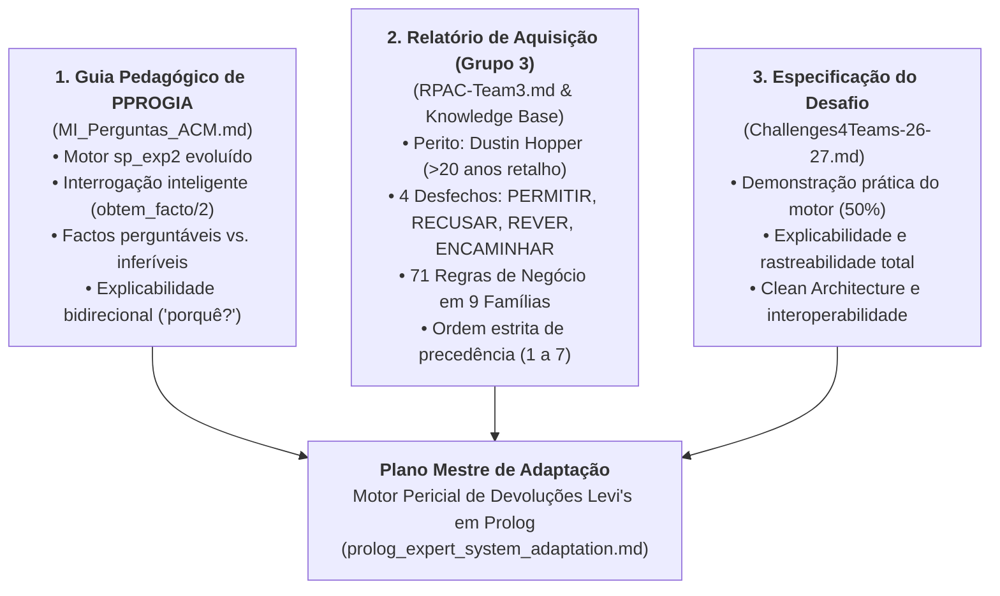
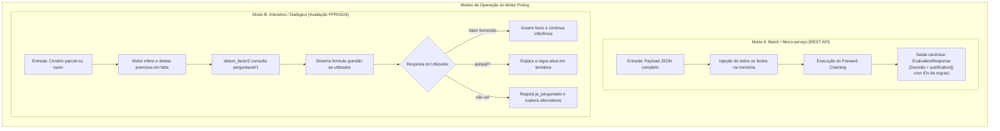
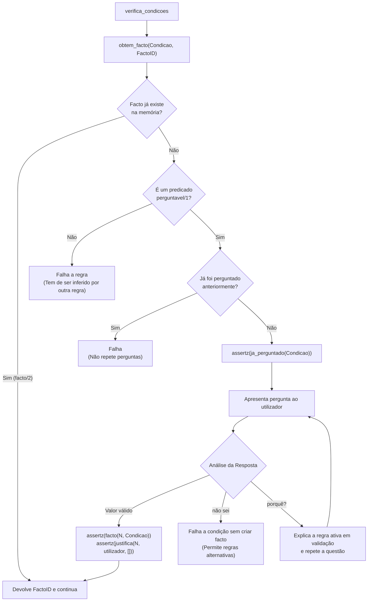
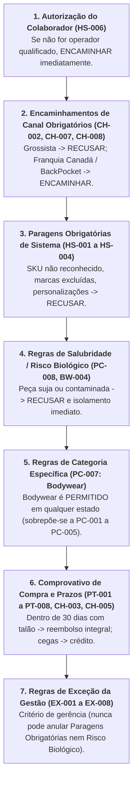
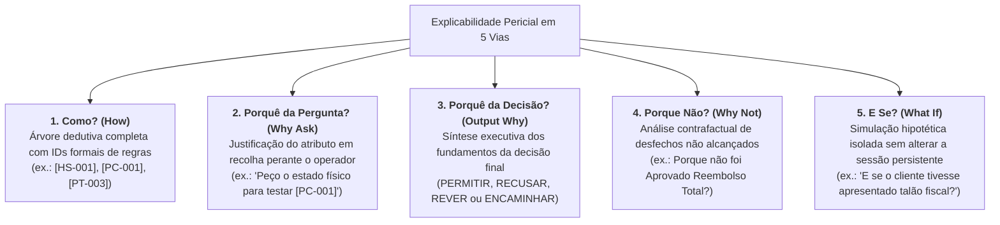
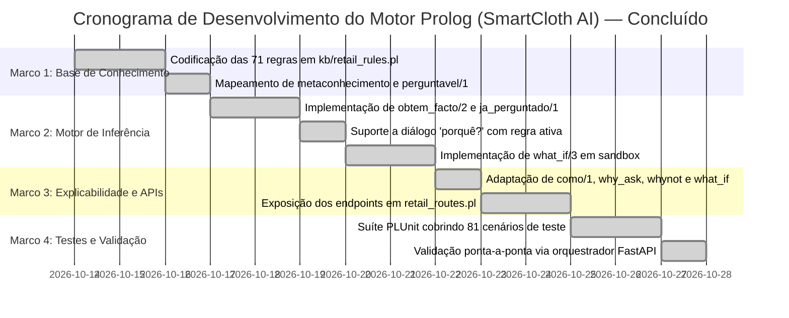

# Plano Mestre de Adaptação do Motor de Inferência em Prolog
### *Sistema Pericial de Diagnóstico para Devoluções e Trocas no Retalho*
#### *Mestrado em Engenharia de Inteligência Artificial (MEIA 2026/2027) — ISEP / GECAD*

---

> [!NOTE]
> **Estado do Plano: 100% Implementado e Validado.**
> Todas as fases de adaptação foram concluídas com sucesso, validadas por **81/81 testes PLUnit** (incluindo 31 de regras, 18 de explicabilidade, 12 de interatividade dialógica, 12 de API REST e 8 do motor académico de paridade) e **153/153 testes Pytest** no backend orquestrador FastAPI.

## 1. Enquadramento e Síntese das Fontes Oficiais

Este documento constitui o guia arquitetural e concetual de referência para a adaptação e evolução do motor de inferência dedutivo em **SWI-Prolog** ([`prolog_engine/`](../../prolog_engine)). 

Ele sintetiza e harmoniza três fontes estruturantes do projeto:



---

## 2. A Arquitetura Dual do Motor: Modo Batch vs. Modo Dialógico

Para satisfazer simultaneamente a arquitetura de micro-serviços do ecossistema e as exigências pedagógicas do corpo docente, o motor é concebido para operar em dois modos complementares:



---

## 3. A Mecânica do Professor ACM: Evolução do `sp_exp2`

Conforme detalhado em [`MI_Perguntas_ACM.md`](../material_aulas/MI_Perguntas_ACM.md), o motor fornecido originalmente (`sp_exp2.pl`) era estático: se um facto não constava na memória antes do arranque, a regra simplesmente não disparava.

### 3.1 A Modificação Nuclear: `obtem_facto/2`
No motor original, a verificação de condições recorria cegamente a `facto(N, X)`. Na versão adaptada, substitui-se por `obtem_facto(X, N)`:



### 3.2 Código Prolog da Infraestrutura de Interrogação

```prolog
:- dynamic ja_perguntado/1.
:- dynamic regra_ativa/2.

% ==============================================================================
% Núcleo de Resolução de Factos: obtem_facto/2
% ==============================================================================

% 1. O facto já se encontra na memória de trabalho
obtem_facto(F, N) :-
    facto(N, F), !.

% 2. O facto está ausente mas é perguntável e ainda não foi questionado
obtem_facto(F, N) :-
    perguntavel(F),
    \+ ja_perguntado(F),
    assertz(ja_perguntado(F)),
    pergunta_ao_utilizador(F, Resposta),
    Resposta \== nao_sei,
    regista_resposta_utilizador(Resposta, N).

% ==============================================================================
% Registo da Resposta do Utilizador com Rastreabilidade
% ==============================================================================
regista_resposta_utilizador(TermoFacto, N) :-
    retract(ultimo_facto(N1)),
    N is N1 + 1,
    asserta(ultimo_facto(N)),
    assertz(facto(N, TermoFacto)),
    assertz(justifica(N, utilizador, [])). % Marcação de origem para o como/1
```

### 3.3 Tratamento da Pergunta "Porquê?" (*Why Ask*)
Quando o sistema questiona o utilizador e este digita `"porquê?"` (ou `"why"`):
1. O motor consulta o predicado dinâmico `regra_ativa(RegraID, ConclusaoAlvo)`;
2. Recupera o identificador formal da regra (ex.: `[PC-001]`) e a justificação textual associada;
3. Exibe:
   > *"Estou a perguntar se o artigo tem etiquetas afixadas porque estou a tentar validar a regra [PC-001] para determinar se o produto é elegível para PERMITIR a devolução."*
4. Reapresenta a questão original para recolha do valor.

---

## 4. Modelação do Domínio de Retalho da Levi's

Com base no relatório [`RPAC-Team3.md`](../material_aulas/RPAC-Team3.md) e na [`Returns & Exchanges Knowledge Base.md`](../material_aulas/Returns%20&%20Exchanges%20Knowledge%20Base.md), a base de conhecimento modela 71 regras distribuídas por 9 famílias operacionais.

### 4.1 Os Quatro Desfechos Canónicos (`OUT-001`)
Todo o processo de avaliação deduz um e apenas um dos quatro desfechos fundamentais:
* **`decisao(permitir)`:** Transação elegível; reembolso ou troca autorizado pela política padrão.
* **`decisao(recusar)`:** Violação insanável de regras imperativas (marca excluída, lavado, fora de prazo sem exceção).
* **`decisao(rever)`:** Situação ambígua que requer juízo humano do gestor de turno (*XStore Manager* / *Key Holder*).
* **`decisao(encaminhar)`:** Canal ou procedimento exige um sistema externo (*BackPocket*, processo de franquia do Canadá).

---

### 4.2 As 9 Famílias de Regras da Levi's

| Família | Nome | Total Regras | Descrição e Âmbito |
|:---|:---|:---:|:---|
| **`HS`** | *Hard Stops* | 6 | Paragens obrigatórias absolutas: SKU inválido, marcas excluídas (Dockers, LS Signature, Beyond Yoga), peças alteradas/embainhadas e credenciais do colaborador. |
| **`PC`** | *Product Condition* | 8 | Estado físico do artigo: etiquetas intactas, soltas, sem etiquetas, lavado, claramente usado, defeito de fabrico, insalubre/risco biológico e regime especial de *bodywear*. |
| **`PT`** | *Proof & Timeframe* | 8 | Validação documental e temporal: comprovativo fiscal, prazo de 30 dias, devolução às cegas e ajuste de preço no limite de 14 dias. |
| **`CH`** | *Channel & Store Type* | 10 | Interação entre canais: lojas Mainline, Outlet, comércio eletrónico (levi.com / levi.ca), franquia canadiana e grossistas autorizados. |
| **`TN`** | *Refund Tender* | 12 | Determinação do meio financeiro de estorno: integridade do método original, cartões bancários, Afterpay, vales e restrições de numerário. |
| **`EP`** | *Exchange & Promotion* | 7 | Regras de trocas diretas: substituição de tamanho preserva promoções ativas; alteração de modelo sujeita ao preço de venda atual. |
| **`EX`** | *Manager Review* | 8 | Limites formais de intervenção hierárquica e tratamento de contestações operacionais de balcão. |
| **`CT`** | *Authorization Controls* | 8 | Auditoria e procedimentos de conformidade: operador autorizado no POS, assinaturas e retenção documental. |
| **`BW`** | *Bodywear Disposition* | 4 | Encaminhamento logístico de artigos de vestuário íntimo devolvidos (revenda, liquidação a 50%, destruição sanitária). |

---

### 4.3 Ordem Estrita de Precedência (Resolução de Conflitos)

Quando múltiplos factos são verdadeiros em simultâneo, o motor aplica a hierarquia formal definida na **Secção 4.6 do RPAC**:



---

### 4.4 Factos Perguntáveis vs. Factos Inferíveis

Seguindo o princípio de ouro de ACM (*“Perguntar evidências observáveis; inferir classificações e decisões”*):

```prolog
% ==============================================================================
% Metaconhecimento de Interrogação: Factos Perguntáveis
% ==============================================================================

perguntavel(colaborador_autorizado(_)).       % IN-001: true / false
perguntavel(sku_reconhecido(_)).              % IN-007: true / false
perguntavel(marca_artigo(_, _)).              % IN-007: levis / dockers / beyond_yoga
perguntavel(artigo_personalizado(_)).         % IN-007: true / false
perguntavel(categoria_artigo(_, _)).          % IN-007: bodywear / vestuario_geral
perguntavel(defeito_fabrico(_)).              % IN-008: true / false
perguntavel(estado_fisico(_, _)).             % IN-008: novo_etiquetas_colocadas / novo_etiquetas_soltas / novo_sem_etiquetas / lavado / usado / contaminado
perguntavel(canal_aquisicao(_, _)).           % IN-003: mainline / outlet / levi_com / levi_ca / grossista / franquia_canada
perguntavel(tem_comprovativo(_)).             % IN-004: true / false
perguntavel(tipo_comprovativo(_, _)).         % IN-004: recibo_fiscal / talao_oferta / digital_order / blind
perguntavel(dias_desde_compra(_, _)).         % IN-006: Inteiro >= 0
perguntavel(tipo_pedido(_)).                  % IN-005: devolucao / troca / ajuste_preco
perguntavel(metodo_pagamento_original(_, _)). % IN-009: numerario / cartao_credito / debito / afterpay / gift_card
```

**Factos que NUNCA são perguntáveis (são estritamente inferidos pelo sistema):**
* `decisao(permitir)`
* `decisao(recusar)`
* `decisao(rever)`
* `decisao(encaminhar)`
* `elegibilidade_produto(_, _)`
* `janela_temporal(_, _)`
* `risco_biologico(_)`

---

## 5. Especificação das 5 Vias de Explicabilidade Pericial

A transparência algorítmica constitui o principal critério de avaliação prática do projeto. O motor implementa nativamente cinco perspetivas de diagnóstico:



---

### 5.1 Via 1: Como? (*How*) — Rastreabilidade Causal
* **Comando Prolog:** `como(FactoID)`.
* **Mecânica:** Percorre a cadeia de justificações `justifica(N, RegraID, FactosSuporte)`. Se a origem for `utilizador`, reporta explicitamente:
  > *“O facto nº 4 (estado_fisico = unworn_clean) foi fornecido pelo utilizador.”*
  > *“Concluiu-se o facto nº 7 (decisao = permitir) pela regra [PT-003] com base nos factos [4, 5, 6].”*

---

### 5.2 Via 2: Porquê da Pergunta? (*Why Ask*) — Interrogação Contextual
* **Comando:** Invocado quando o operador digita `porquê?` durante a solicitação de um facto perguntável.
* **Mecânica:** Identifica a regra candidata em avaliação e reporta a política associada:
  > *“Estou a perguntar os dias decorridos desde a compra para validar a regra [PT-003], que autoriza reembolso integral para transações com comprovativo até 30 dias.”*

---

### 5.3 Via 3: Porquê da Decisão? (*Output Why*) — Justificação Executiva
* **Saída:** Vetor estruturado `justification: list[str]` transmitido no contrato REST.
* **Mecânica:** Sintetiza as conclusões terminais disparadas, associando a cada uma o identificador normativo:
  ```json
  {
    "status": "success",
    "decision": "permitir",
    "justification": [
      "[HS-006] Colaborador devidamente credenciado para operações de POS.",
      "[HS-001] SKU 00501-0115 validado e reconhecido no catálogo de loja.",
      "[PC-001] Peça em estado novo, sem lavagem e com etiquetas originais afixadas.",
      "[PT-003] Comprovativo fiscal apresentado dentro do prazo regulamentar de 30 dias (14 dias decorridos).",
      "[TN-001] Reembolso integral aprovado no meio original de liquidação (Cartão Visa)."
    ]
  }
  ```

---

### 5.4 Via 4: Porque Não? (*Why Not*) — Análise de Desfechos Recusados
* **Comando Prolog:** `whynot(decisao(permitir))`.
* **Mecânica:** Localiza todas as regras que poderiam concluir `decisao(permitir)` e reporta as premissas que falharam:
  > *“A conclusão decisao(permitir) não foi alcançada porque:*
  > *Pela regra [PC-001]: a premissa estado_fisico(novo_etiquetas_colocadas) é falsa (o artigo foi reportado como lavado);*
  > *Pela regra [PC-006]: a premissa defeito_fabrico(true) é falsa.”*

---

### 5.5 Via 5: E Se? (*What-If*) — Simulação Contrafactual em Sandbox
* **Assinatura:** `what_if(+FactosHipoteticos, +FactosRemovidos, -ResultadoComparativo)`.
* **Mecânica:**
  1. Cria um snapshot da memória de trabalho (`facto/2`, `justifica/3`, `ultimo_facto/1`);
  2. Aplica as modificações hipotéticas (ex.: adiciona `tem_comprovativo(true)` e remove `tem_comprovativo(false)`);
  3. Reexecuta `arranca_motor`;
  4. Extrai a nova decisão e compara com a decisão original (*diff* de desfecho);
  5. Restaura deterministicamente a memória de trabalho original através do operador ISO `setup_call_cleanup/3`, garantindo zero poluição na base persistente.

---

## 6. Exemplo de Codificação das Regras na DSL do Prolog

Abaixo ilustra-se a transposição de regras das várias famílias para a sintaxe do motor:

```prolog
% ==============================================================================
% Família HS: Hard Stops (Paragens Obrigatórias)
% ==============================================================================

% HS-006: Falta de autorização do colaborador
regra hs_006 se [colaborador_autorizado(false)]
             entao [cria_facto(decisao(encaminhar)),
                    cria_facto(motivo("[HS-006] Colaborador sem credenciais de POS. Encaminhar para Gestor de Loja ou Lead Cashier."))].

% HS-002: Marcas excluídas da rede Levi's
regra hs_002 se [marca_artigo(Artigo, Marca) e memberchk(Marca, [dockers, signature, beyond_yoga])]
             entao [cria_facto(decisao(recusar)),
                    cria_facto(motivo("[HS-002] Marca excluída da política de devolução em loja Levi's."))].

% HS-003: Peças alteradas ou personalizadas
regra hs_003 se [artigo_personalizado(Artigo, true)]
             entao [cria_facto(decisao(recusar)),
                    cria_facto(motivo("[HS-003] Artigos alterados, embainhados ou personalizados não são elegíveis para devolução."))].

% ==============================================================================
% Família PC: Product Condition (Condição do Artigo)
% ==============================================================================

% PC-008: Risco Biológico / Insalubridade
regra pc_008 se [estado_fisico(Artigo, contaminado)]
             entao [cria_facto(decisao(recusar)),
                    cria_facto(risco_biologico(Artigo)),
                    cria_facto(motivo("[PC-008] Recusa estrita por risco biológico e normas de saúde pública. Proceder a isolamento."))].

% PC-007: Bodywear permitido em qualquer estado
regra pc_007 se [categoria_artigo(Artigo, bodywear) e nao estado_fisico(Artigo, contaminado)]
             entao [cria_facto(elegibilidade_produto(Artigo, aprovada)),
                    cria_facto(motivo("[PC-007] Artigo de bodywear aceite em qualquer estado ao abrigo da política de garantia de satisfação."))].

% PC-001: Estado novo com etiquetas
regra pc_001 se [estado_fisico(Artigo, novo_etiquetas_colocadas)]
             entao [cria_facto(elegibilidade_produto(Artigo, aprovada)),
                    cria_facto(motivo("[PC-001] Artigo em estado novo com etiquetas originais intactas afixadas."))].

% ==============================================================================
% Família PT: Proof and Timeframe (Comprovativos e Prazos)
% ==============================================================================

% PT-003: Devolução dentro do prazo de 30 dias com recibo fiscal
regra pt_003 se [elegibilidade_produto(Artigo, aprovada) e
                 tem_comprovativo(true) e
                 tipo_comprovativo(Artigo, recibo_fiscal) e
                 avalia(dias_desde_compra(Artigo, =<, 30))]
             entao [cria_facto(decisao(permitir)),
                    cria_facto(modalidade_reembolso(meio_original)),
                    cria_facto(motivo("[PT-003] Reembolso integral aprovado no meio original de pagamento dentro da janela de 30 dias."))].

% PT-005: Devolução às cegas (sem comprovativo)
regra pt_005 se [elegibilidade_produto(Artigo, aprovada) e
                 tem_comprovativo(false)]
             entao [cria_facto(decisao(rever)),
                    cria_facto(modalidade_reembolso(store_credit_only)),
                    cria_facto(motivo("[PT-005] Devolução às cegas restrita a troca ou crédito em cartão de oferta ao preço mínimo histórico."))].
```

---

## 7. Roteiro de Implementação e Verificação Experimental

Todos os quatro marcos técnicos foram concluídos e validados a 100%, garantindo total conformidade com os critérios de avaliação prática do Challenge 1:

| Marco Técnico | Componentes Concretizados | Estado de Validação | Testes Associados |
|:---|:---|:---:|:---|
| **Marco 1: Base de Conhecimento** | Codificação integral das 71 regras Levi's em `kb/retail_rules.pl`, metaconhecimento de disparo (`facto_dispara_regras/2`) e 41 predicados `perguntavel/1`. | Concluído (100%) | 31 testes em `test_retail_rules.pl` |
| **Marco 2: Motor de Inferência** | Motor modular em `retail_engine/engine.pl`, mecânica ACM de `obtem_facto/2`, tratamento `nao_sei` com `ja_perguntado/1`, interrogação "porquê?" com `regra_ativa/2` e simulação sandbox `what_if/3` via `setup_call_cleanup/3`. | Concluído (100%) | 12 testes em `test_retail_interactive.pl` |
| **Marco 3: Explicabilidade e APIs** | As 5 vias periciais (*How*, *Why Ask*, *Why Decision*, *Why Not*, *What-If* sandbox) e os 7 endpoints REST `/retail/*` em `retail_routes.pl`. | Concluído (100%) | 18 testes em `test_retail_explainability.pl` e 12 em `test_retail_api.pl` |
| **Marco 4: Testes e Orquestração** | Suíte integrada de 81 testes PLUnit no Prolog, 153 testes Pytest no FastAPI, suporte a `PROLOG_ENGINE_MODE` e rotas `/api/v1/retail/*`. | Concluído (100%) | 81 testes PLUnit e 24 testes em `test_retail_prolog.py` |



---

## 8. Documentos Relacionados

* [Análise da Engenharia do Motor sp_exp2](sp_exp2_engine_analysis.md) — Dissecação profunda da mecânica do código original `sp_exp2.pl`.
* [Arquitetura do Motor Prolog](prolog_engine.md) — Clean Architecture interna, isolamento por paridade e ciclo de vida do micro-serviço SWI-Prolog.
* [Base de Conhecimento e Heurísticas do Perito](../domain/expert_knowledge.md) — As 71 regras de retalho codificadas e precedências normativas.
* [Modelo de Explicabilidade](../domain/explainability.md) — Formalização das 5 vias de explicabilidade pericial em Prolog vs. Drools.
* [Referência da API do Motor Prolog](../api/prolog_engine_api.md) — Especificação técnica dos 7 endpoints `/retail/*` e rotas `/inference/*`.
* [Estratégia de Testes](../development/testing.md) — Validação das 81 asserções PLUnit e testes do orquestrador.
* [Arquitetura do Motor Drools](drools_engine.md) — Implementação comparativa das 98 regras no motor de produção Drools (Java).
