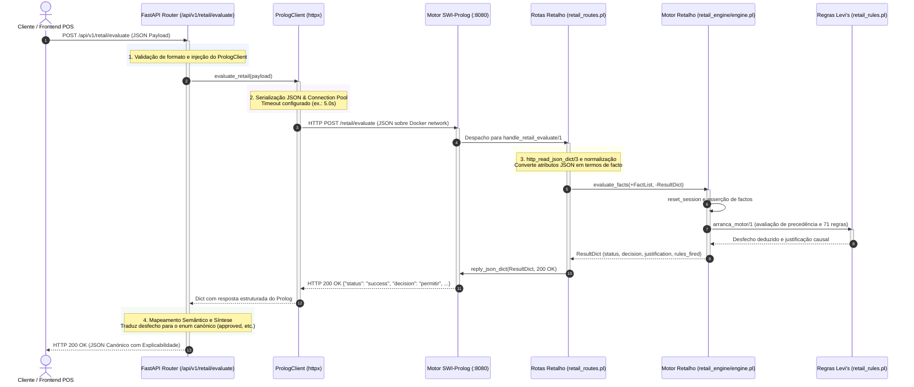
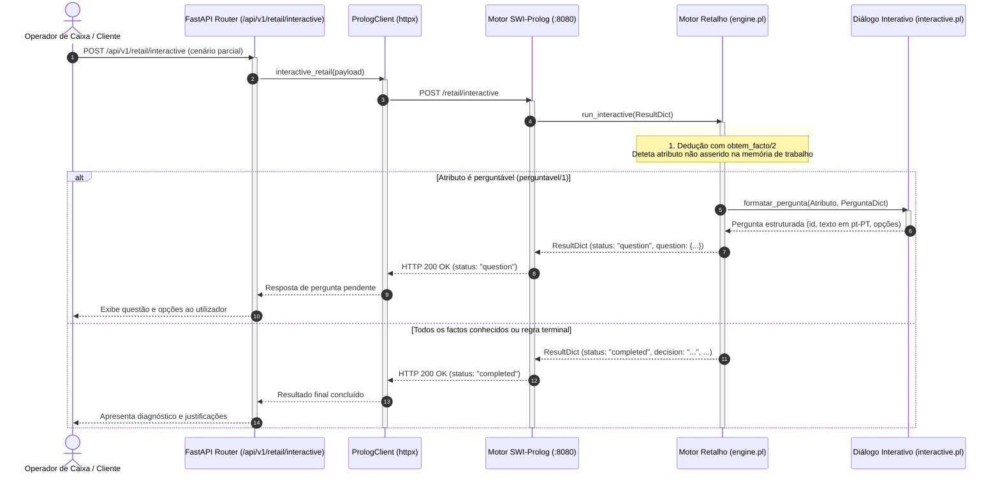
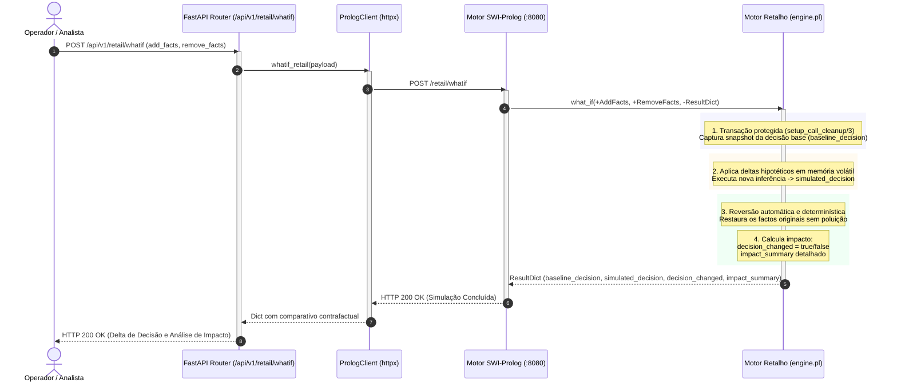
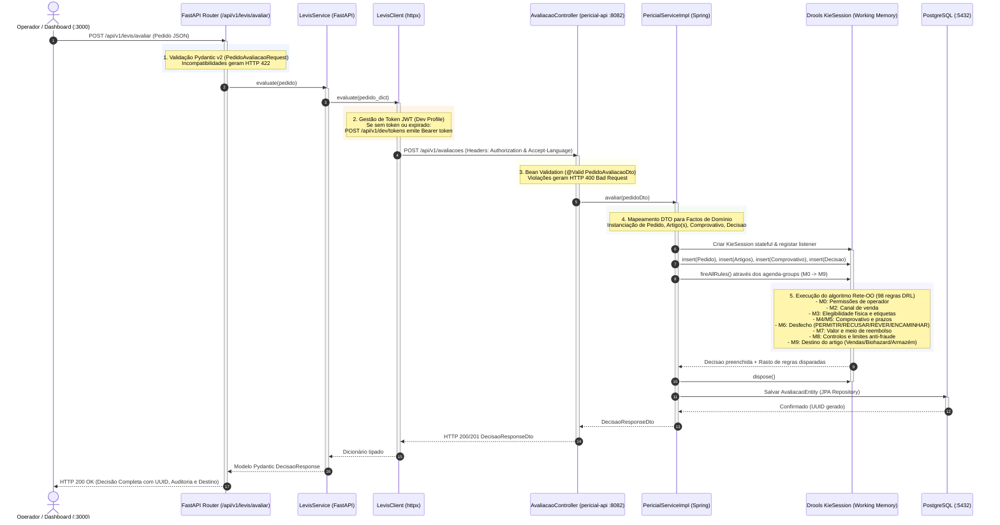
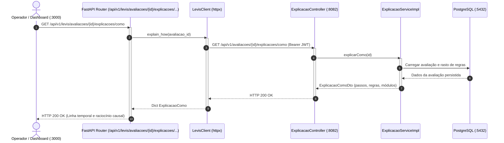
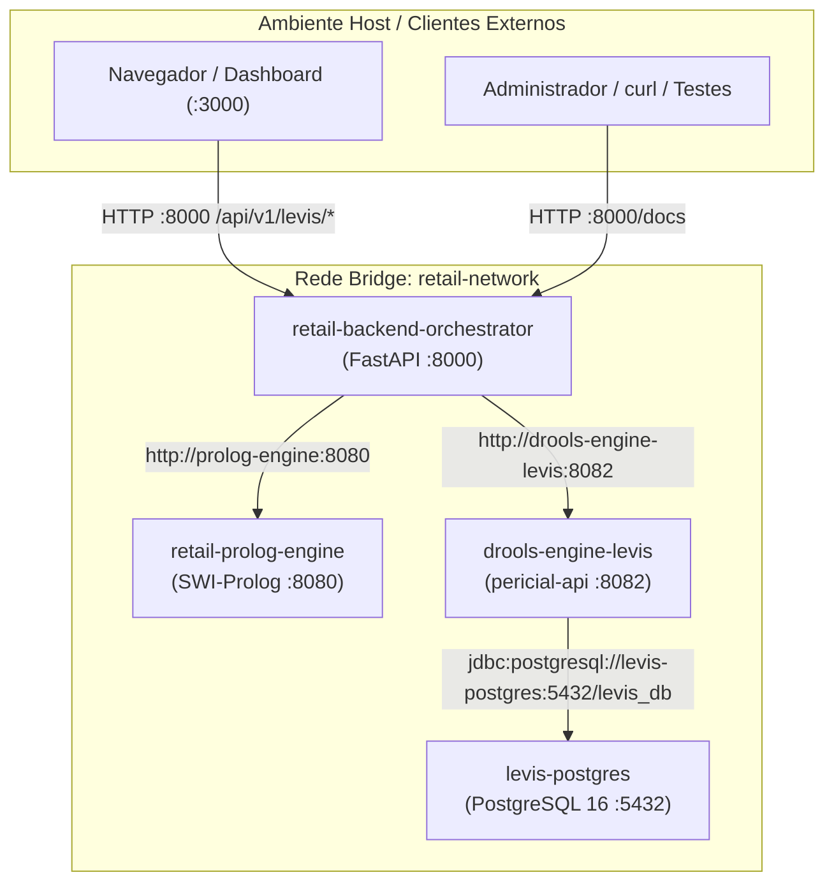

# Interações entre Serviços e Fluxos de Dados
### *Sistema Pericial de Diagnóstico para Devoluções e Trocas no Retalho*

---

## 1. Visão Geral da Comunicação

Num sistema distribuído de inteligência artificial pericial, a integridade da comunicação entre o orquestrador e os motores de regras é fundamental. 

O ecossistema integra dois motores simbólicos independentes para diagnóstico e triagem no retalho:
1. **Motor SWI-Prolog (`prolog_engine` :8080):** Lógica declarativa de primeira ordem que inclui o **Motor Pericial de Retalho da Levi's** (71 regras normativas em 9 famílias, interrogação dialógica ACM, 5 vias de explicabilidade e simulação contrafactual em sandbox) e o motor académico de veículos preservado sob o Princípio do Isolamento por Paridade.
2. **Motor Drools Levi's (`drools-engine-levis-devolucoes-java` / `pericial-api` :8082):** Regras de produção Rete-OO em Java 21 / Spring Boot 3 para o caso de uso real de Devoluções e Trocas da **Levi Strauss & Co.** (98 regras DRL nos módulos M0 a M9), com persistência relacional em PostgreSQL 16 (`levis-postgres` :5432) e explicabilidade multi-via.

Este documento detalha o ciclo de vida completo das transações ponta-a-ponta de ambos os motores, os fluxos dialógicos e contrafactuais, as transformações de dados através das fronteiras de camada, o mapeamento semântico de decisões e as matrizes de tratamento de exceções.

---

## 2. Diagramas de Sequência Ponta-a-Ponta (End-to-End)

### 2.1 Avaliação Canónica em Lote com Motor Prolog (`POST /api/v1/retail/evaluate`)

O diagrama abaixo descreve a interação completa de avaliação em lote desde a submissão do cenário pelo cliente/frontend até à resposta final sintetizada:

---

### 2.2 Fluxo Dialógico Interativo ACM (`POST /api/v1/retail/interactive`)

Quando um cenário é submetido com atributos omissos, o motor de retalho aciona a mecânica dialógica ACM baseada em `obtem_facto/2` e `perguntavel/1`:

---

### 2.3 Simulação Contrafactual What-If em Sandbox (`POST /api/v1/retail/whatif`)

O endpoint de simulação *What-If* permite avaliar cenários hipotéticos sem poluir o estado da sessão de trabalho, tirando partido de transações em memória protegidas por `setup_call_cleanup/3`:

---

### 2.4 Ciclo de Vida do Pedido com Motor Drools Levi's (Devoluções e Trocas de Retalho)

O diagrama abaixo ilustra a cadeia completa de processamento do motor Drools Levi's, incluindo a obtenção de token JWT dev, submissão de factos ao motor KIE, execução das 98 regras, persistência em PostgreSQL e extração de justificações:

---

### 2.5 Fluxo de Explicabilidade em Tempo Real (Drools: *Como?* e *Porque Não?*)

Quando o utilizador ou o operador de caixa solicita esclarecimentos sobre o porquê de uma decisão:

---

## 3. Pipelines de Transformação de Dados por Camada

### 3.1 Pipeline do Motor SWI-Prolog (Retalho Declarativo)

| Etapa | Fronteira / Componente | Formato de Dados | Exemplo / Representação |
|:---:|:---|:---|:---|
| **1** | Entrada no FastAPI | JSON Textual (HTTP Stream) | `{"has_receipt": true, "days_since_purchase": 14, ...}` |
| **2** | Camada de Rota | Dicionário Python / Schema | Payload tipado via `Body(...)` |
| **3** | Cliente HTTPX (`PrologClient`) | JSON Serializado | Bytes em stream HTTP `POST /retail/evaluate` |
| **4** | Camada HTTP Prolog | *Prolog Dict* com tag | `json{has_receipt: true, days_since_purchase: 14}` |
| **5** | Camada Core Prolog | Termos Nativos Prolog | `[facto(has_receipt, true), facto(days_since_purchase, 14)]` |
| **6** | Dedução Normativa | 71 Regras da Levi's | Disparo prioritário de `PT-003` (Troca normal) |
| **7** | Resposta do Prolog | JSON Serializado | `{"status": "success", "decision": "permitir", "justification": [...]}` |
| **8** | Retorno ao Orquestrador | Dicionário Python | `{"status": "success", "decision": "permitir", ...}` |
| **9** | Mapeamento Semântico | Enum Canónico | Conversão de `"permitir"` para `DecisionEnum.APPROVED` |
| **10**| Resposta Canónica Final | JSON Canónico OpenAPI | Payload estruturado com rasto de regras e explicabilidade |

### 3.1.1 Mapeamento Semântico de Decisões no Orquestrador

O orquestrador FastAPI (`app/services/orchestrator_service.py`) implementa uma estratégia resiliente de normalização semântica, mapeando átomos em português emitidos pelo motor Prolog para o modelo canónico `DecisionEnum`:

| Átomo / Resposta Prolog | Enum Canónico FastAPI (`DecisionEnum`) | Semântica de Negócio no Retalho |
|:---|:---|:---|
| `"permitir"`, `"aprovado"`, `"approved"` | `DecisionEnum.APPROVED` | Devolução ou troca plenamente elegível para processamento. |
| `"recusar"`, `"rejeitado"`, `"rejected"` | `DecisionEnum.REJECTED` | Devolução rejeitada por violação de política ou condição física. |
| `"rever"`, `"encaminhar"`, `"manager_override"` | `DecisionEnum.MANAGER_OVERRIDE` | Requer intervenção, autorização ou decisão de um gerente de loja. |
| `"vale_loja"`, `"credito_loja"`, `"store_credit_only"` | `DecisionEnum.STORE_CREDIT_ONLY` | Elegível exclusivamente para crédito em cartão ou vale de loja. |
| `"error"` (ou status `error`) | `DecisionEnum.ERROR` | Erro técnico, payload malformado ou inconsistência operacional. |

### 3.2 Pipeline do Motor Drools Levi's (Retalho Especializado)

| Etapa | Fronteira / Componente | Formato de Dados | Exemplo / Representação |
|:---:|:---|:---|:---|
| **1** | Entrada no FastAPI | JSON Textual (HTTP Stream) | `{"tipoPedido": "DEVOLUCAO", "canal": "LOJA_FISICA", "artigos": [...]}` |
| **2** | Camada de Rota FastAPI | Schema Pydantic v2 | `PedidoAvaliacaoRequest(tipoPedido='DEVOLUCAO', ...)` |
| **3** | Cliente HTTPX (`LevisClient`) | JSON com Headers JWT | `POST /api/v1/avaliacoes` + `Authorization: Bearer <jwt>` |
| **4** | Controller Spring Boot | Record Java com Jakarta Validation | `PedidoAvaliacaoDto(tipoPedido, canal, artigos, ...)` |
| **5** | Camada de Domínio Java | Factos de Domínio Puros | `Pedido`, `Artigo`, `Comprovativo`, `Decisao` |
| **6** | Working Memory (Drools 8.44) | Factos em Memória (Rete-OO) | `kSession.insert(pedido)`, disparo por `agenda-group` |
| **7** | Execução de Regras | Dedução e Modificação de Factos | `PT-003`, `PT-020`, `modify($dec) { setElegibilidade(...) }` |
| **8** | Persistência Relacional | Entidade JPA / Hibernate | `AvaliacaoEntity` gravada no PostgreSQL com ID UUID |
| **9** | Resposta da API Spring | DTO Java Imutável | `DecisaoResponseDto(id, elegibilidade, valorReembolso, ...)` |
| **10**| Retorno ao Orquestrador | Dict Python Deserializado | `{"id": "...", "elegibilidade": "PERMITIR", ...}` |
| **11**| Resposta Canónica FastAPI | Schema Pydantic `DecisaoResponse` | Objeto validado com destino de artigos e rastreabilidade |

---

## 4. Topologia de Rede e Resolução DNS

No ambiente operacional com **Docker Compose**, todos os serviços comunicam através da rede interna virtualizada em modo bridge (`retail-network`):

### Configuração de URLs e Portas por Ambiente:

| Variável de Ambiente | Valor em Docker Compose | Valor Local (Host) | Descrição |
|:---|:---|:---|:---|
| `PORT` | `8000` | `8000` | Porta do orquestrador FastAPI. |
| `PROLOG_ENGINE_URL` | `http://prolog-engine:8080` | `http://localhost:8080` | Endpoint do daemon SWI-Prolog. |
| `DROOLS_ENGINE_URL` | `http://drools-engine-levis:8082` | `http://localhost:8082` | Endpoint do micro-serviço Drools Levi's. |
| `SPRING_DATASOURCE_URL`| `jdbc:postgresql://levis-postgres:5432/levis_db` | `jdbc:postgresql://localhost:5432/levis_db` | Conexão JDBC para persistência PostgreSQL. |

---

## 5. Matriz de Códigos de Erro e Tratamento de Exceções

O orquestrador interceta falhas dos motores de regras e traduz-as em respostas HTTP normativas:

| Cenário de Erro | Componente / Causa Raiz | Deteção / Exceção Interna | Código HTTP Devolvido | Payload de Erro / Descrição |
|:---|:---|:---|:---:|:---|
| **JSON de Entrada Inválido (Prolog)** | Sintaxe corrompida ou campos em falta na rota de retalho | Pydantic `ValidationError` | `422 Unprocessable Entity` | Detalhe dos campos com falha de validação |
| **JSON de Entrada Inválido (Levi's)** | Payload sem `tipoPedido` ou sem artigos | Pydantic `ValidationError` | `422 Unprocessable Entity` | `"O pedido de avaliação exige 'tipoPedido' e pelo menos um artigo em 'artigos'."` |
| **Violação Bean Validation (Drools)** | Violação de formato no Spring Boot (`@Valid`) | `LevisResponseError` (HTTP 400 da API Drools) | `400 Bad Request` | Mensagem detalhada de violação Bean Validation |
| **Motor Prolog Desligado** | Daemon Prolog offline ou porta 8080 inacessível | `httpx.ConnectError` $\rightarrow$ `PrologConnectionError` | `503 Service Unavailable` | `"Could not connect to Prolog engine at '...'"` |
| **Motor Drools Levi's Desligado** | Processo `pericial-api` offline ou porta 8082 inacessível | `httpx.ConnectError` $\rightarrow$ `LevisConnectionError` | `503 Service Unavailable` | `"Could not connect to Levi's Drools engine at '...'"` |
| **Timeout de Inferência (Prolog)** | Resposta excede `PROLOG_TIMEOUT_SECONDS` (omissão 5.0s) | `httpx.TimeoutException` $\rightarrow$ `PrologTimeoutError` | `503 Service Unavailable` | `"Prolog engine timed out after 5.0s during evaluation"` |
| **Timeout de Inferência (Levi's)** | Inferência excede `DROOLS_TIMEOUT_SECONDS` (omissão 8.0s) | `httpx.TimeoutException` $\rightarrow$ `LevisTimeoutError` | `503 Service Unavailable` | `"Levi's Drools engine timed out during evaluation"` |
| **Erro de Gateway (Drools 500)** | Falha interna no Drools ou PostgreSQL | `LevisResponseError` (status $\ge$ 500) | `502 Bad Gateway` | Erro amigável sem exposição de rastos internos |

---

## 6. Coexistência Multi-Motor e Comparação de Desfechos

Com a implementação integral do motor pericial de retalho em Prolog e a integração do micro-serviço Drools Levi's, o sistema consolida o seu compromisso de arquitetura multi-paradigma:

1. **Rotas Dedicadas por Motor:**
   - `/api/v1/retail/*` comunica com o motor pericial de retalho **SWI-Prolog** (71 regras Levi's, ACM e 5 vias de explicabilidade).
   - `/api/v1/evaluate` disponibiliza chaveamento automático ou por query param (`?mode=retail`, `academic`, `dual`).
   - `/api/v1/inference/*` comunica com o motor académico **SWI-Prolog** (veículos `sp_exp2.pl`).
   - `/api/v1/levis/*` comunica com o motor de produção **Drools Levi's** (98 regras DRL em Java 21).
2. **Comparação Cruzada de Desfechos:**
   A arquitetura permite submeter o mesmo cenário de retalho a ambos os motores para confrontar a dedução lógica declarativa com a inferência baseada em regras de produção Rete-OO, garantindo máxima fiabilidade na auditoria de políticas comerciais de retalho.

---

## 7. Documentos Relacionados

* [Visão Global da Arquitetura do Sistema](system_overview.md) — Diagrama e princípios globais do ecossistema.
* [Arquitetura do Motor Prolog](prolog_engine.md) — Clean Architecture interna, isolamento por paridade e ciclo de vida do micro-serviço SWI-Prolog.
* [Arquitetura do Motor Drools](drools_engine.md) — Módulos, regras DRL e persistência do Drools Levi's.
* [Arquitetura do Orquestrador FastAPI](fastapi_orchestrator.md) — Camadas internas, lifespan e connection pooling em Python.
* [Base de Conhecimento e Heurísticas do Perito](../domain/expert_knowledge.md) — As 71 regras normativas e 7 níveis de precedência.
* [Modelo de Explicabilidade](../domain/explainability.md) — As 5 vias de explicabilidade pericial em Prolog vs. Drools.
* [Referência da API Pública v1](../api/orchestrator_api_v1.md) — Especificação detalhada dos endpoints `/api/v1/retail/*` e `/api/v1/levis/*`.
* [Referência da API do Motor Prolog](../api/prolog_engine_api.md) — Especificação técnica dos endpoints `/retail/*` e `/inference/*`.
* [Orquestração com Docker Compose](../deployment/docker_compose.md) — Topologia de rede, variáveis e contentores.
