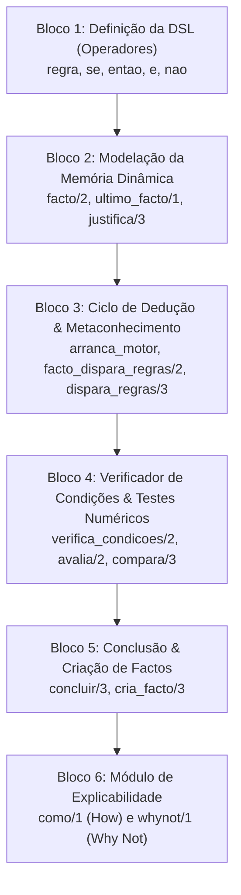
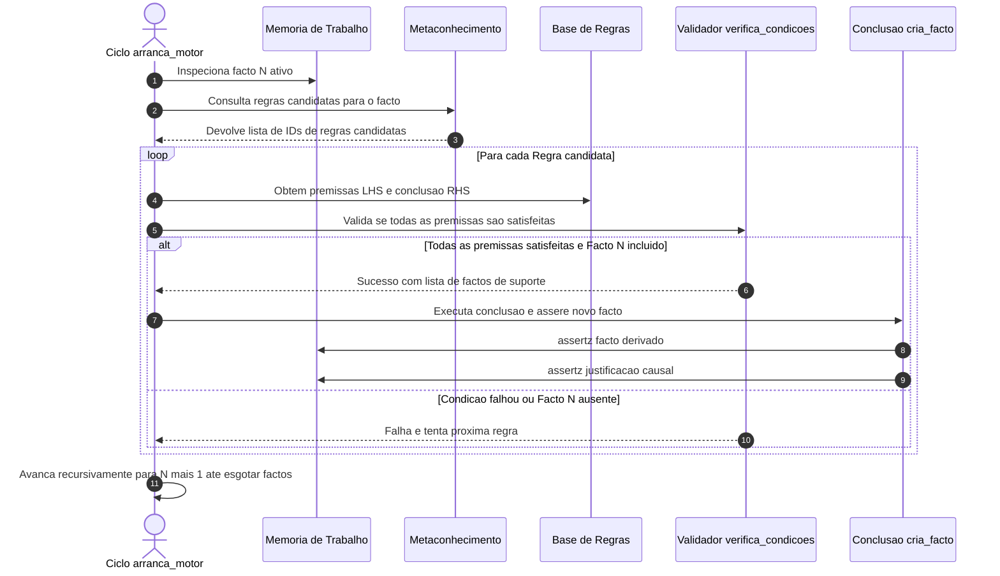
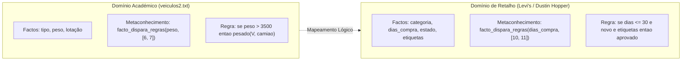

# Análise Aprofundada do Motor de Inferência Académico (sp_exp2.pl)
### *Dissecação Estrutural, Mecânica de Execução e Roteiro de Adaptação Pericial*

---

## 1. Enquadramento e Objetivo da Análise

Este documento fornece uma análise técnica e concetual exaustiva do motor de inferência pericial [`sp_exp2.pl`](../../prolog_engine/Ficheiros%20de%20Apoio%20Sistemas%20Periciais_%20sp_exp1.pl,%20sp_exp2.pl%20e%20base%20de%20conhecimento-20260928/sp_exp2.pl), disponibilizado pelo corpo docente no âmbito das unidades curriculares de **Engenharia do Conhecimento em IA (ENGCIA)** e **Paradigmas de Programação em IA (PPROGIA)** do **Mestrado em Engenharia de Inteligência Artificial (MEIA)**.

O objetivo primordial desta análise consiste em:
1. **Desmistificar o código-fonte** fornecido, explicando detalhadamente a sua sintaxe declarativa e estratégias de controlo lógico;
2. **Avaliar as capacidades existentes** de inferência e explicabilidade nativa (*How* e *Why Not*);
3. **Identificar as lacunas estruturais** face aos requisitos do sistema pericial de diagnóstico de **Devoluções e Trocas no Retalho (Levi Strauss & Co.)**;
4. **Estabelecer um roteiro técnico** para permitir que os membros da equipa adaptem e completem autonomamente o motor, integrando as 5 vias de explicabilidade pericial (*Como, Porquê Perguntar, Porquê da Decisão, Porque Não e E Se*).

---

## 2. Visão Global: Mapa dos 6 Blocos Estruturantes

O motor de inferência [`sp_exp2.pl`](../../prolog_engine/Ficheiros%20de%20Apoio%20Sistemas%20Periciais_%20sp_exp1.pl,%20sp_exp2.pl%20e%20base%20de%20conhecimento-20260928/sp_exp2.pl) é composto por aproximadamente 150 linhas de código Prolog declarativo puro, estruturadas organicamente em seis blocos funcionais:



---

## 3. Dissecação Detalhada Bloco a Bloco

### 3.1 Bloco 1: A Gramática Declarativa (Operadores / DSL)

Para aproximar a sintaxe das regras da linguagem humana e dispensar notações aninhadas complexas, o motor define cinco operadores com recurso ao predicado nativo `op/3`:

```prolog
:- op(220, xfx, entao).
:- op(35,  xfy, se).
:- op(240, fx,  regra).
:- op(500, fy,  nao).
:- op(600, xfy, e).
```

#### Mecânica dos Operadores:
* `op(Precedencia, Tipo, Nome)`: Define a força de ligação relativa de cada símbolo. Números inferiores ligam com maior prioridade que números superiores.
* `xfx` (Infixo não-associativo): Obriga a que o operador `entao` separe a expressão em duas partes estritas: `[LHS] entao [RHS]`.
* `xfy` (Infixo associativo à direita): Permite ligar o identificador da regra ao corpo: `regra ID se [Corpo]`.
* `fx` / `fy` (Prefixos): `regra` atua como marcador inicial e `nao` implementa a negação por falha prefixa sobre uma condição.
* `e` (Infixo de conjunção): Liga premissas compostas no antecedente (`Cond1 e Cond2 e Cond3`).

**Expressão Resultante no Ficheiro de Regras:**
```prolog
regra 1 se [tipo(V, passageiros) e classe(V, ligeiro)] entao [cria_facto(ligeiro(V, carro))].
```
Internamente, o Prolog compila esta linha para a seguinte estrutura de termos:
`se(regra(1), entao([e(tipo(V, passageiros), classe(V, ligeiro))], [cria_facto(ligeiro(V, carro))]))`.

---

### 3.2 Bloco 2: Modelação da Memória Dinâmica

A memória de trabalho (*Working Memory*) do motor é gerida por três predicados dinâmicos:

```prolog
:- dynamic justifica/3.
% Na base de conhecimento de apoio:
:- dynamic facto/2, ultimo_facto/1.
```

1. **`facto(ID, Conteudo)`:**  
   Armazena cada facto individual numerado sequencialmente por um identificador inteiro positivo.
   ```prolog
   facto(1, lotacao(meu_veiculo, 3)).
   facto(2, peso(meu_veiculo, 4500)).
   facto(3, tipo(meu_veiculo, mercadorias)).
   ```
2. **`ultimo_facto(N)`:**  
   Mantém um apontador único para o índice do facto mais recente asserido na memória. É utilizado para controlar a numeração sequencial e como critério de paragem do ciclo de inferência.
3. **`justifica(FactoID, RegraID, ListaFactosSuporte)`:**  
   Regista a genealogia dedutiva de cada facto derivado. Esta tripla é a fundação de todo o subsistema de justificação causal (*How*).
   * Exemplo: `justifica(4, 6, [2])` declara formalmente que o facto 4 foi deduzido pela Regra 6 tendo como premissa factual o facto 2.

---

### 3.3 Bloco 3: Ciclo de Dedução Forward-Chaining e Metaconhecimento

O motor implementa um algoritmo de encadeamento para a frente (*Forward Chaining*) baseado em indexação numérica:



#### O Ponto de Entrada do Ciclo (`arranca_motor/0`):
```prolog
arranca_motor :-
    facto(N, Facto),
    facto_dispara_regras1(Facto, LRegras),
    dispara_regras(N, Facto, LRegras),
    ultimo_facto(N).
```
1. `facto(N, Facto)`: Gera pontos de escolha sobre os factos da memória de trabalho, iterando de $N = 1$ em diante.
2. `facto_dispara_regras1/2`: Protege o motor contra falhas nos casos em que um facto não tem metaconhecimento mapeado, devolvendo uma lista vazia `[]`.
3. `dispara_regras/3`: Percorre as regras candidatas para o facto ativo.
4. `ultimo_facto(N)`: Cláusula de terminação. Assegura que o ciclo só encerra quando o índice do facto processado coincide com o limite superior da memória de trabalho.

#### O Papel Crítico do Metaconhecimento (`facto_dispara_regras/2`):
Num sistema pericial puro sem indexação, a inserção de um novo facto exigiria avaliar exaustivamente todo o conjunto de regras ($O(R \times F)$). O metaconhecimento introduz uma camada de indexação declarativa:
```prolog
facto_dispara_regras(tipo(_, mercadorias), [2, 8]).
facto_dispara_regras(peso(_, _), [6, 7]).
```
Quando o motor processa o facto `peso(meu_veiculo, 4500)`, filtra imediatamente o universo de regras e avalia **única e exclusivamente as regras 6 e 7**, garantindo excelente eficiência computacional.

---

### 3.4 Bloco 4: Validação Estrutural e Numérica de Condições

A avaliação do antecedente lógico (`LHS`) é realizada pelo predicado `verifica_condicoes/2`:

```prolog
% 1. Conjunção com negação numérica
verifica_condicoes([nao avalia(X) e Y], [nao X|LF]) :- !,
    \+ avalia(_, X),
    verifica_condicoes([Y], LF).

% 2. Conjunção com teste numérico afirmativo
verifica_condicoes([avalia(X) e Y], [N|LF]) :- !,
    avalia(N, X),
    verifica_condicoes([Y], LF).

% 3. Conjunção com negação factual
verifica_condicoes([nao X e Y], [nao X|LF]) :- !,
    \+ facto(_, X),
    verifica_condicoes([Y], LF).

% 4. Conjunção afirmativa padrão
verifica_condicoes([X e Y], [N|LF]) :- !,
    facto(N, X),
    verifica_condicoes([Y], LF).

% 5. Casos base singulares (termo terminal)
verifica_condicoes([nao avalia(X)], [nao X]) :- !, \+ avalia(_, X).
verifica_condicoes([avalia(X)], [N])         :- !, avalia(N, X).
verifica_condicoes([nao X], [nao X])         :- !, \+ facto(_, X).
verifica_condicoes([X], [N])                 :- facto(N, X).
```

#### A Decomposição e Avaliação Relacional (`avalia/2`):
Para resolver condições como `avalia(peso(V, >, 3500))`, o motor emprega o operador de meta-programação `=..` (*univ*):
```prolog
avalia(N, P) :-
    P =.. [Functor, Entidade, Operando, Valor],
    P1 =.. [Functor, Entidade, Valor1],
    facto(N, P1),
    compara(Valor1, Operando, Valor).
```
* `P =.. [...]`: Desmonta a expressão relacional em 4 elementos: `Functor = peso`, `Entidade = V`, `Operando = >`, `Valor = 3500`.
* `P1 =.. [...]`: Reconstrói a consulta ao facto correspondente na memória: `peso(V, Valor1)`.
* `compara/3`: Avalia deterministicamente o operador aritmético correspondente (`==`, `\==`, `>`, `<`, `>=`, `=<`).

---

### 3.5 Bloco 5: Resolução e Conclusão de Factos

Quando o antecedente de uma regra é integralmente validado, o motor dispara o consequente (`RHS`):

```prolog
concluir([cria_facto(F)|Y], ID, LFactos) :-
    !,
    cria_facto(F, ID, LFactos),
    concluir(Y, ID, LFactos).
concluir([], _, _) :- !.

cria_facto(F, _, _) :-
    facto(_, F), !. % Prevenção estrita de duplicados na memória

cria_facto(F, ID, LFactos) :-
    retract(ultimo_facto(N1)),
    N is N1 + 1,
    asserta(ultimo_facto(N)),           % Atualiza índice sequencial
    assertz(justifica(N, ID, LFactos)), % Regista certidão dedutiva
    assertz(facto(N, F)),               % Insere o novo facto derivado
    write('Foi concluído o facto nº '), write(N), write(' -> '), write(F), get0(_), !.
```
* **Prevenção de Ciclos e Duplicação:** A primeira cláusula de `cria_facto/3` assegura que factos idênticos não são introduzidos repetidamente, prevenindo explosão combinatória ou ciclos recursivos infinitos.
* **Bloqueio de Terminal:** A presença de `get0(_)` interrompe o fluxo de execução até que o utilizador pressione uma tecla na consola.

---

### 3.6 Bloco 6: O Módulo de Explicabilidade Nativo

O ficheiro `sp_exp2.pl` fornece primitivas para dois modos de interrogação:

#### 1. Explicações do Tipo "Como" (`como/1` — How):
Inspeciona retrospetivamente a cadeia de dedução de um facto:
```prolog
como(N) :- justifica(N, ID, LFactos), !,
    facto(N, F),
    write('Conclui o facto nº '), write(N), write(' -> '), write(F), nl,
    write('pela regra '), write(ID), nl,
    write('por se ter verificado que:'), nl,
    escreve_factos(LFactos),
    explica(LFactos).
como(N) :- facto(N, F),
    write('O facto nº '), write(N), write(' -> '), write(F), nl,
    write('foi conhecido inicialmente'), nl.
```
* O predicado percorre recursivamente a árvore até encontrar as folhas (factos que não possuem entrada em `justifica/3` e que, portanto, foram introduzidos inicialmente).

#### 2. Explicações do Tipo "Porque Não" (`whynot/1` — Why Not):
Identifica o motivo pelo qual uma dada conclusão pretendida não foi gerada:
```prolog
whynot(Facto) :-
    encontra_regras_whynot(Facto, LLPF),
    whynot1(LLPF, 1).

encontra_regras_whynot(Facto, LLPF) :-
    findall((ID, LPF),
        (
            regra ID se LHS entao RHS,
            member(cria_facto(Facto), RHS),
            encontra_premissas_falsas(LHS, LPF),
            LPF \== []
        ),
        LLPF).
```
* Localiza todas as regras que poderiam ter derivado `Facto` no seu consequente.
* Executa `encontra_premissas_falsas/2` sobre o antecedente de cada regra candidata para isolar e reportar as condições que falharam.

---

## 4. Matriz de Capacidades: O Que Há vs. O Que Falta

A tabela abaixo sintetiza o balanço estrutural entre a implementação fornecida pelos docentes e os requisitos reais do projeto MEIA:

| Funcionalidade / Dimensão | Estado no `sp_exp2.pl` Original | Requisito do Projeto MEIA (Retail Returns) | Impacto / Ação Necessária |
|:---|:---:|:---:|:---|
| **Mecanismo de Inferência** | Forward Chaining com Metaconhecimento | Forward Chaining determinístico | **Manter e otimizar:** A mecânica de disparo indexado por metaconhecimento é robusta e deve ser preservada. |
| **Operação Não-Interativa** | Não suportado: Interativo via terminal (`write`, `read`, `get0`) | Daemon HTTP / Microsserviço assíncrono (Clean Architecture) | **Já resolvido na POC:** O módulo [`engine.pl`](../../prolog_engine/src/core/inference/engine.pl) eliminou I/O de consola, retornando Prolog Dicts. |
| **Como? (*How*)** | Suportado: Implementado (`como/1`) | Explicação estruturada da cadeia causal | **Adaptar:** Traduzir termos simbólicos para linguagem natural de retalho (`justification[]`). |
| **Porque Não? (*Why Not*)** | Suportado: Implementado (`whynot/1`) | Diagnóstico contrafactual de recusa | **Adaptar:** Reportar impedimentos comerciais concretos (ex.: ausência de recibo, prazo ultrapassado). |
| **Porquê da Decisão (*Output Why*)** | Não suportado: Inexistente (conclui factos avulsos) | Síntese de desfecho canónico (`approved`, `rejected`, etc.) | **Desenvolver:** Implementar agregação terminal de regras para produzir a resposta executiva de negócio. |
| **Why? da Pergunta (*Why Ask*)** | Não suportado: Inexistente (assume factos prévios) | Justificação em tempo de interrogação de dados em falta | **Desenvolver:** Introduzir suporte a premissas perguntáveis (*askable*) e justificação da meta ativa. |
| **E Se? (*What-If*)** | Não suportado: Inexistente | Simulação hipotética sem efeitos secundários na base persistente | **Desenvolver:** Criar mecanismo de sandbox que permita injetar/remover factos e computar o diferencial de decisão. |
| **Domínio de Conhecimento** | Académico (Classificação de Veículos) | Triagem de Devoluções no Retalho (Levi Strauss & Co.) | **Substituir:** Codificar as heurísticas do perito Dustin Hopper ([`expert_knowledge.md`](../domain/expert_knowledge.md)). |

---

## 5. Mapeamento Concetual: Veículos vs. Retalho Levi's

A transposição das estruturas de dados do exemplo académico para o domínio de retalho é direta e preserva a mesma semântica de regras:



### Exemplos Comparativos de Modelação:

#### 1. Factos de Entrada:
* **Veículos:**
  ```prolog
  facto(1, lotacao(meu_veiculo, 3)).
  facto(2, peso(meu_veiculo, 4500)).
  ```
* **Retalho:**
  ```prolog
  facto(1, categoria(artigo1, jeans)).
  facto(2, dias_compra(artigo1, 14)).
  facto(3, estado(artigo1, unworn_clean)).
  facto(4, etiquetas(artigo1, intactas)).
  ```

#### 2. Metaconhecimento de Disparo:
* **Veículos:**
  ```prolog
  facto_dispara_regras(peso(_, _), [6, 7]).
  ```
* **Retalho:**
  ```prolog
  facto_dispara_regras(categoria(_, intimo), [1, 2]).
  facto_dispara_regras(dias_compra(_, _), [10, 11, 12]).
  ```

#### 3. Regra com Validação Numérica e Lógica:
* **Veículos:**
  ```prolog
  regra 6 se [avalia(peso(V, >, 3500))] entao [cria_facto(classe(V, pesado))].
  ```
* **Retalho:**
  ```prolog
  regra 10 se [avalia(dias_compra(Artigo, =<, 30)) e estado(Artigo, unworn_clean) e etiquetas(Artigo, intactas)]
          entao [cria_facto(elegibilidade(Artigo, aprovada_reembolso_integral))].
  ```

---

## 6. Roteiro Técnico para Adaptação e Extensão

Para que a equipa complete o motor de forma independente e estruturada, recomenda-se a seguinte ordem de trabalhos:

### Fase A: Modelação da Base de Conhecimento de Retalho (`retail_returns.pl`)
1. Criar o ficheiro `src/core/inference/kb/retail_returns.pl`.
2. Mapear as heurísticas de [`expert_knowledge.md`](../domain/expert_knowledge.md) para a DSL do motor:
   * **Higiene e Artigos Íntimos:** Regras de tolerância zero para risco biológico;
   * **Defeito de Fabrico:** Sobreposição a etiquetas e prazos;
   * **Prazos:** Diferenciação entre janela normal ($\le 30$ dias), alargada ($31$ a $60$ dias) e expirada ($> 60$ dias);
   * **Comprovativos:** Regras para recibo fiscal, talão de oferta (*gift receipt*) e ausência de recibo (*blind return*).
3. Construir as cláusulas de `facto_dispara_regras/2` correspondentes.

### Fase B: Implementação do Subsistema "What-If" (Simulação Contrafactual)
1. Criar um predicado determinístico `simulate_what_if(+FactosNovos, +FactosRemovidos, -ComparacaoDict)`.
2. Implementar a estratégia de isolamento de estado:
   * Extrair um snapshot de todos os termos `facto/2` e `justifica/3`;
   * Aplicar as alterações hipotéticas;
   * Disparar `arranca_motor`;
   * Recolher a nova decisão deduzida;
   * Restaurar o estado original da memória dinâmica (garantindo ausência de efeitos secundários na sessão persistente).

### Fase C: Implementação do Subsistema "Why da Pergunta" (Interrogação Ativa)
1. Declarar predicados de atributos perguntáveis:
   ```prolog
   perguntavel(etiquetas(Artigo, _), "O artigo possui as etiquetas originais afixadas?").
   ```
2. Na verificação de condições, caso uma premissa esteja ausente mas seja perguntável:
   * Suspender a resolução da regra e registar a questão em pilha;
   * Associar à pergunta a regra ativa e o objetivo pretendido:
     ```prolog
     justificacao_pergunta(Pergunta, RegraID, Objetivo)
     ```
   * Permitir que o operador submeta `"why"`, retornando a justificação formal do motivo da solicitação daquele atributo.

### Fase D: Exposição REST e Testes PLUnit
1. Expandir o módulo `src/api/inference_routes.pl` para suportar os novos endpoints `/inference/whatif` e `/inference/why_question`.
2. Desenvolver a suíte de testes unitários automatizados em `tests/test_retail_inference.pl` cobrindo todos os cenários de aprovação, rejeição sanitária, crédito em loja e intervenção de gerência.

---

## 7. Documentos Relacionados

* [Arquitetura Interna do Micro-serviço SWI-Prolog](prolog_engine.md) — Clean Architecture e camada HTTP.
* [Base de Conhecimento e Heurísticas do Perito](../domain/expert_knowledge.md) — Especificação conceptual das regras de negócio.
* [Requisito Primordial: Explicabilidade e Transparência](../domain/explainability.md) — Contratos e auditoria de justificações.
* [Motor Drools Levi's e Explicabilidade em 5 Vias](drools_engine.md) — Implementação comparativa em regras de produção Java.
* [Código do Motor Adaptado](../../prolog_engine/src/core/inference/engine.pl) — Implementação de referência desacoplada de I/O.
