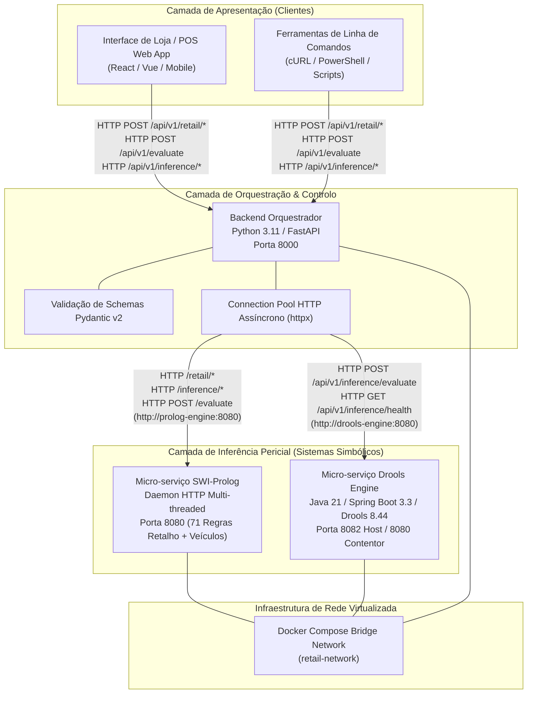

# Visão Global da Arquitetura do Sistema
### *Sistema Pericial de Diagnóstico para Devoluções e Trocas no Retalho*

---

## 1. Visão Geral do Ecossistema

O sistema adota uma arquitetura de micro-serviços distribuídos orientada a **inferência baseada em conhecimento**, separando de forma estrita o canal de comunicação e validação de dados da execução das regras de diagnóstico.

A solução é desenhada para permitir que múltiplos motores de inteligência artificial simbólica — **SWI-Prolog** (lógica declarativa de primeira ordem) e **Apache KIE Drools** (regras de produção Rete-OO) — avaliem cenários clínicos e de devolução de mercadorias no retalho, fornecendo decisões determinísticas e cadeias de justificação auditáveis (*Why / Why not*).

No micro-serviço SWI-Prolog, o sistema disponibiliza dois motores de inferência completos e isolados por paridade:
1. **Motor Pericial de Retalho da Levi's (`/retail/*`):** Implementação completa com 71 regras normativas, diálogo interativo ACM e 5 vias de explicabilidade.
2. **Motor Académico de Veículos (`/inference/*`):** Adaptação do motor `sp_exp2.pl` de referência pedagógica.

---

## 2. Componentes Estruturais do Sistema

### 2.1 Camada de Apresentação (Frontend / POS App)
* **Função:** Ponto de contacto com os operadores de balcão e gerentes de loja.
* **Comunicação:** Comunica **exclusivamente** com o Backend Orquestrador através da API REST pública na porta `8000`. Nunca interage diretamente com os motores de inferência.
* **Estado:** Planeado para o roadmap futuro do projeto.

### 2.2 Backend Orquestrador (FastAPI)
* **Função:** Ponto central de receção, validação, encaminhamento e agregação de respostas.
* **Tecnologia:** Python 3.11 com framework assíncrono **FastAPI** e biblioteca de validação **Pydantic v2**.
* **Responsabilidades:**
  1. Validação estrita de contratos de dados de entrada e serialização canónica de saída.
  2. Gestão de ciclo de vida e connection pooling via cliente HTTP assíncrono (`httpx.AsyncClient`).
  3. Conversão de erros de rede ou timeouts em códigos HTTP normativos (`503 Service Unavailable`, `400 Bad Request`).
  4. Suporte a Cross-Origin Resource Sharing (CORS) para interfaces web.
  5. Camada de serviço e clientes tipados para orquestração de cenários (`OrchestratorService`) e inferência pericial (`InferenceService` / `InferenceClient`).
  6. Controle funcional através de feature toggles (`INFERENCE_ENGINE_ENABLED`).
  7. Ponto de extensão para auditoria comparativa entre motores (Prolog vs Drools).

### 2.3 Micro-serviço Motor SWI-Prolog (`prolog-engine`)
* **Função:** Motor lógico de primeira ordem que aloja dois subsistemas de inferência pericial segmentados sob o Princípio do Isolamento por Paridade:
  * **Motor de Retalho da Levi's (Implementado e Validado):** Motor pericial normativo com 71 regras codificadas em 9 famílias temáticas (`HS`, `PC`, `PT`, `CH`, `TN`, `EP`, `EX`, `CT`, `BW`), precedência estrita de 7 níveis (RPAC-Team3), 41 atributos observáveis formulados em pt-PT, ciclo dialógico ACM com `obtem_facto/2` e `ja_perguntado/1`, e 5 vias completas de explicabilidade (*How*, *Why Ask*, *Why Decision*, *Why Not*, *What-If* sandbox). Exposto nos 7 endpoints REST `/retail/*` (`evaluate`, `interactive`, `whatif`, `how`, `whynot`, `facts`, `reset`) e validado por 73 testes PLUnit específicos.
  * **Motor Académico de Veículos (`sp_exp2.pl`):** Motor *forward-chaining* modular adaptado diretamente dos ficheiros de apoio do Moodle (`sp_exp2.pl`, `veiculos2.txt`), com metaconhecimento (`facto_dispara_regras/2`) e explicabilidade causal bidirecional (*How* / *Why Not*), preservado e exposto na família de rotas `/inference/*` com 8 testes PLUnit.
* **Tecnologia:** SWI-Prolog (versão oficial `swipl:latest`), estruturado rigorosamente em **Clean Architecture** com isolamento total entre transporte (`src/api/`) e domínio (`src/core/`).
* **Responsabilidades:**
  1. Exposição de um daemon HTTP nativo multi-threaded (`thread_httpd`) na porta `8080`.
  2. Receção de factos em JSON e conversão declarativa em dicionários Prolog (*Prolog Dicts*) e termos de facto tipados.
  3. Execução de deduções normativas em lote via `POST /retail/evaluate` e simulações interativas via `POST /retail/interactive`.
  4. Execução de simulações contrafactuais com isolamento transacional (`setup_call_cleanup/3`) em `POST /retail/whatif`.
  5. Fornecimento das 5 vias de explicabilidade pericial em tempo real (`POST /retail/how` e `POST /retail/whynot`).
  6. Preservação da linha de base académica com o motor de veículos (`POST /inference/*`).
  7. Dedução determinística dos desfechos (`approved`, `rejected`, `store_credit_only`, `manager_override`) e geração da cadeia de justificações auditáveis.

### 2.4 Micro-serviço Motor Drools (`drools-engine` — Implementado)
* **Função:** Segundo motor de inferência baseado em regras de produção (*Forward Chaining* via algoritmo Rete-OO), especializado no domínio clínico de diagnóstico diferencial de hemorragias.
* **Tecnologia:** Java 21 com Spring Boot 3.3.4, Apache KIE Drools 8.44.0.Final, Lombok e Bean Validation (Jakarta).
* **Responsabilidades:**
  1. Exposição de uma API REST na porta `8080` (contentor) / `8082` (host) com dois endpoints: `POST /api/v1/inference/evaluate` e `GET /api/v1/inference/health`.
  2. Receção de evidências clínicas em JSON (`EvidencesRequestDto`) com 13 campos binários (`yes`/`no`) validados por `@Pattern`.
  3. Conversão defensiva para factos de domínio (`Evidences`) via método `toDomain()` com normalização de valores ausentes.
  4. Inserção de factos na Working Memory, disparo do algoritmo Rete-OO (`fireAllRules`) e extração de `Hypothesis` e `Conclusion`.
  5. Rastreabilidade completa via lista `firedRules` (explicabilidade) incluída na resposta JSON.
  6. Tratamento global de erros (`GlobalExceptionHandler`) com payloads padronizados para erros 400 e 500.

---

## 3. Princípios Arquiteturais Fundamentais

### 3.1 A "Regra de Ouro": Separação Absoluta de Responsabilidades
> **REGRA DE OURO:** O Backend Orquestrador FastAPI **NÃO contém regras de negócio de retalho**.
> A sua única missão é validar contratos, orquestrar a comunicação entre sistemas e garantir resiliência. Todas as avaliações de elegibilidade de artigos, políticas de recibos, janelas temporais de devolução e regras sanitárias pertencem **exclusivamente aos motores de inferência periciais**.

### 3.2 Desacoplamento e Clean Architecture
Cada componente do sistema possui limites arquiteturais bem definidos:
* A camada core de regras do Prolog (`retail_engine/` e `inference/`) desconhece que existe uma API HTTP ou tráfego de rede.
* O orquestrador trata os motores de inferência como serviços remotos independentes através de contratos HTTP/JSON bem especificados.
* O fracasso, lentidão ou substituição de um motor de inferência não corrompe a estabilidade da camada de orquestração.

### 3.3 Resiliência e Tolerância a Falhas
* O orquestrador aplica políticas de *timeout* estritas (por omissão 5.0 segundos) para impedir que lentidão num motor bloqueie os recursos do servidor.
* Se um motor de inferência estiver inacessível, o orquestrador devolve graciosamente um erro estruturado com código HTTP `503 Service Unavailable`, prevenindo crashes em cascata.

---

## 4. Stack Tecnológica Global

| Camada | Componente | Tecnologia / Framework | Versão / Base | Porta |
|:---|:---|:---|:---|:---:|
| **Orquestração** | Backend Orchestrator | Python / FastAPI / Pydantic v2 | Python 3.11-slim | `8000` |
| **Cliente HTTP** | Async Transport Client | HTTPX (`AsyncClient`) | httpx >= 0.27.0 | — |
| **Servidor ASGI** | Web Server Gateway | Uvicorn (Standard Worker) | uvicorn >= 0.30.0 | `8000` |
| **Motor Lógico (Prolog Retalho)** | Motor Levi's (71 Regras, ACM, 5 Vias) | SWI-Prolog (`retail_engine`) | `swipl:latest` | `8080` (`/retail/*`) |
| **Motor Lógico (Prolog Académico)** | Motor de Veículos (`sp_exp2.pl`) | SWI-Prolog (`inference`) | `swipl:latest` | `8080` (`/inference/*`) |
| **Motor Lógico (Drools)** | Micro-serviço Drools Engine | Java 21 / Spring Boot 3.3 / Drools 8.44 | `eclipse-temurin:21-jre-alpine` | `8080` (contentor) / `8082` (host) |
| **Contentorização** | Virtualização de Serviços | Docker / Docker Compose | v2+ (Compose file 3.8+) | — |
| **Rede Interna** | Bridge Network | Docker Bridge (`retail-network`) | Driver nativo | — |

---

## 5. Documentos Relacionados

* [Arquitetura do Motor Prolog](prolog_engine.md) — Clean Architecture interna, isolamento por paridade e ciclo de vida do micro-serviço SWI-Prolog.
* [Arquitetura do Motor Drools](drools_engine.md) — Arquitetura interna do micro-serviço Drools Engine baseado em regras de produção.
* [Arquitetura do Orquestrador FastAPI](fastapi_orchestrator.md) — Estrutura interna de camadas, lifespan e connection pooling em Python.
* [Interações entre Serviços e Fluxos de Dados](service_interactions.md) — Diagrama de sequência ponta-a-ponta, fluxo ACM e tratamento de erros.
* [Base de Conhecimento e Heurísticas do Perito](../domain/expert_knowledge.md) — As 71 regras normativas da Levi's e 7 níveis de precedência.
* [Modelo de Explicabilidade](../domain/explainability.md) — As 5 vias de explicabilidade pericial em Prolog vs. Drools.
* [Contexto de Negócio e Enquadramento Académico](../domain/business_context.md) — Justificação teórica e caso de uso.
* [Orquestração com Docker Compose](../deployment/docker_compose.md) — Topologia e instruções operacionais de deploy.
