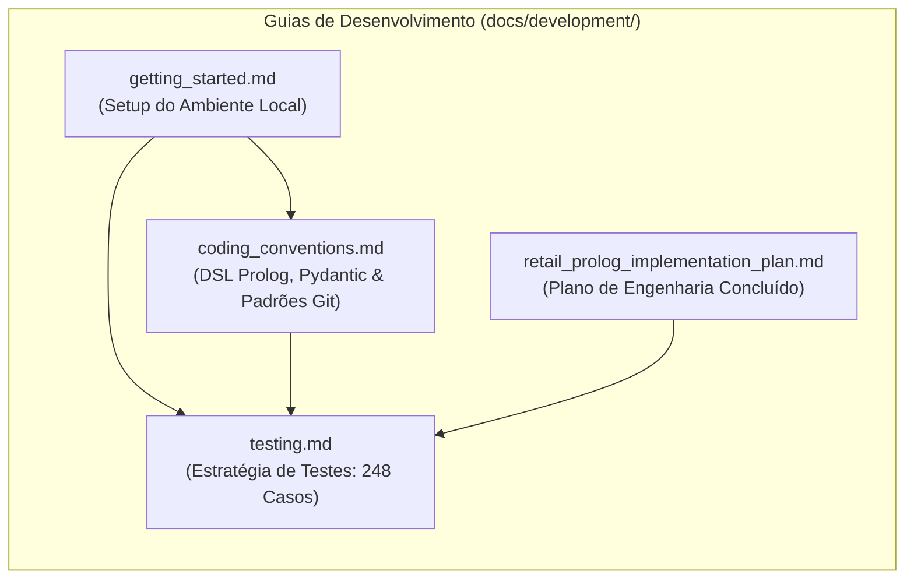

# Guias de Desenvolvimento e Engenharia
### *Sistema Pericial de Diagnóstico para Devoluções e Trocas no Retalho — MEIA 2026/2027*

---

## 1. Visão Geral

Esta secção reúne toda a documentação técnica orientada à equipa de engenharia de software e investigadores responsáveis pelo desenvolvimento, manutenção, expansão e teste do ecossistema **Retail Returns & Exchanges Diagnostic Expert System**.

O projeto conjuga três ecossistemas tecnológicos complementares:
1. **Programação em Lógica Dedutiva (SWI-Prolog):** Motor pericial com 71 regras da Levi's, 5 vias de explicabilidade pericial, interrogação dialógica com a mecânica ACM de `obtem_facto/2` e motor académico de veículos preservado (81 testes PLUnit, 100% de aprovação).
2. **Orquestração Assíncrona Orientada a Serviços (Python / FastAPI):** Validação com Pydantic v2, cliente HTTP assíncrono com pool de ligações, chaveamento por *feature toggle* (`PROLOG_ENGINE_MODE`), mapeamento semântico de decisões e transporte ASGI em memória (153 testes Pytest, 100% de aprovação).
3. **Regras de Produção Empresariais (Java 21 / Spring Boot 3 / Drools):** Motor de raciocínio *forward-chaining* com agenda Rete e validação declarativa Bean Validation (14 testes JUnit 5, 100% de aprovação).



---

## 2. Índice de Documentos da Secção

| Documento | Ficheiro | Descrição e Propósito |
|:---|:---|:---|
| **Guia de Primeiros Passos** | [`getting_started.md`](getting_started.md) | Instruções passo-a-passo para clonar o repositório, configurar ambientes virtuais, definir `PROLOG_ENGINE_MODE=retail`, arrancar os serviços (nativos ou com Docker Compose) e validar com *smoke tests* via cURL e PowerShell para `/retail/evaluate` e `/api/v1/retail/evaluate`. |
| **Estratégia e Execução de Testes** | [`testing.md`](testing.md) | Pirâmide de testes do sistema com **248 testes automatizados operacionais (100% de sucesso)**: 81 testes PLUnit em Prolog (regras Levi's, explicabilidade, diálogo ACM e API REST), 153 testes Pytest em FastAPI e 14 testes JUnit 5 em Drools. |
| **Convenções de Código e Boas Práticas** | [`coding_conventions.md`](coding_conventions.md) | Regra de ouro arquitetural (separação orquestrador ≠ regras), padrões de idioma (código em inglês, documentação em pt-PT), DSL declarativa do motor de retalho (`regra/se/entao`), 9 famílias normativas, precedência de 7 níveis, metaconhecimento e isolamento com `setup_call_cleanup/3`. |
| **Plano de Implementação do Motor de Retalho** | [`retail_prolog_implementation_plan.md`](retail_prolog_implementation_plan.md) | Plano estruturado em 5 fases para a implementação do motor de retalho da Levi's, mecânica ACM (`obtem_facto/2`), 71 regras normativas e 5 vias de explicabilidade (100% concluído). |
| **Plano de Atualização da Documentação Técnica** | [`retail_prolog_documentation_update_plan.md`](retail_prolog_documentation_update_plan.md) | Roteiro estruturado em 8 fases para sincronização exaustiva de toda a documentação técnica do repositório com o código operacional implementado. |
| **Plano de Entregas Moodle e Produção** | [`plano_organizacao_entregas_moodle_e_prod.md`](plano_organizacao_entregas_moodle_e_prod.md) | Plano de engenharia em 5 fases para autonomização dos pacotes de entrega para ENGCIA e PPROGIA e estabilização para o Demo Day. |

---

## 3. Comandos Rápidos de Desenvolvimento

### 3.1 Arranque Local Rápido (Três Terminais)

```bash
# Terminal 1 — Iniciar o Motor SWI-Prolog (Porta 8080)
cd prolog_engine
swipl src/main.pl

# Terminal 2 — Iniciar o Motor Drools Engine (Porta 8082)
cd drools_engine
mvn spring-boot:run -Dspring-boot.run.arguments=--server.port=8082

# Terminal 3 — Iniciar o Backend FastAPI com Hot Reload (Porta 8000)
# No Windows (PowerShell):
.\.venv\Scripts\Activate.ps1
python -m uvicorn app.main:app --app-dir backend_orchestrator --reload --port 8000

# No Linux / macOS (Bash):
source .venv/bin/activate
uvicorn app.main:app --app-dir backend_orchestrator --reload --port 8000
```

### 3.2 Executar Todos os Testes Automatizados

```bash
# 1. Testes do Motor Prolog (81 testes PLUnit: 100% aprovação)
swipl -g "run_tests, halt" -s prolog_engine/tests/test_retail_rules.pl
swipl -g "run_tests, halt" -s prolog_engine/tests/test_retail_explainability.pl
swipl -g "run_tests, halt" -s prolog_engine/tests/test_retail_interactive.pl
swipl -g "run_tests, halt" -s prolog_engine/tests/test_retail_api.pl
swipl -g "run_tests, halt" -s prolog_engine/tests/test_inference_engine.pl

# 2. Testes do Backend Orquestrador (153 testes Pytest: 100% aprovação)
# No Windows (PowerShell):
.\.venv\Scripts\pytest backend_orchestrator/tests -v

# No Linux / macOS (Bash):
pytest backend_orchestrator/tests -v

# 3. Testes do Motor Drools (14 testes JUnit 5: 100% aprovação)
cd drools_engine && mvn test
```

---

## 4. Matriz de Ferramentas de Desenvolvimento

| Domínio | Ferramenta / Biblioteca | Finalidade Principal |
|:---|:---|:---|
| **Motor Dedutivo** | SWI-Prolog 9.x/10.x | Daemon HTTP de inferência lógica, Clean Architecture e DSL pericial. |
| **Testes Prolog** | `library(plunit)` | Suíte de testes unitários, diálogo interativo e integração REST HTTP. |
| **Backend Web** | FastAPI + Uvicorn | Gateway assíncrono REST, injeção de dependências e servidor ASGI. |
| **Modelagem de Dados** | Pydantic v2 & `pydantic-settings` | DTOs tipados, validação de esquemas sintáticos e ficheiros `.env`. |
| **Cliente HTTP** | HTTPX (`AsyncClient`) | Cliente assíncrono resiliente com gestão de pool e timeouts. |
| **Testes Python** | Pytest, Pytest-Asyncio, Pytest-Mock | Testes de integração com transporte ASGI em memória e mocks. |
| **Motor de Regras DRL** | Red Hat Drools 8.44+ | Motor de regras de produção Java com algoritmo Rete e `KieSession`. |
| **Testes Java** | JUnit 5 + MockMvc + Spring Boot Test | Testes unitários clínicos e validação de contratos REST em Java. |
| **Type Checking** | Pyright / Pylance | Análise estática de tipagem estrita para o backend Python. |

---

## 5. Documentos Relacionados

* [Visão Geral da Arquitetura](../architecture/README.md) — Estrutura e interação entre serviços do ecossistema.
* [Arquitetura do Motor Prolog](../architecture/prolog_engine.md) — Clean Architecture, namespaces e componentes do motor SWI-Prolog.
* [Explicabilidade Pericial](../domain/explainability.md) — Modelo formal das 5 vias de explicabilidade implementadas.
* [Base de Conhecimento Pericial](../domain/expert_knowledge.md) — As 71 regras da Levi's e 7 precedências estritas.
* [Referência de APIs](../api/README.md) — Contratos REST, esquemas de entrada/saída e endpoints OpenAPI.
* [Deploy e Operações](../deployment/README.md) — Docker Compose, variáveis de ambiente e resolução de problemas.

