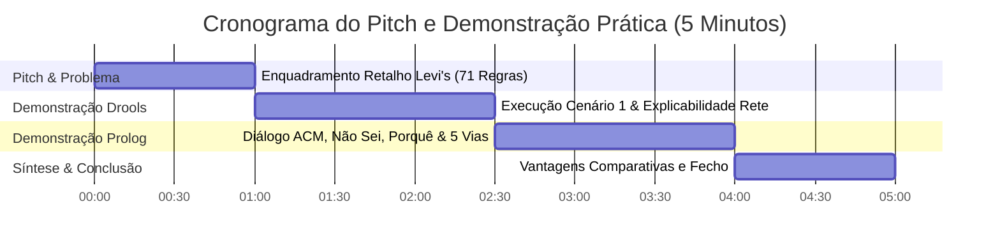

# Guião da Demonstração Prática — Demo Day (MEIA Challenge 1)
### *Sistema Pericial de Trocas e Devoluções Levi Strauss & Co.*
#### *Mestrado em Engenharia de Inteligência Artificial (2026/2027) — Grupo 3 (SmartCloth AI)*

---

## 1. Ficha Técnica da Apresentação

| Parâmetro | Detalhe |
| :--- | :--- |
| **Duração Oficial** | **5 minutos rigorosos** (1 min Pitch + 3 min Demo Prática + 1 min Síntese) + 2 min Q&A |
| **Peso na Avaliação** | **50% Demonstração Prática** + **10% Pitch perante Audiência** |
| **Oradores Sugeridos** | 2 Membros da Equipa (Orador A: Pitch + Drools; Orador B: Prolog + Síntese) |
| **Plataforma Principal** | **Dashboard Web Next.js:** [`http://localhost:3000`](http://localhost:3000) (ou espelho público [`https://challenge1.smbitsolutions.pt`](https://challenge1.smbitsolutions.pt)) |
| **Plataforma de Apoio** | Consola Interativa SWI-Prolog (`swipl -s run_console.pl`) |
| **Infraestrutura Ativa** | PostgreSQL (:5432) + Drools Java (:8082) + Prolog Engine (:8080) + FastAPI (:8000) + Dashboard (:3000) |

---

## 2. Checklist Pré-Demonstração (T-5 Minutos)

Antes de subir ao palco ou partilhar ecrã, o operador técnico deve executar a seguinte verificação:

- [ ] **1. Verificar saúde dos 4 micro-serviços:**
  ```bash
  curl -sf http://127.0.0.1:3000/api/health && \
  curl -sf http://127.0.0.1:8000/health && \
  curl -sf http://127.0.0.1:8082/actuator/health && \
  curl -sf -X POST http://127.0.0.1:8080/evaluate -H "Content-Type: application/json" -d '{"scenario":"health_check","value":42}' && \
  echo "✅ TODOS OS SERVIÇOS OPERACIONAIS"
  ```
- [ ] **2. Separadores do Navegador Pré-Abertos:**
  - Aba 1: Dashboard Principal (`http://localhost:3000`) focado no separador **"Drools (Regras)"**.
  - Aba 2: Dashboard Principal focado no separador **"Prolog (Lógica)"**.
  - Aba 3: Swagger da API de Orquestração (`http://localhost:8000/docs`).
- [ ] **3. Terminal de Contingência aberto na pasta `prolog_engine/`:**
  - Pronto com o comando: `swipl -s run_console.pl`.

---

## 3. Roteiro Minuto a Minuto da Apresentação



---

### ⏱️ Minuto 0:00 – 1:00 | O Problema de Negócio da Levi's (Pitch 10%)
**Orador:** Orador A  
**Ecrã:** Dashboard Web (Vista Geral do Sistema / Arquitetura)

* **Gancho de Abertura:**  
  *"Bom dia a todos. No retalho de vestuário de grande escala, as trocas e devoluções representam até 30% do volume transacional e biliões em perdas por fraude e decisões inconsistentes."*
* **A Complexidade do Domínio (Levi Strauss & Co.):**  
  *"A Levi's possui uma política formal rigorosa com **71 regras de negócio**, cobrindo 9 dimensões críticas: compras Mainline vs Outlet, compras online com Afterpay ou PayPal, devoluções sem recibo ('às cegas'), calças alteradas com bainha, artigos de bodywear contaminados com risco biológico e regras fiscais transfronteiriças no Canadá."*
* **A Nossa Solução — SmartCloth AI:**  
  *"No Desafio 1, a Equipa 3 construiu uma arquitetura pericial pioneira que formaliza este conhecimento em dois paradigmas complementares: um motor empresarial reativo em **Drools (Java 21)** e um motor dialógico declarativo em **SWI-Prolog**, orquestrados por uma interface moderna e explicável."*

---

### ⏱️ Minuto 1:00 – 2:30 | Demonstração Prática: Drools Engine (Java 21 / Rete-OO)
**Orador:** Orador A  
**Ecrã:** Aba **"Drools (Regras)"** no Dashboard (`http://localhost:3000`)

1. **Seleção de Cenário de Fronteira:**
   - Clicar no seletor e carregar o **Cenário 1: "As etiquetas soltas, troca ao 29.º dia"**.
   - Explicar rapidamente o caso: *Compra Mainline com recibo digital, mas o cliente traz as etiquetas soltas ao 29.º dia e pretende trocar de tamanho.*
2. **Submissão e Inferência:**
   - Clicar em **"Avaliar Pedido"** (resposta sub-segundo na porta `:8082`).
   - Apontar o resultado no ecrã:
     - **Elegibilidade:** `REVER` (Requer aprovação humana).
     - **Aprovação Solicitada:** `RESPONSAVEL_SENIOR` / Key Holder.
     - **Regras Críticas Disparadas:** `PC-002` (etiquetas soltas exigem inspeção presencial de revenda), `CH-001` (canal físico), `PT-001` (recibo válido) e `EP-001` (preservação do preço promocional na troca de tamanho).
3. **Explicabilidade Rete-OO ("Como" e "Porque Não"):**
   - Abrir o painel de **"Explicabilidade / Rasto Dedutivo"**:
     - **Como:** Mostrar a cadeia de execução encadeada pela rede Rete através dos *agenda-groups* (`validacao-contexto` $\rightarrow$ `elegibilidade-artigo` $\rightarrow$ `regras-prazo` $\rightarrow$ `consolidacao`).
     - **Porque Não:** *Porque é que o pedido não foi aprovado imediatamente com PERMITIR?* Porque a premissa `etiquetas_colocadas == false` ativou `PC-002` com salience prioritária, bloqueando a aprovação cega.

---

### ⏱️ Minuto 2:30 – 4:00 | Demonstração Prática: Prolog Engine (Lógica Declarativa & ACM)
**Orador:** Orador B  
**Ecrã:** Aba **"Prolog (Lógica)"** no Dashboard ou Terminal Interativo (`run_console.pl`)

1. **Apresentar o Diferenciador do Prolog: Aquisição Dialógica Ativa:**
   - *"Ao contrário do Drools, onde submetemos o formulário completo, o motor Prolog implementa a mecânica dialógica do Prof. ACM: o sistema interroga o utilizador apenas sobre o que realmente importa para provar a meta."*
2. **Demonstração do Diálogo Inteligente:**
   - Simular pergunta do motor: *"O artigo apresenta sujidade, risco biológico ou contaminação?"*
   - **Interação 1 — Pergunta ao Sistema: `"porquê?"`**:
     - O operador escreve `porquê?`.
     - O sistema responde com a via 2 de explicabilidade: *Exibe a regra candidata `PC-008`/`BW-004` e justifica que artigos insalubres devem ser imediatamente isolados em saco de risco biológico para salvaguardar a saúde da equipa de loja.*
   - **Interação 2 — Gestão de Incerteza: `"não sei"`**:
     - O operador responde `não_sei`.
     - O sistema não bloqueia nem aborta; assume tratamento seguro e prossegue para regras alternativas que permitam resolver o pedido ou escalar para a gerência (`manager_override`).
3. **As 5 Vias de Explicabilidade:**
   - Apontar no dashboard ou terminal:
     1. **Como (`explain_how`):** Árvore de prova dedutiva matemática em formato JSON/Árvore.
     2. **Porque Não (`explain_whynot`):** Listagem exata das premissas que falharam para que um desfecho alternativo não fosse deduzido.
     3. **E Se (`what_if`):** Simulação contrafactual sem alterar o estado do sistema.

---

### ⏱️ Minuto 4:00 – 5:00 | Síntese de Engenharia & Vantagens Comparativas
**Orador:** Orador B (com fecho por Orador A)  
**Ecrã:** Matriz Comparativa no Dashboard / Slide Final

* **Comparação Rigorosa de Paradigmas:**
  | Dimensão | Drools (Java / Rete-OO) | SWI-Prolog (Lógica Declarativa) |
  | :--- | :--- | :--- |
  | **Ponto Forte** | Agregação nativa de múltiplos artigos e listas (`PedidoDevolucao` com $N$ itens) e throughput industrial. | Explicabilidade causal transparente (árvores SLD) e diálogo interativo passo-a-passo. |
  | **Tratamento de Faltas** | DTO estático: campos nulos geram regras de validação por DRL. | Interrogação dinâmica (`obtem_facto/2`) e tolerância a `nao_sei`. |
  | **Rasto de Justificação** | Log linear de regras ativadas na agenda. | 5 Vias de Explicabilidade matemáticas (*Como, Porquê, Porque Não, E Se*). |
* **Fecho Conclusivo (15 segundos):**  
  *"Demonstrámos que a engenharia de IA de alto nível no retalho moderno beneficia da simbiose entre os dois mundos: Drools no backend de alta velocidade dos POS e Prolog no aconselhamento dialógico e auditoria explicável de balcão. Estamos disponíveis para as vossas questões. Muito obrigado!"*

---

## 4. Matriz Rápida dos 10 Cenários para Apoio ao Apresentador

Caso o júri ou os docentes solicitem a execução de um cenário específico durante a demonstração, consultar esta tabela de consulta rápida:

| ID | Cenário | Desfecho Normativo | Regras Críticas a Destacar |
| :---: | :--- | :---: | :--- |
| **01** | Etiquetas soltas ao 29.º dia | **`REVER`** | `PC-002` (inspeção), `EP-001` (preserva preço), `CT-003` |
| **02** | Cliente irritado com Afterpay online | **`ENCAMINHAR`** | `CH-002`, `TN-010` (apoio BackPocket obrigatório) |
| **03** | Devolução oferta Outlet sem recibo | **`PERMITIR`** | `PT-002`, `CH-009` (crédito de loja ao valor de escalão) |
| **04** | Calças com bainha e defeito fabrico | **`RECUSAR`** | `HS-003` (artigo alterado anula política de defeito) |
| **05** | Produto grossista em loja própria | **`RECUSAR`** | `CH-008` (canal não autorizado, devolver ao cliente) |
| **06** | Sem recibo com artigo de risco | **`REVER`** | `EX-008` (escalamento distrital), `PC-008` (saco biohazard) |
| **07** | Interac diferente no Canadá | **`REVER`** | `TN-011` (divergência física de cartão Interac Canadiano) |
| **08** | Ajuste preço c/ foto de recibo | **`RECUSAR`** | `PT-008` (fotografias de recibos não são aceites) |
| **09** | Bodywear insalubre c/ recibo | **`PERMITIR` / `RECUSAR`** | `BW-004` (isolamento de risco biológico sem manuseamento) |
| **10** | Troca tardia PayPal portal em baixo | **`REVER`** | `CH-004`, `TN-008` (procedimento alternativo com registo) |

---

## 5. Procedimentos de Emergência (Troubleshooting ao Vivo)

Se durante o Demo Day algum serviço deixar de responder:

1. **Reboot limpo em 10 segundos:**
   ```bash
   ./stop_all.sh && ./start_all.sh
   ```
2. **Se a porta do Dashboard (:3000) estiver bloqueada:**
   ```bash
   fuser -k 3000/tcp
   cd dashboard && npm run start -- -p 3000 -H 0.0.0.0 &
   ```
3. **Se o docente pedir para ver o Prolog puro sem interface web:**
   ```bash
   cd prolog_engine
   swipl -s run_console.pl
   # Na consola:
   ?- cenario(1).
   ?- como(decisao(rever)).
   ?- whynot(decisao(permitir)).
   ```
