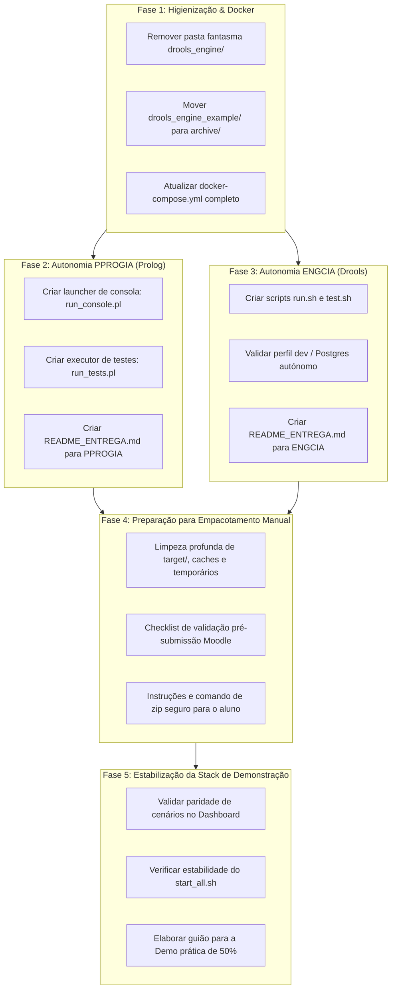

# Plano de Engenharia: Organização de Entregas Moodle e Stack de Produção
### *Autonomização dos Motores Drools (ENGCIA) e Prolog (PPROGIA) e Estabilização para o Demo Day*
#### *Mestrado em Engenharia de Inteligência Artificial (MEIA 2026/2027) — Challenge 1 · Equipa 3*

---

## 1. Enquadramento e Objetivos

O ecossistema do **Retail Returns & Exchanges Diagnostic Expert System** implementa com sucesso o conhecimento normativo de trocas e devoluções da Levi's (71 regras de negócio) em dois paradigmas complementares:
1. **Regras de Produção Empresariais:** Apache KIE Drools 8/9 com Spring Boot 3 e Java 21 ([`drools-engine-levis-devolucoes-java`](../../drools-engine-levis-devolucoes-java)).
2. **Programação Lógica Declarativa:** SWI-Prolog 9+ com Clean Architecture, mecânica dialógica ACM e 5 vias de explicação ([`prolog_engine`](../../prolog_engine)).

Para o fecho do Desafio 1, existem dois requisitos concorrentes com restrições técnicas distintas:
* **Entregas Curriculares Autónomas (Moodle):** Os docentes de **ENGCIA** e **PPROGIA** exigem submissões separadas em formato `.zip`. Cada pacote deve ser **100% autónomo**, executável sem ferramentas do outro paradigma (ex.: a entrega de Prolog não pode requerer Java ou Maven; a de Drools não pode requerer SWI-Prolog ou Python) e respeitar os limites de tamanho do Moodle (< 20 MB a 50 MB).
* **Demonstração Integrada e Pitch de Demo Day (Produção):** A equipa tem uma avaliação de 50% de demonstração prática e 10% de pitch perante o público na Semana 7. A stack integrada (Next.js Dashboard + FastAPI Orchestrator + Drools + Prolog + PostgreSQL) deve arrancar de forma reprodutível e robusta, tanto localmente como no servidor público (`challenge1.smbitsolutions.pt`).

Este plano foi desenhado para ser **executado fase a fase por um agente Gemini 3.8 Flash (High)**, garantindo passos atómicos, critérios de aceitação mensuráveis (*Definition of Done*) e zero regressões.

---

## 2. Princípios Operacionais para o Agente Executor

Ao executar este plano, o agente de IA deve respeitar as seguintes diretrizes:

1. **Preservar a Linha de Base (*Zero Regressions*):** Nenhuma alteração pode quebrar os 248 testes automatizados existentes (testes PLUnit em Prolog, JUnit 5 em Drools e Pytest em FastAPI).
2. **Isolamento de Entregas:** O monorepo permanece como espaço de desenvolvimento e demonstração integrada, mas os diretórios [`drools-engine-levis-devolucoes-java`](../../drools-engine-levis-devolucoes-java) e [`prolog_engine`](../../prolog_engine) devem possuir autonomia total de compilação, teste e documentação.
3. **Não Poluição de Binários nos ZIPs:** Os scripts de empacotamento devem eliminar obrigatoriamente `target/`, `node_modules/`, `.next/`, `.venv/`, `.git/`, logs e ficheiros temporários.
4. **Respeito pelas Convenções das UCs:**
   - Para **PPROGIA**, o docente avalia primariamente no **terminal da consola SWI-Prolog**. A consola interativa deve ser prioritária sobre a API HTTP.
   - Para **ENGCIA**, o docente avalia as regras DRL, agenda-groups, salience, relatório formal e conformidade com o modelo de domínio.
5. **Verificação Imediata:** Cada fase só é dada como concluída após a execução e validação dos comandos de verificação estipulados na respetiva *Definition of Done*.

---

## 3. Roteiro de Implementação por Fases



---

### Fase 1: Higienização da Raiz e Sincronização do Docker Compose

#### 1.1 Objetivo
Eliminar pastas residuais, arquivar código de exemplo não relacionado com a Levi's e corrigir o descritor [`docker-compose.yml`](../../docker-compose.yml) para que a stack completa possa ser compilada e executada sem erros no Docker.

#### 1.2 Contexto Técnico e Ficheiros Afetados
- `drools_engine/`: Pasta residual com apenas `target/` no seu interior.
- [`drools_engine_example/`](../../drools_engine_example): POC clínica de hemorragias, útil como histórico mas que introduz ruído na raiz.
- [`docker-compose.yml`](../../docker-compose.yml): Aponta para o caminho quebrado `./drools_engine` e omite o serviço `dashboard`.

#### 1.3 Ações de Implementação
1. **Eliminar diretoria fantasma:**
   ```bash
   rm -rf drools_engine
   ```
2. **Arquivar exemplo histórico:**
   ```bash
   mkdir -p archive
   mv drools_engine_example archive/
   ```
3. **Atualizar [`docker-compose.yml`](../../docker-compose.yml):**
   - Corrigir o contexto de build do serviço `drools-engine` para `./drools-engine-levis-devolucoes-java` (utilizando o seu Dockerfile que compila a aplicação Spring Boot `pericial-api`).
   - Adicionar o serviço `dashboard` baseado em `./dashboard/Dockerfile`, expondo a porta `3000:3000`.
   - Garantir que a rede `retail-network` interliga `levis-postgres`, `drools-engine` (:8082), `prolog-engine` (:8080), `orchestrator` (:8000) e `dashboard` (:3000).

#### 1.4 Definition of Done (DoD) & Comandos de Validação
```bash
# 1. Validar que as pastas fantasmas não existem na raiz
ls -d drools_engine 2>/dev/null && echo "FALHA: drools_engine ainda existe" || echo "OK: drools_engine removida"
ls -d archive/drools_engine_example && echo "OK: drools_engine_example arquivada"

# 2. Validar sintaxe do docker-compose
docker compose config > /dev/null && echo "OK: docker-compose.yml sintaticamente válido"

# 3. Validar que o start_all.sh nativo continua operacional
bash -n start_all.sh && echo "OK: start_all.sh sem erros de sintaxe"
```

---

### Fase 2: Autonomia e Launcher de Terminal para PPROGIA (SWI-Prolog)

#### 2.1 Objetivo
Garantir que a pasta [`prolog_engine/`](../../prolog_engine) é um pacote 100% autónomo para entrega na UC de **PPROGIA**, permitindo ao docente (Prof. ACM) avaliar imediatamente a solução na consola interativa de SWI-Prolog sem recorrer a comandos cURL ou servidores HTTP externos.

#### 2.2 Contexto Técnico e Ficheiros Afetados
- [`prolog_engine/src/core/retail_engine/engine.pl`](../../prolog_engine/src/core/retail_engine/engine.pl): Motor de dedução com 71 regras e 5 vias de explicação.
- [`prolog_engine/src/core/retail_engine/interactive.pl`](../../prolog_engine/src/core/retail_engine/interactive.pl): Lógica dialógica com `obtem_facto/2`, tratamento de `nao_sei`, resposta ao `porquê?` e `enable_terminal_mode`.
- [`prolog_engine/tests/`](../../prolog_engine/tests): Conjunto de 81 testes PLUnit operacionais.
- Ficheiros a criar:
  - `prolog_engine/run_console.pl`
  - `prolog_engine/run_tests.pl`
  - `prolog_engine/README_ENTREGA.md`

#### 2.3 Ações de Implementação

1. **Criar o Launcher de Consola Interativa (`prolog_engine/run_console.pl`):**
   Deve carregar o motor de retalho, ativar o modo de terminal e fornecer uma experiência amigável:
   ```prolog
   :- encoding(utf8).
   :- use_module(src/core/retail_engine/engine).
   :- use_module(src/core/retail_engine/interactive).

   iniciar :-
       format('~N===============================================================~n', []),
       format('  MEIA 2026/2027 · PPROGIA · Desafio 1 (Equipa 3)~n', []),
       format('  Sistema Pericial de Devoluções e Trocas Levi\'s (71 Regras)~n', []),
       format('===============================================================~n~n', []),
       format('Comandos disponíveis:~n', []),
       format('  ?- avaliar_interativo.   -> Inicia triagem guiada com perguntas.~n', []),
       format('  ?- cenario(N).           -> Executa cenário pré-definido (1 a 10).~n', []),
       format('  ?- como(Facto).          -> Explicação "Como" o facto foi deduzido.~n', []),
       format('  ?- whynot(Facto).        -> Explicação "Porque não" foi deduzido.~n', []),
       format('  ?- testar.               -> Executa a suite completa de testes PLUnit.~n~n', []),
       format('Durante as perguntas pode responder: sim, nao, nao_sei ou porquê?~n~n', []).

   avaliar_interativo :-
       enable_terminal_mode,
       run_interactive(Resultado),
       format('~N---------------------------------------------------------------~n', []),
       format('Desfecho Concluído: ~w~n', [Resultado.decision]),
       format('Total de Factos Deduzidos: ~w~n', [Resultado.derived_facts_count]),
       format('---------------------------------------------------------------~n~n', []).

   cenario(N) :-
       % Carrega e avalia factos do cenário N de forma pedagógica
       format('A executar cenário ~w...~n', [N]),
       ...

   testar :-
       run_tests.

   :- initialization(iniciar, main).
   ```

2. **Criar o Executor de Testes Batch (`prolog_engine/run_tests.pl`):**
   Script que carrega todas as suites PLUnit em `tests/` e termina com exit code apropriado para pipelines ou testes rápidos pelo docente:
   ```prolog
   :- encoding(utf8).
   :- [tests/test_retail_rules].
   :- [tests/test_retail_interactive].
   :- [tests/test_retail_explainability].
   :- [tests/test_retail_api].

   run_all :-
       run_tests,
       halt(0).

   :- initialization(run_all, main).
   ```

3. **Criar o Documento `prolog_engine/README_ENTREGA.md`:**
   - Identificação da equipa e do enquadramento curricular (PPROGIA / MEIA 2026/2027).
   - Requisitos mínimos: SWI-Prolog 9.x instalado (`swipl --version`).
   - Instrução de 1 linha para arranque da consola interativa:
     ```bash
     swipl -s run_console.pl
     ```
   - Exemplos de interação dialógica (demonstrando perguntas, resposta `"porquê?"` com exibição da regra candidata e justificação da política, e resposta `"não sei"` com progressão segura).
   - Instruções para execução dos testes unitários:
     ```bash
     swipl -s run_tests.pl
     ```
   - Secção de **Valorização Adicional**: Documentar a API REST HTTP (`src/main.pl`), endpoints Swagger/OpenAPI e suporte em contentor Docker, remetendo para a respetiva secção do enunciado.

#### 2.4 Definition of Done (DoD) & Comandos de Validação
```bash
cd prolog_engine

# 1. Validar que os testes executam e passam a 100% com o novo executor
swipl -s run_tests.pl

# 2. Validar que a consola arranca e compila sem avisos nem erros de sintaxe
swipl -q -s run_console.pl -g "iniciar, halt."

# 3. Validar a existência do ficheiro README_ENTREGA.md
test -f README_ENTREGA.md && echo "OK: README_ENTREGA.md presente"
```

---

### Fase 3: Autonomia e Execução 1-Click para ENGCIA (Drools Levi's Java)

#### 3.1 Objetivo
Garantir que a pasta [`drools-engine-levis-devolucoes-java/`](../../drools-engine-levis-devolucoes-java) é um pacote 100% autónomo para entrega na UC de **ENGCIA**, fornecendo scripts de compilação e arranque em 1 linha, perfil de dados simplificado e manual de avaliação para o docente.

#### 3.2 Contexto Técnico e Ficheiros Afetados
- 7 submódulos Maven: `pericial-model`, `pericial-rules`, `pericial-explanation`, `pericial-dto`, `pericial-persistence`, `pericial-service`, `pericial-api`.
- Ficheiros a criar na raiz de `drools-engine-levis-devolucoes-java/`:
  - `run.sh` / `run.bat`
  - `test.sh`
  - `docker-compose-minimal.yml` (sobe apenas o PostgreSQL dedicado para a API Drools)
  - `README_ENTREGA.md`

#### 3.3 Ações de Implementação

1. **Criar Scripts de Execução e Teste (`run.sh` e `test.sh`):**
   - `test.sh`:
     ```bash
     #!/bin/bash
     set -e
     echo "A executar verificação completa do motor Drools (Java 21)..."
     mvn clean verify -DskipITs=false
     echo "Testes e verificações concluídos com sucesso!"
     ```
   - `run.sh`:
     ```bash
     #!/bin/bash
     set -e
     echo "Compilando e iniciando a API Drools Levi's (:8082)..."
     mvn package -DskipTests -q
     JAR=$(ls backend/pericial-api/target/pericial-api-*.jar | head -n 1)
     java -jar "$JAR" --spring.profiles.active=dev --server.port=8082
     ```
2. **Garantir Base de Dados Mínima Autónoma:**
   - Criar `docker-compose-minimal.yml` dentro de `drools-engine-levis-devolucoes-java/` para que o docente de ENGCIA não tenha de configurar o PostgreSQL manualmente:
     ```yaml
     services:
       postgres:
         image: postgres:16-alpine
         container_name: drools-levis-postgres
         ports:
           - "5432:5432"
         environment:
           POSTGRES_DB: pericial
           POSTGRES_USER: pericial
           POSTGRES_PASSWORD: pericial
     ```
3. **Criar `drools-engine-levis-devolucoes-java/README_ENTREGA.md`:**
   - Identificação do trabalho para a UC de **ENGCIA**.
   - Requisitos mínimos: JDK 21 e Maven 3.9+.
   - Guia de execução rápida em 2 passos:
     1. `docker compose -f docker-compose-minimal.yml up -d` (arranca a BD)
     2. `./run.sh` (arranca a API em `http://localhost:8082`)
   - Localização das regras de negócio DRL: [`backend/pericial-rules/src/main/resources/com/levis/devolucoes/`](../../drools-engine-levis-devolucoes-java/backend/pericial-rules/src/main/resources/com/levis/devolucoes/).
   - Documentação da arquitetura: Remeter para as pastas `docs/01` a `docs/06` (Base de Conhecimento, Regras IF/THEN, Fluxograma, Diagrama de Classes e Casos de Teste).
   - Inclusão do **Relatório Final de Aquisição de Conhecimento** em formato PDF em `docs/relatorio_final_engcia.pdf`.

#### 3.4 Definition of Done (DoD) & Comandos de Validação
```bash
cd drools-engine-levis-devolucoes-java

# 1. Validar sintaxe e permissões dos scripts
chmod +x run.sh test.sh
bash -n run.sh && bash -n test.sh && echo "OK: scripts de arranque válidos"

# 2. Validar compilação limpa do projeto Drools
mvn test-compile -q && echo "OK: Drools compila com sucesso"

# 3. Validar a existência do ficheiro README_ENTREGA.md
test -f README_ENTREGA.md && echo "OK: README_ENTREGA.md presente"
```

---

### Fase 4: Preparação Estrutural para Empacotamento Manual & Checklist de Submissão

#### 4.1 Objetivo
Preparar as pastas de entrega ([`drools-engine-levis-devolucoes-java`](../../drools-engine-levis-devolucoes-java) e [`prolog_engine`](../../prolog_engine)) num estado **rigorosamente limpo, auditado e validado**, para que o **aluno possa inspecionar e gerar o ZIP final manualmente com total confiança e controlo**, sem depender de scripts automáticos opacos.

#### 4.2 Contexto e Decisão de Engenharia
> [!NOTE]
> **Decisão do Aluno / Equipa:** O empacotamento final `.zip` a submeter no Moodle é executado **manualmente pelo aluno**.
> O papel do agente de IA nesta fase é:
> 1. Executar a limpeza profunda e higienização das pastas (eliminar centenas de megabytes de binários gerados em `target/`, caches de IDE e ficheiros temporários);
> 2. Fornecer a **checklist de inspeção visual** (o que tem de estar lá e o que NÃO pode estar lá);
> 3. Fornecer os comandos de terminal recomendados para o aluno criar e inspecionar o seu próprio ZIP manualmente.

#### 4.3 Ações de Limpeza pelo Agente
1. **Limpeza da pasta Drools (ENGCIA):**
   ```bash
   cd drools-engine-levis-devolucoes-java
   mvn clean
   # Remover ficheiros temporários e caches
   find . -type d -name ".idea" -exec rm -rf {} + 2>/dev/null || true
   find . -type d -name ".vscode" -exec rm -rf {} + 2>/dev/null || true
   find . -name "*.log" -delete 2>/dev/null || true
   ```
2. **Limpeza da pasta Prolog (PPROGIA):**
   ```bash
   cd prolog_engine
   # Remover ficheiros de backup do SWI-Prolog (~), logs e temporários
   find . -name "*~" -delete 2>/dev/null || true
   find . -name "*.log" -delete 2>/dev/null || true
   find . -name ".pytest_cache" -exec rm -rf {} + 2>/dev/null || true
   ```

#### 4.4 Checklist de Conferência Manual para o Aluno

##### 📦 Entrega ENGCIA (Drools Levi's Java)
* [ ] **Limpeza confirmada:** A pasta `target/` foi removida em todos os 7 submódulos Maven (o peso deve descer de ~114 MB para < 5 MB).
* [ ] **Ficheiro de Instruções presente:** `drools-engine-levis-devolucoes-java/README_ENTREGA.md` está na raiz do pacote.
* [ ] **Regras presentes:** Ficheiros `.drl` presentes em `backend/pericial-rules/src/main/resources/com/levis/devolucoes/`.
* [ ] **Relatório de Aquisição incluído:** PDF do relatório final presente na pasta `docs/`.
* [ ] **Comando manual de ZIP recomendado (a executar pelo aluno):**
  ```bash
  # Na raiz do repositório:
  zip -r ENGCIA_Equipa3_Levis_Drools.zip drools-engine-levis-devolucoes-java/ \
    -x "*/.git*" "*/target/*" "*/node_modules/*" "*/.idea/*" "*/.vscode/*" "*.DS_Store"
  ```
* [ ] **Validação manual:** O aluno pode rodar `unzip -l ENGCIA_Equipa3_Levis_Drools.zip | head -n 30` para verificar os ficheiros e confirmar que o tamanho é `< 15 MB`.

---

##### 📦 Entrega PPROGIA (SWI-Prolog)
* [ ] **Ponto de entrada de consola presente:** `prolog_engine/run_console.pl` pronto para o Prof. ACM.
* [ ] **Ficheiro de Instruções presente:** `prolog_engine/README_ENTREGA.md` está na raiz do pacote.
* [ ] **Regras presentes:** 71 regras em `src/core/retail_engine/kb/retail_rules.pl`.
* [ ] **Testes presentes:** 81 testes em `tests/` com executor `run_tests.pl`.
* [ ] **Ficheiros de apoio do professor mantidos:** Pasta `Ficheiros de Apoio Sistemas Periciais...` intacta.
* [ ] **Comando manual de ZIP recomendado (a executar pelo aluno):**
  ```bash
  # Na raiz do repositório:
  zip -r PPROGIA_Equipa3_Levis_Prolog.zip prolog_engine/ \
    -x "*/.git*" "*~" "*.log" "*/.pytest_cache/*" "*.DS_Store"
  ```
* [ ] **Validação manual:** O aluno pode rodar `unzip -l PPROGIA_Equipa3_Levis_Prolog.zip | head -n 30` e confirmar que o tamanho é `< 2 MB`.

#### 4.5 Definition of Done (DoD) & Comandos de Validação
```bash
# 1. Validar que as diretorias de entrega estão perfeitamente limpas antes do zip
test ! -d drools-engine-levis-devolucoes-java/backend/pericial-api/target && echo "OK: Target de Drools limpo"
TAMANHO_PASTA_DROOLS=$(du -sm drools-engine-levis-devolucoes-java | cut -f1)
[ "$TAMANHO_PASTA_DROOLS" -lt 15 ] && echo "OK: Pasta Drools limpa tem $TAMANHO_PASTA_DROOLS MB (< 15 MB)"

TAMANHO_PASTA_PROLOG=$(du -sk prolog_engine | cut -f1)
[ "$TAMANHO_PASTA_PROLOG" -lt 2048 ] && echo "OK: Pasta Prolog limpa tem $TAMANHO_PASTA_PROLOG KB (< 2 MB)"
```

---

### Fase 5: Estabilização da Stack de Demonstração (Demo Day & Produção)

#### 5.1 Objetivo
Garantir a operação perfeita da stack integrada completa durante as apresentações e o pitch de 5 minutos no Demo Day, assegurando paridade absoluta de respostas entre Drools e Prolog e validação com healthchecks em tempo real.

#### 5.2 Contexto Técnico e Ficheiros Afetados
- [`dashboard/`](../../dashboard): Interface de utilizador Next.js.
- [`dashboard/src/config/returnsLabels.ts`](../../dashboard/src/config/returnsLabels.ts): Cenários pré-configurados.
- [`start_all.sh`](../../start_all.sh) e [`stop_all.sh`](../../stop_all.sh): Scripts operacionais da infraestrutura.

#### 5.3 Ações de Implementação
1. **Auditoria dos Cenários de Teste no Dashboard:**
   - Confirmar que os cenários pré-configurados nas abas *Drools* e *Prolog* produzem resultados consistentes para os mesmos casos de teste normativos (ex.: Cenário 1: *Aprovado com Reembolso*, Cenário 5: *Recusado - Roupa Íntima*, Cenário 8: *Revisão de Gerência - Sem Recibo*).
2. **Validação do Script de Produção ([`start_all.sh`](../../start_all.sh)):**
   - Garantir que a ordem de arranque e os tempos de espera (*readiness checks*) em `http://127.0.0.1:3000/api/health`, `:8082/actuator/health` e `:8000/health` estão calibrados para arranques a frio.
3. **Guião da Demonstração Prática (50% da Nota):**
   - Elaborar documento sucinto com o fluxo da apresentação em `docs/development/guiao_demonstracao_demoday.md`:
     1. Enquadramento do problema de retalho da Levi's (1 minuto).
     2. Demonstração do motor Drools com explicabilidade *Como* e *Porque Não* (1.5 minutos).
     3. Demonstração do motor Prolog com diálogo interativo e gestão de *Não Sei* (1.5 minutos).
     4. Conclusão sobre as vantagens comparativas de cada paradigma no retalho (1 minuto).

#### 5.4 Definition of Done (DoD) & Comandos de Validação
```bash
# Executar ciclo de paragem e arranque completo da stack integrada
./stop_all.sh
./start_all.sh

# Confirmar respostas HTTP 200 em todos os serviços
curl -sf http://127.0.0.1:3000/api/health >/dev/null && echo "OK: Dashboard :3000 operacional"
curl -sf http://127.0.0.1:8000/health >/dev/null && echo "OK: Orchestrator :8000 operacional"
curl -sf http://127.0.0.1:8082/actuator/health >/dev/null && echo "OK: Drools :8082 operacional"
curl -sf -X POST http://127.0.0.1:8080/evaluate -H "Content-Type: application/json" -d '{"scenario":"health_check","value":42}' >/dev/null && echo "OK: Prolog :8080 operacional"
```

---

## 4. Prompts Prontos para Execução Passo-a-Passo por IA

O utilizador ou o orquestrador pode fornecer os seguintes prompts sequenciais ao modelo **Gemini 3.8 Flash (High)** para execução autónoma e segura:

````carousel
```markdown
### PROMPT PARA EXECUÇÃO DA FASE 1
Age como o engenheiro de software sénior do projeto MEIA Equipa 3.
Lê atentamente a secção "Fase 1" do ficheiro `docs/development/plano_organizacao_entregas_moodle_e_prod.md`.
Executa as seguintes ações no repositório:
1. Remove a pasta fantasma `drools_engine/`.
2. Move a pasta `drools_engine_example/` para `archive/drools_engine_example/`.
3. Atualiza o ficheiro `docker-compose.yml` para apontar o contexto de `drools-engine` para `./drools-engine-levis-devolucoes-java` e adiciona o serviço `dashboard`.
4. Executa os comandos de validação da Definition of Done da Fase 1 e apresenta os resultados.
Não toques em nenhum ficheiro de código das regras nem no script `start_all.sh`.
```
<!-- slide -->
```markdown
### PROMPT PARA EXECUÇÃO DA FASE 2
Age como especialista em SWI-Prolog e sistemas periciais do projeto MEIA Equipa 3.
Lê a secção "Fase 2" de `docs/development/plano_organizacao_entregas_moodle_e_prod.md`.
Executa as seguintes tarefas dentro de `prolog_engine/`:
1. Cria `prolog_engine/run_console.pl` com a consola interativa amigável baseada em `retail_engine` e `interactive.pl`.
2. Cria `prolog_engine/run_tests.pl` para executar todos os testes PLUnit em modo não-interativo com halt(0).
3. Cria `prolog_engine/README_ENTREGA.md` orientado ao docente de PPROGIA (Prof. ACM), cobrindo o modo consola, testes e menção à API HTTP como valorização adicional.
4. Executa os testes PLUnit e valida a sintaxe do launcher. Mostra o output dos testes a verde.
```
<!-- slide -->
```markdown
### PROMPT PARA EXECUÇÃO DA FASE 3
Age como arquiteto Java / Spring Boot / Drools do projeto MEIA Equipa 3.
Lê a secção "Fase 3" de `docs/development/plano_organizacao_entregas_moodle_e_prod.md`.
Executa as seguintes tarefas em `drools-engine-levis-devolucoes-java/`:
1. Cria `run.sh` e `test.sh` com permissões de execução.
2. Cria `docker-compose-minimal.yml` com um contentor PostgreSQL isolado na porta 5432 para que o docente possa correr o backend sem configurações adicionais.
3. Cria `README_ENTREGA.md` para o docente de ENGCIA, com o mapeamento entre a Base de Conhecimento e os ficheiros DRL.
4. Executa `mvn test-compile` e confirma que tudo compila a 100%.
```
<!-- slide -->
```markdown
### PROMPT PARA EXECUÇÃO DA FASE 4
Age como engenheiro de DevOps / automação do projeto MEIA Equipa 3.
Lê a secção "Fase 4" de `docs/development/plano_organizacao_entregas_moodle_e_prod.md`.
Executa as seguintes tarefas:
1. Executa a limpeza profunda em `drools-engine-levis-devolucoes-java` (executando `mvn clean`, removendo caches de IDE e logs).
2. Executa a limpeza em `prolog_engine` (removendo backups do SWI-Prolog, logs e ficheiros temporários).
3. Executa os comandos de validação da DoD da Fase 4 para comprovar que as diretorias estão limpas e leves (< 15 MB e < 2 MB).
4. Apresenta ao aluno a checklist de conferência pré-submissão e os comandos de 1 linha recomendados para que o aluno gere os ficheiros `ENGCIA_Equipa3_Levis_Drools.zip` e `PPROGIA_Equipa3_Levis_Prolog.zip` manualmente com total controlo e segurança.
```
<!-- slide -->
```markdown
### PROMPT PARA EXECUÇÃO DA FASE 5
Age como líder técnico do projeto MEIA Equipa 3.
Lê a secção "Fase 5" de `docs/development/plano_organizacao_entregas_moodle_e_prod.md`.
Executa as seguintes validações:
1. Executa um ciclo completo de verificação dos serviços através de `./stop_all.sh` e `./start_all.sh`.
2. Testa as rotas de saúde de todos os micro-serviços (Dashboard, Orchestrator, Drools e Prolog).
3. Cria o guião da demonstração prática em `docs/development/guiao_demonstracao_demoday.md`.
Apresenta o relatório final de prontidão da infraestrutura para o Demo Day.
```
````

---

## 5. Matriz de Rastreabilidade e Critérios de Conclusão Global

| Fase | Entregável Principal | Critério de Aceitação Mensurável | Responsável Técnico |
| :--- | :--- | :--- | :--- |
| **Fase 1** | Raiz limpa e `docker-compose.yml` atualizado | `docker compose config` válido; `drools_engine/` removida. | DevOps / Infraestrutura |
| **Fase 2** | `run_console.pl`, `run_tests.pl` e `README_ENTREGA.md` | `swipl -s run_tests.pl` passa 100% dos testes sem falhas. | Engenharia Prolog |
| **Fase 3** | `run.sh`, `test.sh`, `docker-compose-minimal.yml` e `README_ENTREGA.md` | `mvn test-compile` verde; scripts executáveis. | Engenharia Drools / Java |
| **Fase 4** | Pastas de entrega limpas e Checklist de Zip Manual | Pastas auditadas sem lixo (`target/`, logs); tamanho Drools < 15MB e Prolog < 2MB. | Aluno & DevOps |
| **Fase 5** | Healthchecks operacionais e guião de apresentação | Todos os 4 serviços com HTTP 200 no `start_all.sh`. | Lead / Coordenação |
