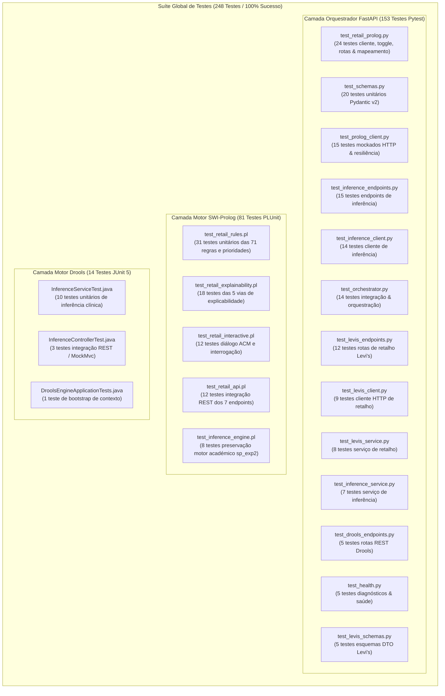

# Estratégia e Execução de Testes Automatizados
### *Sistema Pericial de Diagnóstico para Devoluções e Trocas no Retalho — MEIA 2026/2027*

---

## 1. Visão Geral

A integridade, previsibilidade e explicabilidade das decisões periciais no ecossistema **Retail Returns & Exchanges Diagnostic Expert System** são garantidas por uma estratégia de testes automatizados em múltiplas camadas.

O projeto adota a pirâmide de testes de engenharia de software moderna, separando testes em três domínios tecnológicos especializados:

1. **Motor de Inferência Dedutiva (SWI-Prolog):** 81 testes automatizados (100% de aprovação) divididos em testes unitários para a base de conhecimento de 71 regras da Levi's e 7 precedências estritas, testes das 5 vias de explicabilidade pericial, validação do fluxo dialógico interativo ACM com gestão defensiva de respostas, testes de integração REST dos 7 endpoints e preservação académica do motor sp_exp2. Implementados com a biblioteca nativa `library(plunit)`.
2. **Backend Orquestrador (Python / FastAPI):** 153 testes automatizados (100% de aprovação) cobrindo validação de esquemas Pydantic v2, testes assíncronos do cliente HTTP Prolog com suporte a modos (`retail`, `academic`, `dual`), mapeamento semântico de decisões de retalho, endpoints públicos versionados (`/api/v1/retail/*`) e testes de integração com transporte ASGI em memória (`httpx.ASGITransport`). Implementados com `pytest`, `pytest-asyncio` e `pytest-mock`.
3. **Motor de Inferência por Regras de Produção (Java 21 / Spring Boot 3 / Drools):** 14 testes automatizados (100% de aprovação) para regras de produção e raciocínio clínico *forward-chaining* (`haemorrhage_rules.drl`), testes de integração REST com MockMvc e validação de arranque do contexto Spring Boot. Implementados com `JUnit 5`, `MockMvc` e `Spring Boot Test`.



---

## 2. Testes do Motor SWI-Prolog (`prolog_engine/tests/`)

Os testes do motor Prolog utilizam a biblioteca nativa `plunit`, integrada no ecossistema SWI-Prolog, sem necessidade de dependências externas. A suíte divide-se em testes unitários das regras de negócio de retalho, testes das cinco vias de explicabilidade pericial, testes de diálogo dialógico e interrogação adaptada (ACM), testes de integração HTTP dos endpoints REST e suítes de preservação académica.

### 2.1 Testes Unitários das Regras de Retalho Levi's (`test_retail_rules.pl`) — 31 Testes

O ficheiro [`prolog_engine/tests/test_retail_rules.pl`](../../prolog_engine/tests/test_retail_rules.pl) valida de forma exaustiva as **71 regras de negócio da Levi's** organizadas em 9 famílias, bem como a hierarquia normativa de 7 precedências estipulada pelo perito humano e formalizada no RPAC:

| Grupo de Teste | Família / Precedência | Casos Validados | Decisões Testadas |
|:---|:---|:---:|:---|
| **Precedência 1 (Hard Stop Operador)** | `HS-006` | 2 | `recusar` imediato se colaborador não tiver permissão para processar devolução. |
| **Precedência 2 (Encaminhamento)** | `CH-002`, `CH-007`, `CH-008` | 3 | Encaminhamento para canais dedicados (compras online no estrangeiro, marketplace, b2b). |
| **Precedência 3 (Hard Stops Comerciais)** | `HS-001` a `HS-004` | 4 | Fraude detetada, item falsificado, produto final sale e sem prova com etiquetas adulteradas. |
| **Precedência 4 (Salubridade e Higiene)** | `PC-008`, `BW-004` | 3 | Roupa interior sem selo higiénico intacto, artigos de banho usados e contaminação biológica. |
| **Precedência 5 (Condição de Produto)** | `PC-001` a `PC-007` | 6 | Etiquetas originais, sinais de uso, lavagem, odores a tabaco/perfume e peças alteradas. |
| **Precedência 6 (Prazos e Comprovativos)** | `PT-001` a `PT-008` | 7 | Prazos de 14/28 dias, talão de compra, extrato bancário, conta de fidelidade e ausência de prova. |
| **Precedência 7 (Exceções de Gerência)** | `EX-001` a `EX-008` | 4 | Defeito de fabrico comprovado, aprovação expressa de gerente e situações de exceção comercial. |
| **Famílias Auxiliares** | `TN`, `EP`, `CT`, `BW` | 2 | Métodos de reembolso original vs. vale de loja, trocas diretas de tamanho e verificação de controlos. |

**Comando de Execução:**
```bash
swipl -g "run_tests, halt" -s prolog_engine/tests/test_retail_rules.pl
```

### 2.2 Testes das 5 Vias de Explicabilidade (`test_retail_explainability.pl`) — 18 Testes

O ficheiro [`prolog_engine/tests/test_retail_explainability.pl`](../../prolog_engine/tests/test_retail_explainability.pl) valida formalmente as **5 vias de explicabilidade pericial** desenhadas para apoiar clientes e operadores de caixa:

| Via de Explicabilidade | Predicado Base | Casos | Validação Realizada |
|:---|:---|:---:|:---|
| **Via 1: Como? (How)** | `como/1`, `explain_how/2` | 4 | Geração da árvore causal dedutiva retrospetiva, inclusão de identificadores normativos formais (`[PT-003]`, `[PC-001]`) e discriminação inequívoca entre premissas fornecidas pelo operador (`utilizador`), factos iniciais e factos inferidos por regras. |
| **Via 2: Porquê da Pergunta? (Why Ask)** | `why_ask/1..2` | 3 | Justificação contextualizada durante a interrogação de premissas em falta, recuperando a regra ativa sob teste (`regra_ativa/2`) e os metadados associados (`regra_info/3`). |
| **Via 3: Porquê da Decisão? (Output Why)** | `output_why/1`, `decision_justification/2` | 3 | Síntese determinística da decisão no vetor `justification[]`, concatenando motivos normativos e identificadores canónicos para consumo pelo orquestrador. |
| **Via 4: Porque Não? (Why Not)** | `whynot/1`, `explain_whynot/2` | 4 | Diagnóstico de falha contrafactual quando o objetivo de aprovação integral (`permitir`) não é alcançado, decompondo conjunções e apontando as premissas em falta. |
| **Via 5: E Se? (What-If Sandbox)** | `what_if/3` | 4 | Simulação contrafactual com transações voláteis via `setup_call_cleanup/3`, cálculo do delta decisório (`baseline_decision` vs `simulated_decision`), resumo de impacto e garantia estrita de ausência de poluição da sessão. |

**Comando de Execução:**
```bash
swipl -g "run_tests, halt" -s prolog_engine/tests/test_retail_explainability.pl
```

### 2.3 Testes do Fluxo Dialógico Interativo ACM (`test_retail_interactive.pl`) — 12 Testes

O ficheiro [`prolog_engine/tests/test_retail_interactive.pl`](../../prolog_engine/tests/test_retail_interactive.pl) valida a mecânica de interrogação dinâmica passo-a-passo baseada nos princípios do Prof. ACM:

| Cenário de Teste | Mecânica Validada | Validação Realizada |
|:---|:---|:---|
| `interactive_step_ask_single_fact` | `obtem_facto/2` | Formulação de pergunta estruturada em pt-PT para o primeiro facto em falta declarado em `perguntavel/1`. |
| `interactive_step_provide_answer` | Asserção de resposta | Integração da resposta na memória de trabalho com `justifica(N, utilizador, [])` e continuação da inferência. |
| `interactive_step_loop_prevention` | `ja_perguntado/1` | Prevenção absoluta de loops dialógicos; cada atributo é questionado no máximo uma vez por sessão. |
| `interactive_handle_nao_sei` | Tratamento de incerteza | Resposta `nao_sei` registada sem afirmar falsidades lógicas, acionando caminhos de raciocínio alternativos. |
| `interactive_why_inquiry` | Inquirição bidirecional | Operador submete `porquê?` e o motor devolve a justificação normativa da pergunta sem perder o estado dialógico. |
| `interactive_mock_queue_support` | `set_mock_answers/1` | Injeção determinística de fila de respostas para testes automatizados sem intervenção humana de terminal. |
| `interactive_non_askable_exclusion` | Metaconhecimento | Garantia de que conclusões periciais diagnósticas nunca são questionadas diretamente ao utilizador. |
| `interactive_reset_cleanup` | `reset_engine/0` | Limpeza atómica de estados pendentes, factos e histórico de perguntas na reinicialização. |

**Comando de Execução:**
```bash
swipl -g "run_tests, halt" -s prolog_engine/tests/test_retail_interactive.pl
```

### 2.4 Testes de Integração da API REST de Retalho (`test_retail_api.pl`) — 12 Testes

O ficheiro [`prolog_engine/tests/test_retail_api.pl`](../../prolog_engine/tests/test_retail_api.pl) testa o ciclo de vida completo do servidor HTTP e todos os 7 endpoints dedicados de retalho. A suíte instancia dinamicamente um servidor de testes numa porta TCP dedicada (`8992`) para evitar colisões:

| Rota / Endpoint | Método | Cenário de Teste | Validação Realizada |
|:---|:---:|:---|:---|
| `/retail/evaluate` | POST | Avaliação direta de retalho | Resposta HTTP 200, status `success`, decisão mapeada e array de justificações preenchido. |
| `/retail/interactive` | POST | Diálogo passo-a-passo | Retorno de pergunta estruturada com `question_id`, texto em pt-PT e lista de opções válidas. |
| `/retail/interactive` | POST | Resposta ao "porquê?" | Submissão de `"porquê?"` devolve explicação contextual da regra ativa em teste. |
| `/retail/whatif` | POST | Simulação contrafactual | Execução em sandbox com adição/remoção de factos e reporte comparativo de impacto. |
| `/retail/how` | POST | Explicação retrospetiva | Rasto dedutivo completo para um facto inferido ou fornecido. |
| `/retail/whynot` | POST | Explicação de rejeição | Identificação de antecedentes não satisfeitos para um objetivo não alcançado. |
| `/retail/facts` | GET | Listagem de factos ativos | Obtenção estruturada da memória de trabalho da sessão corrente. |
| `/retail/reset` | POST | Limpeza de sessão | Restauro limpo do estado inicial sem efeitos colaterais. |

**Comando de Execução:**
```bash
swipl -g "run_tests, halt" -s prolog_engine/tests/test_retail_api.pl
```

### 2.5 Testes de Preservação do Motor Académico (`test_inference_engine.pl`) — 8 Testes

O ficheiro [`prolog_engine/tests/test_inference_engine.pl`](../../prolog_engine/tests/test_inference_engine.pl) assegura a **estratégia de paridade e preservação académica**, confirmando que a introdução do motor de retalho não comprometeu o comportamento original do motor de veículos (`sp_exp2`):

| Teste | Módulo Validado | Validação Realizada |
|:---|:---|:---|
| `load_academic_vehicles_kb` | `inference_engine` | Carregamento da base `vehicles.pl` sem erros ou conflitos com regras de retalho. |
| `run_academic_inference` | `inference_engine` | Execução completa de *forward-chaining* no domínio de veículos gerando as deduções esperadas. |
| `academic_why_and_how` | `inference_engine` | Verificação dos mecanismos originais de explicação `como/1` e `whynot/1` da base académica. |
| `academic_reset_isolation` | `inference_engine` | Confirmação de que `reset_engine` académico não afeta a base de retalho e vice-versa. |

**Comando de Execução:**
```bash
swipl -g "run_tests, halt" -s prolog_engine/tests/test_inference_engine.pl
```

### 2.6 Testes Legados de Inferência da Prova de Conceito (`test_rules.pl` e `test_api.pl`)

Os ficheiros [`test_rules.pl`](../../prolog_engine/tests/test_rules.pl) (7 testes) e [`test_api.pl`](../../prolog_engine/tests/test_api.pl) (5 testes) continuam disponíveis no repositório como registo histórico da prova de conceito preliminar (avaliação de `value=42`), mantendo 100% de retrocompatibilidade com a suíte inicial.

### 2.7 Comandos Unificados de Execução da Suíte Prolog

Para executar sequencialmente todas as suítes de teste de retalho e preservação académica em SWI-Prolog:

```bash
# Executar suíte completa do motor de retalho Levi's
swipl -g "run_tests, halt" -s prolog_engine/tests/test_retail_rules.pl
swipl -g "run_tests, halt" -s prolog_engine/tests/test_retail_explainability.pl
swipl -g "run_tests, halt" -s prolog_engine/tests/test_retail_interactive.pl
swipl -g "run_tests, halt" -s prolog_engine/tests/test_retail_api.pl

# Executar suíte de preservação académica
swipl -g "run_tests, halt" -s prolog_engine/tests/test_inference_engine.pl
```

---

## 3. Testes do Backend Orquestrador (`backend_orchestrator/tests/`)

A suíte Python foi concebida para ser determinística, rápida (execução em menos de 1 segundo) e completamente independente de processos externos em execução na rede.

### 3.1 Fixtures e Arquitetura de Mocks (`conftest.py`)

O ficheiro central [`conftest.py`](../../backend_orchestrator/tests/conftest.py) estabelece as fundações de injeção de dependências para os testes:

* **Injeção de Dependências Dinâmica:** O FastAPI permite sobrescrever geradores de dependência em tempo de execução via `app.dependency_overrides`. O `conftest.py` substitui `get_prolog_client` e `get_orchestrator_service` por instâncias mockadas (`AsyncMock`).
* **Transporte ASGI em Memória (`ASGITransport`):** Em vez de abrir uma porta TCP real no anfitrião (o que causaria lentidão e conflitos), o cliente de teste `httpx.AsyncClient(transport=ASGITransport(app=test_app))` comunica diretamente com a pilha ASGI do FastAPI em memória.
* **Limpeza Automática:** Cada fixture assíncrona limpa os `dependency_overrides` e o estado da aplicação no final de cada teste, garantindo isolamento absoluto entre casos de teste.

```python
# Exemplo de configuração de transporte assíncrono em conftest.py
@pytest_asyncio.fixture
async def async_client(test_app: FastAPI) -> AsyncGenerator[AsyncClient, None]:
    transport = ASGITransport(app=test_app)
    async with AsyncClient(transport=transport, base_url="http://testserver") as client:
        yield client
```

### 3.2 Suíte de Validação de Esquemas (`test_schemas.py`) — 20 Testes

Testa exaustivamente todas as classes Pydantic v2 do projeto:

1. **`ScenarioInput` (POC):**
   - Aceitação de inteiros válidos (`value=42`), floats (`value=42.5`), zero e valores negativos.
   - Rejeição estrita com `ValidationError` de valores alfanuméricos (`"not_a_number"`), objetos vazios e strings em branco para o campo `scenario`.
2. **`EvaluationResponse`:**
   - Valores padrão (`engine=EngineSourceEnum.PROLOG`, timestamp em formato UTC ISO-8601).
   - Suporte e validação de todos os valores de `DecisionEnum` (`approved`, `rejected`, `pending`, `error`).
   - Rejeição de valores de enumeração não reconhecidos.
   - Serialização e desserialização JSON canónicas.
3. **`HealthResponse`:**
   - Validação da estrutura de diagnóstico e obrigatoriedade de campos.
4. **Esquemas Futuros de Retalho (`RetailReturnScenarioInput`):**
   - Validação do modelo completo de retalho (`ItemCondition`, `days_since_purchase >= 0`, `purchase_price > 0`, canais de venda e formas de pagamento).

### 3.3 Suíte do Cliente HTTP Prolog (`test_prolog_client.py`) — 15 Testes

Valida a resiliência do [`PrologClient`](../../backend_orchestrator/app/clients/prolog_client.py) perante múltiplos cenários de rede:

1. **Hierarquia de Exceções Personalizadas:**
   - Confirma que `PrologConnectionError`, `PrologTimeoutError` e `PrologResponseError` herdam da classe base [`InferenceEngineError`](../../backend_orchestrator/app/clients/prolog_client.py).
   - Validação de atributos específicos de erro (`status_code`, `response_body`).
2. **Chamadas de Avaliação:**
   - Casos de sucesso para decisões `approved` e `rejected`.
   - Aceitação indiferenciada de instâncias Pydantic (`ScenarioInput`) ou dicionários nativos Python (`dict`).
3. **Resiliência e Tratamento de Falhas:**
   - Conversão de `httpx.ConnectError` em `PrologConnectionError`.
   - Conversão de `httpx.TimeoutException` em `PrologTimeoutError`.
   - Conversão de respostas HTTP 400 ou 500 do motor em `PrologResponseError`.
4. **Health Check e Gestão de Recursos:**
   - Retorno booleano `True` em caso de sucesso e `False` resiliente perante falha de conexão ou timeout (sem lançar exceções não tratadas).
   - Validação de saída limpa como gestor de contexto assíncrono (`async with`).

### 3.4 Suíte de Orquestração e Integração de Endpoints (`test_orchestrator.py`) — 14 Testes

Testa a lógica do serviço [`OrchestratorService`](../../backend_orchestrator/app/services/orchestrator_service.py) e o endpoint público `POST /api/v1/evaluate`:

1. **Cenário A (Aprovação):** Envio de `value=42` gera resposta HTTP 200, `decision: approved` e array de justificações preenchido.
2. **Cenário B (Rejeição):** Envio de `value=15` gera resposta HTTP 200, `decision: rejected` e justificações de fallback.
3. **Cenário C (Falha de Conexão):** Quando o motor Prolog está indisponível (`PrologConnectionError`), o orquestrador responde com HTTP **503 Service Unavailable** e mensagem explicativa clara.
4. **Cenário D (Timeout do Motor):** Quando o motor excede o tempo limite (`PrologTimeoutError`), o orquestrador responde com HTTP **503 Service Unavailable**.
5. **Erro de Regras/Sintaxe:** Quando o Prolog retorna erro estruturado, o orquestrador converte para HTTP **400 Bad Request**.
6. **Validação de Payload:** Tipos inválidos ou payloads vazios são intercetados pela camada de validação e respondem com HTTP **422 Unprocessable Entity**.
7. **Normalização de Dados:** Garantia de que respostas do Prolog com justificações em string singular são automaticamente convertidas para lista `["..."]`.
8. **Ciclo de Vida (Lifespan):** Valida a inicialização e encerramento correto do pool HTTP no arranque e encerramento da aplicação.

### 3.5 Suíte de Diagnóstico (`test_health.py`) — 5 Testes

Valida os endpoints de infraestrutura e monitorização:
- `GET /health` com motor conectado (`prolog_engine: connected`).
- `GET /health` com motor desconectado (`prolog_engine: disconnected`), mantendo código HTTP 200 para permitir diagnóstico a balanceadores de carga.
- `GET /api/v1/health` (rota versionada alternativa).
- `GET /api/v1/health/` (rota com trailing slash).
- `GET /` (metadados e ponteiros de documentação).

### 3.6 Suíte do Motor de Retalho Prolog (`test_retail_prolog.py`) — 24 Testes

O ficheiro [`backend_orchestrator/tests/test_retail_prolog.py`](../../backend_orchestrator/tests/test_retail_prolog.py) valida a camada de orquestração dedicada ao motor de retalho da Levi's, cobrindo o cliente HTTP assíncrono, a chave de funcionalidade (*feature toggle*), o mapeamento semântico de decisões e as rotas REST públicas:

| Classe de Teste | Testes | Âmbito da Validação |
|:---|:---:|:---|
| `TestPrologClientRetailEndpoints` | 5 | Invocação e tratamento assíncrono dos métodos de retalho em [`PrologClient`](../../backend_orchestrator/app/clients/prolog_client.py): `evaluate_retail`, `interactive_retail`, `whatif_retail`, `how_retail`, `whynot_retail`, `facts_retail` e `reset_retail`. |
| `TestFeatureToggleAndModeSwitching` | 3 | Validação do chaveamento dinâmico via variável de ambiente `PROLOG_ENGINE_MODE`: modo `retail` (avaliação via `/retail/evaluate`), modo `academic` (avaliação via `/evaluate`) e modo `dual` (combinação e comparação de desfechos entre ambos os motores). |
| `TestOrchestratorDecisionMapping` | 13 | Testes parametrizados de mapeamento canónico no [`OrchestratorService`](../../backend_orchestrator/app/services/orchestrator_service.py): conversão de átomos em português (`permitir`, `aprovado` $\rightarrow$ `approved`; `recusar`, `rejeitado` $\rightarrow$ `rejected`; `rever`, `encaminhar` $\rightarrow$ `manager_override`; `vale_loja`, `credito_loja` $\rightarrow$ `store_credit_only`; `error` $\rightarrow$ `error`). |
| `TestFastAPIRetailRoutes` | 3 | Integração end-to-end com transporte ASGI em memória (`httpx.ASGITransport`) para os endpoints REST públicos: `POST /api/v1/retail/evaluate`, `POST /api/v1/retail/interactive` e `POST /api/v1/retail/whatif`. |

---

## 4. Testes do Motor Drools (`drools_engine/src/test/java/`)

A suíte de testes do micro-serviço Drools utiliza a biblioteca **JUnit 5 (Jupiter)** combinada com as anotações e utilitários de teste do **Spring Boot Test** (`@SpringBootTest`, `@WebMvcTest`, `MockMvc`).

### 4.1 Testes Unitários da Camada de Serviço e Regras (`InferenceServiceTest.java`) — 10 Testes

O ficheiro [`drools_engine/src/test/java/com/expert/drools/services/InferenceServiceTest.java`](../../drools_engine/src/test/java/com/expert/drools/services/InferenceServiceTest.java) valida a execução das regras DRL (`haemorrhage_rules.drl`) em isolamento sobre o `KieContainer` real:

| Método de Teste | Sinais Clínicos Injetados | Hipótese Inferida | Diagnóstico Primário | Regras Disparadas (`firedRules`) |
|:---|:---|:---:|:---:|:---|
| `testOtorrhagiaWithEarAche` | `bloodEar="yes"`, `earAche="yes"` | `upper haemorrhage` | `otorrhagia` | `r1_upper_type`, `r3_otorrhagia_ear_ache` |
| `testOtorrhagiaWithDeafness` | `bloodEar="yes"`, `deafness="yes"` | `upper haemorrhage` | `otorrhagia` | `r1_upper_type`, `r4_otorrhagia_deafness` |
| `testSkullFracture` | `bloodEar="yes"`, `trauma="yes"` | `upper haemorrhage` | `skull fracture` | `r1_upper_type`, `r2_skull_fracture` |
| `testEpistaxe` | `bloodNose="yes"` | `upper haemorrhage` | `epistaxis` | `r1_upper_type`, `r5_epistaxis` |
| `testHemathese` | `vomitBlood="yes"` | `upper haemorrhage` | `hematemesis` | `r1_upper_type`, `r6_hematemesis` |
| `testMouthHaemorrhage` | `coughBlood="yes"` | `upper haemorrhage` | `mouth haemorrhage` | `r1_upper_type`, `r7_mouth_haemorrhage` |
| `testMetrorrhagia` | `bloodVagina="yes"`, `pregnant="no"` | `lower haemorrhage` | `metrorrhagia` | `r8_lower_type`, `r9_metrorrhagia` |
| `testHematuria` | `bloodUrine="yes"` | `lower haemorrhage` | `hematuria` | `r8_lower_type`, `r10_hematuria` |
| `testMelena` | `bloodFeces="yes"`, `darkBlood="yes"` | `lower haemorrhage` | `melena` | `r8_lower_type`, `r11_melena` |
| `testRectalBleeding` | `bloodFeces="yes"`, `redBlood="yes"` | `lower haemorrhage` | `rectal bleeding` | `r8_lower_type`, `r12_rectal_bleeding` |
| `testUnknownFallback` | Todos `"no"` (sem sinais) | *(nenhuma)* | `unknown` | `r13_fallback_unknown` |

### 4.2 Testes de Integração da Camada REST (`InferenceControllerTest.java`) — 3 Testes

O ficheiro [`drools_engine/src/test/java/com/expert/drools/controllers/InferenceControllerTest.java`](../../drools_engine/src/test/java/com/expert/drools/controllers/InferenceControllerTest.java) utiliza `@WebMvcTest` e `MockMvc` para testar as rotas HTTP e a validação sintática do Spring:

| Método de Teste | Rota & Método | Cenário de Teste | Validação Realizada |
|:---|:---:|:---|:---|
| `testHealthEndpoint` | `GET /api/v1/inference/health` | Verificação do estado do motor | HTTP 200 OK, `status: "UP"`, `service: "drools-engine"`, `totalRules: 13`. |
| `testEvaluateEndpointSuccess` | `POST /api/v1/inference/evaluate` | Payload válido com `bloodEar="yes"`, `earAche="yes"` | HTTP 200 OK, `status: "COMPLETED"`, diagnóstico `otorrhagia` e array `firedRules`. |
| `testEvaluateEndpointValidationFailure` | `POST /api/v1/inference/evaluate` | Payload com valor inválido (`bloodEar: "maybe"`) | HTTP 400 Bad Request com corpo estruturado de erro `MethodArgumentNotValidException`. |

### 4.3 Teste de Bootstrap do Contexto Spring (`DroolsEngineApplicationTests.java`) — 1 Teste

O ficheiro [`drools_engine/src/test/java/com/expert/drools/DroolsEngineApplicationTests.java`](../../drools_engine/src/test/java/com/expert/drools/DroolsEngineApplicationTests.java) anota com `@SpringBootTest` e valida que todos os beans do contexto Spring Boot (incluindo o `KieContainer` em `DroolsConfig`) inicializam corretamente sem exceções.

---

## 5. Matriz Consolidada de Cobertura de Testes

| Domínio Tecnológico | Ficheiro de Teste | Tecnologia | Casos de Teste | Taxa de Sucesso |
|:---|:---|:---:|:---:|:---:|
| **Prolog (Regras Retalho Levi's)** | [`test_retail_rules.pl`](../../prolog_engine/tests/test_retail_rules.pl) | PLUnit | 31 | 100% |
| **Prolog (5 Vias de Explicabilidade)** | [`test_retail_explainability.pl`](../../prolog_engine/tests/test_retail_explainability.pl) | PLUnit | 18 | 100% |
| **Prolog (Diálogo Interativo ACM)** | [`test_retail_interactive.pl`](../../prolog_engine/tests/test_retail_interactive.pl) | PLUnit | 12 | 100% |
| **Prolog (API REST Retalho 7 Rotas)** | [`test_retail_api.pl`](../../prolog_engine/tests/test_retail_api.pl) | PLUnit | 12 | 100% |
| **Prolog (Preservação sp_exp2 Veículos)** | [`test_inference_engine.pl`](../../prolog_engine/tests/test_inference_engine.pl) | PLUnit | 8 | 100% |
| **Subtotal Motor SWI-Prolog (Ativo)** | **5 Ficheiros PLUnit** | **PLUnit** | **81 Testes** | **100%** |
| **Orquestrador (Retalho & Toggle)** | [`test_retail_prolog.py`](../../backend_orchestrator/tests/test_retail_prolog.py) | Pytest | 24 | 100% |
| **Orquestrador (Validação Esquemas)** | [`test_schemas.py`](../../backend_orchestrator/tests/test_schemas.py) | Pytest | 20 | 100% |
| **Orquestrador (Cliente HTTP Prolog)** | [`test_prolog_client.py`](../../backend_orchestrator/tests/test_prolog_client.py) | Pytest | 15 | 100% |
| **Orquestrador (Endpoints Inferência)** | [`test_inference_endpoints.py`](../../backend_orchestrator/tests/test_inference_endpoints.py) | Pytest | 15 | 100% |
| **Orquestrador (Cliente Inferência)** | [`test_inference_client.py`](../../backend_orchestrator/tests/test_inference_client.py) | Pytest | 14 | 100% |
| **Orquestrador (Serviço & Integração)** | [`test_orchestrator.py`](../../backend_orchestrator/tests/test_orchestrator.py) | Pytest | 14 | 100% |
| **Orquestrador (Rotas Retalho Levi's)** | [`test_levis_endpoints.py`](../../backend_orchestrator/tests/test_levis_endpoints.py) | Pytest | 12 | 100% |
| **Orquestrador (Cliente HTTP Levi's)** | [`test_levis_client.py`](../../backend_orchestrator/tests/test_levis_client.py) | Pytest | 9 | 100% |
| **Orquestrador (Serviço Retalho Levi's)** | [`test_levis_service.py`](../../backend_orchestrator/tests/test_levis_service.py) | Pytest | 8 | 100% |
| **Orquestrador (Serviço Inferência)** | [`test_inference_service.py`](../../backend_orchestrator/tests/test_inference_service.py) | Pytest | 7 | 100% |
| **Orquestrador (Rotas REST Drools)** | [`test_drools_endpoints.py`](../../backend_orchestrator/tests/test_drools_endpoints.py) | Pytest | 5 | 100% |
| **Orquestrador (Saúde & Diagnóstico)** | [`test_health.py`](../../backend_orchestrator/tests/test_health.py) | Pytest | 5 | 100% |
| **Orquestrador (Esquemas DTO Levi's)** | [`test_levis_schemas.py`](../../backend_orchestrator/tests/test_levis_schemas.py) | Pytest | 5 | 100% |
| **Subtotal Orquestrador FastAPI** | **13 Ficheiros Pytest** | **Pytest** | **153 Testes** | **100%** |
| **Drools (Serviço & Regras DRL)** | [`InferenceServiceTest.java`](../../drools_engine/src/test/java/com/expert/drools/services/InferenceServiceTest.java) | JUnit 5 | 10 | 100% |
| **Drools (Controlador & MockMvc)** | [`InferenceControllerTest.java`](../../drools_engine/src/test/java/com/expert/drools/controllers/InferenceControllerTest.java) | JUnit 5 / MockMvc | 3 | 100% |
| **Drools (Bootstrap Contexto Spring)** | [`DroolsEngineApplicationTests.java`](../../drools_engine/src/test/java/com/expert/drools/DroolsEngineApplicationTests.java) | Spring Boot Test | 1 | 100% |
| **Subtotal Motor Drools** | **3 Ficheiros JUnit 5** | **JUnit 5 / Spring** | **14 Testes** | **100%** |
| **TOTAL CONSOLIDADO** | **21 Ficheiros Operacionais** | **PLUnit + Pytest + JUnit 5** | **248 Testes** | **100%** |
| *(Suíte Legada POC Base)* | `test_rules.pl` + `test_api.pl` | PLUnit | 12 | 100% |

---

## 6. Guia Prático de Execução

### 6.1 Executar a Suíte Completa do Orquestrador (Pytest)

Com o ambiente virtual ativado:

**No Windows (PowerShell):**
```powershell
.\.venv\Scripts\pytest backend_orchestrator/tests -v
```

**No Linux / macOS (Bash):**
```bash
pytest backend_orchestrator/tests -v
```

**Comandos Úteis de Pytest:**
```bash
# Executar apenas a suíte de testes de retalho Prolog
pytest backend_orchestrator/tests/test_retail_prolog.py -v

# Executar apenas testes de integração do orquestrador
pytest backend_orchestrator/tests/test_orchestrator.py -v

# Filtrar testes por nome/palavra-chave (ex: testar apenas timeouts)
pytest backend_orchestrator/tests -k "timeout" -v

# Exibir traços de erro resumidos em caso de falha
pytest backend_orchestrator/tests --tb=short

# Imprimir outputs de consola de imediato (sem captura de stdout)
pytest backend_orchestrator/tests -s
```

### 6.2 Executar a Suíte Completa do Prolog (PLUnit)

A partir da raiz do repositório:

```bash
# 1. Executar testes das 71 regras de retalho Levi's e 7 precedências
swipl -g "run_tests, halt" -s prolog_engine/tests/test_retail_rules.pl

# 2. Executar testes das 5 vias de explicabilidade pericial
swipl -g "run_tests, halt" -s prolog_engine/tests/test_retail_explainability.pl

# 3. Executar testes do diálogo dinâmico e interrogação ACM
swipl -g "run_tests, halt" -s prolog_engine/tests/test_retail_interactive.pl

# 4. Executar testes de integração HTTP da API REST de retalho
swipl -g "run_tests, halt" -s prolog_engine/tests/test_retail_api.pl

# 5. Executar testes de preservação académica (veículos sp_exp2)
swipl -g "run_tests, halt" -s prolog_engine/tests/test_inference_engine.pl
```

### 6.3 Executar a Suíte Completa do Drools (Maven / JUnit 5)

A partir do diretório `drools_engine`:

```bash
# Executar todos os 14 testes do motor Drools
cd drools_engine
mvn test

# Executar apenas os testes unitários de inferência de regras DRL
mvn test -Dtest=InferenceServiceTest

# Executar apenas os testes de integração do controlador REST
mvn test -Dtest=InferenceControllerTest

# Executar apenas o teste de arranque do contexto Spring
mvn test -Dtest=DroolsEngineApplicationTests
```

---

## 7. Boas Práticas para Novos Testes

Ao adicionar novas regras periciais ou novos endpoints, observe as seguintes diretrizes:

1. **Separação Obrigatória:**
   - Adicione regras lógicas declarativas no módulo Prolog correspondente e respetivo teste `test_retail_rules.pl` ou `test_retail_explainability.pl`.
   - Adicione regras de produção DRL em `haemorrhage_rules.drl` e os testes de cobertura clínica em `InferenceServiceTest.java`.
   - Adicione testes de validação sintática e serialização nos testes Pydantic do orquestrador (`test_schemas.py` ou `test_retail_prolog.py`).
2. **Determinismo:**
   - Não crie testes que dependam de servidores ou portas fixas em execução na máquina de quem testa.
   - Utilize mocks para chamadas remotas no Pytest e portas dinâmicas/efémeras nos testes de integração Prolog (`test_retail_api.pl` usa a porta isolada `8992`).
   - Isole as sessões Drools (`KieSession`) garantindo `dispose()` em bloco `finally`.
3. **Cobertura de Casos de Fronteira:**
   - Cada nova regra pericial deve incluir pelo menos: 1 caso de aprovação/conclusão positiva, 1 caso de rejeição/fallback e 1 teste com payload malformado ou valores inválidos.
4. **Verificação de Explicabilidade:**
   - Todo o teste de avaliação deve validar explicitamente o campo de justificação (`justification` no Prolog, `firedRules` no Drools), confirmando que a lista contém motivos inteligíveis e alinhados com o diagnóstico pretendido.

---

## 8. Documentos Relacionados

* [Guia de Primeiros Passos](getting_started.md) — Configuração do ambiente local de execução.
* [Convenções de Código](coding_conventions.md) — Padrões de código e estruturação de módulos.
* [Referência de Esquemas e Contratos](../api/schemas.md) — Definição dos modelos Pydantic e DTOs Java validados na suíte.
* [API Interna do Motor Prolog](../api/prolog_engine_api.md) — Especificação técnica dos endpoints `/retail/*`.
* [API do Orquestrador FastAPI](../api/orchestrator_api_v1.md) — Especificação técnica dos endpoints `/api/v1/retail/*`.
* [Arquitetura do Motor Prolog](../architecture/prolog_engine.md) — Clean Architecture, componentes e ciclo de vida do motor de retalho.
* [Explicabilidade Pericial](../domain/explainability.md) — Modelo formal das 5 vias de explicabilidade implementadas.
* [Conhecimento Pericial da Levi's](../domain/expert_knowledge.md) — Mapeamento das 71 regras normativas e 9 famílias.
* [Orquestração com Docker Compose](../deployment/docker_compose.md) — Validação em ambiente contentorizado.
