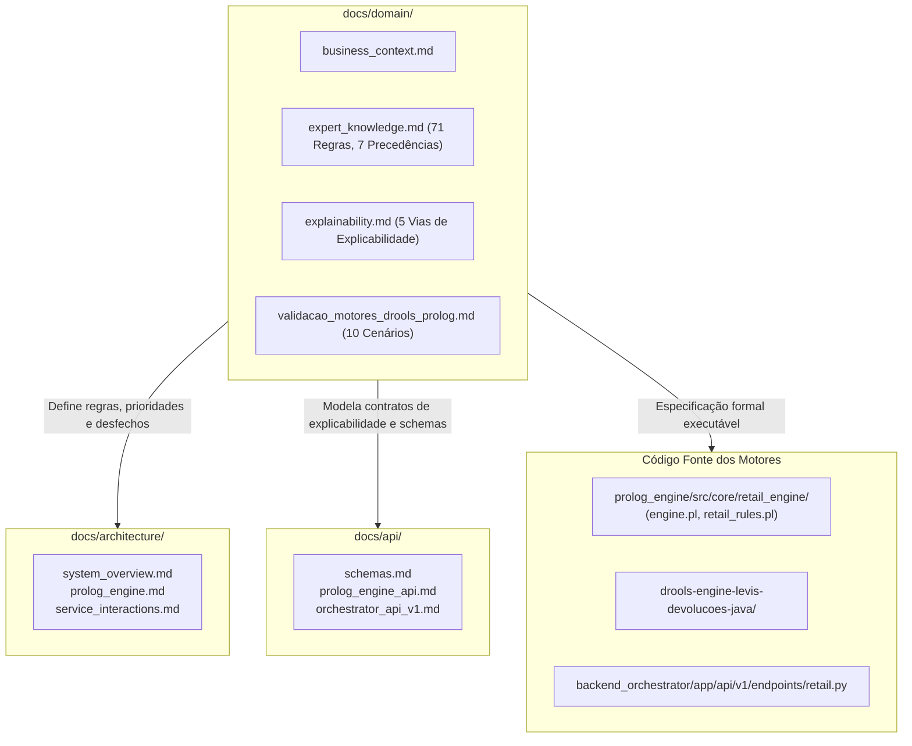

# Domínio de Negócio e Base de Conhecimento
### *Sistema Pericial de Diagnóstico para Devoluções e Trocas no Retalho*

---

## 1. Visão Geral da Secção

Esta secção documenta o conhecimento de domínio que fundamenta o sistema pericial, o enquadramento académico do projeto no mestrado MEIA e os requisitos mandatórios de transparência através do **Modelo de 5 Vias de Explicabilidade**.

O conhecimento operacional recolhido junto do perito de retalho Dustin Hopper e dos manuais corporativos da Levi Strauss & Co. foi integralmente formalizado em **71 regras de negócio distribuídas por 9 famílias funcionais** e estruturado segundo uma **hierarquia estrita de 7 níveis de precedência**, permitindo a sua execução dedutiva em SWI-Prolog ([`prolog_engine`](../../prolog_engine)) e reativa em Drools ([`drools-engine-levis-devolucoes-java`](../../drools-engine-levis-devolucoes-java)).

---

## 2. Índice de Documentos

| Documento | Propósito | Tópicos Centrais |
|:---|:---|:---|
| [Contexto de Negócio (`business_context.md`)](business_context.md) | Enquadramento académico e operacional | Mestrado MEIA (ENGCIA & PPROGIA), Desafio Challenges 4Teams (Equipa 3: SmartCloth AI), caso de uso de devoluções no retalho da Levi's, papel do perito Dustin Hopper e fatores operacionais modelados. |
| [Heurísticas do Perito (`expert_knowledge.md`)](expert_knowledge.md) | Base de conhecimento e regras de retalho | Catálogo exaustivo das **71 regras da Levi's em 9 famílias** (`HS`, `PC`, `PT`, `CH`, `TN`, `EP`, `EX`, `CT`, `BW`), hierarquia estrita de **7 precedências normativas**, árvore conceptual de decisão, categorias de desfecho (`DecisionEnum`) e formalização lógica em Prolog e Drools. |
| [Explicabilidade e Transparência (`explainability.md`)](explainability.md) | Requisito de diagnóstico explicativo | **Modelo das 5 Vias de Explicabilidade em Prolog** (*Como?*, *Porquê da Pergunta?*, *Porquê da Decisão?*, *Porque Não?*, *E Se? Sandbox*), estrutura de `justification[]`, matriz comparativa Prolog vs. Drools, cenários reais da Levi's e exemplos de execução em Bash e PowerShell. |
| [Validação Cruzada Drools vs. Prolog (`validacao_motores_drools_prolog.md`)](validacao_motores_drools_prolog.md) | Validação empírica de 10 cenários oficiais | Relatório comparativo exaustivo dos 10 cenários reais fornecidos pelo perito Dustin Hopper, executados em Drools e Prolog via REST, com extração de JSONs e análise de paridade. |
| [Comparativo: Regras vs. Redes Semânticas (`comparativo_regras_vs_redes_semanticas.md`)](comparativo_regras_vs_redes_semanticas.md) | Análise formal de representação e guia para defesa oral | Comparação teórica e prática entre Sistemas de Regras de Produção e Redes Semânticas, modelação no domínio Levi's, código comparativo em Prolog, arquitetura híbrida e guia de perguntas e respostas para a apresentação oral de MEIA. |

---

## 3. Relação com as Restantes Secções do Sistema

---

## 4. Navegação no Repositório de Documentação

* **Arquitetura:** [Visão Global da Arquitetura](../architecture/README.md)
* **APIs & Contratos:** [Referência de APIs e Schemas](../api/README.md)
* **Deploy & Operações:** [Guia de Deploy e Docker](../deployment/README.md)
* **Desenvolvimento:** [Guias de Desenvolvimento e Testes](../development/README.md)
* **Histórico:** [Planos e Histórico de Implementação](../history/README.md)

