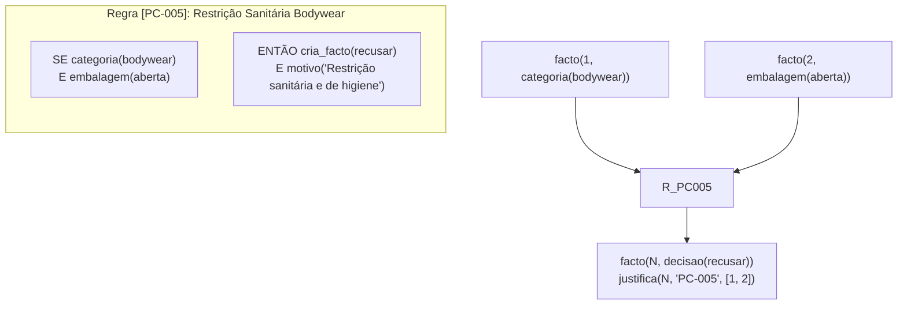
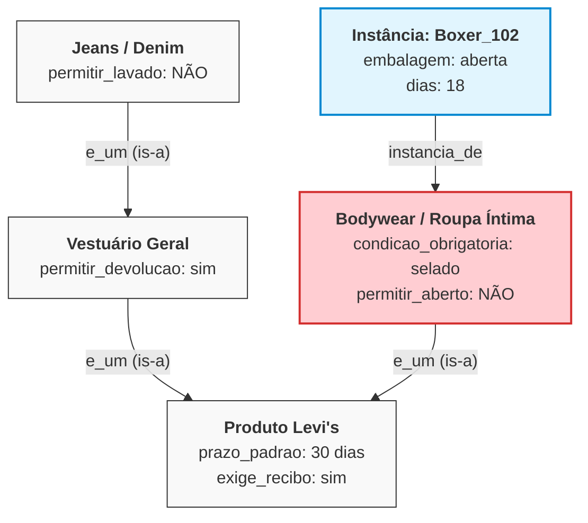
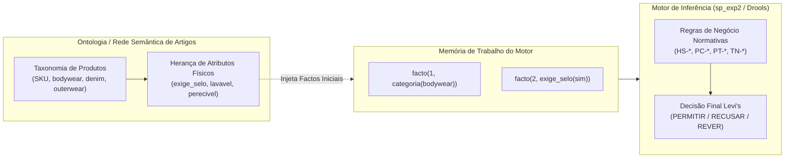

# Análise Comparativa: Regras de Produção vs. Redes Semânticas
### *Representação do Conhecimento e Inferência no Diagnóstico de Devoluções e Trocas da Levi's*
#### *ISEP · MEIA 2026/2027 · Engenharia do Conhecimento (ENGCIA) & Paradigmas de Programação em IA (PPROGIA)*

---

## 1. Enquadramento e Motivação Académica

No âmbito do desenvolvimento do Sistema Pericial de Diagnóstico para Devoluções e Trocas da Levi's (Grupo 3 – *SmartCloth AI*), a escolha do **formalismo de representação do conhecimento** constitui uma decisão arquitetural central avaliada em Engenharia do Conhecimento (ENGCIA) e Paradigmas de Programação em IA (PPROGIA).

Na secção 4.1 do [Relatório Prévio de Aquisição de Conhecimento (RPAC-Team3.md)](file:///root/meia-equipa3-challenge1-26_27/docs/material_aulas/RPAC-Team3.md#L179-L189), a equipa estabeleceu formalmente o uso de **Regras de Produção (*Se-Então*)** organizadas em nove etapas decisórias. Contudo, na literatura clássica de Inteligência Artificial e no programa curricular do mestrado, as **Redes Semânticas (*Semantic Networks*)** surgem frequentemente como um formalismo alternativo ou complementar.

Este documento estabelece a fundamentação teórica e empírica da escolha realizada, contrasta os dois formalismos face à realidade operacional da Levi's, apresenta implementações comparativas em SWI-Prolog e fornece um guia estruturado de preparação para a defesa e apresentação oral perante o corpo docente.
---

## 2. Fundamentação Teórica dos Dois Formalismos

### 2.1. Sistemas Baseados em Regras de Produção

Um **Sistema Baseado em Regras de Produção** estrutura o conhecimento pericial através de heurísticas modulares de causalidade:
$$\text{SE } \langle \text{Premissas / Condições} \rangle \text{ ENTÃO } \langle \text{Ações / Conclusões} \rangle$$

O sistema decompõe-se em três componentes fundamentais:
1. **Memória de Trabalho (*Working Memory*):** Contém o estado dinâmico da consulta (factos observados, dados fornecidos pelo operador e conclusões intermédias deduzidas).
2. **Base de Regras (*Production Memory*):** Conjunto estático e declarativo de regras de inferência fornecidas pelo perito humano.
3. **Motor de Inferência (*Inference Engine*):** Mecanismo de resolução que executa ciclos de encadeamento para a frente (*Forward Chaining* orientado aos dados) ou para trás (*Backward Chaining* orientado a objetivos).

No modelo adotado pelo grupo (extensão do `sp_exp2.pl` dos docentes em [`retail_engine`](file:///root/meia-equipa3-challenge1-26_27/prolog_engine/src/core/retail_engine/engine.pl)), o motor opera em encadeamento para a frente com metaconhecimento (`facto_dispara_regras/2`), gerando um grafo acíclico dirigido de dependências causais registado em `justifica(Conclusao, Regra, [Premissas])`.

### 2.2. Redes Semânticas

Propostas originalmente por Allan Collins e Ross Quillian (1968), as **Redes Semânticas** representam o conhecimento através de um **Grafo Orientado e Rotulado** $G = (V, E)$:
* **Vértices / Nós ($V$):** Representam conceitos universais, categorias, classes taxonómicas ou instâncias concretas de objetos do mundo real.
* **Arestas / Arcos ($E$):** Representam relações semânticas explícitas entre conceitos.

As relações estruturais canónicas incluem:
* **`e_um` (*is-a*):** Relação de subsunção e generalização taxonómica entre classes (ex.: $\text{Calças} \xrightarrow{\text{e\_um}} \text{Vestuário}$).
* **`instancia_de` (*instance-of*):** Ligação entre um elemento individual concreto e a sua classe geradora (ex.: $\text{Devolução\_102} \xrightarrow{\text{instancia\_de}} \text{Jeans\_501}$).
* **`parte_de` (*part-of* / *has-part*):** Relação de meronímia e composição física ou conceptual (ex.: $\text{Etiqueta\_Preço} \xrightarrow{\text{parte\_de}} \text{Artigo}$).
* **Relações de Atributo/Propriedade:** Arcos direcionados para valores específicos (ex.: $\text{Vestuário} \xrightarrow{\text{prazo\_dias}} 30$).

O mecanismo central de inferência de uma rede semântica é a **Herança de Propriedades (*Property Inheritance*)**: se um conceito $A$ está ligado a $B$ por um arco `e_um`, $A$ herda automaticamente todos os atributos e comportamentos associados a $B$, a menos que possua uma especialização local expressa (*default reasoning with exception override*).

---

## 3. Modelação do Domínio Levi's: Comparação Prática

Para ilustrar a discrepância estrutural entre ambos os modelos, considere-se o seguinte cenário do domínio pericial:
> *"Um par de boxers (bodywear) comprado há 18 dias na loja física de Nova Iorque com recibo é apresentado com embalagem aberta mas com etiqueta. Pode ser devolvido?"*

### 3.1. Como o Problema é Tratado em Regras de Produção (Modelo Implementado)

No motor de regras, este raciocínio é processado de forma procedural em etapas sequenciais com verificação explícita de exceções prioritárias (*Hard Stops* e regras de estado):



* **Vantagem:** A regra `PC-005` atua como um travão imediato. O motor conclui a recusa sem necessitar de consultar prazos, canais ou meios de reembolso.
* **Explicabilidade:** O rasto em `justifica/3` indica imediatamente ao operador que a recusa decorre da premissa de higiene (`categoria=bodywear` $\wedge$ `embalagem=aberta`).

### 3.2. Como o Problema Seria Modelado numa Rede Semântica

Numa rede semântica, o conhecimento teria de ser organizado como uma hierarquia ontológica de classes:



* **Processo de Inferência:** O motor procura o atributo `permitir_devolucao`. Parte de `Boxer_102`, sobe para `Bodywear` e encontra a propriedade local `permitir_aberto: NÃO`, que sobrepõe a regra geral de `Produto`.
* **Limitação Estrutural:** A rede semântica consegue expressar com perfeição que *boxers pertencem a bodywear e que bodywear tem regras sanitárias*. No entanto, **tem enorme dificuldade em representar condições conjuntas e fluxos dinâmicos**, tais como:
  * *"Se não tem recibo mas pagou com PayPal e está no Canadá, devolve em crédito de loja pelo menor preço histórico caso o colaborador tenha cargo de gerente"*.
  * Na rede semântica, cruzar 4 ou 5 dimensões independentes (tempo, canal de compra, canal de devolução, tipo de comprovativo, método de pagamento e cargo do funcionário) provoca uma **explosão combinatória de arcos e nós auxiliares**, tornando o grafo ininteligível.

---

## 4. Matriz Comparativa Multidimensional

A tabela seguinte sintetiza as diferenças técnicas e práticas entre ambos os paradigmas de representação para o caso de estudo de retalho:

| Dimensão de Análise | Sistemas de Regras de Produção (`sp_exp2` / Drools) | Redes Semânticas (*Semantic Networks*) |
|:---|:---|:---|
| **Tipo Primário de Conhecimento** | **Procedural e Normativo:** regras de decisão, causas e efeitos, etapas sequenciais de triagem. | **Declarativo e Taxonómico:** relações ontológicas ("quem é o quê", "o que pertence a quê"). |
| **Mecanismo de Raciocínio** | **Encadeamento (*Forward/Backward Chaining*):** ciclo reconhecer-selecionar-atuar via unificação lógica. | **Herança de Atributos e Ativação Propagada:** travessia de caminhos orientados no grafo. |
| **Expressividade para o Negócio** | **Elevada:** expressa facilmente condições booleanas complexas, limites numéricos (`dias <= 30`) e exceções. | **Baixa para Decisão:** excelente para descrever catálogos de artigos, mas ineficaz para políticas de atendimento ao balcão. |
| **Tratamento de Exceções** | Regras prioritárias com corte (`!`), precedências de módulos (níveis 1 a 7) ou condições negativas (`nao`). | Sobrescrita de propriedades em nós mais profundos da hierarquia (*local override*). |
| **Múltiplos Desfechos Simultâneos** | **Nativo:** deduz em simultâneo decisão, destino do produto, meio de reembolso e controlos numa só execução. | **Complexo:** exige consultas isoladas a múltiplos atributos espalhados por diferentes regiões do grafo. |
| **Interrogação Dialógica (ACM)** | **Nativa:** interceta premissas não resolvidas com `obtem_facto/2` e `perguntavel/1` só quando uma regra precisa. | **Difícil:** a travessia de arcos não tem um contexto natural de "qual é a regra que está agora a tentar provar". |
| **Explicabilidade das 5 Vias** | **Completa e Causal:** rasto exato de derivação (`justifica/3`), pré-condições falhadas (`whynot/1`) e sandbox (`what_if/3`). | **Limitada a Caminhos:** explica apenas que "X tem a propriedade P porque herda da classe ancestral Y". |

---

## 5. Implementação Comparativa em SWI-Prolog

Para evidenciar o contraste algorítmico entre as duas abordagens, apresentam-se as implementações mínimas de ambos os motores em código Prolog funcional.

### 5.1. Paradigma de Regras de Produção (Motor de Encadeamento para a Frente)

Este é o padrão canónico implementado no projeto (`prolog_engine`), baseado no `sp_exp2.pl`:

```prolog
% ==============================================================================
% 1. Base de Conhecimento: Regras Causais de Negócio
% ==============================================================================
regra 'PC-005' se [categoria(Artigo, bodywear) e estado_embalagem(Artigo, aberta)]
               entao [cria_facto(decisao(recusar)), 
                      cria_facto(motivo(restricao_higiene))].

% ==============================================================================
% 2. Motor de Inferência: Forward-Chaining com Registo Causal
% ==============================================================================
arranca_motor(N) :-
    facto(N, Facto),
    facto_dispara_regras(Facto, RegrasCandidatas),
    dispara_regras(N, Facto, RegrasCandidatas),
    N1 is N + 1,
    arranca_motor(N1).
arranca_motor(_) :- !.

dispara_regras(N, Facto, [ID|Resto]) :-
    regra ID se Condicoes entao Acoes,
    verifica_condicoes(Condicoes, LFactosSuporte),
    member(N, LFactosSuporte),
    executa_acoes(Acoes, ID, LFactosSuporte),
    !,
    dispara_regras(N, Facto, Resto).
dispara_regras(N, Facto, [_|Resto]) :-
    dispara_regras(N, Facto, Resto).
dispara_regras(_, _, []).

% ==============================================================================
% 3. Explicabilidade Recursiva (Como?)
% ==============================================================================
como(FactoID) :-
    justifica(FactoID, utilizador, _),
    format("Facto ~w foi fornecido pelo utilizador.~n", [FactoID]).
como(FactoID) :-
    justifica(FactoID, RegraID, FactosBase),
    format("Facto ~w deduzido pela regra [~w] com base em ~w.~n", [FactoID, RegraID, FactosBase]),
    forall(member(F, FactosBase), como(F)).
```

### 5.2. Paradigma de Rede Semântica (Motor de Herança por Grafo)

Se a equipa tivesse optado por implementar uma Rede Semântica para o mesmo problema, o código assumiria a seguinte estrutura declarativa:

```prolog
% ==============================================================================
% 1. Estrutura do Grafo: Relações Semânticas e Propriedades
% ==============================================================================
% Arcos de Subsunção Taxonómica (is-a)
e_um(bodywear, produto_retalho).
e_um(jeans, vestuario_geral).
e_um(vestuario_geral, produto_retalho).

% Instanciação Concreta
instancia_de(devolucao_102, bodywear).

% Atributos Definidos por Omissão nas Classes
propriedade(produto_retalho, prazo_maximo_dias, 30).
propriedade(produto_retalho, elegivel_devolucao, sim).

% Exceção Local na Subclasse Bodywear (Sobrescrita da Classe Base)
propriedade(bodywear, elegivel_se_aberto, nao).

% ==============================================================================
% 2. Motor de Inferência: Travessia do Grafo com Herança e Override
% ==============================================================================
% Caso 1: A propriedade está definida localmente no próprio nó
obter_propriedade(No, Propriedade, Valor) :-
    propriedade(No, Propriedade, Valor),
    !.

% Caso 2: O nó é uma instância de uma classe, herda dessa classe
obter_propriedade(Instancia, Propriedade, Valor) :-
    instancia_de(Instancia, Classe),
    obter_propriedade(Classe, Propriedade, Valor),
    !.

% Caso 3: O nó é uma subclasse, sobe hierarquicamente via 'e_um'
obter_propriedade(SubClasse, Propriedade, Valor) :-
    e_um(SubClasse, SuperClasse),
    obter_propriedade(SuperClasse, Propriedade, Valor).

% ==============================================================================
% 3. Explicabilidade Semântica
% ==============================================================================
explicar_heranca(No, Prop, Valor) :-
    propriedade(No, Prop, Valor),
    format("Propriedade ~w = ~w definida diretamente em ~w.~n", [Prop, Valor, No]).
explicar_heranca(No, Prop, Valor) :-
    (instancia_de(No, Pai) ; e_um(No, Pai)),
    format("~w herda através de ~w:~n", [No, Pai]),
    explicar_heranca(Pai, Prop, Valor).
```

---

## 6. Proposta de Arquitetura Híbrida (Extensão Teórica)

Embora o sistema pericial completo utilize regras de produção, é academicamente relevante reconhecer que os dois formalismos **não são mutuamente exclusivos**, podendo operar em sinergia numa arquitetura híbrida:



Neste modelo conceitual híbrido:
1. A **Rede Semântica** funcionaria como uma ontologia de suporte para classificar artigos a partir do SKU e inferir propriedades físicas inerentes.
2. O **Motor de Regras de Produção** receberia essas propriedades na memória de trabalho e executaria o raciocínio normativo comercial, canal, prazo e fraude.

---

## 7. Guia de Preparação para a Defesa Oral (Perguntas & Respostas)

Este guião foi estruturado para apoiar a equipa nas questões previsíveis do corpo docente durante a apresentação e defesa do projeto.

---

### Pergunta 1: *"Porque escolheram formalizar o conhecimento através de Regras de Produção em vez de uma Rede Semântica ou de Quadros (Frames)?"*

> **Resposta Recomendada:**
> *"A escolha baseou-se na natureza do problema pericial da Levi's. As Redes Semânticas e os Quadros são formalismos desenhados para representar conhecimento declarativo e estrutural — como ontologias e hierarquias taxonómicas de conceitos (*'quem é o quê'*).  
> Por outro lado, a triagem de devoluções no retalho é um processo eminentemente **procedural, normativo e dinâmico** (*'o que fazer quando determinadas condições conjuntas ocorrem'*). O problema envolve cruzamentos multifatoriais entre canais de venda, tipos de comprovativo, métodos de pagamento, prazos temporais rigorosos e políticas de escalonamento hierárquico.  
> As **Regras de Produção** permitem modelar este fluxo sequencial em 9 etapas com facilidade de manutenção e garantem uma capacidade de justificação causal direta através do rasto de derivação dedutiva, algo que numa rede semântica pura geraria uma complexidade combinatória de arcos inavegável."*

---

### Pergunta 2: *"Seria possível ou vantajoso utilizar uma Rede Semântica neste sistema?"*

> **Resposta Recomendada:**
> *"Sim, mas com um papel delimitado e complementar, sob a forma de uma **arquitetura híbrida**.  
> Uma Rede Semântica seria muito útil como subsistema de representação do catálogo de produtos: a partir da leitura de um SKU ou código de barras, a rede herdaria automaticamente que um determinado artigo pertence à categoria `bodywear`, que é roupa íntima e que possui exigência de selo sanitário inviolável.  
> Essas propriedades inferidas pela rede semântica seriam depois inseridas na memória de trabalho do nosso motor de inferência, cabendo às regras de produção tomar a decisão final sobre se a devolução é permitida, recusada, revista ou encaminhada."*

---

### Pergunta 3: *"Como se compara a explicabilidade das 5 Vias entre o motor de regras que implementaram e uma Rede Semântica?"*

> **Resposta Recomendada:**
> *"No nosso motor de regras, a explicabilidade assenta na causalidade lógica estrita e cobre as 5 Vias avaliadas no projeto:
> 1. **Como (Via 1):** reconstrói a árvore de derivação a partir das cláusulas `justifica(Facto, Regra, Premissas)`;
> 2. **Porquê da Pergunta (Via 2):** identifica a regra candidata ativa que solicitou o dado ao utilizador;
> 3. **Porquê da Decisão (Via 3):** resume as regras normativas de topo que fixaram o desfecho;
> 4. **Porque Não (Via 4):** analisa as premissas falsificadas que impediram uma regra de disparar;
> 5. **E Se (Via 5):** executa simulações contrafactuais em sandbox isolada.
>
> Numa Rede Semântica pura, a explicabilidade limita-se à **justificação por herança taxonómica** (*'o artigo X tem prazo de 30 dias porque é um produto de retalho'*). Não existe o conceito nativo de 'regra ativa a perguntar', nem de 'premissas conjuntas não cumpridas', inviabilizando as vias do 'Porquê da Pergunta' e do 'Porque Não' sem a adição de uma camada complexa de meta-intérpretes."*

---

### Pergunta 4: *"O vosso motor Prolog é um meta-intérprete ou um motor de encadeamento para a frente? Qual a diferença relativamente ao que o professor deu no sp_exp2?"*

> **Resposta Recomendada:**
> *"O nosso motor de inferência em Prolog é uma **extensão robusta e interativa do motor de encadeamento para a frente (`sp_exp2.pl`)** disponibilizado pelos docentes no Moodle.  
> Mantivemos a estrutura canónica do ciclo forward-chaining com metaconhecimento (`facto_dispara_regras/2`) e a sintaxe DSL dos operadores (`regra`, `se`, `entao`, `e`, `nao`).  
> A evolução que implementámos seguiu exatamente a orientação da aula teórica/prática do Prof. ACM documentada em `MI_Perguntas_ACM.md`: substituímos a recolha estática inicial por uma **recolha dialógica a pedido** (`obtem_facto/2` e `perguntavel/1`), tratámos de forma segura a resposta `'não sei'` para evitar negações indevidas na memória de trabalho, e estendemos o rasto causal de `justifica/3` para suportar as 5 vias de explicabilidade."*

---

## 8. Conclusão

A adoção de **Sistemas de Regras de Produção** no projeto Levi's Returns & Exchanges é técnica e pedagogicamente sólida. Garante a expressividade necessária para lidar com as 71 regras normativas e os 10 cenários periciais do perito, cumpre integralmente os requisitos de explicabilidade causal e paridade entre implementações (Drools e Prolog), e reflete as melhores práticas de Engenharia do Conhecimento recomendadas no âmbito do MEIA.
