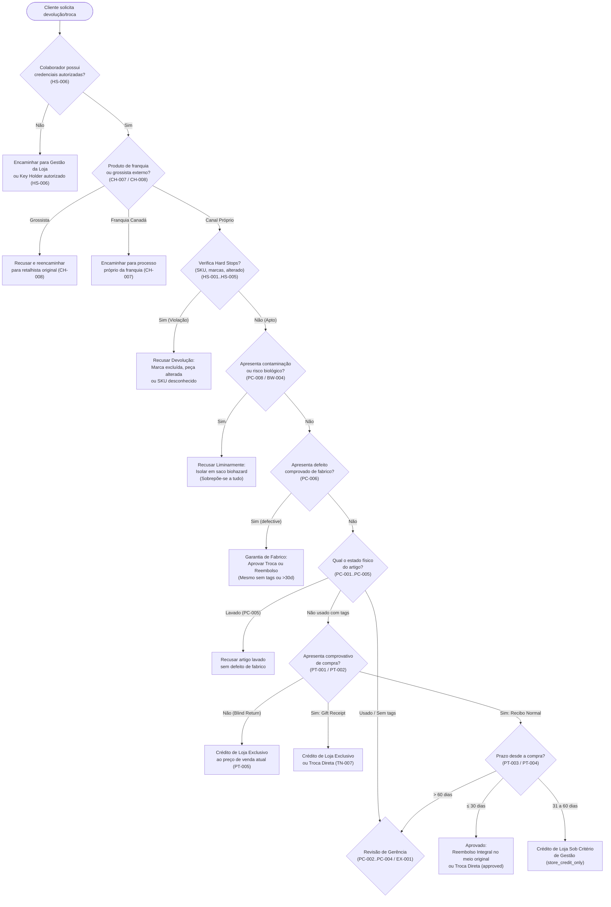
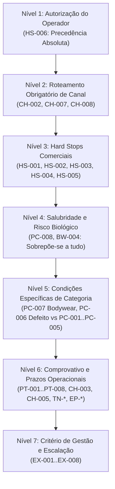

# Base de Conhecimento e Heurísticas do Perito
### *Regras Empíricas e Modelação Lógica para Devoluções e Trocas*

---

> [!NOTE]
> ### Da Aquisição Empírica à Formalização Lógica Integral (100% Implementado)
> As regras, critérios e fluxos operacionais documentados neste relatório tiveram origem no conhecimento empírico partilhado pelo perito de retalho Dustin Hopper (recolhido através de entrevistas estruturadas e manuais de loja da Levi Strauss & Co.).
> 
> Este conhecimento foi formalizado, estruturado e integralmente codificado no repositório através de:
> 1. [`RPAC-Team3.md`](../material_aulas/RPAC-Team3.md) — Relatório de Aquisição de Conhecimento formal da Equipa 3;
> 2. [`Returns & Exchanges Knowledge Base.md`](../material_aulas/Returns%20&%20Exchanges%20Knowledge%20Base.md) — Base de conhecimento corporativa oficial da Levi's;
> 3. [`prolog_engine/src/core/retail_engine/kb/retail_rules.pl`](../../prolog_engine/src/core/retail_engine/kb/retail_rules.pl) — Base declarativa com as **71 regras canónicas em 9 famílias** e **7 níveis de precedência estrita**, validada por 31 testes unitários PLUnit ([`test_retail_rules.pl`](../../prolog_engine/tests/test_retail_rules.pl));
> 4. Micro-serviço Drools Java ([`drools-engine-levis-devolucoes-java`](../../drools-engine-levis-devolucoes-java)) com regras de produção reativas equivalentes.

---

## 1. Conceitos-Chave Extraídos do Perito

A tomada de decisão no balcão de retalho da Levi's divide-se em cinco dimensões avaliadas cumulativamente de acordo com o perito Dustin Hopper:

### 1.1 Elegibilidade e Integridade do Artigo (*Item Attributes*)
* **Categoria Sanitária (*Intimate / Underwear / Bodywear*):** Produtos de contacto íntimo (peças interiores, fatos de banho, collants) possuem uma política de tolerância zero após quebra do selo original, devido a restrições legais de saúde pública e risco biológico (*biohazard*). Contudo, a Levi's dispõe de uma cláusula especial de satisfação do cliente para *bodywear* (`PC-007`), permitindo a aceitação excecional desde que o artigo seja imediatamente isolado ou descartado de acordo com as regras `BW-001` a `BW-004`.
* **Presença de Etiquetas Originais (*Tags & Packaging*):** A fixação das etiquetas de fábrica ou da loja comprova que o produto não foi utilizado em ambiente social e permite a sua reintegração direta no expositor de vendas (`PC-001`).
* **Estado Físico do Artigo (*Physical Condition*):**
  * `nao_usado_com_etiquetas` (`unworn_clean`): Artigo imaculado, sem odores, sem marcas de uso ou lavagem, com etiquetas presas.
  * `nao_usado_etiquetas_soltas`: Artigo novo cujas etiquetas se soltaram (requer validação de gerência `PC-002`).
  * `nao_usado_sem_etiquetas`: Artigo novo sem etiquetas (requer validação de gerência `PC-003`).
  * `usado` (`worn`): Artigo que evidencia marcas de uso continuado (requer validação de gerência `PC-004`).
  * `lavado` (`washed`): Artigo lavado pelo cliente (rejeição liminar pela regra `PC-005`, salvo defeito comprovado).
  * `sujo_ou_contaminado`: Artigo com risco biológico, secreções ou sujidade grave (rejeição mandatória e isolamento por `PC-008`).
  * `com_defeito` (`defective`): Defeito comprovado de fabrico (costuras desalinhadas, fechos avariados, defeito no tingimento), o qual confere salvaguarda integral ao abrigo da regra `PC-006`.

### 1.2 Comprovativo de Compra (*Proof of Purchase*)
* **Recibo Fiscal Válido (*Standard Receipt*):** Documento original (impresso ou em formato digital na aplicação da loja) que atesta o preço exato pago, promoções aplicadas e data exata de compra (`PT-001`).
* **Recibo de Oferta (*Gift Receipt*):** Comprovativo que omite o valor monetário pago, conferindo direito à substituição por outro artigo ou emissão de crédito de loja, mas bloqueando expressamente o estorno financeiro em numerário ou cartão (`TN-007`).
* **Ausência de Comprovativo (*Blind Return*):** Situação em que o cliente não apresenta qualquer talão (`PT-002`). Requer cálculo do preço promocional mais baixo ou preço atual de sistema e restringe o desfecho a crédito de loja sob autorização ou supervisão (`PT-005`).

### 1.3 Prazos Operacionais (*Timeframe & Elapsed Days*)
* **Janela Padrão (≤ 30 dias):** Prazo contratual padrão para devolução integral ou troca direta de mercadoria em estado novo (`PT-003`).
* **Ajuste de Preço (≤ 14 dias):** Janela reduzida em que o cliente solicita a devolução da diferença monetária caso o produto tenha entrado em campanha promocional posterior (`PT-007`). Rejeitado após 14 dias (`PT-008`).
* **Janela Alargada (31 a 60 dias):** Prazo em que o reembolso direto já não é autorizado pela política da empresa, convertendo-se exclusivamente em vale de compras / crédito de loja sob critério de gestão (`PT-004`).
* **Fora de Prazo (> 60 dias):** Rejeição liminar do pedido, salvo defeito de fabrico comprovado (`PC-006`) ou intervenção extraordinária de gerência (`EX-001` a `EX-004`).

### 1.4 Canal e Mercado de Origem (*Sales Channel*)
* **Loja Física Normal (*Mainline Store*):** Elegível para devolução direta e troca no balcão (`CH-001`).
* **Loja Outlet (*Outlet Store*):** Artigos adquiridos em regime de liquidação, sujeitos a políticas de cálculo de saldo próprias (`CH-009`, `CH-010`).
* **Comércio Eletrónico (*Online Order*):** Compras online verificadas através do portal BackPocket (`CH-002`). Quando a encomenda não é localizada, aplica-se o regime de devolução às cegas (`CH-003`).
* **Franquia Internacional (*Canada Franchise*):** Exige encaminhamento estrito para procedimento próprio da franquia sem uso de SKUs genéricos (`HS-004`, `CH-007`).
* **Retalhistas Grossistas (*Wholesale*):** Recusa estrita em lojas Levi's de retalho próprio, devendo o consumidor ser reencaminhado para o retalhista original (`HS-002`, `CH-008`).

### 1.5 Método Original de Pagamento (*Tender*)
* Devoluções financeiras respeitam o princípio de integridade do método original de liquidação:
  * Cartão de crédito/débito estorna tokenizado diretamente para a conta (`TN-001`, `TN-002`, `TN-005`);
  * Proibição estrita de estorno em dinheiro para pagamentos efetuados por cartão de débito sem prévia rejeição no terminal (`TN-004`);
  * Compras efetuadas via Afterpay em canal online não admitem qualquer exceção de meio de reembolso (`HS-005`, `TN-010`);
  * Compras no Canadá via débito Interac exigem a apresentação física obrigatória do cartão (`TN-011`).

---

## 2. Fluxo Conceptual de Decisão

Abaixo apresenta-se a árvore de triagem conceptual que orienta a priorização e resolução das regras:



---

## 3. Catálogo Sistemático das 71 Regras da Levi's em Prolog

As **71 regras canónicas de retalho** estão formalmente codificadas no módulo [`retail_rules.pl`](../../prolog_engine/src/core/retail_engine/kb/retail_rules.pl) e distribuem-se por **9 famílias funcionais**:

| Família | Código | Quantidade | Âmbito Operacional Principal |
|:---|:---:|:---:|:---|
| **Hard Stops** | `HS` | 6 regras (`HS-001` a `HS-006`) | Paragens obrigatórias e condições impeditivas imediatas (credenciais, marcas excluídas, peças alteradas, SKU). |
| **Product Condition** | `PC` | 8 regras (`PC-001` a `PC-008`) | Avaliação física do artigo (etiquetas, uso, lavagem, defeito de fabrico, bodywear e risco biológico). |
| **Proof & Timeframe** | `PT` | 8 regras (`PT-001` a `PT-008`) | Validação de talões de compra, devoluções verificadas vs às cegas, janelas de 30 dias e ajuste de preço aos 14 dias. |
| **Channel & Store Type** | `CH` | 10 regras (`CH-001` a `CH-010`) | Roteamento entre lojas Mainline, Outlet, encomendas online (BackPocket), franquias do Canadá e grossistas. |
| **Refund Tender** | `TN` | 12 regras (`TN-001` a `TN-012`) | Regras de estorno financeiro (cartão tokenizado, Afterpay, PayPal/Venmo, Interac no Canadá e recibos de oferta). |
| **Exchange & Promotion** | `EP` | 7 regras (`EP-001` a `EP-007`) | Trocas diretas de tamanho vs modelo, dinâmicas de promoções por escalões (*buy more, save more*) e artigos de saldo. |
| **Manager Review & Escalation** | `EX` | 8 regras (`EX-001` a `EX-008`) | Critérios de gerência para apaziguamento, resolução de contestações, clientes agitados e salvaguardas antifraude. |
| **Authorization & Controls** | `CT` | 8 regras (`CT-001` a `CT-008`) | Controlos internos de auditoria (credenciais de caixa, aprovações XStore, recolha de assinaturas e retenção de talões a 90 dias). |
| **Bodywear Disposition** | `BW` | 4 regras (`BW-001` a `BW-004`) | Destino físico de peças interiores (reposição com embalagem intacta, saldo a 50%, baixa por dano ou saco biohazard). |

### 3.1 Família HS: Hard Stops (Paragens Obrigatórias)
* **`HS-001`:** Recusar quando o produto não possui SKU reconhecido no sistema POS (salvo franquia do Canadá).
* **`HS-002`:** Recusar marcas excluídas da rede Levi's (Dockers, Levi Strauss Signature, Beyond Yoga ou mercadoria de grossista não comercializada em loja própria).
* **`HS-003`:** Recusar artigos personalizados, alterados ou embainhados (*tailored*), mesmo que apresentem defeito.
* **`HS-004`:** Encaminhar produtos da franquia canadiana para procedimento próprio, proibindo o registo sob SKU genérico ou diferente.
* **`HS-005`:** Proibir categoricamente exceções de meio de reembolso para compras online efetuadas com Afterpay.
* **`HS-006`:** Pré-condição de autorização: encaminhar para a gerência de loja se o operador não possuir credenciais autorizadas.

### 3.2 Família PC: Product Condition (Estado Físico do Produto)
* **`PC-001`:** Permitir elegibilidade física para artigo não usado com etiquetas originais intactas.
* **`PC-002`:** Rever com a gestão artigo não usado com etiquetas soltas; aprovar apenas se vendável.
* **`PC-003`:** Rever com a gestão artigo não usado sem etiquetas; aprovar apenas se puder ser re-etiquetado para venda.
* **`PC-004`:** Rever com a gestão artigo usado sem defeito; autorizar no máximo troca direta pelo mesmo artigo.
* **`PC-005`:** Recusar artigo lavado pelo cliente sem defeito comprovado de fabrico.
* **`PC-006`:** Permitir reembolso total ou substituição imediata com baixa por dano perante defeito de fabrico confirmado.
* **`PC-007`:** Permitir devolução de *bodywear* em qualquer estado ao abrigo da política especial de satisfação.
* **`PC-008`:** Recusar e isolar de imediato em saco de risco biológico artigos com secreções, sujidade ou contaminação.

### 3.3 Família PT: Proof & Timeframe (Comprovativos e Prazos)
* **`PT-001`:** Classificar como devolução verificada quando comprovativo fiscal válido atesta a transação.
* **`PT-002`:** Classificar como devolução às cegas (*blind return*) na ausência de talão ou comprovativo eletrónico.
* **`PT-003`:** Permitir reembolso total no meio de pagamento original ou troca direta para devolução verificada até 30 dias.
* **`PT-004`:** Rever com a gestão devolução verificada após 30 dias (31 a 60 dias); emissão de crédito de loja sob critério.
* **`PT-005`:** Autorizar exclusivamente troca ou crédito de loja ao preço atual para devolução às cegas com artigo elegível.
* **`PT-006`:** Selecionar opção "Saltar" no POS se o cliente sem recibo não fornecer dados de identificação ou houver barreira linguística.
* **`PT-007`:** Permitir ajuste de preço único no POS até 14 dias para compra em loja física com recibo original.
* **`PT-008`:** Recusar ajuste de preço após 14 dias da compra ou sem o recibo fiscal original.

### 3.4 Família CH: Channel & Store Type (Canais e Tipos de Loja)
* **`CH-001`:** Aplicar políticas de comprovativo e avaliação da loja recetora para devoluções em lojas Mainline e Outlet.
* **`CH-002`:** Localizar e processar devolução online verificada através do portal BackPocket com estorno ao meio original.
* **`CH-003`:** Tratar devolução de encomenda online não localizada como devolução às cegas com emissão de vale de compras.
* **`CH-004`:** Rever com a gestão sénior perante indisponibilidade técnica prolongada do portal de devoluções online.
* **`CH-005`:** Emitir vale de compras para devolução de compra online cujo envio original tenha ocorrido há mais de 30 dias.
* **`CH-006`:** Concluir troca online no balcão e estornar eventual saldo remanescente ao meio de pagamento original.
* **`CH-007`:** Encaminhar produto de loja franquiada do Canadá para procedimento próprio com SKU de franquia.
* **`CH-008`:** Recusar mercadoria adquirida em grossista externo e reencaminhar o cliente para o retalhista original.
* **`CH-009`:** Avaliar devolução às cegas em loja Outlet pelo preço de venda atual deduzido das promoções em vigor.
* **`CH-010`:** Aceitar devolução com recibo de loja Mainline/Online em Outlet ao PVP original quando a política o admitir.

### 3.5 Família TN: Refund Tender (Meios de Pagamento e Liquidação)
* **`TN-001`:** Processar reembolso tokenizado em cartão de crédito/débito sem necessidade de exigir a presença do cartão físico.
* **`TN-002`:** Reembolsar automaticamente para a conta bancária associada se o cartão tiver sido reportado como perdido/roubado.
* **`TN-003`:** Permitir meio alternativo de reembolso se a conta do cartão estiver encerrada e o estorno for formalmente recusado.
* **`TN-004`:** Proibir estorno em numerário para pagamentos originais por cartão sem tentativa prévia e falha técnica no terminal.
* **`TN-005`:** Reembolsar automaticamente para a conta associada em transações efetuadas por Apple Pay ou Google Pay (*contactless*).
* **`TN-006`:** Estornar saldo remanescente ao cartão original após conclusão de troca parcial.
* **`TN-007`:** Devoluções com recibo de oferta: emissão exclusiva de crédito de loja ao portador ou estorno ao comprador original.
* **`TN-008`:** Exigir fluxo dedicado da aplicação no balcão para compras liquidadas através de PayPal ou Venmo.
* **`TN-009`:** Processar devolução em loja de compra Afterpay através da aplicação com talão de devolução emitido pelo POS.
* **`TN-010`:** Processar devolução de compra Afterpay online através da BackPocket exclusivamente para o método original sem exceções.
* **`TN-011`:** Exigir a presença e inserção do cartão físico Interac para estorno de débito no mercado do Canadá.
* **`TN-012`:** Processar devolução Interac da BackPocket mediante estorno manual no terminal VeriFone pelo valor exato.

### 3.6 Família EP: Exchange & Promotion (Trocas e Promoções)
* **`EP-001`:** Honrar preço original ou promocional em troca com recibo que altere estritamente o tamanho da mesma peça.
* **`EP-002`:** Tratar troca com alteração de modelo ou cor como devolução regular seguida de nova venda.
* **`EP-003`:** Devolução às cegas em compras com promoção por escalões avaliada pela quantidade de peças devolvidas na sessão.
* **`EP-004`:** Devolução com recibo em compras com promoção por escalões calculada pelo POS com base na quantidade original faturada.
* **`EP-005`:** Reprecificar ao valor atual e retornar à área de vendas artigo entre canais que integre o sortido regular da loja.
* **`EP-006`:** Colocar em saldos com 20% de desconto adicional sobre o valor devolvido artigo entre canais que não pertença ao sortido.
* **`EP-007`:** Manter em saldo com promoções ativas artigo entre canais já em liquidação no momento da devolução.

### 3.7 Família EX: Manager Review & Escalation (Escalação e Gestão)
* **`EX-001`:** Critério de gestão avalia vendabilidade, comprovativo, tempo decorrido, risco e circunstâncias comerciais.
* **`EX-002`:** Explicar a política da empresa e oferecer a melhor alternativa regulamentar viável perante contestação do cliente.
* **`EX-003`:** Escalar para responsável sénior perante cliente agitado; a agitação do consumidor não confere direito automático.
* **`EX-004`:** Autorizar exceção de apaziguamento (*appeasement*) apenas na ausência de Hard Stops, com baixo risco de fraude e viabilidade de sistema.
* **`EX-005`:** Adotar a resolução comercial menos abrangente para exceção aprovada em artigo que se mantenha vendável.
* **`EX-006`:** Recusar terminantemente exceções que violem políticas Afterpay, PayPal, Venmo, ausência de SKU ou personalização.
* **`EX-007`:** Documentar formalmente no sistema o motivo, identificador do gestor aprovador, valor e destino de exceção autorizada.
* **`EX-008`:** Pausar a transação, envolver a gestão e reportar à equipa de Prevenção e Segurança perante indícios de fraude.

### 3.8 Família CT: Authorization & Controls (Controlos de Caixa e Auditoria)
* **`CT-001`:** Devolução verificada deve ser conduzida exclusivamente por colaborador autorizado com credenciais ativas.
* **`CT-002`:** Devolução às cegas operada por Lead Cashier ou Elevated Stylist exige validação do XStore Manager.
* **`CT-003`:** O mesmo colaborador deve concluir a transação do início ao fim com as suas próprias credenciais de operador.
* **`CT-004`:** Atribuir devolução com recibo ao Stylist responsável pela transação de venda original.
* **`CT-005`:** Recolher assinaturas obrigatórias do cliente, do operador e da testemunha/supervisor quando exigido.
* **`CT-006`:** Agrafar o recibo original entregue ou efetuar anotação de retenção na cópia de loja se o cliente retiver o original.
* **`CT-007`:** Reter talões de loja e folhas de assinaturas em arquivo físico regulamentar durante 90 dias.
* **`CT-008`:** Inspecionar danos, etiquetas de preço e precisão de gravação RFID antes de recolocar o artigo na área de vendas.

### 3.9 Família BW: Bodywear Disposition (Tratamento de Roupa Íntima)
* **`BW-001`:** Retornar imediatamente à área de vendas peça de *bodywear* não usada com embalagem original selada e intacta.
* **`BW-002`:** Colocar em saldos com 50% de desconto e código de barras riscado a vermelho peça de *bodywear* sem embalagem.
* **`BW-003`:** Efetuar baixa contabilística por dano do conjunto completo se o artigo de *bodywear* tiver unidades em falta ou sinais de manuseamento.
* **`BW-004`:** Isolar de imediato em saco de risco biológico peça de *bodywear* usada, suja ou contaminada.

---

## 4. Hierarquia Estrita de Precedências (Níveis 1 a 7)

De acordo com o Relatório de Aquisição de Conhecimento ([`RPAC-Team3.md`](../material_aulas/RPAC-Team3.md), Secção 4.6), a resolução de regras no motor pericial de retalho não segue uma ordem puramente empírica, mas obedece a uma **hierarquia estrita de 7 níveis de precedência**:



### Detalhe Operacional dos Níveis de Precedência:

1. **Nível 1 — Autorização do Colaborador (`HS-006`):**
   * Precedência absoluta. Antes de analisar qualquer facto relativo ao artigo ou ao cliente, o sistema verifica se o operador que iniciou o processo no terminal possui permissões ativas. Se `colaborador_autorizado(false)`, a transação é liminarmente suspensa e encaminhada para a gerência de loja.
2. **Nível 2 — Roteamento de Canal Obrigatório (`CH-002`, `CH-007`, `CH-008`):**
   * Produtos que não pertencem ao canal da loja recetora (mercadoria de grossistas externos `CH-008` ou lojas franquiadas canadianas `CH-007`) são imediatamente encaminhados para o seu fluxo regulamentar próprio antes da inspeção do estado físico. Encomendas online verificadas são encaminhadas via BackPocket (`CH-002`).
3. **Nível 3 — Hard Stops Comerciais (`HS-001` a `HS-005`):**
   * Paragens comerciais definitivas: produto sem SKU no catálogo (`HS-001`), marcas excluídas como Dockers ou LS Signature (`HS-002`), artigos personalizados/alterados (`HS-003`) e proibições de exceção em devoluções Afterpay (`HS-005`). A violação de um Hard Stop impede qualquer concessão comercial.
4. **Nível 4 — Salubridade e Risco Biológico (`PC-008`, `BW-004`):**
   * Proteção intransigente da saúde pública. Artigos que apresentem sinais de sujidade grave, sangue ou fluídos biológicos são recusados e imediatamente isolados em saco selado de risco biológico. **Esta regra sobrepõe-se a qualquer comprovativo de compra válido, a prazos legais e a qualquer tentativa de exceção de gerência**.
5. **Nível 5 — Condições Específicas de Categoria vs. Gerais (`PC-007`, `PC-006` vs. `PC-001` a `PC-005`):**
   * As regras da categoria de *bodywear* (`PC-007`) e de defeito de fabrico comprovado (`PC-006`) avaliam-se com prioridade face às regras de condição física geral (`PC-001` a `PC-005`). Um defeito de fabrico garante reparação ou devolução mesmo que o produto tenha sido usado ou as etiquetas tenham sido removidas.
6. **Nível 6 — Comprovativo de Compra e Prazos Operacionais (`PT-001` a `PT-008`):**
   * Aplicação da política comercial padrão para artigos em estado conforme: validação da presença de recibo fiscal (`PT-001`), devoluções às cegas (`PT-002`, `PT-005`), janela temporal de 30 dias (`PT-003`), transições para crédito de loja após 30 dias (`PT-004`) e ajustes de preço até 14 dias (`PT-007`).
7. **Nível 7 — Critério de Gestão e Escalação (`EX-001` a `EX-008`):**
   * Intervenção hierárquica e apaziguamento de clientes. Apenas pode ser invocada se os níveis 1 a 6 não tiverem emitido um bloqueio definitivo de risco biológico ou violação legal. Avalia vendabilidade, histórico e risco de fraude (`EX-008`).

---

## 5. Formalização Lógica nos Motores de Inferência

A codificação destas regras nos motores do ecossistema respeita a separação estrita de paradigmas:

### 5.1 No SWI-Prolog (`prolog_engine/src/core/retail_engine/`)
O motor Prolog utiliza inferência dedutiva com operadores canónicos em Português:
```prolog
% Sintaxe da DSL Declarativa
regra 'ID' se Premissas entao Conclusoes.
```

* **Indexação com Metaconhecimento (`facto_dispara_regras/2`):** Assegura que apenas as regras diretamente impactadas por novos factos são selecionadas para a agenda de inferência, garantindo latências inferiores a 5 milissegundos.
* **Declaração de Atributos Perguntáveis (`perguntavel/1`):** 41 predicados observáveis pelo operador são marcados como perguntáveis, garantindo que o motor nunca questiona conclusões de diagnóstico ou desfechos de negócio.
* **Metadados Normativos (`regra_info/3`):** Armazena para cada regra o seu identificador, família e texto explicativo em Português para fundamentar as consultas da Via 2 (*Why Ask*) e Via 3 (*Output Why*).

### 5.2 No Drools Engine (Java Rule Engine)
O micro-serviço Drools emprega o algoritmo *Rete-OO* com regras de produção reativas:
```java
rule "HS-002: Recusar Marcas Excluidas"
when
    $scenario : RetailScenario( marca in ("dockers", "signature", "beyond_yoga", "grossista_nao_vendido") )
then
    $scenario.setDecision(DecisionEnum.REJECTED);
    $scenario.addFiredRule("HS-002");
    $scenario.addJustification("[HS-002] Marca excluída da rede Levi's: devolução e troca não autorizadas.");
end
```

---

## 6. Categorias de Desfecho Normativo (`DecisionEnum`)

As 71 regras de retalho convergem para quatro categorias canónicas de decisão, mapeadas de forma unificada entre o Prolog e o Orquestrador FastAPI:

| Decisão Canónica (FastAPI) | Átomo Prolog (`retail_engine`) | Significado Operacional no Balcão |
|:---|:---|:---|
| **`approved`** | `permitir` | Cumpre todas as normas de integridade, comprovativo e prazo. Autorizado o reembolso financeiro integral no meio original ou troca direta de tamanho. |
| **`store_credit_only`** | `vale_loja` ou `credito_loja` | Devolução comercialmente autorizada, mas restrita a vale de compras ou crédito de loja (devolução às cegas, talão de oferta ou janela alargada de 31 a 60 dias). |
| **`manager_override`** | `rever` ou `encaminhar` | Requer validação presencial do gestor de turno ou encaminhamento para processo específico (etiquetas soltas, exceções de prazo, transação online não localizada ou operador não autorizado). |
| **`rejected`** | `recusar` | Violação insanável das políticas da empresa (risco biológico, marcas excluídas, artigo alterado, artigo lavado sem defeito ou fraude detetada). |

---

## 7. Documentos Relacionados

* [Contexto de Negócio e Enquadramento Académico](business_context.md) — Objetivos do projeto MEIA e caso de estudo Levi's.
* [Requisito Primordial: Explicabilidade e Transparência](explainability.md) — O modelo das 5 vias de explicabilidade pericial em Prolog.
* [Relatório de Aquisição de Conhecimento (RPAC)](../material_aulas/RPAC-Team3.md) — Fonte formal da ontologia e heurísticas recolhidas com o perito.
* [Base de Conhecimento Oficial da Levi's](../material_aulas/Returns%20&%20Exchanges%20Knowledge%20Base.md) — Manual de operações e políticas de loja.
* [Arquitetura do Motor Prolog](../architecture/prolog_engine.md) — Clean Architecture do motor `retail_engine`.
* [Referência da API do Motor Prolog](../api/prolog_engine_api.md) — Especificação técnica dos endpoints do motor de retalho.

