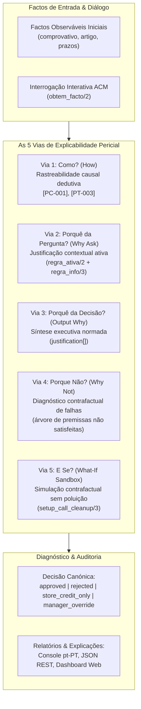
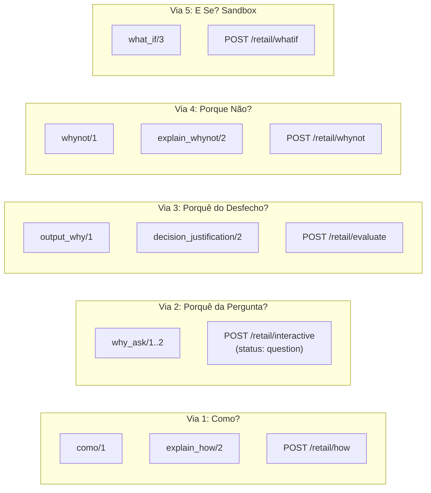
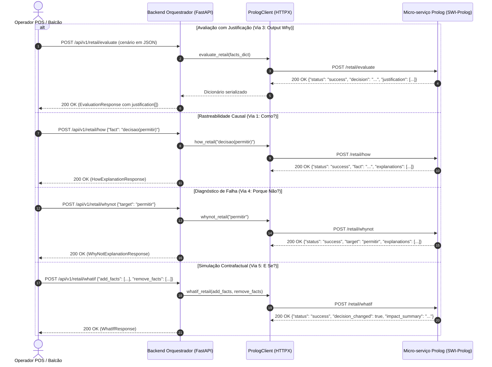

# Requisito Primordial: Explicabilidade e Transparência
### *Diagnóstico Explicativo e as 5 Vias de Explicabilidade em Sistemas Periciais de Retalho*

---

## 1. Filosofia de Diagnóstico e Transparência

Em ambientes operacionais de retalho moderno, uma decisão automatizada emitida por um sistema de Inteligência Artificial sem fundamentação compreensível é inaceitável:

1. **Impacto no Relacionamento com o Consumidor:** Um cliente ao balcão a quem é recusada uma devolução ou limitado o estorno a crédito de loja necessita de uma justificação clara, objetiva e imediata dos motivos da decisão. A recusa sem explicação gera tensão no balcão e degrada a reputação da marca.
2. **Capacitação dos Colaboradores:** Os operadores de caixa e assistentes de loja (*associates* e *stylists*) necessitam de compreender a regra de negócio aplicada para argumentarem com segurança e rigor normativo perante o cliente.
3. **Auditoria e Conformidade Legal:** As decisões de recusa ou reembolso estão sujeitas a escrutínio legal, diretivas de proteção ao consumidor e políticas fiscais. Cada avaliação deve ser plenamente auditável e reproduzível.
4. **Superação do Paradigma "Caixa-Negra":** Ao contrário de modelos conexionistas (*Machine Learning / Deep Learning*), onde as predições são opacas e estatísticas, o raciocínio dedutivo simbólico em sistemas periciais garante que cada conclusão decorre de premissas factuais explícitas e regras auditáveis.

O sistema pericial foi concebido sob o princípio de **Explicabilidade Nativa (*Explainability by Design*)**: a justificação não é uma reflexão posterior gerada heuristicamente, mas sim a transcrição e rastreio formal das regras lógicas ativadas durante o processo de inferência.

Para responder às exigências analíticas da operação de retalho, o sistema disponibiliza **cinco perspetivas complementares de explicabilidade**:



---

## 2. Estrutura da Cadeia de Justificações (`justification[]`)

O contrato de dados do ecossistema estabelece que todas as respostas de avaliação integram uma lista estruturada de justificações no campo `justification: list[str]` do modelo canónico [`EvaluationResponse`](../api/schemas.md#evaluationresponse):

```json
{
  "status": "success",
  "decision": "approved",
  "justification": [
    "[PC-001] Artigo não usado com etiquetas originais intactas cumpre os requisitos de elegibilidade física.",
    "[PT-003] Devolução verificada com comprovativo válido apresentada dentro da janela regulamentar de 30 dias (14 dias decorridos).",
    "[TN-001] Reembolso total autorizado através de estorno tokenizado no método de liquidação original (cartão de crédito)."
  ],
  "rules_fired": [
    "PC-001",
    "PT-003",
    "TN-001"
  ],
  "engine": "prolog",
  "timestamp": "2026-10-14T18:30:00Z"
}
```

### Regras de Construção da Cadeia Explicativa:
* **Ordem Lógica Causal:** As justificações são ordenadas das premissas para a conclusão (avaliação de conformidade do colaborador $\rightarrow$ elegibilidade física do artigo $\rightarrow$ validação do comprovativo $\rightarrow$ validação do prazo $\rightarrow$ determinação do método de liquidação).
* **Identificação Normativa Formal:** Todas as justificações do motor de retalho em Prolog incluem o identificador da regra de negócio entre parêntesis retos (ex.: `[HS-006]`, `[PC-008]`, `[PT-003]`), garantindo rastreabilidade direta face às políticas oficiais da Levi's.
* **Multi-critério Cumulativo:** Em cenários de infração ou restrição múltipla (ex.: artigo lavado E sem recibo), o sistema regista todos os motivos de impedimento em vez de abortar silenciosamente no primeiro teste.

---

## 3. Modelo de Explicabilidade em 5 Vias no SWI-Prolog

O micro-serviço SWI-Prolog ([`prolog_engine`](../../prolog_engine)) implementa o modelo formal de **5 Vias de Explicabilidade Pericial**, acessíveis quer programaticamente no terminal Prolog, quer através da API REST:



### 3.1 Via 1: Como? (`como/1` / `explain_how/2` — How)
A Via 1 fornece a **rastreabilidade causal dedutiva retrospetiva**. Dado um facto provado ou a decisão final, reconstrói a árvore de derivação que conduziu a essa conclusão.

* **Discriminação de Proveniência:** O predicado distingue de forma explícita a origem de cada facto:
  * Factos fornecidos diretamente pelo operador durante o diálogo (`justifica(FactId, utilizador, _)`);
  * Factos iniciais carregados no cenário (`justifica(FactId, inicial, _)`);
  * Factos deduzidos por regras normativas (`justifica(FactId, RuleId, SupportingFacts)`).
* **Formatação Formal de Regras:** Os identificadores de regra são formatados com parêntesis retos (ex.: `[PC-001]`).
* **Predicados Prolog Centrais:**
  ```prolog
  % Impressão na consola em prosa em Português com indentação hierárquica
  como(+FactInput)

  % Extração estruturada de rasto como lista de strings para API REST
  explain_how(+FactInput, -ExplanationList)
  ```
* **Exemplo de Saída na Consola (`como/1`):**
  ```text
  Concluiu o facto nº 8 -> decisao(permitir) pela regra [PT-003] com base nos factos: [5, 6, 7].
    O facto nº 5 -> tipo_verificacao(devolucao_verificada) era um facto inicial da base.
    Concluiu o facto nº 6 -> elegibilidade_produto(elegivel) pela regra [PC-001] com base nos factos: [3].
      O facto nº 3 -> estado_produto(nao_usado_com_etiquetas) foi fornecido pelo utilizador (operador de balcão).
    O facto nº 7 -> dias_desde_compra(14) era um facto inicial da base.
  ```

---

### 3.2 Via 2: Porquê da Pergunta? (`why_ask/1..2` — Why Ask)
A Via 2 resolve a fricção no balcão de atendimento quando o operador de caixa não compreende o motivo pelo qual o sistema lhe está a solicitar um determinado atributo.

* **Rastreamento de Regra Ativa:** Durante a interrogação dialógica conduzida por `obtem_facto/2`, o motor regista dinamicamente a regra candidata em avaliação através do predicado transacional `regra_ativa(RuleId, IndicePremissa)`.
* **Fundamentação Normativa com `regra_info/3`:** O motor consulta os metadados da regra ativa para formular uma resposta fundamentada em Português, esclarecendo o objetivo comercial e o normativo aplicável.
* **Tratamento de Perguntas do Operador:** Quando o operador responde `"porquê?"` a uma questão, o motor não aborta a inferência: devolve a explicação da Via 2 e repete a questão de forma polida.
* **Predicados Prolog Centrais:**
  ```prolog
  % Devolve a fundamentação da pergunta associada à regra ativa em teste
  why_ask(-ExplanationText)

  % Devolve a fundamentação normativa de uma regra específica
  why_ask(+RuleId, -ExplanationText)
  ```
* **Exemplo de Explicação Gerada:**
  ```text
  --- [PORQUÊ DA PERGUNTA] ---
  Regra candidata em teste: [PC-008] (Família: Product Condition)
  Objetivo: Recusar e isolar em saco de risco biológico artigos sujos ou contaminados.
  Esta questão é necessária para verificar se o artigo apresenta risco sanitário antes de prosseguir com a avaliação comercial.
  ```

---

### 3.3 Via 3: Porquê do Desfecho? (`output_why/1` / `decision_justification/2` — Output Why)
A Via 3 sintetiza as razões executivas da conclusão final alcançada pelo motor, produzindo o vetor canónico `justification[]`.

* **Consolidação Determinística:** O motor recolhe todos os factos do tipo `motivo(M)` gerados pelas ações das regras disparadas (`cria_facto(motivo(...))`). Caso não existam motivos textuais explícitos, compila descrições normativas a partir de `regra_disparada(RID)` e `regra_info(RID, _, Desc)`.
* **Integração com DTO Canónico:** As justificações são mapeadas de forma direta para a chave `justification` de `EvaluationResponse`.
* **Predicados Prolog Centrais:**
  ```prolog
  % Devolve a lista de justificações normadas
  output_why(-JustificationsList)

  % Devolve o par atómico (Decisao, Justificacoes)
  decision_justification(-Decision, -JustificationsList)
  ```
* **Exemplo de Saída na Consola (`output_why/0`):**
  ```text
  === [PORQUÊ DA DECISÃO: recusar] ===
  • [HS-002] Marca excluída: Dockers, Levi Strauss Signature, Beyond Yoga ou grossista não vendido não são aceites em lojas Levi's.
  ```

---

### 3.4 Via 4: Porque Não? (`whynot/1` / `explain_whynot/2` — Why Not)
A Via 4 responde à pergunta analítica fundamental: *"Por que razão a devolução não foi aprovada?"* ou *"Por que razão a regra X não disparou?"*.

* **Árvore Recursiva de Falhas:** O predicado analisa a estrutura de todas as regras que poderiam ter concluído a meta pretendida (por exemplo, `decisao(permitir)` ou `permitir`). Decompõe recursivamente:
  * Conjunções lógicas `Premissa1 e Premissa2`;
  * Negações lógicas `nao Premissa`;
  * Condições aritméticas e de pertença `avalia(Condicao)`.
* **Identificação Precisa de Condições em Falta:** Reporta de forma cirúrgica qual ou quais as premissas que não se verificaram na memória de trabalho.
* **Predicados Prolog Centrais:**
  ```prolog
  % Impressão na consola em Português da árvore de falhas
  whynot(+FactInput)

  % Lista estruturada de explicações de falha para a API REST
  explain_whynot(+FactInput, -ExplanationList)
  ```
* **Exemplo de Saída (`whynot(permitir)` quando o prazo expirou):**
  ```text
  Because by rule [PT-003]:
    Condition dias_desde_compra(D) <= 30 is false (valor atual: 45)
  Because by rule [PC-006]:
    Condition defeito_fabrico(true) is false
  ```

---

### 3.5 Via 5: E Se? Sandbox (`what_if/3` — What-If Sandbox)
A Via 5 viabiliza a **simulação contrafactual sem poluição de memória**, permitindo aos operadores e gestores de loja colocar questões do tipo: *"E se o cliente tivesse trazido o recibo de compra?"* ou *"E se o artigo não estivesse lavado?"*.

* **Isolamento Transacional via `setup_call_cleanup/3`:** O motor captura um snapshot completo da memória dinâmica da sessão (`facto/2`, `ultimo_facto/1`, `justifica/3`, `ja_perguntado/1`), executa a inferência hipotética com os factos adicionados/removidos, calcula a divergência de desfecho e restaura obrigatoriamente o estado anterior, mesmo perante exceções.
* **Contrato Estruturado de Resposta:** A simulação devolve um dicionário com `baseline_decision`, `simulated_decision`, `decision_changed` (booleano) e `impact_summary`.
* **Predicado Prolog Central:**
  ```prolog
  what_if(+FactosAdicionar, +FactosRemover, -ResultadoComparativo)
  ```
* **Exemplo de Resultado do What-If:**
  ```prolog
  ResultadoComparativo = _{
    baseline_decision: recusar,
    simulated_decision: permitir,
    decision_changed: true,
    impact_summary: "Alteração de decisão: de recusar para permitir."
  }
  ```

---

## 4. Matriz Comparativa: Prolog Engine vs. Drools Engine

O ecossistema dispõe de dois motores periciais completos para validação cruzada das políticas da Levi's. A tabela abaixo compara as respetivas implementações de explicabilidade:

| Dimensão de Explicabilidade | Motor SWI-Prolog (`retail_engine`) | Motor Drools (`drools_engine`) |
|:---|:---|:---|
| **Paradigma de Raciocínio** | Dedutivo de Primeira Ordem (*Forward Chaining* modular com metaprogramação) | Regras de Produção Reativas (*Pattern Matching* baseado em Rete-OO / Phreak) |
| **Arquitetura de Memória** | Memória volátil por sessão, isolamento transacional estrito, sem necessidade de base de dados | Estado persistido em PostgreSQL com tabelas de avaliações, regras e premissas |
| **Via 1: Como? (*How*)** | `como/1` e `explain_how/2` com grafo dedutivo e distinção de proveniência (`utilizador`, `inicial`, `regra`) | Rasto histórico de regras ativadas na agenda (*ActivationListener*) via `GET /explicacoes/como` |
| **Via 2: Porquê da Pergunta? (*Why Ask*)** | Rastreamento dinâmico da regra ativa (`regra_ativa/2`) e interrogação contextual com a mecânica ACM (`obtem_facto/2`) | Não aplicável diretamente em modo lote; simulação interativa via múltiplos passos REST |
| **Via 3: Porquê do Desfecho? (*Output Why*)** | `output_why/1` agregando motivos normativos com prefixos canónicos `[PC-001]` no campo `justification[]` | Justificações acumuladas no objeto de resposta (`EvaluationResponse.justification`) |
| **Via 4: Porque Não? (*Why Not*)** | `whynot/1` e `explain_whynot/2` inspecionando recursivamente antecedentes e premissas falsas | `GET /explicacoes/porque-nao` analisando nós e premissas não satisfeitas no grafo Rete |
| **Via 5: E Se? (*What-If Sandbox*)** | `what_if/3` em sandbox com snapshot dinâmico e garantia transacional via `setup_call_cleanup/3` | Reavaliação pontual contra base de dados com mutação controlada de atributos |
| **Latência Típica de Execução** | Inferior a 5 milissegundos (execução pura em memória RAM) | Entre 15 e 40 milissegundos (devido a I/O e persistência JPA/Hibernate) |
| **Independência Operacional** | Micro-serviço autónomo em Docker sem dependências externas de armazenamento | Requer contentor PostgreSQL ativo e pool de conexões JDBC |

---

## 5. Fluxo de Geração e Propagação da Explicabilidade

O diagrama abaixo ilustra a propagação transparente das 5 vias de explicabilidade desde as regras internas do SWI-Prolog até à aplicação cliente:



---

## 6. Exemplos Reais de Payloads e Diagnósticos de Retalho

Abaixo documentam-se cenários práticos reais da política da Levi's processados pelo motor de retalho em Prolog:

### Cenário A: Aprovação Integral de Devolução (`approved`)
* **Situação:** Artigo de vestuário não usado com etiquetas intactas, com recibo impresso e apresentado aos 14 dias da compra.
* **Diagnóstico Produzido (`POST /api/v1/retail/evaluate`):**
  ```json
  {
    "status": "success",
    "decision": "approved",
    "justification": [
      "[PC-001] Artigo não usado com etiquetas originais intactas cumpre os requisitos de elegibilidade física.",
      "[PT-003] Devolução verificada com comprovativo válido apresentada dentro da janela regulamentar de 30 dias.",
      "[TN-001] Reembolso total autorizado no meio de pagamento original."
    ],
    "rules_fired": [
      "PC-001",
      "PT-003",
      "TN-001"
    ],
    "engine": "prolog",
    "timestamp": "2026-10-14T18:45:00Z"
  }
  ```

---

### Cenário B: Rejeição por Risco Biológico / Insalubridade (`rejected`)
* **Situação:** Artigo com marcas de sujidade ou fluidos biológicos (Precedência 4 — sobrepõe-se a prazos e comprovativos).
* **Diagnóstico Produzido (`POST /api/v1/retail/evaluate`):**
  ```json
  {
    "status": "success",
    "decision": "rejected",
    "justification": [
      "[PC-008] Recusar e isolar em saco de risco biológico artigos sujos ou contaminados por risco à saúde pública."
    ],
    "rules_fired": [
      "PC-008"
    ],
    "engine": "prolog",
    "timestamp": "2026-10-14T18:45:10Z"
  }
  ```

---

### Cenário C: Restrição a Crédito de Loja por Devolução às Cegas (`store_credit_only`)
* **Situação:** Cliente apresenta artigo em estado novo, mas sem qualquer comprovativo de compra (*blind return*).
* **Diagnóstico Produzido (`POST /api/v1/retail/evaluate`):**
  ```json
  {
    "status": "success",
    "decision": "store_credit_only",
    "justification": [
      "[PC-001] Artigo não usado com etiquetas originais intactas cumpre os requisitos de elegibilidade física.",
      "[PT-002] Classificar como devolução às cegas na ausência de comprovativo de compra verificável.",
      "[PT-005] Devolução às cegas com artigo elegível autorizada exclusivamente para troca ou crédito de loja ao preço de venda atual."
    ],
    "rules_fired": [
      "PC-001",
      "PT-002",
      "PT-005"
    ],
    "engine": "prolog",
    "timestamp": "2026-10-14T18:45:20Z"
  }
  ```

---

### Cenário D: Intervenção de Gerência por Artigo Sem Etiquetas (`manager_override`)
* **Situação:** Artigo não usado mas com etiquetas removidas pelo cliente.
* **Diagnóstico Produzido (`POST /api/v1/retail/evaluate`):**
  ```json
  {
    "status": "success",
    "decision": "manager_override",
    "justification": [
      "[PC-003] Rever com gestão artigo não usado sem etiquetas; aprovar apenas se puder ser preparado para venda e colocado novo código."
    ],
    "rules_fired": [
      "PC-003"
    ],
    "engine": "prolog",
    "timestamp": "2026-10-14T18:45:30Z"
  }
  ```

---

### Cenário E: Resposta da Via 1 (Como? — `POST /api/v1/retail/how`)
* **Corpo do Pedido:**
  ```json
  {
    "fact": "decisao(permitir)"
  }
  ```
* **Diagnóstico Produzido (HTTP 200 OK):**
  ```json
  {
    "status": "success",
    "fact": "decisao(permitir)",
    "fact_id": 8,
    "explanations": [
      "Fact 8 -> decisao(permitir) concluded by rule [PT-003]",
      "Based on facts: [5, 6, 7]",
      "Fact 5 -> tipo_verificacao(devolucao_verificada) was an initial fact",
      "Fact 6 -> elegibilidade_produto(elegivel) concluded by rule [PC-001]",
      "Based on facts: [3]",
      "Fact 3 -> estado_produto(nao_usado_com_etiquetas) was provided by user (operador)",
      "Fact 7 -> dias_desde_compra(14) was an initial fact"
    ]
  }
  ```

---

### Cenário F: Resposta da Via 4 (Porque Não? — `POST /api/v1/retail/whynot`)
* **Corpo do Pedido:**
  ```json
  {
    "target": "permitir"
  }
  ```
* **Diagnóstico Produzido (HTTP 200 OK):**
  ```json
  {
    "status": "success",
    "target": "permitir",
    "explanations": [
      "Because by rule [PT-003]:",
      "  Condition dias_desde_compra(D) <= 30 is false",
      "Because by rule [PC-006]:",
      "  Condition defeito_fabrico(true) is false"
    ]
  }
  ```

---

### Cenário G: Resposta da Via 5 (E Se? — `POST /api/v1/retail/whatif`)
* **Corpo do Pedido:**
  ```json
  {
    "add_facts": [
      "comprovativo(recibo_impresso)",
      "dias_desde_compra(10)"
    ],
    "remove_facts": [
      "comprovativo(sem_recibo)"
    ]
  }
  ```
* **Diagnóstico Produzido (HTTP 200 OK):**
  ```json
  {
    "status": "success",
    "baseline_decision": "store_credit_only",
    "simulated_decision": "approved",
    "decision_changed": true,
    "baseline_justification": [
      "[PT-005] Devolução às cegas autorizada exclusivamente para troca ou crédito de loja."
    ],
    "simulated_justification": [
      "[PC-001] Artigo não usado com etiquetas originais intactas cumpre os requisitos de elegibilidade.",
      "[PT-003] Devolução verificada com comprovativo válido apresentada até 30 dias autoriza reembolso total."
    ],
    "impact_summary": "Alteração de decisão: de store_credit_only para approved."
  }
  ```

---

## 7. Exemplos de Execução e Teste de Explicabilidade

### 7.1 Execução via cURL (Linux / macOS / Git Bash)

#### Avaliação de Cenário com Justificação Completa:
```bash
curl -X POST http://localhost:8000/api/v1/retail/evaluate \
  -H "Content-Type: application/json" \
  -d '{
    "colaborador_autorizado": true,
    "sku_reconhecido": true,
    "estado_produto": "nao_usado_com_etiquetas",
    "comprovativo": "recibo_impresso",
    "dias_desde_compra": 14,
    "meio_pagamento": "credito"
  }'
```

#### Consulta de Rastreabilidade Causal (Como?):
```bash
curl -X POST http://localhost:8000/api/v1/retail/how \
  -H "Content-Type: application/json" \
  -d '{"fact": "decisao(permitir)"}'
```

#### Diagnóstico Contrafactual de Falha (Porque Não?):
```bash
curl -X POST http://localhost:8000/api/v1/retail/whynot \
  -H "Content-Type: application/json" \
  -d '{"target": "permitir"}'
```

#### Simulação Contrafactual em Sandbox (E Se?):
```bash
curl -X POST http://localhost:8000/api/v1/retail/whatif \
  -H "Content-Type: application/json" \
  -d '{
    "add_facts": ["comprovativo(recibo_impresso)", "dias_desde_compra(10)"],
    "remove_facts": ["comprovativo(sem_recibo)"]
  }'
```

---

### 7.2 Execução via PowerShell (Windows)

#### Avaliação de Cenário com Justificação Completa:
```powershell
$body = @{
    colaborador_autorizado = $true
    sku_reconhecido        = $true
    estado_produto         = "nao_usado_com_etiquetas"
    comprovativo           = "recibo_impresso"
    dias_desde_compra      = 14
    meio_pagamento         = "credito"
} | ConvertTo-Json

$response = Invoke-RestMethod -Uri "http://localhost:8000/api/v1/retail/evaluate" `
    -Method Post `
    -ContentType "application/json" `
    -Body $body

$response | ConvertTo-Json -Depth 5
```

#### Consulta de Simulação Contrafactual (E Se?):
```powershell
$whatIfBody = @{
    add_facts    = @("comprovativo(recibo_impresso)", "dias_desde_compra(10)")
    remove_facts = @("comprovativo(sem_recibo)")
} | ConvertTo-Json

$whatIfResp = Invoke-RestMethod -Uri "http://localhost:8000/api/v1/retail/whatif" `
    -Method Post `
    -ContentType "application/json" `
    -Body $whatIfBody

$whatIfResp | ConvertTo-Json -Depth 5
```

---

## 8. Documentos Relacionados

* [Contexto de Negócio e Enquadramento Académico](business_context.md) — Objetivos e enquadramento do projeto no MEIA.
* [Base de Conhecimento e Heurísticas do Perito](expert_knowledge.md) — As 71 regras da Levi's e a hierarquia estrita de precedências.
* [Referência da API do Motor Prolog](../api/prolog_engine_api.md) — Especificação técnica dos 7 endpoints internos `/retail/*`.
* [Referência da API do Orquestrador](../api/orchestrator_api_v1.md) — Endpoints REST públicos `/api/v1/retail/*`.
* [Especificação de Schemas Pydantic / DTOs](../api/schemas.md) — Modelos de dados canónicos de explicabilidade.
* [Arquitetura do Motor Prolog](../architecture/prolog_engine.md) — Implementação da Clean Architecture e motor `retail_engine`.
* [Interações entre Serviços e Fluxos](../architecture/service_interactions.md) — Diagramas de sequência detalhados para diálogo e sandbox.
