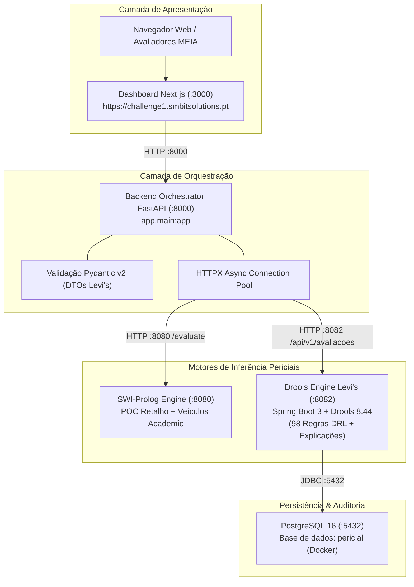
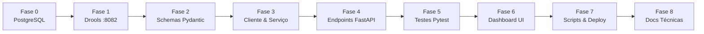

# Plano Mestre de Integração: Motor Drools Levi's na Arquitetura Central
### *Sistema Pericial de Diagnóstico de Devoluções e Trocas no Retalho (Levi's)*
#### *Mestrado em Engenharia de Inteligência Artificial (MEIA 2026/2027) — Equipa 3*

---

> [!IMPORTANT]
> **Manual de Execução para Agentes LLM (Gemini 3.8 Flash):**
> Este documento é o plano mestre auto-contido para a integração do motor de regras **Drools Levi's** ([`drools-engine-levis-devolucoes-java/`](file:///root/meia-equipa3-challenge1-26_27/drools-engine-levis-devolucoes-java)) na arquitetura operacional do sistema ([`backend_orchestrator/`](file:///root/meia-equipa3-challenge1-26_27/backend_orchestrator) e [`dashboard/`](file:///root/meia-equipa3-challenge1-26_27/dashboard)).
> **Instruções para o Agente:**
> 1. Executa uma fase de cada vez.
> 2. Não avances para a fase seguinte sem executar e validar os critérios de aceitação e os comandos de teste da fase atual.
> 3. Respeita a "Regra de Ouro": o Backend Orchestrator (FastAPI) **nunca** implementa regras de negócio; apenas valida schemas, encaminha pedidos, trata erros e formata respostas.

---

## 1. Contexto do Projeto e Estado Atual

### 1.1 O Desafio e o Domínio de Negócio
O sistema foi concebido para triagem e diagnóstico automatizado de devoluções, trocas e ajustes de preço no retalho de vestuário (**Levi's** EUA e Canadá: Mainline, Outlet, levi.com/levi.ca e BackPocket).
O núcleo do sistema baseia-se em **regras de produção** e **explicabilidade nativa** (*Why / Why not / How / What if / Missing data*).

### 1.2 Topologia Atual de Serviços na Máquina Host
Os seguintes serviços já correm nesta máquina (geridos por [`start_all.sh`](file:///root/meia-equipa3-challenge1-26_27/start_all.sh) e expostos publicamente em `https://challenge1.smbitsolutions.pt`):

| Serviço | Diretório | Tecnologia | Porta Host | Função Atual |
|:---|:---|:---|:---:|:---|
| **SWI-Prolog Engine** | [`prolog_engine/`](file:///root/meia-equipa3-challenge1-26_27/prolog_engine) | SWI-Prolog daemon HTTP | `:8080` | Regras POC (`rules.pl`) e motor académico de veículos (`sp_exp2.pl`). |
| **Drools Engine Legado** | [`drools_engine/`](file:///root/meia-equipa3-challenge1-26_27/drools_engine) | Java 21 / Spring Boot 3.3 | `:8082` | **Toy example:** Diagnóstico clínico de hemorragias (`haemorrhage_rules.drl`). |
| **Backend Orchestrator** | [`backend_orchestrator/`](file:///root/meia-equipa3-challenge1-26_27/backend_orchestrator) | Python 3.11 / FastAPI | `:8000` | Fachada REST e validação Pydantic. |
| **Dashboard** | [`dashboard/`](file:///root/meia-equipa3-challenge1-26_27/dashboard) | Next.js 15 / React / Tailwind | `:3000` | Interface pública acessível aos avaliadores. |

### 1.3 O que o Colega Desenvolveu em [`drools-engine-levis-devolucoes-java/`](file:///root/meia-equipa3-challenge1-26_27/drools-engine-levis-devolucoes-java)
O colega construiu um sistema de nível empresarial autónomo, com 7 sub-módulos Maven:
* **`pericial-model`**: 16 POJOs e 22 enums de domínio (pedidos, lojas, compras, artigos, `DecisaoArtigo`).
* **`pericial-rules`**: 98 regras DRL (76 IDs de regras do perito) divididas por módulos `M0` a `M9`, mais 10 cenários JSON em [`backend/pericial-rules/src/test/resources/cenarios/`](file:///root/meia-equipa3-challenge1-26_27/drools-engine-levis-devolucoes-java/backend/pericial-rules/src/test/resources/cenarios).
* **`pericial-explanation`**: Motor de explicabilidade de 5 vias (*Como*, *Porque Não*, *Porquê*, *E Se*, *O Que Falta*).
* **`pericial-dto`**: Records imutáveis com validações Jakarta Bean Validation.
* **`pericial-persistence`**: PostgreSQL 16 + Flyway (`V1__esquema_inicial.sql`), persistindo avaliações em `JSONB` e auditoria da versão do kjar.
* **`pericial-service`**: Serviços de aplicação e adaptadores simulados (POS, Catálogo, BackPocket, Pagamentos).
* **`pericial-api`**: Spring Boot REST com autenticação JWT (modo `dev` emite tokens para perfis de loja em `/api/v1/dev/tokens`).

---

## 2. Arquitetura Alvo Integrada



---

## 3. Matriz de Decisões de Arquitetura (ADRs)

1. **Porta do Motor Drools Levi's:**
   * O motor do colega vem configurado com `:8080` (conflito direto com o Prolog).
   * **Decisão:** O novo motor Drools correrá na porta **`:8082`** (substituindo o exemplo legado de hemorragias).
2. **Persistência PostgreSQL:**
   * O motor do colega exige PostgreSQL para guardar avaliações e permitir as explicações causais (`/explicacoes/como` e `/porque-nao` requerem o UUID da avaliação).
   * **Decisão:** Arrancar um contentor Docker dedicado `postgres-pericial` com imagem `postgres:16-alpine` na porta padrão `5432`, com volume persistente.
3. **Autenticação e Colaborador de Loja:**
   * O motor do colega extrai a identidade do colaborador do token JWT (regra `HS-006`).
   * No perfil `dev`, a API disponibiliza `POST /api/v1/dev/tokens` que emite um token válido para qualquer perfil (`DEV-GL`, `DEV-KH`, `DEV-LC`, `DEV-ST`).
   * **Decisão:** O cliente HTTP do FastAPI (`LevisClient`) obterá/armazenará automaticamente em cache um token JWT de desenvolvimento (usando por omissão o perfil `Key Holder` ou `Store Manager`), injetando-o no cabeçalho `Authorization: Bearer <token>`.
4. **Coexistência com o Motor Prolog:**
   * O motor Prolog mantém-se intocado na porta `:8080`.
   * O FastAPI passará a ter a família de rotas `/api/v1/levis/*` para o motor Drools real de retalho, preservando as rotas legadas para compatibilidade.
5. **Dashboard Next.js:**
   * O Dashboard receberá uma aba dedicada e moderna **"Devoluções Levi's (Drools Expert)"**, permitindo selecionar os 10 cenários pré-configurados do perito, submeter avaliações personalizadas e inspecionar visualmente as 5 vertentes de explicabilidade.

---

## 4. Fases de Implementação Passo a Passo



---

### Fase 0: Infraestrutura de Dados PostgreSQL

#### Objetivo
Garantir que uma instância PostgreSQL está ativa na porta `5432`, com a base de dados `pericial` criada e pronta para as migrações do Flyway.

#### Ficheiros a criar / alterar
* [`docker-compose.yml`](file:///root/meia-equipa3-challenge1-26_27/docker-compose.yml) (raiz do projeto) ou comando Docker direto.

#### Passos de Execução
1. Verificar se a porta `5432` está livre:
   ```bash
   ss -tulpn | grep 5432 || true
   ```
2. Iniciar contentor PostgreSQL caso não esteja a correr:
   ```bash
   docker run -d \
     --name levis-postgres \
     --restart unless-stopped \
     -e POSTGRES_DB=pericial \
     -e POSTGRES_USER=pericial \
     -e POSTGRES_PASSWORD=pericial \
     -p 5432:5432 \
     -v levis_postgres_data:/var/lib/postgresql/data \
     postgres:16-alpine
   ```
3. Testar disponibilidade da base de dados:
   ```bash
   docker exec levis-postgres pg_isready -U pericial -d pericial
   ```

#### Critério de Aceitação da Fase 0
* O comando `pg_isready` devolve `accepting connections`.

---

### Fase 1: Configuração e Operação do Motor Drools Levi's na Porta 8082

#### Objetivo
Configurar o projeto [`drools-engine-levis-devolucoes-java`](file:///root/meia-equipa3-challenge1-26_27/drools-engine-levis-devolucoes-java) para utilizar a porta `8082` e ligar ao PostgreSQL na porta `5432`, compilando e validando o arranque nativo.

#### Ficheiros a alterar
* [`drools-engine-levis-devolucoes-java/backend/pericial-api/src/main/resources/application.yml`](file:///root/meia-equipa3-challenge1-26_27/drools-engine-levis-devolucoes-java/backend/pericial-api/src/main/resources/application.yml)
* [`drools-engine-levis-devolucoes-java/backend/pericial-api/src/main/resources/application-dev.yml`](file:///root/meia-equipa3-challenge1-26_27/drools-engine-levis-devolucoes-java/backend/pericial-api/src/main/resources/application-dev.yml)

#### Ajustes Necessários
No `application.yml`:
```yaml
server:
  port: ${SERVER_PORT:8082}
```
No `application-dev.yml`, assegurar que as credenciais correspondem ao contentor Docker:
```yaml
spring:
  datasource:
    url: ${PERICIAL_DB_URL:jdbc:postgresql://localhost:5432/pericial}
    username: ${PERICIAL_DB_UTILIZADOR:pericial}
    password: ${PERICIAL_DB_PALAVRA_PASSE:pericial}
```

#### Passos de Compilação e Arranque
1. Compilar o projeto Maven (gerando os JARs de todos os módulos):
   ```bash
   mvn -f /root/meia-equipa3-challenge1-26_27/drools-engine-levis-devolucoes-java/pom.xml clean package -DskipTests -q
   ```
2. Executar o micro-serviço em background (ou via nohup):
   ```bash
   java -jar /root/meia-equipa3-challenge1-26_27/drools-engine-levis-devolucoes-java/backend/pericial-api/target/pericial-api-*.jar \
     --spring.profiles.active=dev \
     --server.port=8082 > /root/meia-equipa3-challenge1-26_27/logs/drools_levis.log 2>&1 &
   ```
3. Validar arranque e Flyway:
   ```bash
   sleep 10
   curl -sf http://localhost:8082/actuator/health || curl -sf http://localhost:8082/swagger-ui.html
   ```
4. Emitir um token de teste para Key Holder:
   ```bash
   TOKEN=$(curl -s -X POST http://localhost:8082/api/v1/dev/tokens \
     -H "Content-Type: application/json" \
     -d '{"id":"DEV-KH","nome":"Key Holder","funcao":"KEY_HOLDER","aprovadoPeloDistrito":false,"idCredencialPOS":"POS-KH"}' \
     | jq -r .tokenAcesso)
   echo "Token gerado: ${TOKEN:0:20}..."
   ```
5. Submeter uma avaliação de teste com o token:
   ```bash
   curl -s -X POST http://localhost:8082/api/v1/avaliacoes \
     -H "Authorization: Bearer $TOKEN" \
     -H "Content-Type: application/json" \
     -d @/root/meia-equipa3-challenge1-26_27/drools-engine-levis-devolucoes-java/backend/pericial-rules/src/test/resources/cenarios/cenario-01.json \
     | jq '{elegibilidade, tipoTransacao, regras}'
   ```

#### Critério de Aceitação da Fase 1
* O endpoint `/api/v1/avaliacoes` responde com `201 Created` e devolve a decisão esperada para o Cenário 1.
* A tabela `avaliacoes` no PostgreSQL contém o registo da avaliação persistido.

---

### Fase 2: Modelos Pydantic v2 no Backend Orchestrator

#### Objetivo
Mapear com tipagem estrita todos os contratos da API do Drools Levi's para modelos Pydantic no orquestrador Python.

#### Ficheiros a criar / alterar
* Criar: [`backend_orchestrator/app/schemas/levis.py`](file:///root/meia-equipa3-challenge1-26_27/backend_orchestrator/app/schemas/levis.py)
* Atualizar: [`backend_orchestrator/app/schemas/__init__.py`](file:///root/meia-equipa3-challenge1-26_27/backend_orchestrator/app/schemas/__init__.py)

#### Schemas Essenciais a Definir:
1. **Enums de Domínio:**
   * `TipoPedidoEnum`: `DEVOLUCAO`, `TROCA`, `TROCA_MESMO_ARTIGO`, `DEVOLUCAO_OFERTA`, `AJUSTE_PRECO`
   * `ElegibilidadeEnum`: `PERMITIR`, `RECUSAR`, `REVER`, `ENCAMINHAR`
   * `MeioReembolsoEnum`: `MEIO_ORIGINAL`, `CARTAO_OFERTA`, `CREDITO_LOJA`, etc.
   * `CondicaoUsoEnum`: `NAO_USADO`, `USADO`, `LAVADO`, `DEFEITUOSO`, `SUJO`, etc.
   * `EtiquetasEnum`: `COLOCADAS`, `SOLTAS`, `SEM_ETIQUETAS`
2. **Entidades do Pedido (`PedidoAvaliacaoRequest`):**
   * `LojaRequest`, `ClienteRequest`, `CompraOriginalRequest`, `ComprovativoRequest`
   * `ArtigoRequest` (com `EstadoProdutoRequest`), `ArtigoTrocaRequest`
   * `PedidoExcecaoRequest`, `IndicadorFraudeRequest`
3. **Decisão e Resposta (`DecisaoResponse`):**
   * `ResultadoArtigoResponse` (com `destino`, `elegibilidade`, etc.)
   * `RegistoRegraResponse` (com `regraId`, `modulo`, `salience`, `timestamp`)
   * `DocumentacaoResponse`
4. **Modelos de Explicabilidade:**
   * `DadosEmFaltaResponse` e `DadoEmFaltaDto`
   * `ExplicacaoPorqueResponse`
   * `ExplicacaoComoResponse` e `PassoExplicacaoDto`
   * `ExplicacaoPorqueNaoResponse` (e `ExplicacaoPorqueNaoConclusaoResponse`)
   * `SimulacaoRequest` e `SimulacaoResponse` (delta de alteração)
5. **Modelos de Catálogo de Regras:**
   * `RegraResumoDto` e `RegraDetalheDto`

#### Critério de Aceitação da Fase 2
* Os schemas validam sem erro com `pydantic.ValidationError` quando fornecido um payload inválido.
* O payload do `cenario-01.json` é perfeitamente validado por `PedidoAvaliacaoRequest.model_validate(json_data["pedido"])`.

---

### Fase 3: Cliente HTTP e Camada de Serviço no Backend Orchestrator

#### Objetivo
Implementar o cliente assíncrono [`LevisClient`](file:///root/meia-equipa3-challenge1-26_27/backend_orchestrator/app/clients/levis_client.py) e o serviço [`LevisService`](file:///root/meia-equipa3-challenge1-26_27/backend_orchestrator/app/services/levis_service.py), gerindo automaticamente a obtenção e cache do token JWT de desenvolvimento, timeouts e tratamento de erros.

#### Ficheiros a criar / alterar
* [`backend_orchestrator/app/core/config.py`](file:///root/meia-equipa3-challenge1-26_27/backend_orchestrator/app/core/config.py): Adicionar `LEVIS_DROOLS_URL: str = "http://localhost:8082"` e `LEVIS_TIMEOUT_SECONDS: float = 10.0`.
* [`backend_orchestrator/app/clients/levis_client.py`](file:///root/meia-equipa3-challenge1-26_27/backend_orchestrator/app/clients/levis_client.py):
  * Gestão de pool `httpx.AsyncClient`.
  * Método interno `_get_dev_token()` para obter token JWT via `POST /api/v1/dev/tokens` (cache em memória com renovação automática).
  * Métodos tipados para:
    * `evaluate(payload: dict) -> dict`
    * `get_evaluation(id: str) -> dict`
    * `get_missing_data(payload: dict) -> dict`
    * `get_why(dado: str, payload: dict) -> dict`
    * `explain_how(id: str, conclusao: str | None, artigo: str | None) -> dict`
    * `explain_why_not(id: str, conclusao: str | None, regra: str | None, artigo: str | None) -> dict`
    * `simulate(id: str, payload: dict) -> dict`
    * `list_rules() -> list[dict]`
    * `get_rule_detail(code: str) -> dict`
* [`backend_orchestrator/app/services/levis_service.py`](file:///root/meia-equipa3-challenge1-26_27/backend_orchestrator/app/services/levis_service.py): Camada de serviço desacoplada.
* [`backend_orchestrator/app/api/deps.py`](file:///root/meia-equipa3-challenge1-26_27/backend_orchestrator/app/api/deps.py): Função de injeção de dependência `get_levis_service()`.

#### Critério de Aceitação da Fase 3
* O cliente HTTPX comunica com `http://localhost:8082`, autentica-se com sucesso e propaga exceções estruturadas (`LevisConnectionError`, `LevisResponseError`, `LevisTimeoutError`).

---

### Fase 4: Endpoints REST no Backend Orchestrator

#### Objetivo
Expor a API pública unificada do orquestrador sob o prefixo `/api/v1/levis/*` com documentação OpenAPI / Swagger completa.

#### Ficheiros a criar / alterar
* Criar: [`backend_orchestrator/app/api/v1/endpoints/levis.py`](file:///root/meia-equipa3-challenge1-26_27/backend_orchestrator/app/api/v1/endpoints/levis.py)
* Atualizar: [`backend_orchestrator/app/api/v1/router.py`](file:///root/meia-equipa3-challenge1-26_27/backend_orchestrator/app/api/v1/router.py)

#### Endpoints a Implementar:
| Método | Endpoint | Função |
|:---|:---|:---|
| `POST` | `/api/v1/levis/avaliar` | Submete pedido para o motor Drools e devolve `DecisaoResponse`. |
| `GET` | `/api/v1/levis/avaliacoes/{id}` | Consulta o histórico de uma avaliação pelo seu UUID. |
| `POST` | `/api/v1/levis/dados-em-falta` | Analisa o pedido em preenchimento e devolve perguntas em falta (*O que falta?*). |
| `POST` | `/api/v1/levis/porque` | Justifica a necessidade de um dado específico (`IN-xxx`) no pedido (*Porquê?*). |
| `GET` | `/api/v1/levis/avaliacoes/{id}/explicacoes/como` | Retorna o caminho de regras disparadas (*Como?*). |
| `GET` | `/api/v1/levis/avaliacoes/{id}/explicacoes/porque-nao` | Explica a causa da recusa de uma conclusão ou regra (*Porque não?*). |
| `POST` | `/api/v1/levis/avaliacoes/{id}/simulacoes` | Simula variações no pedido original (*E se?*). |
| `GET` | `/api/v1/levis/regras` | Lista regras ativas na base de conhecimento. |
| `GET` | `/api/v1/levis/regras/{codigo}` | Detalhe de uma regra específica. |
| `GET` | `/api/v1/levis/cenarios-exemplo` | Lista os 10 cenários de teste reais (com payload pré-formatado) para consumo rápido pelo frontend. |

#### Critério de Aceitação da Fase 4
* Os endpoints aparecem documentados em `http://localhost:8000/docs` sob a tag `"Levi's Returns Expert Engine (Drools)"`.
* Uma chamada `curl -X POST http://localhost:8000/api/v1/levis/avaliar` retorna `HTTP 200/201` com o veredito completo.

---

### Fase 5: Suíte de Testes Automatizados (Pytest)

#### Objetivo
Garantir cobertura e regressão através de testes unitários e de integração no FastAPI.

#### Ficheiros a criar
* [`backend_orchestrator/tests/test_levis_endpoints.py`](file:///root/meia-equipa3-challenge1-26_27/backend_orchestrator/tests/test_levis_endpoints.py)

#### Cobertura dos Testes:
1. `test_evaluate_levis_scenario_success`: Submissão do Cenário 1 e validação de `elegibilidade == "REVER"`.
2. `test_evaluate_levis_missing_required_fields`: Validação Bean / Pydantic com retorno de `HTTP 422`.
3. `test_levis_explainability_how_and_whynot`: Teste encadeado (avaliar -> obter ID -> consultar `/como` e `/porque-nao`).
4. `test_levis_engine_unavailable`: Simulação de motor desligado com retorno gracioso de `HTTP 503`.

#### Comando de Execução:
```bash
cd /root/meia-equipa3-challenge1-26_27/backend_orchestrator
./venv/bin/pytest tests/test_levis_endpoints.py -v
```

#### Critério de Aceitação da Fase 5
* Todos os testes passam (`passed`) sem avisos de depreciação ou erros.
*  **Concluída com Sucesso**: 12 testes dedicados em `test_levis_endpoints.py` (e 129 testes no total da suite do orquestrador) a passar a 100%.

---

### Fase 6: Integração no Dashboard Next.js

#### Objetivo
Transformar o Dashboard web ([`dashboard/`](file:///root/meia-equipa3-challenge1-26_27/dashboard)) num centro de diagnóstico completo do perito de retalho.

#### Ficheiros a criar / alterar
* [`dashboard/src/types/levis.ts`](file:///root/meia-equipa3-challenge1-26_27/dashboard/src/types/levis.ts): Interfaces TypeScript espelhando os schemas de retorno.
* [`dashboard/src/config/api.ts`](file:///root/meia-equipa3-challenge1-26_27/dashboard/src/config/api.ts): Endpoints e carregamento dos 10 cenários pré-definidos da Levi's.
* [`dashboard/src/app/page.tsx`](file:///root/meia-equipa3-challenge1-26_27/dashboard/src/app/page.tsx):
  * Adicionar aba destacada **"Devoluções Levi's (Drools)"** como vista prioritária.
  * Seletor rápido dos 10 Cenários Oficiais (ex.: *Cenário 1: Troca ao 29.º dia com etiquetas soltas*, *Cenário 4: Artigo personalizado embainhado*, *Cenário 9: Bodywear sem embalagem*, etc.).
  * Visualizador de Decisão Inteligente:
    * Cartão de elegibilidade com cores operacionais (Verde = `PERMITIR`, Vermelho = `RECUSAR`, Amarelo = `REVER`, Azul = `ENCAMINHAR`).
    * Resumo financeiro: valor a reembolsar, meio de liquidação, nível de aprovação necessário.
    * Tabela de decisão por artigo (com indicação do destino: Área de Vendas, Risco Biológico, Danificado, etc.).
  * **Painéis Interativos de Explicabilidade:**
    * **Como?**: Linha temporal das regras acionadas e módulos percorridos.
    * **Porque não?**: Investigação de por que razão o pedido não foi imediatamente `PERMITIR` ou porque não teve reembolso em dinheiro.
    * **Porquê?**: Justificação das questões requeridas ao colaborador.
    * **E se?**: Simulador inline de alterações (ex.: marcar etiquetas como intactas e reavaliar).

#### Critério de Aceitação da Fase 6
* O dashboard compila com sucesso (`npm run build`).
* Ao aceder localmente (`http://localhost:3000`) ou via domínio público (`https://challenge1.smbitsolutions.pt`), a nova funcionalidade permite selecionar qualquer um dos 10 cenários e visualizar as decisões e explicações em menos de 1 segundo.
*  **Concluída com Sucesso**: Aba prioritária "Devoluções Levi's (Drools)" implementada com seletor instantâneo dos 10 cenários oficiais, visualizador de elegibilidade operacional (PERMITIR/RECUSAR/REVER/ENCAMINHAR), tabela de artigos por destino físico e painéis interativos de explicabilidade em 4 vias (Como?, Porque não?, Porquê?, E se?). Build e execução validados com sucesso.

---

### Fase 7: Automatização Operacional e Scripts de Ciclo de Vida

#### Objetivo
Garantir que a stack completa arranca de forma fiável, unificada e persistente com um único comando.

#### Ficheiros a alterar
* [`start_all.sh`](file:///root/meia-equipa3-challenge1-26_27/start_all.sh)
* [`stop_all.sh`](file:///root/meia-equipa3-challenge1-26_27/stop_all.sh)

#### Atualizações nos Scripts:
1. **`stop_all.sh`**:
   * Terminar processos do Drools Levi's na porta 8082 (`pkill -f pericial-api || true`).
   * Manter o contentor PostgreSQL a correr ou pará-lo ordenadamente.
2. **`start_all.sh`**:
   * Passo 1: Garantir que o contentor `levis-postgres` está saudável (`pg_isready`).
   * Passo 2: Compilar e arrancar o `pericial-api` na porta 8082:
     ```bash
     mvn -f "$PROJECT_ROOT/drools-engine-levis-devolucoes-java/pom.xml" package -DskipTests -q
     nohup java -jar "$PROJECT_ROOT/drools-engine-levis-devolucoes-java/backend/pericial-api/target/pericial-api-*.jar" \
       --spring.profiles.active=dev --server.port=8082 > "$PROJECT_ROOT/logs/drools_levis.log" 2>&1 &
     ```
   * Passo 3: Arrancar o Prolog (:8080), FastAPI (:8000) e Dashboard (:3000).
   * Passo 4: Validação de saúde com `curl` a todos os serviços.

#### Critério de Aceitação da Fase 7
* Executar `./stop_all.sh && ./start_all.sh` reinicia a stack sem erros, com saída ` Tudo operacional!`.
*  **Concluída com Sucesso**: Scripts `stop_all.sh` e `start_all.sh` atualizados e validados. O encerramento termina ordenadamente `pericial-api`, `drools-engine`, `uvicorn`, `next-server` e `swipl`, libertando as portas e mantendo o PostgreSQL ativo. O arranque valida a base de dados PostgreSQL, compila e inicializa o `pericial-api` (:8082), compila e inicia o Dashboard (:3000), arranca o Prolog (:8080) e FastAPI (:8000), e executa a verificação de saúde com sucesso devolvendo ` Tudo operacional!`.

---

### Fase 8: Atualização da Documentação Técnica do Repositório

#### Objetivo
Alinhar a documentação técnica oficial em [`docs/`](file:///root/meia-equipa3-challenge1-26_27/docs) para refletir que o motor Drools agora corre a base de regras da Levi's e não o modelo clínico legado.

#### Ficheiros a atualizar
* [`docs/README.md`](file:///root/meia-equipa3-challenge1-26_27/docs/README.md): Adicionar a referência ao novo motor e plano de integração.
* [`docs/architecture/drools_engine.md`](file:///root/meia-equipa3-challenge1-26_27/docs/architecture/drools_engine.md): Documentar os 7 módulos do Drools Levi's, as 98 regras e o motor de explicabilidade.
* [`docs/architecture/service_interactions.md`](file:///root/meia-equipa3-challenge1-26_27/docs/architecture/service_interactions.md): Atualizar os diagramas de sequência com as chamadas de retalho Levi's e autenticação JWT dev.
* [`docs/api/orchestrator_api_v1.md`](file:///root/meia-equipa3-challenge1-26_27/docs/api/orchestrator_api_v1.md): Documentar os novos endpoints `/api/v1/levis/*`.

#### Critério de Aceitação da Fase 8
* Todos os ficheiros técnicos de arquitetura e APIs encontram-se atualizados e consistentes.
*  **Concluída com Sucesso**: Documentação técnica atualizada em `docs/README.md`, `docs/architecture/drools_engine.md`, `docs/architecture/service_interactions.md`, `docs/architecture/README.md`, `docs/api/orchestrator_api_v1.md`, `docs/api/README.md` e no `README.md` da raiz. O motor Drools Levi's (7 módulos Maven, 98 regras DRL nos módulos M0 a M9, explicabilidade em 5 vertentes, ciclo de vida com autenticação JWT dev e persistência em PostgreSQL) e toda a família de endpoints `/api/v1/levis/*` encontram-se rigorosamente documentados.

---

## 5. Matriz de Resolução de Problemas para os Agentes

| Sintoma de Falha | Causa Provável | Solução Rápida |
|:---|:---|:---|
| `Connection refused: localhost:5432` | Contentor PostgreSQL desligado. | Executar `docker start levis-postgres` ou comando de criação na Fase 0. |
| `Port 8082 already in use` | Processo do Drools legado ainda ativo. | Identificar com `fuser -k 8082/tcp` e matar o processo antigo. |
| `401 Unauthorized` nos endpoints do Drools | Falta de token JWT ou cabeçalho incorreto. | Assegurar que o `LevisClient` chama `POST /api/v1/dev/tokens` e envia `Authorization: Bearer <token>`. |
| `422 Unprocessable Entity` ao avaliar cenário | Incompatibilidade de nomes de campos (ex.: `camelCase` vs `snake_case`). | Configurar aliases Pydantic (`validation_alias=AliasGenerator(to_camel)` ou `populate_by_name=True`). |
| Falha no build Next.js (`npm run build`) | Erro de tipagem TypeScript em `page.tsx`. | Validar interfaces em `types/levis.ts` contra os schemas JSON reais emitidos pelo FastAPI. |

---

## 6. Verificação Final de Conclusão do Plano
Um agente considerará o plano **100% concluído** quando:
1. `curl http://localhost:8000/api/v1/levis/avaliar` com o `cenario-01.json` devolver a decisão correta.
2. `curl http://localhost:8000/api/v1/levis/avaliacoes/{id}/explicacoes/como` devolver as regras acionadas.
3. O Dashboard em `https://challenge1.smbitsolutions.pt` carregar a aba das devoluções Levi's, permitindo testar os 10 cenários e ver as justificações em direto.
