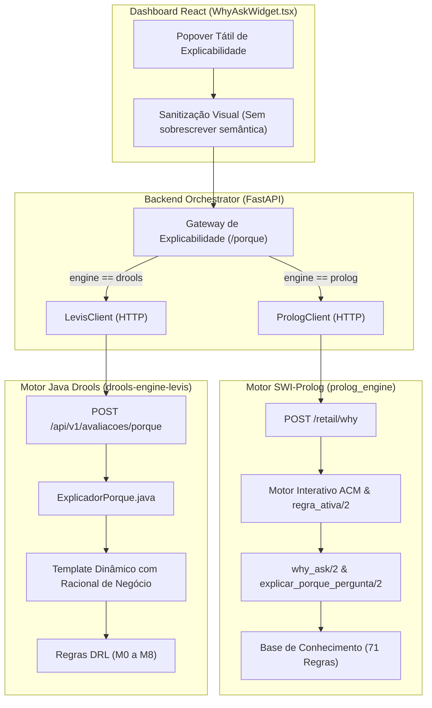

# Plano de Ação: Restauração da Inferência Causal Real "Porquê?" (Why Ask) nos Motores Prolog e Drools

**Alvo:** Sistema Pericial Levi's Retail (Prolog, Drools, Orchestrator, Dashboard)  
**Objetivo:** Eliminar completamente o atalho estático (*mock*) no orquestrador Python e a substituição forçada no Dashboard, fazendo com que **ambos os motores respondam dinamicamente a partir do seu próprio raciocínio dedutivo** sobre o estado do pedido.  
**Referências Normativas e Curriculares:**
- [`MI_Perguntas_ACM.md`](file:///root/meia-equipa3-challenge1-26_27/docs/material_aulas/MI_Perguntas_ACM.md) (Secções 1, 4, 11, 12, 15, 16 e 19)
- [`Returns & Exchanges Knowledge Base.md`](file:///root/meia-equipa3-challenge1-26_27/docs/material_aulas/Returns%20&%20Exchanges%20Knowledge%20Base.md)
- [`diagnostico_explicabilidade_why_ask.md`](file:///root/.gemini/antigravity-ide/brain/86e37fd8-3e77-45e2-943c-24ce7ecfdbc6/diagnostico_explicabilidade_why_ask.md)

---

## 1. Visão Geral da Arquitetura Alvo



---

## 2. Diagnóstico das Lacunas a Corrigir

| Componente | Estado Atual (Com Defeito) | Estado Alvo (Inferência Real) |
| :--- | :--- | :--- |
| **SWI-Prolog Engine** | Possui `why_ask/1..2` e `explicar_porque_pergunta/2`, mas **não expõe rota HTTP** para consultar o porquê de um dado `IN-xxx` com base no pedido atual. | Criar endpoint `POST /retail/why` no servidor HTTP Prolog que avalia os factos atuais e calcula regras dependentes e em espera reais. |
| **Backend Orchestrator (Prolog)** | `RetailPrologService.explain_why` tem um dicionário estático em Python e forja `regrasEmEspera` com `cumprida=False`. | Invocar `prolog_client.why_retail(dado, facts)` e mapear o resultado dinâmico devolvido pelo SWI-Prolog. |
| **Java Drools Engine** | Devolve apenas a frase mecânica `porque.sem_espera` (*"A pergunta X é usada pelas regras Y..."*) sem contextualização de negócio. | Enriquecer o `ExplicadorPorque` para conjugar o estado pericial das regras com o fundamento de negócio do catálogo. |
| **Dashboard Frontend** | Função `cleanCounterText` em `WhyAskWidget.tsx` apaga o texto do Drools e substitui-o por uma frase genérica fixa. | Remover a substituição forçada por regex, preservando o racional pericial real devolvido pelo motor. |

---

## 3. Fases do Plano de Ação

### Fase 1: Implementação da Rota de Explicabilidade no Motor SWI-Prolog
**Ficheiros a alterar:**
* [`prolog_engine/src/api/retail_routes.pl`](file:///root/meia-equipa3-challenge1-26_27/prolog_engine/src/api/retail_routes.pl)
* [`prolog_engine/src/core/retail_engine/engine.pl`](file:///root/meia-equipa3-challenge1-26_27/prolog_engine/src/core/retail_engine/engine.pl)

**Tarefas Técnicas:**
1. **Registo do Endpoint HTTP:**
   Registar `:- http_handler(root('retail/why'), handle_retail_why, [method(post)]).` no [`retail_routes.pl`](file:///root/meia-equipa3-challenge1-26_27/prolog_engine/src/api/retail_routes.pl#L62).
2. **Implementação do `handle_retail_why`:**
   - Receber JSON contendo: `dado` (ex.: `"IN-001"` ou `"mercado"`) e `base_facts` (lista de factos já conhecidos do pedido atual).
   - Mapear código `IN-xxx` para o termo do predicado perguntável correspondente (ex: `IN-001` $\rightarrow$ `mercado(_)`, `IN-008` $\rightarrow$ `estado_produto(_)`).
   - Carregar temporariamente os factos conhecidos na memória de trabalho de forma isolada.
   - Determinar dinamicamente:
     * **Regras dependentes:** Procurar na base de conhecimento todas as regras que incluem este predicado nas suas condições (`regra_info/3` / condições de ativação).
     * **Regras em espera:** Avaliar quais dessas regras têm **todas as restantes condições satisfeitas** no estado atual dos factos (ou seja, só estão dependentes desta resposta para disparar).
     * **Racional e justificação:** Chamar `explicar_porque_pergunta/2` para obter o fundamento normativo de cada regra candidata.
   - Responder em JSON com a estrutura unificada:
     ```json
     {
       "codigo": "IN-001",
       "dado": "mercado",
       "pergunta": "Qual é o mercado da transação de retalho?",
       "resumo": "Fundamento normativo causal deduzido pelo motor...",
       "regras_dependentes": ["CH-007", "TN-011", ...],
       "regras_em_espera": [...]
     }
     ```
3. **Testes Unitários em Prolog:**
   Adicionar testes ao ficheiro [`prolog_engine/tests/test_retail_explainability.pl`](file:///root/meia-equipa3-challenge1-26_27/prolog_engine/tests/test_retail_explainability.pl) validando a rota `/retail/why` com factos parciais.

---

### Fase 2: Integração da Inferência Real no Orquestrador Python
**Ficheiros a alterar:**
* [`backend_orchestrator/app/clients/prolog_client.py`](file:///root/meia-equipa3-challenge1-26_27/backend_orchestrator/app/clients/prolog_client.py)
* [`backend_orchestrator/app/services/retail_prolog_service.py`](file:///root/meia-equipa3-challenge1-26_27/backend_orchestrator/app/services/retail_prolog_service.py)

**Tarefas Técnicas:**
1. **Adicionar método cliente no [`PrologClient`](file:///root/meia-equipa3-challenge1-26_27/backend_orchestrator/app/clients/prolog_client.py):**
   ```python
   async def why_retail(self, payload: Dict[str, Any]) -> Dict[str, Any]:
       """Query why an input premise is requested via POST /retail/why."""
       return await self._post("/retail/why", payload)
   ```
2. **Refatorar [`RetailPrologService.explain_why`](file:///root/meia-equipa3-challenge1-26_27/backend_orchestrator/app/services/retail_prolog_service.py#L899):**
   - Converter o payload atual do pedido (wizard) nos factos conhecidos em formato Prolog utilizando `_map_pedido_to_prolog_facts(payload)`.
   - Invocar o motor SWI-Prolog via `self.prolog_client.why_retail({"dado": dado, "base_facts": facts})`.
   - Mapear a resposta real do motor para o modelo Pydantic [`ExplicacaoPorqueResponse`](file:///root/meia-equipa3-challenge1-26_27/backend_orchestrator/app/schemas/levis.py#L686).
   - Manter o dicionário atual `PROLOG_INPUT_KNOWLEDGE` estritamente como *fallback resiliente* caso o processo SWI-Prolog esteja inacessível.
3. **Testes de Integração:**
   Atualizar os testes em [`test_retail_parity_endpoints.py`](file:///root/meia-equipa3-challenge1-26_27/backend_orchestrator/tests/test_retail_parity_endpoints.py) para validar que o serviço consulta o cliente HTTP e reflete as regras reais.

---

### Fase 3: Enriquecimento Pericial no Motor Java Drools
**Ficheiros a alterar:**
* [`drools-engine-levis-devolucoes-java/backend/pericial-explanation/.../ExplicadorPorque.java`](file:///root/meia-equipa3-challenge1-26_27/drools-engine-levis-devolucoes-java/backend/pericial-explanation/src/main/java/com/levis/devolucoes/explicacao/porque/ExplicadorPorque.java)
* [`drools-engine-levis-devolucoes-java/backend/pericial-explanation/.../DadoEntrada.java`](file:///root/meia-equipa3-challenge1-26_27/drools-engine-levis-devolucoes-java/backend/pericial-explanation/src/main/java/com/levis/devolucoes/explicacao/porque/DadoEntrada.java)
* [`explicacoes_pt_PT.properties`](file:///root/meia-equipa3-challenge1-26_27/drools-engine-levis-devolucoes-java/backend/pericial-explanation/src/main/resources/i18n/explicacoes_pt_PT.properties)

**Tarefas Técnicas:**
1. **Adicionar Racional de Negócio ao `DadoEntrada`:**
   Adicionar a descrição de negócio da Levi's no enum `DadoEntrada` (ex: `IN-001` $\rightarrow$ *"O mercado da transação (Estados Unidos vs Canadá) determina a aplicação de regras fiscais e meios de pagamento exclusivos como débito Interac..."*).
2. **Harmonizar a Formatação do Resumo em `ExplicadorPorque.java`:**
   Quando `emEspera` está vazia, o resumo passa a conjugar o racional de negócio com o estado dinâmico:
   > *"[Racional de Negócio do Dado]. No pedido atual, nenhuma decisão terminal está imediatamente dependente desta resposta porque os restantes requisitos ainda não foram avaliados."*
   Quando `emEspera` contém regras ativas, cita as regras pendentes e o impacto no desfecho.

---

### Fase 4: Limpeza e Alinhamento do Dashboard React
**Ficheiros a alterar:**
* [`dashboard/src/components/wizard/WhyAskWidget.tsx`](file:///root/meia-equipa3-challenge1-26_27/dashboard/src/components/wizard/WhyAskWidget.tsx)

**Tarefas Técnicas:**
1. **Remover a Interceção Forçada em `cleanCounterText`:**
   Eliminar as linhas 301 a 308 que sobrescrevem o texto com a frase genérica:
   ```typescript
   // REMOVER ESTE BLOCO QUE FORÇA A MENSAGEM GENÉRICA:
   if (/é usada pelas regras/i.test(s)) {
     return "Esta informação é avaliada pelas políticas comerciais da loja; no pedido atual, nenhuma decisão terminal está pendente desta resposta.";
   }
   ```
2. **Preservar a Sanitização de Balcão:**
   Manter a limpeza dos tokens de depuração interna `(TN-011)` e parênteses de prompt, garantindo que o texto exibido é exatamente a justificação pericial calculada pelo motor ativo selecionado.
3. **Garantir Paridade Visual:**
   Assegurar que, quer no modo Prolog quer no modo Drools, o operador vê:
   - Pergunta ao Operador autêntica
   - Racional de Negócio fundamentado
   - Políticas de Loja Envolvidas derivadas dinamicamente
   - Regras em Decisão Imediata calculadas a partir dos dados já preenchidos no formulário.

---

## 4. Plano de Validação e Critérios de Aceitação

1. **Validação de Transparência Causal (Prolog):**
   - Ao inspecionar as chamadas de rede no terminal ou logs, verificar que o orquestrador faz um pedido HTTP real ao SWI-Prolog em `POST /retail/why`.
   - Se os factos do pedido mudarem (ex.: cliente altera canal de compra), as regras dependentes e em espera devolvidas pelo Prolog adaptam-se dinamicamente.
2. **Validação de Paridade Pericial (Drools vs Prolog):**
   - No Passo 2, ambos os motores explicam o racional de negócio do mercado geográfico com precisão.
   - No Passo 6 (Reembolso), quando os artigos e o meio de pagamento já estão definidos, ambos os motores devem identificar com precisão a regra de pagamento pendente (ex.: TN-011).
3. **Cobertura de Testes Automatizados:**
   - Testes unitários do Prolog (`ctest` ou PLUnit).
   - Testes do Spring Boot Drools (`mvn test`).
   - Testes de integração do FastAPI (`pytest`).
   - Teste ponta-a-ponta no dashboard.

---

## 5. Ordem de Execução Recomendada

```text
Passo 1: Criar rota POST /retail/why no prolog_engine (Prolog puro)
Passo 2: Ligar PrologClient e refatorar RetailPrologService no Python
Passo 3: Enriquecer ExplicadorPorque no motor Java Drools
Passo 4: Remover a substituição forçada em WhyAskWidget.tsx no Dashboard
Passo 5: Testar e validar visualmente ambos os motores no browser
```
