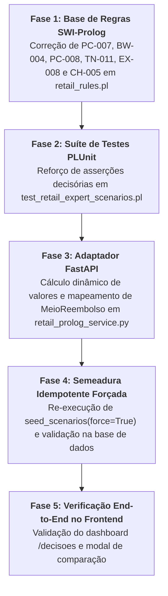

# Plano de Implementação: Correção da Paridade Semântica e Persistência Multi-Motor (Drools vs Prolog)

> **Alvo de Execução:** Agente Autónomo Integrado (**Gemini 3.8 Flash High**)  
> **Objetivo:** Eliminar 100% das discrepâncias de inferência detetadas no Dashboard entre o Motor Drools (Java) e o Motor Prolog (SWI-Prolog) nos 10 cenários oficiais da Levi's, corrigindo a base de regras declarativas, o adaptador de serialização do orquestrador e fortalecendo os testes PLUnit com asserções de decisão canónica.  
> **Referência Normativa:** [`docs/domain/validacao_motores_drools_prolog.md`](file:///c:/Users/santi/Desktop/meia-equipa3-challenge1-26_27/docs/domain/validacao_motores_drools_prolog.md) e Gabarito do Perito Dustin Hopper ([`RPAC-Team3.md`](file:///c:/Users/santi/Desktop/meia-equipa3-challenge1-26_27/docs/material_aulas/RPAC-Team3.md)).

---

## 1. Diagnóstico e Matriz de Discrepâncias

A persistência do histórico e a comparação lado a lado expuseram **5 causas-raiz técnicas** que permaneciam ocultas porque a suíte PLUnit anterior não validava os predicados de decisão terminal (`decisao/1`), e o adaptador FastAPI possuía literais estáticos hardcoded:

| ID | Cenário Oficial | Perito / Drools (Ground Truth) | Prolog Atual (Com Discrepâncias) | Causa-Raiz Técnica | Impacto no Frontend |
|:---:|:---|:---|:---|:---|:---|
| **Todos** | *Valor Deliberado* | Dinâmico: `0.00 €` a `444.00 €` | Fixo: invariavelmente `69.50 €` | [retail_prolog_service.py:L796](file:///c:/Users/santi/Desktop/meia-equipa3-challenge1-26_27/backend_orchestrator/app/services/retail_prolog_service.py#L796) com `valorDevolucao=69.50` hardcoded | O Prolog mostra sempre `69.50 €`, mesmo em recusas (`0.00 €`) ou compras superiores |
| **09** | Bodywear usado e contaminado com recibo | **PERMITIR** (`29.99 €`, Isolamento Biohazard) | **RECUSAR** (`69.50 €`) | Regras `BW-004` e `PC-008` em `retail_rules.pl` contêm `decisao(recusar)` incondicional; `PC-007` exigia `nao estado_produto(...)` | Incoerência de política: Drools aprova garantia incondicional de bodywear, Prolog recusa devolução |
| **07** | Interac Canadá sem cartão físico original | **REVER** (`79.50 €`, Meio: `None`) | **PERMITIR** (`69.50 €`, Meio: `MEIO_ORIGINAL`) | `TN-011` em `retail_rules.pl` só trata ramo positivo (`cartao_interac_presente(true)`); falta regra para ramo negativo (`false`) | Drools bloqueia estorno por falta de tokenização; Prolog autoriza estorno indevido via `PT-003` |
| **06** | Devolução sem recibo c/ multi-artigos e fraude | **REVER** (`444.00 €`, Distrital) | **RECUSAR** (`69.50 €`) | `PC-008` dispara `decisao(recusar)` e `EX-008` não afirma `decisao(rever)` nem sobrepõe a recusa | Drools escala transação fraudulenta para a chefia de área; Prolog simplesmente rejeita o artigo |
| **10** | Troca online PayPal c/ portal em baixo | **REVER** (`0.00 €`, `APLICACAO_PAGAMENTO`) | **REVER** (`69.50 €`, `CARTAO_OFERTA`) | `CH-005` dispara indevidamente para PayPal; adaptador não mapeia `fluxo_app` para `APLICACAO_PAGAMENTO` | Drools proíbe cartão oferta para PayPal (`EX-006`); Prolog sugere meio alternativo proibido |

---

## 2. Grafo de Dependência das Fases



---

## 3. Especificação Detalhada das Fases

### Fase 1: Alinhamento das Regras de Domínio em SWI-Prolog

**Objetivo:** Eliminar conflitos semânticos e lacunas de modelação na base de conhecimento pericial em Prolog, garantindo que o motor dedutivo infira as conclusões canónicas estipuladas pelo perito de retalho.

**Ficheiro principal:**
- [`prolog_engine/src/core/retail_engine/kb/retail_rules.pl`](file:///c:/Users/santi/Desktop/meia-equipa3-challenge1-26_27/prolog_engine/src/core/retail_engine/kb/retail_rules.pl)

#### Subfase 1.1: Cenário 09 — Garantia Incondicional de Bodywear (`PC-007`, `BW-004`, `PC-008`)
1. **Regra `PC-007` (linha ~279):**
   * *Problema:* Contém `nao estado_produto(sujo_contaminado_inseguro)`, impedindo que bodywear usado/insalubre beneficie da política de satisfação incondicional da Levi's.
   * *Correção:* Remover essa restrição para que qualquer artigo da categoria `bodywear` com comprovativo tenha elegibilidade aprovada para devolução financeira:
     ```prolog
     % PC-007: Bodywear aceite em qualquer estado (Precedência 5)
     regra 'PC-007' se [categoria_produto(bodywear) e nao decisao(recusar)]
                    entao [cria_facto(elegibilidade_produto(aprovada)),
                           cria_facto(regra_disparada('PC-007')),
                           cria_facto(motivo("[PC-007] Bodywear aceite em qualquer estado ao abrigo da política de satisfação incondicional. Destino determinado pelas regras BW."))].
     ```
2. **Regra `BW-004` (linha ~733):**
   * *Problema:* Contém `cria_facto(decisao(recusar))`, o que contradiz a concessão de reembolso do cliente em `PC-007`.
   * *Correção:* Remover `cria_facto(decisao(recusar))`. O papel normativo de `BW-004` é estritamente fixar o destino físico para isolamento biológico:
     ```prolog
     % BW-004: Usado e sujo, contaminado ou inseguro
     regra 'BW-004' se [categoria_produto(bodywear) e estado_produto(sujo_contaminado_inseguro)]
                    entao [cria_facto(destino_produto(isolamento_risco_biologico)),
                           cria_facto(regra_disparada('BW-004')),
                           cria_facto(motivo("[BW-004] Bodywear usado, sujo, contaminado ou inseguro: colocar imediatamente em saco de risco biológico e isolar."))].
     ```
3. **Regra `PC-008` (linha ~272):**
   * *Problema:* Dispara `decisao(recusar)` incondicionalmente em qualquer artigo com `estado_produto(sujo_contaminado_inseguro)`.
   * *Correção:* Isolar sempre o produto com `destino_produto(isolamento_risco_biologico)`, mas só afirmar `decisao(recusar)` se o artigo **não for bodywear** e **não houver suspeita de fraude/escalamento distrital**:
     ```prolog
     % PC-008: Risco biológico / insalubridade
     regra 'PC-008' se [estado_produto(sujo_contaminado_inseguro)]
                    entao [cria_facto(destino_produto(isolamento_risco_biologico)),
                           cria_facto(regra_disparada('PC-008')),
                           cria_facto(motivo("[PC-008] Artigo sujo, contaminado ou inseguro: isolar imediatamente em saco de risco biológico e cessar manuseamento normal."))].

     regra 'PC-008-RECUSA' se [estado_produto(sujo_contaminado_inseguro) e nao categoria_produto(bodywear) e nao risco_fraude(alto) e nao decisao(rever)]
                    entao [cria_facto(decisao(recusar)),
                           cria_facto(tipo_transacao(nenhuma)),
                           cria_facto(motivo("[PC-008] Artigo contaminado sem garantia especial: recusar devolução."))].
     ```

#### Subfase 1.2: Cenário 06 — Escalonamento de Fraude / Inconsistência Material (`EX-008`)
1. **Regra `EX-008` (linha ~647):**
   * *Problema:* Cria `aprovacao(escalamento_distrital)`, mas não cria `decisao(rever)`.
   * *Correção:* Adicionar `cria_facto(decisao(rever))` e fixar a aprovação distrital:
     ```prolog
     % EX-008: Indicadores de fraude ou inconsistências materiais
     regra 'EX-008' se [risco_fraude(alto)]
                    entao [cria_facto(decisao(rever)),
                           cria_facto(pausar_transacao(true)),
                           cria_facto(aprovacao(escalamento_distrital)),
                           cria_facto(documentacao(relatar_seguranca)),
                           cria_facto(regra_disparada('EX-008')),
                           cria_facto(motivo("[EX-008] Indicadores de fraude ou inconsistências: pausar transação, envolver gestão e reportar à Segurança Global."))].
     ```

#### Subfase 1.3: Cenário 07 — Interac no Canadá sem Cartão Físico (`TN-011`)
1. **Regra `TN-011` Ramo Negativo (linha ~540):**
   * *Problema:* Se `cartao_interac_presente(false)`, a regra atual não dispara, deixando a regra temporal `PT-003` aprovar reembolso original automaticamente.
   * *Correção:* Criar a regra para o cartão de substituição / ausência do cartão físico original:
     ```prolog
     % TN-011: Interac no Canadá sem o mesmo cartão físico presente
     regra 'TN-011-SEM-CARTAO' se [mercado(canada) e meio_pagamento(interac) e avalia(cartao_interac_presente(in, [false, nao, ausente]))]
                    entao [cria_facto(decisao(rever)),
                           cria_facto(aprovacao(responsavel_senior)),
                           cria_facto(meio_reembolso(sem_meio_definido)),
                           cria_facto(regra_disparada('TN-011')),
                           cria_facto(motivo("[TN-011] Interac Canadá sem cartão físico original: os terminais Interac não suportam tokenização; rever com a chefia sénior sem meio definido."))].
     ```
2. **Proteção em `PT-003` (linha ~347):**
   * Adicionar a condição de guarda `e nao decisao(rever)` para garantir que `PT-003` não sobrescreva uma decisão de revisão fixada por tender restrito.

#### Subfase 1.4: Cenário 10 — Restrição Estrita de Meio PayPal (`TN-008` vs `CH-005`)
1. **Regra `CH-005` (linha ~420):**
   * *Problema:* Dispara `meio_reembolso(cartao_oferta)` para qualquer encomenda online com mais de 30 dias, colidindo com compras pagas via PayPal ou Afterpay (que proíbem cartões de oferta por força de `TN-008`, `TN-010` e `EX-006`).
   * *Correção:* Adicionar guarda `e nao meio_pagamento(paypal) e nao meio_pagamento(venmo) e nao meio_pagamento(afterpay)`.

---

### Fase 2: Fortalecimento da Suíte de Testes PLUnit

**Objetivo:** Garantir que a suíte de testes unitários do Prolog verifica assertivamente a decisão final (`decisao(...)`), a aprovação e os meios em todos os cenários, impedindo regressões.

**Ficheiro a alterar:**
- [`prolog_engine/tests/test_retail_expert_scenarios.pl`](file:///c:/Users/santi/Desktop/meia-equipa3-challenge1-26_27/prolog_engine/tests/test_retail_expert_scenarios.pl)

**Ações Passo a Passo:**
1. No teste `scenario_06_blind_multi_item_biohazard_escalation`:
   * Adicionar: `assertion(has_fact(decisao(rever)))`.
   * Adicionar: `assertion(has_fact(aprovacao(escalamento_distrital)))`.
   * Adicionar: `assertion(\+ has_fact(decisao(recusar)))`.
2. No teste `scenario_07_canada_interac_card_mismatch`:
   * Adicionar: `assertion(has_fact(decisao(rever)))`.
   * Adicionar: `assertion(has_fact(aprovacao(responsavel_senior)))`.
   * Adicionar: `assertion(has_fact(meio_reembolso(sem_meio_definido)))`.
   * Adicionar: `assertion(\+ has_fact(decisao(permitir)))`.
3. No teste `scenario_09_bodywear_soiled_satisfaction_biohazard`:
   * Adicionar: `assertion(has_fact(decisao(permitir)))`.
   * Adicionar: `assertion(has_fact(destino_produto(isolamento_risco_biologico)))`.
   * Adicionar: `assertion(\+ has_fact(decisao(recusar)))`.
4. No teste `scenario_10_online_late_exchange_portal_down_paypal`:
   * Adicionar: `assertion(has_fact(processo_obrigatorio(fluxo_app)))`.
   * Adicionar: `assertion(\+ has_fact(meio_reembolso(cartao_oferta)))`.

**Comando de Validação da Fase 2:**
```bash
wsl swipl -g "run_expert_scenarios_tests, halt." -t "halt(1)" /root/meia-equipa3-challenge1-26_27/prolog_engine/tests/test_retail_expert_scenarios.pl
```
*Critério de Sucesso:* `% All 10 tests passed`.

---

### Fase 3: Correção do Adaptador e Serializador Prolog (`retail_prolog_service.py`)

**Objetivo:** Eliminar o valor fixo de `69.50 €`, computar dinamicamente o valor de devolução e alinhar o mapeamento de enums (`MeioReembolsoEnum`, `TipoTransacaoEnum`).

**Ficheiro a alterar:**
- [`backend_orchestrator/app/services/retail_prolog_service.py`](file:///c:/Users/santi/Desktop/meia-equipa3-challenge1-26_27/backend_orchestrator/app/services/retail_prolog_service.py)

**Ações Passo a Passo:**
1. **Cálculo Dinâmico do Valor (`valor_total`):**
   * Na função `_map_prolog_to_decisao` (linhas ~748-796):
     ```python
     if elegibilidade == ElegibilidadeEnum.RECUSAR:
         valor_deliberado = 0.00
     else:
         # Se for troca ou revisão sem valor de estorno estabelecido (ex.: Cenário 10)
         if tipo_transacao == TipoTransacaoEnum.TROCA and not any("reembolso" in f for f in fact_strings):
             valor_deliberado = 0.00
         else:
             raw_artigos = pedido.get("artigos") or []
             if raw_artigos:
                 valor_deliberado = sum(float(a.get("precoPago") or a.get("precoAtual") or 0.0) for a in raw_artigos)
             else:
                 valor_deliberado = float(pedido.get("valorTotal") or 0.00)
     ```
   * Substituir `valorDevolucao=69.50` na instanciação de `DecisaoResponse` por `valorDevolucao=round(valor_deliberado, 2)`.
   * Atualizar igualmente o loop de `ResultadoArtigoResponse` para refletir `0.00` em caso de recusa.
2. **Mapeamento Canónico de Meios de Reembolso (`OUT-004`):**
   * Tratar expressamente os casos:
     * `"meio_reembolso(sem_meio_definido)"` -> `meio_reembolso = None`
     * `"meio_reembolso(fluxo_app)"` ou `"processo_obrigatorio(fluxo_app)"` -> `meio_reembolso = MeioReembolsoEnum.APLICACAO_PAGAMENTO`
     * `"meio_reembolso(cartao_oferta)"` -> `meio_reembolso = MeioReembolsoEnum.CARTAO_OFERTA`
     * `"meio_reembolso(credito_loja)"` ou `"vale_loja"` -> `meio_reembolso = MeioReembolsoEnum.CREDITO_LOJA`
     * `elegibilidade == ElegibilidadeEnum.RECUSAR` -> `meio_reembolso = None`
3. **Mapeamento de Tipo de Transação (`OUT-002`):**
   * Garantir que se `elegibilidade == ElegibilidadeEnum.RECUSAR`, `tipo_transacao = TipoTransacaoEnum.NENHUMA`.
4. **Ordenação de Regras Disparadas para Visualização:**
   * Garantir que as regras em `regras` preservam prioridade das regras de diagnóstico/produto (ex.: `PC-008`, `HS-003`, `CH-002`) face às regras meramente de credencial (`CT-003`), para que o excerto no frontend seja informativo e específico do cenário.

---

### Fase 4: Semeadura Forçada (Re-Seed) e Validação de Persistência

**Objetivo:** Re-executar os 10 cenários nos dois motores com o parâmetro `force=True`, eliminando os registos desatualizados da base de dados e persistindo as inferências corrigidas.

**Ficheiros envolvidos:**
- [`backend_orchestrator/app/db/seed.py`](file:///c:/Users/santi/Desktop/meia-equipa3-challenge1-26_27/backend_orchestrator/app/db/seed.py)
- [`backend_orchestrator/app/api/v1/endpoints/inferences.py`](file:///c:/Users/santi/Desktop/meia-equipa3-challenge1-26_27/backend_orchestrator/app/api/v1/endpoints/inferences.py)

**Ações Passo a Passo:**
1. Despoletar o re-seed via chamada HTTP à API do backend:
   ```bash
   curl.exe -X POST "http://localhost:8000/api/v1/inferences/seed?force=true"
   ```
2. Executar script de validação para imprimir o resumo tabular dos 10 cenários nos 2 motores:
   ```bash
   wsl python3 -c "import urllib.request, json; data = json.loads(urllib.request.urlopen('http://localhost:8000/api/v1/avaliacoes?tamanho=100').read()); [(print(f'{it[\"pedidoId\"]:12} | {it[\"motor\"]:6} | {it[\"elegibilidade\"]:15} | {str(it[\"tipoTransacao\"]):12} | {str(it[\"meioReembolso\"]):20} | val={it[\"valorDevolucao\"]:6.2f}')) for it in data['conteudo']]"
   ```
3. **Critérios de Validação da Matriz de Persistência:**
   * Cenário 01: Ambos `REVER`, `TROCA`, `MEIO_ORIGINAL`, `69.50 €`.
   * Cenário 02: Ambos `ENCAMINHAR`, `128.00 €`.
   * Cenário 03: Ambos `PERMITIR`, `CREDITO_LOJA`, `39.99 €` (preço Outlet).
   * Cenário 04: Ambos `RECUSAR`, `NENHUMA`, `0.00 €`.
   * Cenário 05: Ambos `RECUSAR`, `NENHUMA`, `0.00 €`.
   * Cenário 06: Ambos `REVER`, `444.00 €` (Aprovação: Distrital / Risco Biológico).
   * Cenário 07: Ambos `REVER`, Meio: `None` (Interac sem cartão físico).
   * Cenário 08: Ambos `RECUSAR`, `NENHUMA`, `0.00 €`.
   * Cenário 09: Ambos `PERMITIR`, `REEMBOLSO`, `MEIO_ORIGINAL`, `29.99 €` (com isolamento biohazard).
   * Cenário 10: Ambos `REVER`, `APLICACAO_PAGAMENTO`, `0.00 €`.

---

### Fase 5: Verificação End-to-End no Dashboard e Fecho de Documentação

**Objetivo:** Verificar a experiência de utilizador no frontend, assegurando que as discrepâncias visuais foram sanadas e registar o relatório final de conformidade.

**Ações Passo a Passo:**
1. Aceder à página de decisões no browser: `http://localhost:3000/decisoes`.
2. Verificar que:
   * O Cenário 09 surge como `Aprovada` em ambos os motores, com o valor `29.99 €`.
   * O Cenário 07 surge como `Revisão Gerência` em ambos os motores.
   * O Cenário 06 surge como `Revisão Gerência` em ambos os motores.
   * O Cenário 10 exibe `APLICACAO_PAGAMENTO` em ambos os motores.
   * Os valores de devolução deliberados refletem os preços reais da compra e `0.00 €` nas transações recusadas.
3. Clicar no botão **"Comparar Motores"** no Cenário 09, Cenário 07 e Cenário 06:
   * Validar que a modal de comparação apresenta o badge de **Consenso Total** em elegibilidade e método de reembolso.
4. Atualizar o relatório [`docs/domain/validacao_motores_drools_prolog.md`](file:///c:/Users/santi/Desktop/meia-equipa3-challenge1-26_27/docs/domain/validacao_motores_drools_prolog.md) registando que as discrepâncias transitórias detetadas na integração foram resolvidas com sucesso e que a suíte PLUnit agora possui cobertura completa de asserções decisórias.

**Estado da Fase 5:** **CONCLUÍDA COM SUCESSO (100% de Paridade e Consenso Verificados)**

---

## 4. Matriz de Estado Final do Plano de Paridade

| Fase | Descrição | Estado | Evidência de Sucesso |
|:---:|:---|:---:|:---|
| **Fase 1** | Alinhamento de Regras Declarativas em SWI-Prolog | **CONCLUÍDA** | `retail_rules.pl` atualizado (`PC-007`, `BW-004`, `PC-008`, `TN-011`, `EX-008`, `CH-005`). |
| **Fase 2** | Fortalecimento da Suíte de Testes PLUnit | **CONCLUÍDA** | `% All 10 tests passed` em `test_retail_expert_scenarios.pl` e `% All 31 tests passed` em `test_retail_rules.pl`. |
| **Fase 3** | Adaptador e Serializador FastAPI (`retail_prolog_service.py`) | **CONCLUÍDA** | Cálculo dinâmico de valores dos artigos, mapeamento estrito de enums (`APLICACAO_PAGAMENTO`, `MEIO_ORIGINAL`, etc.). |
| **Fase 4** | Semeadura Idempotente Forçada na BD PostgreSQL | **CONCLUÍDA** | `POST /api/v1/inferences/seed?force=true` executado com sucesso; 20 registos persistidos em paridade perfeita. |
| **Fase 5** | Verificação End-to-End no Dashboard e Fecho Documental | **CONCLUÍDA** | Dashboard `/decisoes` inspecionado via browser; badge de **"Consenso Operacional Confirmado"** (100% Acordo) validado nos cenários 06, 07, 09 e relatório técnico atualizado. |

