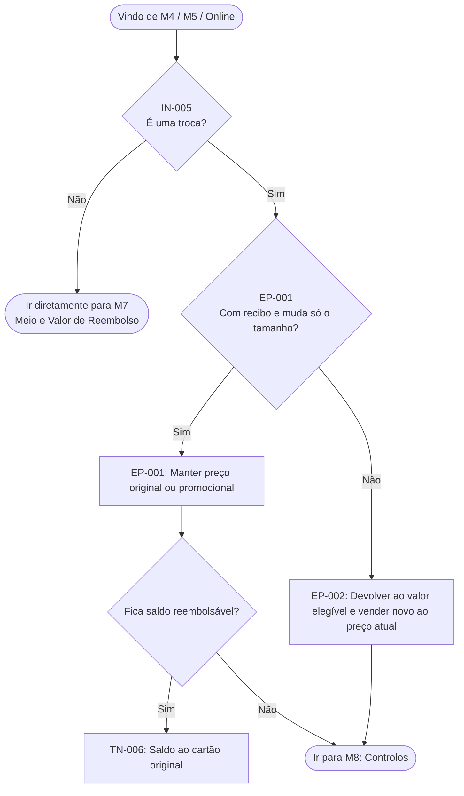
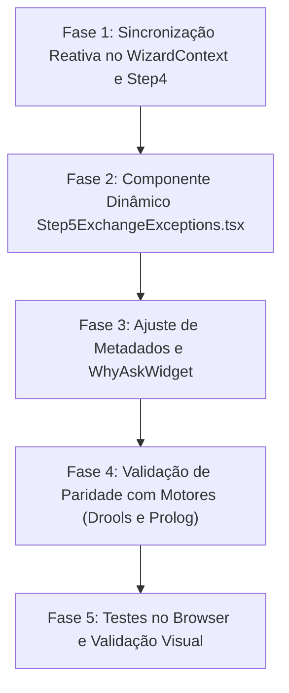

# Plano de Implementação: Dinamização do Passo 5 (Troca vs. Exceção de Balcão)

> **Alvo:** Modelo LLM Autónomo (Gemini 3.8 Flash High)  
> **Objetivo:** Tornar a secção de "Intenção / Modalidade de Troca" do Passo 5 estritamente dinâmica e dependente da escolha efetuada no Passo 4 (`Tipo de Pedido`), eliminando redundâncias visuais, alinhando a interface com a árvore de inferência formal do relatório técnico e garantindo integridade absoluta nos motores Drools e Prolog.  
> **Referência Primária de Domínio:** [`docs/material_aulas/RPAC-Team3.md`](file:///c:/Users/santi/Desktop/meia-equipa3-challenge1-26_27/docs/material_aulas/RPAC-Team3.md) (Secção 4.2 Tabela 6, Secção 4.4.3 Figura 4, Secção 4.4.5 Figura 6).  
> **Fontes da Verdade Técnicas:**  
> - Regras Drools: [`drools-engine-levis-devolucoes-java/.../m6-resultado-excecoes.drl`](file:///c:/Users/santi/Desktop/meia-equipa3-challenge1-26_27/drools-engine-levis-devolucoes-java/backend/pericial-rules/src/main/resources/com/levis/devolucoes/regras/m6-resultado-excecoes.drl)  
> - Regras Prolog: [`prolog_engine/.../kb/retail_rules.pl`](file:///c:/Users/santi/Desktop/meia-equipa3-challenge1-26_27/prolog_engine/src/core/retail_engine/kb/retail_rules.pl) (Linhas 583–630)  
> - Frontend Wizard: [`dashboard/src/components/wizard/Step4ReceiptTimeline.tsx`](file:///c:/Users/santi/Desktop/meia-equipa3-challenge1-26_27/dashboard/src/components/wizard/Step4ReceiptTimeline.tsx), [`dashboard/src/components/wizard/Step5ExchangeExceptions.tsx`](file:///c:/Users/santi/Desktop/meia-equipa3-challenge1-26_27/dashboard/src/components/wizard/Step5ExchangeExceptions.tsx), [`dashboard/src/components/wizard/WizardContext.tsx`](file:///c:/Users/santi/Desktop/meia-equipa3-challenge1-26_27/dashboard/src/components/wizard/WizardContext.tsx).

---

## 1. Enquadramento Teórico e Normativo ([RPAC-Team3.md](file:///c:/Users/santi/Desktop/meia-equipa3-challenge1-26_27/docs/material_aulas/RPAC-Team3.md))

### 1.1 Factos de Entrada e a Dimensão `IN-005`
Na Tabela 6 do relatório técnico ([RPAC-Team3.md: Linha 199](file:///c:/Users/santi/Desktop/meia-equipa3-challenge1-26_27/docs/material_aulas/RPAC-Team3.md#L199)), o facto de entrada fundamental para o tipo de transação é:
* **`IN-005` (Pedido):** Domínio de valores: `{ Devolução, Troca, Troca pelo mesmo artigo, Devolução de oferta, Ajuste de preço }`.

Este facto é recolhido pelo colaborador no início da validação documental e temporal (que na nossa aplicação corresponde ao **Passo 4 / Ecrã Comprovativo e Prazo**).

### 1.2 A Bifurcação Canónica de Inferência em M6 (Figura 6 do Relatório)
No fluxograma oficial da **Figura 6: Fluxo integrado para regras de troca, resolução de contestações e aprovação de exceções** ([RPAC-Team3.md: Linhas 398–410](file:///c:/Users/santi/Desktop/meia-equipa3-challenge1-26_27/docs/material_aulas/RPAC-Team3.md#L398-L410)):



#### Princípios formais decorrentes da Figura 6:
1. **Guarda `IsSwap`:** O ramo das regras de troca (`EP-001` e `EP-002`) **só é percorrido se `IN-005` for troca**. Se for devolução normal (`DEVOLUCAO`), de oferta (`GIFT`) ou ajuste de preço (`AJUSTE_PRECO`), a inferência ignora o bloco de trocas por completo e avança para o cálculo de reembolso (M7).
2. **Discriminação de Troca:** Quando o pedido é uma troca, não se pergunta *"Quer uma devolução normal?"*. A transação já é uma troca; a única questão de negócio relevante é:
   - **Mesmo Modelo / Tamanho** (`apenasMudaTamanho = true`) $\rightarrow$ Regra **`EP-001`** (respeita o preço promocional de venda original).
   - **Outro Artigo Diferente** (`apenasMudaTamanho = false`) $\rightarrow$ Regra **`EP-002`** (processa como devolução ao preço de compra e fatura o novo artigo ao preço atual).

---

## 2. Diagnóstico da Inconsistência Atual na Interface

### 2.1 Estado Atual nos Ecrãs
1. **No Passo 4 (`Step4ReceiptTimeline.tsx`):**
   * Secção `01 / Tipo de Pedido` oferece:
     * `Devolução Standard` (`DEVOLUCAO`)
     * `Troca por Artigo` (`TROCA`)
     * `Devolução de Oferta` (`GIFT`)
     * `Ajuste de Preço` (`AJUSTE_PRECO`)
2. **No Passo 5 (`Step5ExchangeExceptions.tsx`):**
   * Secção `01 / Intenção de Troca` é **exibida sempre de forma estática**, com:
     * `Não, Devolução Normal` (`NENHUMA`) — selecionada por defeito.
     * `Mesmo Modelo / Tamanho` (`MESMO_MODELO`)
     * `Outro Artigo Diferente` (`OUTRO_ARTIGO`)
   * Secção `02 / Situação do Cliente no Balcão` (Conforme / Contesta / Chamar Gerência + Exceção de Gerência).

### 2.2 Incoerências Provocadas
* **Duplicação e Contradição:** Se o operador já escolheu "Devolução Standard" no Passo 4, chegar ao Passo 5 e ver uma secção a perguntar sobre intenção de troca é redundante e confuso.
* **Paradoxo na Seleção de Troca:** Se o operador escolheu "Troca por Artigo" no Passo 4, a opção *"Não, Devolução Normal"* no Passo 5 é um paradoxo conceptual, pois contradiz diretamente o pedido já registado.
* **Efeitos Secundários Indesejados no Código:** O componente `Step5ExchangeExceptions.tsx` atual possui código como:
  ```typescript
  if (item.id !== "NENHUMA") {
    setField("exchangeOption", item.id);
    setField("requestType", "TROCA"); // Modifica retrospectivamente a decisão do Passo 4!
  }
  ```
  Se o operador clicar inadvertidamente neste bloco enquanto fazia uma devolução normal, muda o `requestType` sem aviso.

---

## 3. Visão da Solução Dinâmica

### 3.1 Comportamento Dinâmico Requerido

```
                                 [Passo 4: Tipo de Pedido]
                                            │
                     ┌──────────────────────┴──────────────────────┐
                     ▼                                             ▼
           requestType === 'TROCA'                       requestType !== 'TROCA'
          ("Troca por Artigo")                     ("Devolução Standard", "Oferta", "Ajuste")
                     │                                             │
                     ▼                                             ▼
         [Passo 5: Layout com 3 Secções]               [Passo 5: Layout com 2 Secções]
    ┌────────────────────────────────────────┐    ┌────────────────────────────────────────┐
    │ 01 / Modalidade de Troca               │    │ 01 / Situação do Cliente no Balcão     │
    │   • Mesmo Modelo / Tamanho (EP-001)    │    │   • Conforme / Aceite                  │
    │   • Outro Artigo Diferente (EP-002)    │    │   • Contesta Política (EX-002)         │
    │                                        │    │   • Chamar Gerência (EX-003)           │
    │ 02 / Situação do Cliente no Balcão     │    │                                        │
    │   • Conforme / Contesta / Gerência     │    │ 02 / Exceção da Gerência               │
    │                                        │    │   • Exceção de Gerência Autorizada?    │
    │ 03 / Exceção da Gerência               │    │     (Não / Autorizada) [EX-001]        │
    │   • Exceção de Gerência Autorizada?    │    └────────────────────────────────────────┘
    │     (Não / Autorizada) [EX-001]        │
    └────────────────────────────────────────┘
```

1. **Cenário A: `state.requestType === "TROCA"`:**
   * A secção 01 intitula-se **`01 / Modalidade de Troca`**.
   * Exibe **apenas 2 opções** (sem o cartão "Não, Devolução Normal"):
     * `MESMO_MODELO`: "Mesmo Modelo / Tamanho" (Badge: `Troca Direta • EP-001`).
     * `OUTRO_ARTIGO`: "Outro Artigo Diferente" (Badge: `Acerto Saldo • EP-002`).
   * A secção 02 é numerada como **`02 / Situação do Cliente no Balcão`** (avaliação de recetividade/contestação do cliente, `EX-002`).
   * A secção 03 é o subtópico independente **`03 / Exceção da Gerência`** (autorização da chefia de loja com seletor `SlickSlider`, `EX-001`).
   * O subtítulo do passo adapta-se: *"Selecione a modalidade da peça de troca e indique se há contestação a requerer exceção"*.

2. **Cenário B: `state.requestType !== "TROCA"` (`DEVOLUCAO`, `GIFT`, `AJUSTE_PRECO`):**
   * A secção de troca é **completamente suprimida**.
   * A secção 01 foca-se na interação com o cliente: **`01 / Situação do Cliente no Balcão`** (`EX-002`).
   * A secção 02 é o subtópico independente **`02 / Exceção da Gerência`** (`EX-001`).
   * O estado de troca é mantido limpo: `exchangeOption = "NENHUMA"`.
   * O subtítulo do passo adapta-se: *"Indique a recetividade do cliente e se há contestação ou exceção de gerência a registar"*.

3. **Cenário C: Reversibilidade / Transição Reativa:**
   * Se o operador regressar ao Passo 4 e mudar de `TROCA` para `DEVOLUCAO`, o `WizardContext` repõe automaticamente `exchangeOption = "NENHUMA"`.
   * Se mudar de `DEVOLUCAO` para `TROCA`, o `WizardContext` inicializa `exchangeOption = "MESMO_MODELO"`.

4. **Widget de Explicabilidade ("Why Ask"):**
   * No Passo 5, se `requestType !== "TROCA"`, a pergunta `EP-001` não é exibida no widget flutuante, focando-se em `EX-002` e `EX-001`.

---

## 4. Fases de Implementação



---

### Fase 1: Sincronização Reativa no `WizardContext.tsx` e `Step4ReceiptTimeline.tsx`

**Objetivo:** Garantir que o estado global `exchangeOption` e a construção de `artigosTroca` refletem fielmente a intenção selecionada no Passo 4.

#### Ficheiros a modificar:
* [`dashboard/src/components/wizard/WizardContext.tsx`](file:///c:/Users/santi/Desktop/meia-equipa3-challenge1-26_27/dashboard/src/components/wizard/WizardContext.tsx)
* [`dashboard/src/components/wizard/Step4ReceiptTimeline.tsx`](file:///c:/Users/santi/Desktop/meia-equipa3-challenge1-26_27/dashboard/src/components/wizard/Step4ReceiptTimeline.tsx)

#### Ações Passo a Passo:
1. **Em `WizardContext.tsx` (`setField`):**
   * Ao alterar `requestType`:
     * Se `value === "TROCA"`, garantir que `exchangeOption` passa para `"MESMO_MODELO"` se estiver `"NENHUMA"`.
     * Se `value !== "TROCA"`, forçar `exchangeOption = "NENHUMA"`.
2. **Em `WizardContext.tsx` (`buildReturnRequest`):**
   * Verificar a condição de criação do array `artigosTroca` ([Linha 393–419](file:///c:/Users/santi/Desktop/meia-equipa3-challenge1-26_27/dashboard/src/components/wizard/WizardContext.tsx#L393-L419)):
     * Garantir que `artigosTroca` só é populado se `state.requestType === "TROCA"` (ou online exchange) E `state.exchangeOption !== "NENHUMA"`.
     * Se `state.requestType !== "TROCA"`, `artigosTroca` deve ser sempre `[]`.
3. **Em `Step4ReceiptTimeline.tsx`:**
   * No `handleSelect` de `REQUEST_TYPES`:
     * Manter a transição limpa e explícita ao selecionar qualquer cartão de pedido.

---

### Fase 2: Componente Dinâmico `Step5ExchangeExceptions.tsx`

**Objetivo:** Adaptar o Passo 5 para renderizar condicionalmente a secção de troca e renumerar as secções de forma impecável.

#### Ficheiro a modificar:
* [`dashboard/src/components/wizard/Step5ExchangeExceptions.tsx`](file:///c:/Users/santi/Desktop/meia-equipa3-challenge1-26_27/dashboard/src/components/wizard/Step5ExchangeExceptions.tsx)

#### Ações Passo a Passo:
1. **Definição das opções de troca:**
   * Criar constante específica com **apenas 2 opções** para quando é troca:
     ```typescript
     const EXCHANGE_MODALITIES = [
       {
         id: "MESMO_MODELO",
         title: "Mesmo Modelo / Tamanho",
         subtitle: "Troca direta de tamanho mantendo o preço de compra original ou promocional (EP-001)",
         badge: "Troca Direta",
         icon: "straighten",
         tone: "emerald",
       },
       {
         id: "OUTRO_ARTIGO",
         title: "Outro Artigo Diferente",
         subtitle: "Escolha de peça de modelo ou cor diferente com acerto de saldo no caixa ou vale (EP-002)",
         badge: "Acerto Saldo",
         icon: "style",
         tone: "amber",
       },
     ] as const;
     ```
2. **Renderização Condicional:**
   * Obter `isExchange = state.requestType === "TROCA"`.
   * Se `isExchange`:
     * Renderizar Secção com prefixo `01 /` e título `Modalidade de Troca`.
     * Grid de 2 colunas com os 2 cartões (`MESMO_MODELO` e `OUTRO_ARTIGO`).
     * Secção de Situação do Cliente numerada como `02 / Situação do Cliente no Balcão` (`EX-002`).
     * Secção de Exceção da Gerência numerada como `03 / Exceção da Gerência` (`EX-001`).
   * Se `!isExchange`:
     * Ocultar completamente o bloco de troca.
     * Renderizar diretamente a Secção de Situação do Cliente numerada como `01 / Situação do Cliente no Balcão` (`EX-002`).
     * Renderizar a Secção de Exceção da Gerência numerada como `02 / Exceção da Gerência` (`EX-001`).
3. **Garantia de Tipografia e Acessibilidade:**
   * Manter o padrão estético minimalista estabelecido nos Passos 2, 3 e 4 (bordas `border-slate-200`, foco `focus-visible:outline-emerald-600`, badges de estado).

---

### Fase 3: Ajuste de Metadados e `WhyAskWidget.tsx`

**Objetivo:** Ajustar títulos, subtítulos de contexto e as razões periciais exibidas no botão flutuante "Porquê?".

#### Ficheiros a modificar:
* [`dashboard/src/components/wizard/WizardStepContainer.tsx`](file:///c:/Users/santi/Desktop/meia-equipa3-challenge1-26_27/dashboard/src/components/wizard/WizardStepContainer.tsx)
* [`dashboard/src/components/wizard/WhyAskWidget.tsx`](file:///c:/Users/santi/Desktop/meia-equipa3-challenge1-26_27/dashboard/src/components/wizard/WhyAskWidget.tsx)

#### Ações Passo a Passo:
1. **Em `WizardStepContainer.tsx`:**
   * Adaptar o subtítulo do Passo 5 no objeto `STEP_METADATA[5]`:
     * Se `state.requestType === "TROCA"`: `"Indique a peça de substituição pretendida e se há contestação a requerer exceção"`
     * Se não for troca: `"Indique se o cliente aceita a resolução padrão ou se há contestação a requerer exceção de gerência"`
2. **Em `WhyAskWidget.tsx`:**
   * No mapeamento de perguntas para o Passo 5:
     * Se `state.requestType === "TROCA"`: exibe `['EP-001', 'EX-002', 'EX-001']`.
     * Se `state.requestType !== "TROCA"`: exibe apenas `['EX-002', 'EX-001']` (omitindo a justificação de `EP-001` que não se aplica).

---

### Fase 4: Validação de Paridade com Motores (Drools e Prolog)

**Objetivo:** Executar a suite de testes automatizados e de paridade para comprovar que nenhuma regra de negócio foi afetada.

#### Ficheiros de teste a executar:
* [`test_parity_step5.py`](file:///c:/Users/santi/Desktop/meia-equipa3-challenge1-26_27/test_parity_step5.py)
* Testes do motor Prolog (`prolog_engine/tests/`)
* Testes do motor Drools (`drools-engine-levis-devolucoes-java`)

#### Validações Obrigatórias:
1. **Cenário Devolução Normal (`DEVOLUCAO`):**
   * `tipoPedido = "DEVOLUCAO"`
   * `artigosTroca = []`
   * Drools e Prolog NÃO disparam `EP-001` nem `EP-002`.
   * Paridade entre motores = 100%.
2. **Cenário Troca Mesmo Modelo (`TROCA` + `MESMO_MODELO`):**
   * `tipoPedido = "TROCA"`
   * `artigosTroca[0].apenasMudaTamanho = true`
   * Drools e Prolog disparam obrigatoriamente **`EP-001`**.
3. **Cenário Troca Outro Artigo (`TROCA` + `OUTRO_ARTIGO`):**
   * `tipoPedido = "TROCA"`
   * `artigosTroca[0].apenasMudaTamanho = false`
   * Drools e Prolog disparam obrigatoriamente **`EP-002`**.

---

### Fase 5: Testes no Browser e Validação Visual

**Objetivo:** Validar o fluxo interativo no browser (via `browser_subagent` ou inspeção visual local).

#### Casos de Teste Visuais:
1. **Teste 1 — Devolução Standard:**
   * Navegar para Passo 4.
   * Selecionar `Devolução Standard`.
   * Clicar em "Continuar para Passo 5".
   * **Resultado esperado:** O Passo 5 exibe diretamente `01 / Situação do Cliente no Balcão`. Não existe qualquer secção ou opção de troca.
2. **Teste 2 — Troca por Artigo:**
   * No Passo 4, selecionar `Troca por Artigo`.
   * Clicar em "Continuar para Passo 5".
   * **Resultado esperado:** O Passo 5 exibe `01 / Modalidade de Troca` com exatamente 2 opções (`Mesmo Modelo / Tamanho` e `Outro Artigo Diferente`), seguido de `02 / Situação do Cliente no Balcão`.
3. **Teste 3 — Reatividade e Troca de Decisão:**
   * No Passo 5 com troca ativa, clicar em "Voltar para Passo 4".
   * Mudar para `Devolução Standard` e avançar novamente.
   * **Resultado esperado:** A secção de troca desaparece instantaneamente e o estado `exchangeOption` volta a `"NENHUMA"`.

---

## 5. Critérios de Aceitação

* [x] O Passo 5 adapta a sua interface dinamicamente consoante `state.requestType`.
* [x] Em `requestType !== "TROCA"`, a secção de modalidade de troca não é renderizada.
* [x] Em `requestType === "TROCA"`, a secção de troca apresenta exclusivamente as opções `MESMO_MODELO` e `OUTRO_ARTIGO`, eliminando a opção paradoxal `"Não, Devolução Normal"`.
* [x] A numeração dos blocos (`01 /`, `02 /`) ajusta-se automaticamente sem quebras visuais.
* [x] O payload gerado por `buildReturnRequest()` nunca inclui `artigosTroca` em pedidos que não sejam de troca.
* [x] O teste de paridade `test_parity_step5.py` executa com 100% de sucesso em ambos os motores.
* [x] O widget "Why Ask" ajusta as perguntas visíveis no Passo 5 em conformidade com o tipo de pedido.
