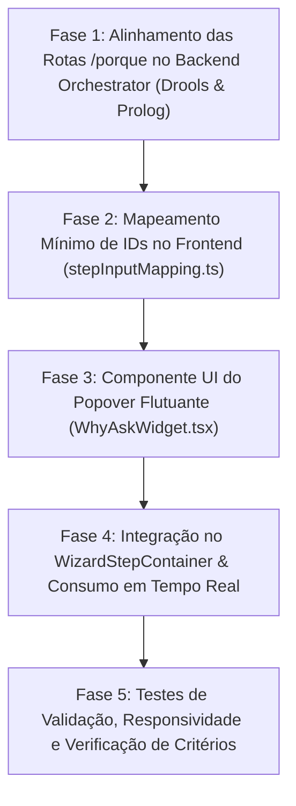

# Plano de Implementação: Explicabilidade Bidirecional "Porquê?" (Why Ask) no Wizard de Atendimento

> **Alvo:** Modelo LLM Autónomo (Gemini 3.8 Flash High)  
> **Objetivo:** Implementar o widget flutuante minimalista de explicabilidade dialógica da pergunta (*"Porquê me estás a fazer esta pergunta?"* / Via 2 - *Why Ask*) nos Passos 2 a 6 do ecrã de "Novo Atendimento", integrando a mecânica pedagógica do Prof. ACM com as regras oficiais da Levi's e os motores Drools e Prolog.  
> **Referência Curricular Primária:** [`docs/material_aulas/MI_Perguntas_ACM.md`](file:///c:/Users/santi/Desktop/meia-equipa3-challenge1-26_27/docs/material_aulas/MI_Perguntas_ACM.md) (Secções 1, 4, 12 e 15).  
> **Fontes da Verdade:** [`docs/material_aulas/Returns & Exchanges Knowledge Base.md`](file:///c:/Users/santi/Desktop/meia-equipa3-challenge1-26_27/docs/material_aulas/Returns%20&%20Exchanges%20Knowledge%20Base.md), [`docs/material_aulas/RPAC-Team3.md`](file:///c:/Users/santi/Desktop/meia-equipa3-challenge1-26_27/docs/material_aulas/RPAC-Team3.md) e [`docs/domain/explainability.md`](file:///c:/Users/santi/Desktop/meia-equipa3-challenge1-26_27/docs/domain/explainability.md).

---

## 1. Contexto Teórico e Enquadramento Curricular

### 1.1 O Princípio das Perguntas num Sistema Pericial (ACM)
Conforme documentado em [`MI_Perguntas_ACM.md`](file:///c:/Users/santi/Desktop/meia-equipa3-challenge1-26_27/docs/material_aulas/MI_Perguntas_ACM.md):
1. **O sistema não pede tudo à partida:** Perguntar apenas à medida que o raciocínio dedutivo precisa (`obtem_facto/2` e `perguntavel/1`).
2. **Factos Perguntáveis vs Inferíveis:** Apenas evidências observáveis simples são perguntadas ao operador de caixa (ex: se tem recibo, dias desde a compra, estado da peça). Decisões e classificações normativas são rigorosamente inferidas.
3. **Inquirição Bidirecional (Secção 12 - Estilo MYCIN):** O utilizador não se limita a responder passivamente; perante uma pergunta formulada pelo sistema, tem o direito de interrogar:
   $$\text{"Porquê me estás a fazer esta pergunta?"}$$
4. **Resposta do Motor:** O sistema deve revelar a **regra candidata ativa em teste** (`regra_ativa/2`), o **objetivo sob validação**, a **família de regras** e o **fundamento de negócio Levi's**.

### 1.2 Âmbito de Aplicação no Dashboard (`RetailFlow`)
* **Passo 1 (Selecione o Motor):** **Excluído.** Não é uma pergunta do domínio de devoluções, mas sim uma escolha técnica de infraestrutura exigida nas aulas.
* **Passos 2 a 6 (Perguntas de Negócio):** **Ativo.**
  * Uma bolinha circular com ícone minimalista posicionada no canto inferior direito.
  * Ao clicar, abre um **popover flutuante tátil** que consulta o motor ativo em tempo real e exibe as razões periciais vindas do backend para as perguntas do passo em curso.

---

## 2. Diagnóstico da Infraestrutura Existente

1. **Motor Java Drools (`drools-engine-levis-devolucoes-java`):**
   * Possui o módulo `pericial-explanation` com a classe [`ExplicadorPorque.java`](file:///c:/Users/santi/Desktop/meia-equipa3-challenge1-26_27/drools-engine-levis-devolucoes-java/backend/pericial-explanation/src/main/java/com/levis/devolucoes/explicacao/porque/ExplicadorPorque.java) e o catálogo de dados [`DadoEntrada.java`](file:///c:/Users/santi/Desktop/meia-equipa3-challenge1-26_27/drools-engine-levis-devolucoes-java/backend/pericial-explanation/src/main/java/com/levis/devolucoes/explicacao/porque/DadoEntrada.java) (`IN-001` a `IN-010`).
   * Endpoint Spring Boot: `POST /api/v1/avaliacoes/porque?dado=IN-xxx`.
   * Gera dinamicamente: pergunta oficial, resumo explicativo, regras que dependem (`regrasQueDependem`) e regras que só esperam por este dado no pedido atual (`regrasEmEspera`).
2. **Motor SWI-Prolog (`prolog_engine`):**
   * Predicados [`explicar_porque_pergunta/2`](file:///c:/Users/santi/Desktop/meia-equipa3-challenge1-26_27/prolog_engine/src/core/retail_engine/interactive.pl#L279) e `why_ask/1..2` em `interactive.pl` e `engine.pl`.
   * Mapeamento de famílias e regras ativas `regra_info/3` e `regra_ativa/2`.
3. **Backend Orchestrator & BFF Gateway:**
   * Rotas FastAPI prontas: `POST /api/v1/levis/porque` e `POST /api/v1/retail/porque`.
   * Gateway Next.js (`dashboard/src/config/gateway.ts`): rotas `/api/returns/porque` e `/api/prolog/porque`.
   * Modelo TypeScript unificado: [`ExplicacaoPorqueResponse`](file:///c:/Users/santi/Desktop/meia-equipa3-challenge1-26_27/dashboard/src/types/returns.ts#L123).

---

## 3. Divisão de Responsabilidades: Backend vs Frontend

| Componente | Responsabilidade | O que contém |
| :--- | :--- | :--- |
| **Backend (Motores Drools / Prolog & Orchestrator)** | **Fonte Única da Verdade do Conhecimento Pericial** | • Texto oficial da pergunta (`pergunta`)<br/>• Resumo causal e normativo da justificação (`resumo`)<br/>• Regras que leem este dado (`regrasQueDependem`)<br/>• Regras que estão ativamente à espera no estado atual (`regrasEmEspera`) |
| **Frontend (Dashboard RetailFlow)** | **Interface / Apresentação Tátil** | • Mapeamento simples de IDs: que códigos de dados de entrada (`IN-xxx`) pertencem a que passo visual do wizard (ex.: Passo 2 $\rightarrow$ `['IN-001', 'IN-002', 'IN-003']`)<br/>• Widget flutuante minimalista e popover tátil de exibição |

---

## 4. Mapeamento Simples de Chaves: Passos vs. Códigos de Entrada (`IN-xxx`)

O frontend apenas necessita de saber quais são os códigos dos dados de entrada avaliados em cada etapa do formulário:
* **Passo 2 (Mercado & Loja):** `['IN-001', 'IN-002', 'IN-003']` (Mercado, Formato Loja, Canal Original)
* **Passo 3 (Elegibilidade do Produto):** `['IN-007', 'IN-008', 'IN-010']` (Produto/SKU/Marca, Estado Físico, Revendível)
* **Passo 4 (Comprovativo e Prazo):** `['IN-005', 'IN-004', 'IN-006']` (Tipo de Pedido, Comprovativo, Momento/Dias)
* **Passo 5 (Troca ou Exceção):** `['EP-001', 'EX-001', 'EX-002']` (Modalidade de Troca, Exceção Gerência, Contestação)
* **Passo 6 (Reembolso & Liquidação):** `['IN-009']` (Meio de Pagamento Original e regras TN associadas)

---

## 5. Visão Geral das Fases de Implementação



---

## 6. Especificação Técnica Detalhada por Fases

### Fase 1: Alinhamento das Rotas `/porque` no Backend Orchestrator (Drools & Prolog)

**Objetivo:** Garantir que o endpoint `POST /porque?dado=IN-xxx` responde com metadados periciais ricos e precisos, tanto para o motor Drools como para o motor Prolog.

**Ficheiros a verificar/ajustar:**
* [`backend_orchestrator/app/services/retail_prolog_service.py`](file:///c:/Users/santi/Desktop/meia-equipa3-challenge1-26_27/backend_orchestrator/app/services/retail_prolog_service.py)
* [`backend_orchestrator/app/services/levis_service.py`](file:///c:/Users/santi/Desktop/meia-equipa3-challenge1-26_27/backend_orchestrator/app/services/levis_service.py)

**Ações:**
1. No `retail_prolog_service.py`, em `explain_why(dado, payload)`, substituir o retorno genérico por um mapeamento dinâmico que devolve a pergunta oficial do Prolog (`formatar_pergunta/2`), as regras da base de conhecimento que leem o atributo (ex: `IN-001` $\rightarrow$ `CH-002`, `TN-008`), e o fundamento normativo (`regra_info/3`).
2. No motor Drools, verificar que o `ExplicadorPorque` continua a devolver `pergunta`, `resumo`, `regrasQueDependem` e `regrasEmEspera`.

---

### Fase 2: Mapeamento Mínimo de IDs no Frontend (`stepInputMapping.ts`)

**Objetivo:** Criar apenas a tabela de ligação de IDs no frontend, associando cada passo aos códigos de entrada que ele recolhe, sem duplicar lógica de negócio nem textos de justificação.

**Ficheiro a criar:**
* `dashboard/src/config/stepInputMapping.ts`

**Conteúdo do Ficheiro:**
```typescript
export interface StepInputItem {
  code: string; // ex: 'IN-001'
  label: string; // ex: '01 / Jurisdição Territorial'
}

export const STEP_INPUT_MAPPING: Record<number, StepInputItem[]> = {
  2: [
    { code: "IN-001", label: "01 / Jurisdição Territorial" },
    { code: "IN-002", label: "02 / Formato Comercial da Loja" },
    { code: "IN-003", label: "03 / Canal de Compra Original" },
  ],
  3: [
    { code: "IN-007", label: "01 / Identificação & Marca" },
    { code: "IN-008", label: "02 / Estado Físico do Artigo" },
    { code: "IN-010", label: "03 / Aptidão para Revenda" },
  ],
  4: [
    { code: "IN-005", label: "01 / Tipo de Pedido Formulado" },
    { code: "IN-004", label: "02 / Comprovativo Apresentado" },
    { code: "IN-006", label: "03 / Prazo Decorrido da Compra" },
  ],
  5: [
    { code: "EP-001", label: "01 / Modalidade de Troca" },
    { code: "EX-001", label: "02 / Exceção de Balcão e Gerência" },
    { code: "EX-002", label: "03 / Contestação do Cliente" },
  ],
  6: [
    { code: "IN-009", label: "01 / Meio de Pagamento Original" },
  ],
};
```

---

### Fase 3: Componente UI do Popover Flutuante (`WhyAskWidget.tsx`)

**Objetivo:** Criar o componente visual que renderiza a bolinha circular minimalista e o popover flutuante no canto inferior direito, consumindo os dados diretamente da API do motor ativo.

**Ficheiro a criar:**
* `dashboard/src/components/wizard/WhyAskWidget.tsx`

**Comportamento:**
1. Mostra a bolinha minimalista (`w-11 h-11`, ícone `help_outline`, estilo tátil esmeralda).
2. Ao clicar, abre o popover flutuante:
   * Exibe abas/chips para os campos mapeados do passo ativo (ex.: no Passo 2: `[Jurisdição]`, `[Formato]`, `[Canal]`).
   * Faz a chamada em tempo real ao motor selecionado no Passo 1 (`/api/returns/porque?dado=...` ou `/api/prolog/porque?dado=...`).
   * Apresenta os dados genuínos devolvidos pelo backend:
     - **Pergunta formulada pelo sistema** (`data.pergunta`);
     - **Resumo causal e normativo** (`data.resumo`);
     - **Regras que dependem da resposta** (`data.regrasQueDependem`);
     - **Regras em espera no pedido atual** (`data.regrasEmEspera`, indicando regras prestes a disparar).
3. Inclui estado de loading suave (`A consultar raciocínio pericial...`) e tratamento de erros.
4. Suporta fecho por botão `close`, clique exterior e tecla `Escape`.

### Fase 4: Integração no `WizardStepContainer.tsx` & Consumo em Tempo Real

**Objetivo:** Integrar o widget no ecrã de etapas, garantindo que só é renderizado a partir do Passo 2 e atualiza dinamicamente conforme o utilizador avança ou recua.

**Ficheiro a alterar:**
* [`dashboard/src/components/wizard/WizardStepContainer.tsx`](file:///c:/Users/santi/Desktop/meia-equipa3-challenge1-26_27/dashboard/src/components/wizard/WizardStepContainer.tsx)

**Ações Passo a Passo:**
1. Importar `WhyAskWidget` em `WizardStepContainer.tsx`.
2. Inserir o componente condicionalmente:
   ```tsx
   {/* Widget de Explicabilidade Bidirecional "Porquê?" (ACM - Via 2) */}
   {stepNumber >= 2 && stepNumber <= 6 && (
     <WhyAskWidget
       stepNumber={stepNumber}
       engine={state.engine || "returns"}
       returnRequest={buildReturnRequest()}
     />
   )}
   ```
3. Garantir que a renderização do widget respeita a área visual circulada pelo utilizador sem tapar a barra de progresso ([ProgressBar.tsx](file:///c:/Users/santi/Desktop/meia-equipa3-challenge1-26_27/dashboard/src/components/ui/ProgressBar.tsx)) ou os botões de navegação ([NavigationFooter.tsx](file:///c:/Users/santi/Desktop/meia-equipa3-challenge1-26_27/dashboard/src/components/ui/NavigationFooter.tsx)).

---

### Fase 5: Testes de Validação, Responsividade e Verificação de Critérios

**Objetivo:** Validar a funcionalidade nos 5 passos (2 a 6), nos dois motores (Drools e Prolog) e nos diferentes tamanhos de ecrã.

**Checklist de Validação:**
1. [x] **Passo 1:** Confirmar que a bolinha **NÃO** aparece.
2. [x] **Passo 2:** Clicar na bolinha e verificar as 3 perguntas (Jurisdição, Formato, Canal) e regras `[CH-001]`, `[CH-002]`, `[CH-003]`.
3. [x] **Passo 3:** Avançar para o Passo 3; verificar se o popover atualiza automaticamente para as perguntas de Elegibilidade do Produto e regras `[PC-001]`, `[PC-008]`.
4. [x] **Passos 4, 5 e 6:** Verificar a exibição correta de Comprovativo (`PT`), Trocas (`EP`/`EX`) e Reembolso (`TN`).
5. [x] **Alternância de Motor:** Testar com motor selecionado como `Drools` e como `Prolog`, validando os respetivos badges no cabeçalho do popover.
6. [x] **Responsividade & Acessibilidade:**
   * [x] O popover não quebra o layout em ecrãs menores (`max-w-[calc(100vw-2rem)]`).
   * [x] Tecla `Escape` fecha o popover.
   * [x] Fechar ao clicar fora funciona perfeitamente.
7. [x] **Compilação sem Erros:** Executar `npm run build` no `dashboard` garantindo 0 erros de compilação ou TypeScript.

---

## 7. Prompt Específico para Execução por Gemini 3.8 Flash High

Quando estiveres pronto para implementar, basta executar o seguinte prompt de arranque:

```text
Atua como Engenheiro Especialista em Sistemas Periciais e Engenharia de Software no projeto RetailFlow (MEIA/ISEP).
Segue escrupulosamente o plano em docs/plano_implementacao_explicabilidade_why_ask.md e os fundamentos teóricos em docs/material_aulas/MI_Perguntas_ACM.md.

Executa as seguintes fases:
1. No backend_orchestrator/app/services/retail_prolog_service.py, ajusta o método explain_why para mapear cada código de entrada (IN-001..IN-010, EP-001, EX-001..002) para as respetivas perguntas oficiais do Prolog (formatar_pergunta/2), regras associadas e fundamento normativo (regra_info/3).
2. Cria dashboard/src/config/stepInputMapping.ts contendo exclusivamente o mapeamento dos passos visuais 2 a 6 para os códigos de entrada de dados (IN-xxx, EP-xxx, EX-xxx).
3. Cria dashboard/src/components/wizard/WhyAskWidget.tsx com a bolinha minimalista circular flutuante (no canto inferior direito) e o popover tátil responsivo, que consome em tempo real o endpoint /porque do motor selecionado no Passo 1 (Drools ou Prolog).
4. Atualiza dashboard/src/components/wizard/WizardStepContainer.tsx para renderizar o WhyAskWidget exclusivamente dos passos 2 a 6, passando o estado atual da transação.
5. Valida a compilação do dashboard com npm run build garantindo zero erros de TypeScript e conformidade visual com o design do RetailFlow.
```

