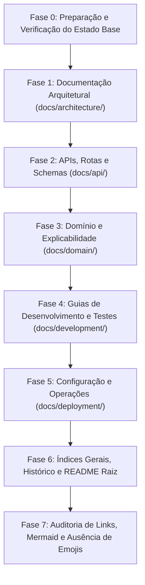

# Plano de Atualização da Documentação Técnica — Motor Pericial de Retalho em Prolog
### *Integração do Motor Levi's com 71 Regras, 5 Vias de Explicabilidade, Mecânica ACM e Orquestração FastAPI*
#### *MEIA 2026/2027 — Challenge 1 (Grupo 3: SmartCloth AI)*

---

## 0. Enquadramento e Guia Operacional do Agente Antigravity

### 0.1 Contexto e Motivação
A implementação do plano de engenharia [`docs/development/retail_prolog_implementation_plan.md`](retail_prolog_implementation_plan.md) foi concluída com 100% de sucesso:
- **81/81 testes PLUnit** aprovados no micro-serviço SWI-Prolog ([`prolog_engine/`](../../prolog_engine));
- **153/153 testes Pytest** aprovados no backend orquestrador FastAPI ([`backend_orchestrator/`](../../backend_orchestrator));
- O motor de retalho declarativo da Levi's (71 regras em 9 famílias, 5 vias de explicabilidade, interrogação dialógica com a mecânica ACM de `obtem_facto/2` e simulação *What-If* em sandbox) está plenamente operacional e integrado via HTTP REST e *feature toggle* (`PROLOG_ENGINE_MODE`).

A documentação técnica centralizada em `docs/` e o `README.md` raiz ainda contêm referências que tratam o motor de retalho como "Prova de Conceito (POC) inicial" ou "a ser expandida em fases futuras". É imperativo atualizar a documentação do repositório para refletir o estado de maturidade e completude do sistema pericial.

### 0.2 Perfil Operacional do Agente Executor (Gemini 3.8 Flash High no Antigravity)
Este plano foi desenhado para ser executado de forma autónoma, sistemática e determinística por um agente integrado no **Antigravity IDE** sob o modelo **Gemini 3.8 Flash High**:
1. **Inspeção Prévia Obrigatória:** Antes de editar qualquer documento existente, o agente deve obrigatoriamente invocar `view_file` para analisar a estrutura, estilos, numeração de secções e contexto prévio.
2. **Edições Atómicas e Cirúrgicas:** Utilizar prioritariamente `replace_file_content` (para blocos contíguos) ou `multi_replace_file_content` (para múltiplos blocos não contíguos). Evitar rescritas cegas de ficheiros inteiros.
3. **Padrão Estrito de Idioma:** Toda a prosa deve ser rigorosamente redigida em **Português de Portugal (pt-PT)**. Termos técnicos, identificadores de código, nomes de classes/funções, chaves JSON, predicados Prolog e comandos mantêm-se em inglês.
4. **Proibição Absoluta de Emojis:** Não utilizar nenhum emoji ou símbolo decorativo Unicode em ficheiros `.md` dentro de `docs/` e no `README.md` raiz.
5. **Estrutura de Cabeçalhos e Subtítulo:**
   - Todos os documentos devem usar numeração hierárquica (`## 1.`, `### 1.1`, `#### 1.1.1`);
   - A Linha 2 de cada documento deve conter o subtítulo padrão em itálico: `### *Sistema Pericial de Diagnóstico para Devoluções e Trocas no Retalho*` (ou subtítulo temático análogo aprovado);
   - A última secção de cada documento deve intitular-se `## N. Documentos Relacionados` e conter links relativos Markdown válidos.
6. **Diagramas Mermaid Robustos:** Garantir sintaxe válida no Mermaid. Labels com parêntesis, chavetas ou barras devem ser devidamente quotadas com aspas (ex.: `id["Label (Detalhe)"]`).
7. **Exemplos Bipolares de Teste HTTP:** Todos os novos endpoints devem conter exemplos prontos para execução em **Bash (cURL)** e **Windows PowerShell (Invoke-RestMethod)**.
8. **Validação Contínua:** Ao final de cada fase, o agente deve executar os testes de integridade e verificar links relativos.

---

## 1. Inventário de Código Implementado vs. Gaps na Documentação

### 1.1 Ficheiros de Código Implementados (Fontes da Verdade)

| Ficheiro (Caminho Relativo) | Módulo / Componente | Elementos Chave Implementados |
|:---|:---|:---|
| [`prolog_engine/src/core/retail_engine/engine.pl`](../../prolog_engine/src/core/retail_engine/engine.pl) | Core Prolog | Motor *forward-chaining* modular, `obtem_facto/2`, `perguntavel/1`, `ja_perguntado/1`, tratamento `nao_sei`, `regra_ativa/2`, 5 vias (`como/1`, `explain_how/2`, `why_ask/1..2`, `output_why/1`, `decision_justification/2`, `whynot/1`, `explain_whynot/2`, `what_if/3` em sandbox). |
| [`prolog_engine/src/core/retail_engine/interactive.pl`](../../prolog_engine/src/core/retail_engine/interactive.pl) | Diálogo Dinâmico | Formulação textual em pt-PT para 41 atributos observáveis, fila de mocks (`set_mock_answers/1`), máquina de estados passo-a-passo não bloqueante. |
| [`prolog_engine/src/core/retail_engine/kb/retail_rules.pl`](../../prolog_engine/src/core/retail_engine/kb/retail_rules.pl) | Base de Conhecimento | As 71 regras da Levi's nas 9 famílias (`HS`, `PC`, `PT`, `CH`, `TN`, `EP`, `EX`, `CT`, `BW`), 7 precedências estritas, `facto_dispara_regras/2`, `perguntavel/1` e `regra_info/3`. |
| [`prolog_engine/src/api/retail_routes.pl`](../../prolog_engine/src/api/retail_routes.pl) | API REST Prolog | Endpoints `/retail/evaluate`, `/retail/interactive`, `/retail/whatif`, `/retail/how`, `/retail/whynot`, `/retail/facts`, `/retail/reset`. |
| [`prolog_engine/src/main.pl`](../../prolog_engine/src/main.pl) | Bootstrap Prolog | Registo modular de `api/retail_routes` e `core/retail_engine/engine`, mantendo paridade com `core/inference/engine` (sp_exp2). |
| [`prolog_engine/tests/test_retail_rules.pl`](../../prolog_engine/tests/test_retail_rules.pl) | Testes PLUnit | 31 testes unitários das 71 regras e prioridades normativas. |
| [`prolog_engine/tests/test_retail_explainability.pl`](../../prolog_engine/tests/test_retail_explainability.pl) | Testes PLUnit | 18 testes unitários cobrindo as 5 vias de explicabilidade pericial. |
| [`prolog_engine/tests/test_retail_interactive.pl`](../../prolog_engine/tests/test_retail_interactive.pl) | Testes PLUnit | 12 testes do fluxo dialógico, interrogação pontual e resposta a "porquê?". |
| [`prolog_engine/tests/test_retail_api.pl`](../../prolog_engine/tests/test_retail_api.pl) | Testes PLUnit | 12 testes de integração HTTP validando todos os 7 endpoints `/retail/*`. |
| [`prolog_engine/tests/test_retail_engine_phase1.pl`](../../prolog_engine/tests/test_retail_engine_phase1.pl) | Testes PLUnit | Teste de isolamento de paridade e coexistência. |
| [`backend_orchestrator/app/core/config.py`](../../backend_orchestrator/app/core/config.py) | Configuração FastAPI | Feature toggle `PROLOG_ENGINE_MODE: Literal["retail", "academic", "dual"] = "retail"`. |
| [`backend_orchestrator/.env.example`](../../backend_orchestrator/.env.example) | Configuração de Ambiente | Definição de `PROLOG_ENGINE_MODE=retail`. |
| [`backend_orchestrator/app/clients/prolog_client.py`](../../backend_orchestrator/app/clients/prolog_client.py) | Cliente HTTP | Métodos assíncronos: `evaluate_retail`, `interactive_retail`, `whatif_retail`, `how_retail`, `whynot_retail`, `facts_retail`, `reset_retail` e chaveamento automático por modo. |
| [`backend_orchestrator/app/services/orchestrator.py`](../../backend_orchestrator/app/services/orchestrator.py) | Serviço de Orquestração | Mapeamento canónico de átomos em português (`permitir`, `recusar`, `rever`, `vale_loja`) para enum canónico (`approved`, `rejected`, `manager_override`, `store_credit_only`) e suporte a dual mode. |
| [`backend_orchestrator/app/api/v1/endpoints/retail.py`](../../backend_orchestrator/app/api/v1/endpoints/retail.py) | Router FastAPI | Endpoints REST públicos sob prefixo `/api/v1/retail/*` com tradução estrita de exceções de rede e negócio. |
| [`backend_orchestrator/app/api/v1/endpoints/evaluate.py`](../../backend_orchestrator/app/api/v1/endpoints/evaluate.py) | Router FastAPI | Suporte ao query parameter `?mode=` no endpoint principal `/api/v1/evaluate`. |
| [`backend_orchestrator/app/api/v1/router.py`](../../backend_orchestrator/app/api/v1/router.py) | Router Central | Registo de `retail.router` na árvore OpenAPI. |
| [`backend_orchestrator/tests/test_retail_prolog.py`](../../backend_orchestrator/tests/test_retail_prolog.py) | Testes Pytest | 24 novos testes de integração e unitários cobrindo cliente, toggle, rotas e mapeamento. |

---

### 1.2 Mapa de Gaps na Documentação Técnica

| Ficheiro de Documentação | Secção / Tema | Natureza da Alteração Necessária |
|:---|:---|:---|
| [`docs/architecture/prolog_engine.md`](architecture/prolog_engine.md) | Arquitetura Prolog | Documentar a Clean Architecture com `retail_engine/`, o princípio de isolamento por paridade com `inference/` (veículos), os componentes `engine.pl`, `interactive.pl` e `kb/retail_rules.pl`, ciclo de vida do pedido de retalho e serialização via Prolog Dicts. |
| [`docs/architecture/system_overview.md`](architecture/system_overview.md) | Visão Global | Atualizar secção 2.3 substituindo "POC inicial a ser expandida no futuro" pelo Motor de Retalho completo; atualizar diagrama de arquitetura Mermaid e matriz de portas e capacidades. |
| [`docs/architecture/service_interactions.md`](architecture/service_interactions.md) | Interações & Fluxos | Adicionar diagrama de sequência ponta-a-ponta para `/retail/*`, fluxo interativo passo-a-passo (ACM), simulação contrafactual *What-If* em sandbox com `setup_call_cleanup/3`, e mapeamento semântico no orquestrador. |
| [`docs/architecture/prolog_expert_system_adaptation.md`](architecture/prolog_expert_system_adaptation.md) | Adaptação Pericial | Atualizar o documento para refletir que o plano de adaptação foi 100% concretizado e validado, referenciando as métricas e suítes de testes. |
| [`docs/architecture/README.md`](architecture/README.md) | Índice de Arquitetura | Atualizar tabela de documentos, resumos temáticos e grafo de dependências Mermaid. |
| [`docs/api/prolog_engine_api.md`](api/prolog_engine_api.md) | API Interna Prolog | Adicionar secção exaustiva para os 7 endpoints `/retail/*` (`evaluate`, `interactive`, `whatif`, `how`, `whynot`, `facts`, `reset`), tabelas de campos JSON, códigos de resposta e exemplos em Bash e PowerShell. |
| [`docs/api/orchestrator_api_v1.md`](api/orchestrator_api_v1.md) | API Pública FastAPI | Adicionar secção dedicada para os endpoints `/api/v1/retail/*` e suporte a query param `?mode=` em `/api/v1/evaluate`, com tabelas de schemas, cURL e PowerShell. |
| [`docs/api/schemas.md`](api/schemas.md) | Schemas e Contratos | Documentar os contratos de dados do motor de retalho Prolog: payload de avaliação, estrutura de pergunta/resposta interativa, contrato What-If (`baseline_decision`, `simulated_decision`, `decision_changed`), contratos de explicabilidade e mapeamento para `EvaluationResponse`. |
| [`docs/api/README.md`](api/README.md) | Índice de APIs | Atualizar tabelas de endpoints públicos e internos para incluir as rotas de retalho em Prolog. |
| [`docs/domain/explainability.md`](domain/explainability.md) | Explicabilidade | Documentar o modelo formal das **5 Vias de Explicabilidade em Prolog**: Como?, Porquê da Pergunta?, Porquê da Decisão?, Porque Não?, E Se? Sandbox, comparando a abordagem Prolog à do Drools. |
| [`docs/domain/expert_knowledge.md`](domain/expert_knowledge.md) | Conhecimento Pericial | Mapear formalmente as 71 regras codificadas em `retail_rules.pl`, as 9 famílias e a precedência de 7 níveis estipulada pelo perito Dustin Hopper e RPAC. |
| [`docs/development/testing.md`](development/testing.md) | Estratégia de Testes | Atualizar contagens globais para **81 testes PLUnit** e **153 testes Pytest**, detalhar as 4 novas suítes de retalho em Prolog e a suíte `test_retail_prolog.py`. |
| [`docs/development/getting_started.md`](development/getting_started.md) | Primeiros Passos | Adicionar comandos para arrancar e testar o motor de retalho em Prolog, validar o toggle `PROLOG_ENGINE_MODE` e executar as suítes de teste de retalho. |
| [`docs/development/coding_conventions.md`](development/coding_conventions.md) | Convenções de Código | Adicionar padrões de codificação de regras em Prolog (DSL `regra/se/entao`, prefixos normativos, metaconhecimento obrigatório `perguntavel/1` e `facto_dispara_regras/2`, asserções transacionais seguras). |
| [`docs/development/README.md`](development/README.md) | Índice de Desenvolvimento | Atualizar comandos rápidos de execução de testes e tabela de documentos. |
| [`docs/deployment/environment_variables.md`](deployment/environment_variables.md) | Variáveis de Ambiente | Documentar `PROLOG_ENGINE_MODE` (`retail`, `academic`, `dual`), valores padrão e comportamento no Docker Compose; atualizar secção 4.1. |
| [`docs/deployment/troubleshooting.md`](deployment/troubleshooting.md) | Resolução de Problemas | Adicionar secções de resolução de problemas específicas para o motor de retalho Prolog: loops dialógicos, atributos omitidos em `perguntavel/1`, exaustão de mocks e isolamento de transações *What-If*. |
| [`docs/history/README.md`](history/README.md) | Arquivo Histórico | Registar a conclusão do plano `retail_prolog_implementation_plan.md` no catálogo histórico e diagrama Mermaid. |
| [`docs/README.md`](README.md) | Índice Geral | Atualizar prosa de boas-vindas, estatísticas de testes, catálogos e roteiros de leitura. |
| [`README.md`](../../README.md) | README Raiz do Projeto | Atualizar arquitetura, tabela de componentes, comandos rápidos cURL para testar o motor de retalho em Prolog e contagens de testes. |

---

## 2. Fases de Execução do Plano de Atualização

O trabalho está estruturado em **sete fases sequenciais**. O agente deve completar e validar cada fase antes de transitar para a seguinte, respeitando a integridade das referências cruzadas:



---

### FASE 0: Preparação e Verificação do Estado Base

**Objetivo:** Garantir que o ambiente está limpo, os testes passam a 100% e as ferramentas de inspeção estão alinhadas.

**Tarefas Concretas para o Agente:**
1. **Verificar Estado dos Testes Unitários e de Integração:**
   - Executar suíte PLUnit Prolog:
     ```bash
     swipl -g "run_tests, halt" -s prolog_engine/tests/test_retail_rules.pl
     swipl -g "run_tests, halt" -s prolog_engine/tests/test_retail_explainability.pl
     swipl -g "run_tests, halt" -s prolog_engine/tests/test_retail_interactive.pl
     swipl -g "run_tests, halt" -s prolog_engine/tests/test_retail_api.pl
     swipl -g "run_tests, halt" -s prolog_engine/tests/test_inference_engine.pl
     ```
   - Executar suíte Pytest FastAPI:
     ```bash
     pytest backend_orchestrator/tests/test_retail_prolog.py -v
     pytest backend_orchestrator/tests -v
     ```
   - Confirmar 81/81 testes PLUnit e 153/153 testes Pytest com zero falhas.
2. **Inspecionar Diretório `docs/`:**
   - Confirmar ausência de ficheiros temporários ou corrompidos.

---

### FASE 1: Documentação Arquitetural (`docs/architecture/`)

**Objetivo:** Elevar a documentação arquitetural do micro-serviço Prolog ao nível do Drools Engine, formalizando a Clean Architecture do motor de retalho e a estratégia de coexistência por paridade.

#### Tarefa 1.1: Atualizar `docs/architecture/prolog_engine.md`
- **Ficheiro:** [`docs/architecture/prolog_engine.md`](architecture/prolog_engine.md)
- **Instruções Detalhadas para o Agente:**
  1. Utilizar `view_file` para examinar a secção 2 atual.
  2. Atualizar a árvore de diretórios do micro-serviço em texto com anotações claras, refletindo a nova estrutura:
     - `prolog_engine/src/core/retail_engine/` (`engine.pl`, `interactive.pl`, `kb/retail_rules.pl`);
     - `prolog_engine/src/core/inference/` (preservação do motor académico `engine.pl` e `vehicles.pl`);
     - `prolog_engine/src/api/retail_routes.pl` e `prolog_engine/src/api/inference_routes.pl`;
     - `prolog_engine/tests/` (todas as 8 suítes de teste).
  3. Adicionar subsecção detalhando o **Princípio do Isolamento por Paridade**:
     - Explicar por que razão o motor de veículos (`inference/`) e o motor de retalho (`retail_engine/`) coexistem em namespaces Prolog isolados;
     - Demonstração académica para os docentes: paridade entre o motor de apoio original e a adaptação avançada.
  4. Adicionar subsecção detalhando o **Motor Pericial de Retalho Adaptado (`src/core/retail_engine/`)**:
     - Mecânica ACM de `obtem_facto/2` vs `facto(N, X)`;
     - Rastreamento contextual com `regra_ativa/2` e `setup_call_cleanup/3`;
     - Gestão defensiva de `nao_sei` com `ja_perguntado/1`;
     - As 5 vias de explicabilidade pericial nativa;
     - Sandbox de simulação contrafactual *What-If* com transações em memória volátil sem poluição de sessão.
  5. Atualizar o ciclo de vida do pedido (Request-Response Lifecycle) com diagrama de sequência Mermaid cobrindo `/retail/evaluate` e `/retail/interactive`.
  6. Garantir referências relativas atualizadas na secção final "Documentos Relacionados".

#### Tarefa 1.2: Atualizar `docs/architecture/system_overview.md`
- **Ficheiro:** [`docs/architecture/system_overview.md`](architecture/system_overview.md)
- **Instruções Detalhadas para o Agente:**
  1. Atualizar a prosa da Secção 1 e o diagrama Mermaid de arquitetura macro:
     - Refletir que o micro-serviço SWI-Prolog disponibiliza **dois motores de inferência completos**: o Motor Académico de Veículos (`/inference/*`) e o Motor Pericial Oficial de Retalho da Levi's (`/retail/*`), além da rota agregadora `/evaluate`.
  2. Reescrever a Secção 2.3 (**Micro-serviço Motor SWI-Prolog**):
     - Substituir a menção de "POC inicial a ser expandida no futuro" pela especificação integral do **Motor de Retalho Levi's (Implementado e Validado)**;
     - Descrever as 71 regras normativas, os 41 atributos perguntáveis, a precedência de 7 níveis e as 5 vias de explicabilidade.
  3. Adicionar linha na tabela de tecnologias para a camada de retalho em Prolog.
  4. Manter estrita a regra de proibição de emojis.

#### Tarefa 1.3: Atualizar `docs/architecture/service_interactions.md`
- **Ficheiro:** [`docs/architecture/service_interactions.md`](architecture/service_interactions.md)
- **Instruções Detalhadas para o Agente:**
  1. Na Secção 2.1, atualizar o diagrama de sequência Mermaid para representar o fluxo moderno de retalho com o motor Prolog:
     - `FastAPI Router (/api/v1/retail/evaluate)` $\rightarrow$ `PrologClient` $\rightarrow$ `POST /retail/evaluate` $\rightarrow$ `retail_engine` $\rightarrow$ resposta canónica com `EvaluationResponse`.
  2. Adicionar nova subsecção com diagrama de sequência Mermaid para o **Fluxo Dialógico Interativo (ACM)**:
     - Detalhar a mecânica de interrogação: cenário parcial $\rightarrow$ motor deteta facto omisso $\rightarrow$ `obtem_facto/2` verifica `perguntavel/1` $\rightarrow$ devolução de pergunta pendente estruturada $\rightarrow$ submissão de resposta $\rightarrow$ continuação da dedução.
  3. Adicionar nova subsecção com diagrama para a **Simulação Contrafactual What-If em Sandbox**:
     - Detalhar o isolamento transacional com `setup_call_cleanup/3`, cálculo do delta de desfecho (`baseline_decision` vs `simulated_decision`), `impact_summary` e restauração da memória sem efeitos colaterais.
  4. Documentar o mapeamento semântico no orquestrador:
     - Conversão de decisões de retalho em português (`permitir`, `recusar`, `rever`, `vale_loja`, `credito_loja`) para o enum canónico (`approved`, `rejected`, `manager_override`, `store_credit_only`).

#### Tarefa 1.4: Atualizar `docs/architecture/prolog_expert_system_adaptation.md`
- **Ficheiro:** [`docs/architecture/prolog_expert_system_adaptation.md`](architecture/prolog_expert_system_adaptation.md)
- **Instruções Detalhadas para o Agente:**
  1. Rever o documento para sincronizar o texto com a concretização prática:
     - Anotar o estado como **100% Implementado e Validado**;
     - Referenciar a conformidade estrita com os 12 testes de `test_retail_interactive.pl` e 18 testes de `test_retail_explainability.pl`.

#### Tarefa 1.5: Atualizar `docs/architecture/README.md`
- **Ficheiro:** [`docs/architecture/README.md`](architecture/README.md)
- **Instruções Detalhadas para o Agente:**
  1. Atualizar a tabela de documentos da secção, descrevendo o estado dos motores Prolog e Drools.
  2. Atualizar o grafo de navegação Mermaid.

---

### FASE 2: APIs, Rotas e Schemas (`docs/api/`)

**Objetivo:** Documentar exaustivamente todos os endpoints públicos e internos adicionados para o motor de retalho em Prolog, respetivos contratos JSON e exemplos de consumo.

#### Tarefa 2.1: Atualizar `docs/api/prolog_engine_api.md`
- **Ficheiro:** [`docs/api/prolog_engine_api.md`](api/prolog_engine_api.md)
- **Instruções Detalhadas para o Agente:**
  1. Inserir nova secção completa: **`## 4. Endpoints do Motor Pericial de Retalho (/retail/*)`**.
  2. Documentar exaustivamente cada um dos 7 endpoints do micro-serviço Prolog:
     - `POST /retail/evaluate`: Payload de entrada (factos observáveis `IN-001` a `IN-010`), payload de saída (`status`, `decision`, `justification[]`, `rules_fired[]`, `facts_count`);
     - `POST /retail/interactive`: Payload para avançar diálogo, estrutura de pergunta devolvida (`status: "question"`, `question_id`, `text`, `options[]`), tratamento de `porquê?` e `não sei`;
     - `POST /retail/whatif`: Payload (`add_facts[]`, `remove_facts[]`), resposta comparativa (`baseline_decision`, `simulated_decision`, `decision_changed`, `impact_summary`);
     - `POST /retail/how`: Pedido por FactId numérico ou termo compósito, resposta com rasto dedutivo completo e distinção de origens (`utilizador` vs `regra`);
     - `POST /retail/whynot`: Pedido por objetivo falhado, resposta com árvore de premissas não satisfeitas e antecedentes;
     - `GET /retail/facts`: Listagem estruturada de factos na memória de trabalho da sessão;
     - `POST /retail/reset`: Limpeza determinística de memória volátil e estado interativo.
  3. Adicionar tabelas de campos, tipos, obrigatoriedade e descrições para cada endpoint.
  4. Fornecer exemplos práticos em **Bash (cURL)** e **Windows PowerShell (Invoke-RestMethod)** para cada rota.

#### Tarefa 2.2: Atualizar `docs/api/orchestrator_api_v1.md`
- **Ficheiro:** [`docs/api/orchestrator_api_v1.md`](api/orchestrator_api_v1.md)
- **Instruções Detalhadas para o Agente:**
  1. Adicionar nova secção: **`## 4. Endpoints do Motor de Retalho em Prolog (/api/v1/retail/*)`**.
  2. Documentar os endpoints expostos pelo FastAPI orquestrador:
     - `POST /api/v1/retail/evaluate`
     - `POST /api/v1/retail/interactive`
     - `POST /api/v1/retail/whatif`
     - `POST /api/v1/retail/how`
     - `POST /api/v1/retail/whynot`
     - `GET /api/v1/retail/facts`
     - `POST /api/v1/retail/reset`
  3. Documentar o suporte ao query parameter `?mode=` no endpoint principal `POST /api/v1/evaluate` (`mode=retail`, `mode=academic`, `mode=dual`).
  4. Incluir exemplos em Bash e PowerShell para os endpoints da API pública.

#### Tarefa 2.3: Atualizar `docs/api/schemas.md`
- **Ficheiro:** [`docs/api/schemas.md`](api/schemas.md)
- **Instruções Detalhadas para o Agente:**
  1. Adicionar nova subsecção cobrindo os **Contratos de Dados do Motor de Retalho Prolog**:
     - Schemas de pedido e resposta de avaliação (`EvaluationResponse` com mapeamento canónico);
     - Schemas da interrogação interativa dialógica (`InteractiveStepRequest`, `InteractiveStepResponse`);
     - Schemas de simulação contrafactual (`WhatIfRequest`, `WhatIfResponse`);
     - Schemas das explicações causais (`HowExplanationResponse`, `WhyNotExplanationResponse`).
  2. Atualizar o diagrama de classes Mermaid incluindo as novas entidades e enums.

#### Tarefa 2.4: Atualizar `docs/api/README.md`
- **Ficheiro:** [`docs/api/README.md`](api/README.md)
- **Instruções Detalhadas para o Agente:**
  1. Atualizar tabela de endpoints do Orquestrador (porta 8000) e do Motor Prolog (porta 8080) adicionando as rotas `/retail/*` e `/api/v1/retail/*`.
  2. Atualizar diagrama Mermaid da camada de API.

---

### FASE 3: Domínio de Negócio e Explicabilidade Multi-Via (`docs/domain/`)

**Objetivo:** Alinhar os documentos de domínio com as 71 regras de negócio reais da Levi's codificadas em Prolog e formalizar a teoria das 5 vias de explicabilidade.

#### Tarefa 3.1: Atualizar `docs/domain/explainability.md`
- **Ficheiro:** [`docs/domain/explainability.md`](domain/explainability.md)
- **Instruções Detalhadas para o Agente:**
  1. Inserir secção detalhada dedicada ao **Modelo de Explicabilidade em 5 Vias no SWI-Prolog**:
     - **Via 1: Como? (`como/1` / `explain_how/2` — How):** Explicação causal retrospetiva, proveniência de premissas (`utilizador` vs `inicial` vs `regra`), formatação entre parêntesis retos `[PC-001]`;
     - **Via 2: Porquê da Pergunta? (`why_ask/1..2` — Why Ask):** Resolução contextual da regra ativa em teste via `regra_ativa/2` e `regra_info/3`, justificando perante o operador o motivo de cada questão;
     - **Via 3: Porquê do Desfecho? (`output_why/1` / `decision_justification/2` — Output Why):** Síntese determinística de motivos normativos e regras disparadas no vetor `justification[]`;
     - **Via 4: Porque Não? (`whynot/1` / `explain_whynot/2` — Why Not):** Árvore recursiva de falhas para desfechos não alcançados, decomposição de conjunções `e` e análise de antecedentes em falta;
     - **Via 5: E Se? (`what_if/3` — What-If Sandbox):** Simulação contrafactual sem poluição de memória de sessão através do padrão de sandbox transacional com snapshot dinâmico e `setup_call_cleanup/3`.
  2. Incluir tabela comparativa da explicabilidade: **Prolog Engine (5 Vias)** vs **Drools Engine (5 Vias)**.
  3. Adicionar exemplos de payloads JSON reais com explicações.

#### Tarefa 3.2: Atualizar `docs/domain/expert_knowledge.md`
- **Ficheiro:** [`docs/domain/expert_knowledge.md`](domain/expert_knowledge.md)
- **Instruções Detalhadas para o Agente:**
  1. Mapear a formalização em Prolog das **71 regras de negócio da Levi's** distribuídas pelas 9 famílias (`HS`, `PC`, `PT`, `CH`, `TN`, `EP`, `EX`, `CT`, `BW`).
  2. Documentar a hierarquia estrita de precedência (1 a 7) implementada na base `retail_rules.pl` (prioridade absoluta de `HS-006`, precedência de salubridade `PC-008` sobre exceções de gerência, etc.).
  3. Citar a conformidade com as fontes oficiais: [`RPAC-Team3.md`](../material_aulas/RPAC-Team3.md), [`Returns & Exchanges Knowledge Base.md`](../material_aulas/Returns%20&%20Exchanges%20Knowledge%20Base.md) e o perito Dustin Hopper.

#### Tarefa 3.3: Atualizar `docs/domain/README.md`
- **Ficheiro:** [`docs/domain/README.md`](domain/README.md)
- **Instruções Detalhadas para o Agente:**
  1. Atualizar o catálogo de documentos e resumos temáticos.

---

### FASE 4: Guias de Desenvolvimento, Testes e Convenções (`docs/development/`)

**Objetivo:** Atualizar os guias de desenvolvimento e estratégia de testes para refletir os 81 testes PLUnit e 153 testes Pytest, e documentar as convenções da DSL do motor de retalho.

#### Tarefa 4.1: Atualizar `docs/development/testing.md`
- **Ficheiro:** [`docs/development/testing.md`](development/testing.md)
- **Instruções Detalhadas para o Agente:**
  1. Atualizar o cabeçalho e estatísticas globais da Secção 1:
     - **Total Global:** Atualizar contagem total de testes automatizados do ecossistema;
     - **Motor SWI-Prolog:** Atualizar para **81 Testes PLUnit (100% Aprovados)**;
     - **Backend FastAPI:** Atualizar para **153 Testes Pytest (100% Aprovados)**;
     - **Motor Drools:** Manter os 14 testes JUnit 5.
  2. Atualizar o diagrama Mermaid da suíte global de testes para incluir:
     - `test_retail_rules.pl` (31 testes unitários das 71 regras e precedências);
     - `test_retail_explainability.pl` (18 testes das 5 vias de explicabilidade);
     - `test_retail_interactive.pl` (12 testes do fluxo dialógico ACM e mocks);
     - `test_retail_api.pl` (12 testes de integração REST dos endpoints `/retail/*`);
     - `test_inference_engine.pl` (8 testes preservados do motor académico sp_exp2);
     - `test_rules.pl` (7 testes) e `test_api.pl` (5 testes);
     - `test_retail_prolog.py` (24 testes Pytest no FastAPI para o cliente e rotas de retalho).
  3. Adicionar subsecções detalhadas para cada um dos novos ficheiros de teste com tabelas de cenários validados e comandos de execução.
  4. Adicionar comandos unificados para correr todos os testes do Prolog:
     ```bash
     swipl -g "run_tests, halt" -s prolog_engine/tests/test_retail_rules.pl
     swipl -g "run_tests, halt" -s prolog_engine/tests/test_retail_explainability.pl
     swipl -g "run_tests, halt" -s prolog_engine/tests/test_retail_interactive.pl
     swipl -g "run_tests, halt" -s prolog_engine/tests/test_retail_api.pl
     ```

#### Tarefa 4.2: Atualizar `docs/development/getting_started.md`
- **Ficheiro:** [`docs/development/getting_started.md`](development/getting_started.md)
- **Instruções Detalhadas para o Agente:**
  1. Adicionar comandos de arranque e validação para o motor de retalho em Prolog.
  2. Adicionar exemplo de *smoke test* via cURL para `POST http://localhost:8080/retail/evaluate` e `POST http://localhost:8000/api/v1/retail/evaluate`.
  3. Documentar a verificação da variável `PROLOG_ENGINE_MODE=retail`.

#### Tarefa 4.3: Atualizar `docs/development/coding_conventions.md`
- **Ficheiro:** [`docs/development/coding_conventions.md`](development/coding_conventions.md)
- **Instruções Detalhadas para o Agente:**
  1. Inserir subsecção de **Convenções para o Motor Pericial em Prolog**:
     - Sintaxe declarativa da DSL: `regra 'ID' se Premissas entao Conclusao.`;
     - Regras de precedência e prefixos canónicos (`HS`, `PC`, `PT`, `CH`, `TN`, `EP`, `EX`, `CT`, `BW`);
     - Metaconhecimento obrigatório: indexação de disparo via `facto_dispara_regras/2`, declaração de atributos observáveis via `perguntavel/1` e fundamentação normativa via `regra_info/3`;
     - Isolamento transacional: utilização obrigatória de `setup_call_cleanup/3` em operações voláteis com asserções dinâmicas.

#### Tarefa 4.4: Atualizar `docs/development/README.md`
- **Ficheiro:** [`docs/development/README.md`](development/README.md)
- **Instruções Detalhadas para o Agente:**
  1. Atualizar tabela de documentos e comandos rápidos de teste da secção 3.

---

### FASE 5: Configuração, Deploy e Operações (`docs/deployment/`)

**Objetivo:** Documentar as variáveis de ambiente adicionadas, configuração no Docker Compose e guias operacionais de troubleshooting.

#### Tarefa 5.1: Atualizar `docs/deployment/environment_variables.md`
- **Ficheiro:** [`docs/deployment/environment_variables.md`](deployment/environment_variables.md)
- **Instruções Detalhadas para o Agente:**
  1. Na Secção 4 (Variáveis do Backend Orquestrador), adicionar à tabela:
     - `PROLOG_ENGINE_MODE`: tipo `Literal["retail", "academic", "dual"]`, valor padrão `"retail"`, descrição do chaveamento funcional entre o motor de retalho da Levi's, o motor académico de veículos e o modo dual comparativo.
  2. Atualizar a Secção 4.1 (**Segmentação Funcional**):
     - Substituir o texto que definia o motor de retalho como "POC inicial reservada para fases posteriores" pela descrição do motor completo agora operacional;
     - Explicar a relação entre `INFERENCE_ENGINE_ENABLED` (controlo dos endpoints académicos `/api/v1/inference/*`) e `PROLOG_ENGINE_MODE` (controlo do motor padrão de avaliação).

#### Tarefa 5.2: Atualizar `docs/deployment/troubleshooting.md`
- **Ficheiro:** [`docs/deployment/troubleshooting.md`](deployment/troubleshooting.md)
- **Instruções Detalhadas para o Agente:**
  1. Adicionar cenários de resolução de problemas específicos do Motor de Retalho Prolog:
     - **Cenário A: Atributo observável não perguntado:** Esquecimento de declarar `perguntavel/1` em `retail_rules.pl`;
     - **Cenário B: Falha em testes de diálogo interativo:** Fila de respostas simuladas vazia (`mock_answers`), resolução via `set_mock_answers/1`;
     - **Cenário C: Decisão divergente por precedência:** Regra com maior precedência (ex.: `HS-006` ou `PC-008`) a disparar antes de regra permissiva;
     - **Cenário D: Sessão poluída após erro em What-If:** Falha na limpeza de memória por não utilização de `setup_call_cleanup/3`.

#### Tarefa 5.3: Atualizar `docs/deployment/README.md`
- **Ficheiro:** [`docs/deployment/README.md`](deployment/README.md)
- **Instruções Detalhadas para o Agente:**
  1. Garantir que as descrições dos documentos de deploy refletem as variáveis de configuração atualizadas.

---

### FASE 6: Índices Gerais, Arquivo Histórico e README Raiz

**Objetivo:** Sincronizar os portais de navegação do repositório, o catálogo de histórico e o documento principal de apresentação do projeto.

#### Tarefa 6.1: Atualizar `docs/history/README.md`
- **Ficheiro:** [`docs/history/README.md`](history/README.md)
- **Instruções Detalhadas para o Agente:**
  1. Registar o plano [`retail_prolog_implementation_plan.md`](../development/retail_prolog_implementation_plan.md) na tabela de documentos de planeamento histórico, assinalando o estado como **100% Concluído (Fases 1 a 5)** com descrição dos artefactos entregues.
  2. Atualizar o diagrama Mermaid de planos históricos adicionando o nó correspondente.

#### Tarefa 6.2: Atualizar `docs/README.md` (Índice Geral)
- **Ficheiro:** [`docs/README.md`](README.md)
- **Instruções Detalhadas para o Agente:**
  1. Atualizar a prosa da Secção 1 destacando a completude dos dois motores periciais (Prolog para retalho declarativo e Drools para regras de produção empresariais).
  2. Atualizar o catálogo de documentos em todas as subsecções afetadas (`architecture`, `api`, `domain`, `development`, `deployment`, `history`).
  3. Atualizar os roteiros de leitura recomendados para incluir o percurso do Motor Pericial de Retalho em Prolog.
  4. Atualizar os comandos do resumo rápido de execução.

#### Tarefa 6.3: Atualizar `README.md` (Raiz do Projeto)
- **Ficheiro:** [`README.md`](../../README.md)
- **Instruções Detalhadas para o Agente:**
  1. Atualizar a secção de arquitetura e o diagrama Mermaid:
     - Refletir o motor SWI-Prolog com as 71 regras de retalho da Levi's e 5 vias de explicabilidade.
  2. Atualizar a tabela de micro-serviços e portas.
  3. Adicionar exemplo de cURL no Guia de Início Rápido para o motor de retalho em Prolog (`POST http://localhost:8000/api/v1/retail/evaluate`).
  4. Atualizar os comandos e contagens de testes automatizados:
     - PLUnit: 81 testes (100% aprovados);
     - Pytest: 153 testes (100% aprovados).

---

### FASE 7: Auditoria de Integridade, Validação de Links e Verificação de Emojis

**Objetivo:** Garantir a perfeição formal, sintática e estrutural de toda a documentação revista antes da entrega final.

**Tarefas Concretas para o Agente:**
1. **Auditoria de Links Relativos Markdown:**
   - Verificar se todos os links `[texto](caminho.md)` em ficheiros alterados apontam para ficheiros existentes.
2. **Auditoria de Diagramas Mermaid:**
   - Validar se todos os diagramas Mermaid modificados ou adicionados possuem sintaxe correta e labels com aspas onde existem parêntesis ou caracteres especiais.
3. **Auditoria Estrita de Ausência de Emojis:**
   - Efetuar pesquisa global por expressões regulares ou verificação de caracteres fora do intervalo padrão em todos os ficheiros `.md` modificados. Garantir zero emojis em toda a documentação.
4. **Verificação de Padrões Tipográficos e Idioma:**
   - Confirmar que a prosa segue rigorosamente o Português de Portugal (pt-PT);
   - Confirmar a presença de subtítulo em itálico na Linha 2 de cada documento;
   - Confirmar numeração hierárquica em todos os cabeçalhos;
   - Confirmar presença de secção "Documentos Relacionados" no final de cada ficheiro.

---

## 3. Matriz de Ficheiros, Tarefas e Estimativa de Impacto

| Fase | Documento Afetado (Caminho Relativo) | Tipo de Ação | Âmbito Principal das Alterações |
|:---:|:---|:---:|:---|
| **F0** | *(Ambiente e Testes)* | Validação | Execução de 81 testes PLUnit e 153 testes Pytest. |
| **F1** | [`docs/architecture/prolog_engine.md`](architecture/prolog_engine.md) | Edição | Clean Architecture, `retail_engine`, isolamento por paridade, ACM, 5 vias. |
| **F1** | [`docs/architecture/system_overview.md`](architecture/system_overview.md) | Edição | Remover menção de POC, atualizar diagrama macro e tabela de capacidades. |
| **F1** | [`docs/architecture/service_interactions.md`](architecture/service_interactions.md) | Edição | Sequência ponta-a-ponta `/retail/*`, interrogação ACM, sandbox What-If. |
| **F1** | [`docs/architecture/prolog_expert_system_adaptation.md`](architecture/prolog_expert_system_adaptation.md) | Edição | Sincronizar plano com código 100% implementado e testado. |
| **F1** | [`docs/architecture/README.md`](architecture/README.md) | Edição | Atualizar tabela de documentos e diagrama de navegação da secção. |
| **F2** | [`docs/api/prolog_engine_api.md`](api/prolog_engine_api.md) | Edição | Documentar os 7 endpoints `/retail/*`, contratos JSON, cURL e PowerShell. |
| **F2** | [`docs/api/orchestrator_api_v1.md`](api/orchestrator_api_v1.md) | Edição | Documentar rotas `/api/v1/retail/*`, query param `?mode=`, cURL e PowerShell. |
| **F2** | [`docs/api/schemas.md`](api/schemas.md) | Edição | Schemas Pydantic DTOs e contratos JSON do motor de retalho Prolog. |
| **F2** | [`docs/api/README.md`](api/README.md) | Edição | Atualizar tabelas de endpoints públicos e internos e diagrama de camadas. |
| **F3** | [`docs/domain/explainability.md`](domain/explainability.md) | Edição | Formalizar modelo de 5 vias no Prolog, payloads reais e comparação Drools. |
| **F3** | [`docs/domain/expert_knowledge.md`](domain/expert_knowledge.md) | Edição | Mapear as 71 regras Levi's, 9 famílias e 7 níveis de precedência. |
| **F3** | [`docs/domain/README.md`](domain/README.md) | Edição | Atualizar índice e descrições do domínio. |
| **F4** | [`docs/development/testing.md`](development/testing.md) | Edição | Atualizar para 81 PLUnit e 153 Pytest, detalhar 5 novas suítes de teste. |
| **F4** | [`docs/development/getting_started.md`](development/getting_started.md) | Edição | Comandos de arranque, smoke test e toggle para motor de retalho Prolog. |
| **F4** | [`docs/development/coding_conventions.md`](development/coding_conventions.md) | Edição | Convenções de regras Prolog, DSL declarativa, metaconhecimento obrigatório. |
| **F4** | [`docs/development/README.md`](development/README.md) | Edição | Atualizar tabela de documentos e comandos rápidos de teste. |
| **F5** | [`docs/deployment/environment_variables.md`](deployment/environment_variables.md) | Edição | Documentar `PROLOG_ENGINE_MODE` (`retail`/`academic`/`dual`), atualizar 4.1. |
| **F5** | [`docs/deployment/troubleshooting.md`](deployment/troubleshooting.md) | Edição | Troubleshooting de retalho Prolog (loops, mock queue, What-If memory). |
| **F5** | [`docs/deployment/README.md`](deployment/README.md) | Edição | Atualizar referências de deploy e variáveis. |
| **F6** | [`docs/history/README.md`](history/README.md) | Edição | Registar conclusão do plano de retalho no catálogo e diagrama histórico. |
| **F6** | [`docs/README.md`](README.md) | Edição | Atualizar índice geral, estatísticas, roteiros de leitura e catálogos. |
| **F6** | [`README.md`](../../README.md) | Edição | Atualizar arquitetura raiz, portas, cURL de teste e contagens de testes. |
| **F7** | *(Transversal em `docs/` e raiz)* | Auditoria | Validação de links relativos, sintaxe Mermaid, pt-PT e ausência de emojis. |

---

## 4. Diretrizes Específicas de Execução com Ferramentas do Antigravity

Quando um agente executar este plano no ambiente Antigravity com o modelo **Gemini 3.8 Flash High**, deve seguir estritamente o seguinte protocolo de uso de ferramentas:

1. **Uso de `view_file` com Slicing Preciso:**
   - Antes de efetuar qualquer alteração, ler o ficheiro-alvo. Se o ficheiro for extenso (como `schemas.md` ou `service_interactions.md`), utilizar os parâmetros `StartLine` e `EndLine` para inspecionar com precisão o bloco a editar.
2. **Substituição Cirúrgica com `replace_file_content`:**
   - Fornecer sempre em `TargetContent` linhas de contexto suficientes e únicas para garantir que a correspondência é inequívoca;
   - Assegurar que os espaços iniciais e indentação coincidem exatamente com o original;
   - Se existirem múltiplos blocos distantes no mesmo ficheiro, utilizar `multi_replace_file_content`.
3. **Validação de Sintaxe Mermaid:**
   - Sempre que adicionar ou modificar blocos ````mermaid ... ````, verificar se as etiquetas com parêntesis contêm aspas:
     - Correto: `NODE["Explicabilidade (5 Vias)"]`
     - Incorreto: `NODE[Explicabilidade (5 Vias)]`
4. **Respeito pelas Convenções de Código e Idioma:**
   - Prosa 100% em Português de Portugal (ex.: "micro-serviço", "orquestrador", "desfecho", "concessão");
   - Nunca introduzir emojis (como fogos, setas decorativas, robôs ou vistos gráficos);
   - Manter links relativos sempre funcionais com sintaxe Markdown canónica `[nome](caminho.md)`.
5. **Progresso Fase a Fase:**
   - Executar uma fase de cada vez. No final de cada fase, apresentar um resumo conciso das alterações realizadas e dos ficheiros modificados antes de avançar para a fase subsequente.

---

## 5. Documentos Relacionados

* [Plano de Implementação do Motor de Retalho em Prolog](retail_prolog_implementation_plan.md) — Registo técnico e arquitetural das 5 fases de implementação concluídas.
* [Plano Mestre de Adaptação do Motor em Prolog](../architecture/prolog_expert_system_adaptation.md) — Teoria de perguntas do Prof. ACM e 71 regras da Levi's.
* [Dissecação do Motor sp_exp2](../architecture/sp_exp2_engine_analysis.md) — Análise técnica dos 6 blocos estruturais do motor académico de apoio.
* [Relatório de Aquisição de Conhecimento (RPAC)](../material_aulas/RPAC-Team3.md) — Fonte formal das regras da Levi's, ontologia e prioridades do perito.
* [Guia do Motor de Inferência e Perguntas ACM](../material_aulas/MI_Perguntas_ACM.md) — Regras de ouro para `obtem_facto/2`, `perguntavel/1` e tratamento de "não sei".
* [Plano de Atualização da Documentação Técnica (Drools)](../history/documentation_update_plan.md) — Plano homólogo de referência metodológica utilizado para a documentação do Drools Engine.
