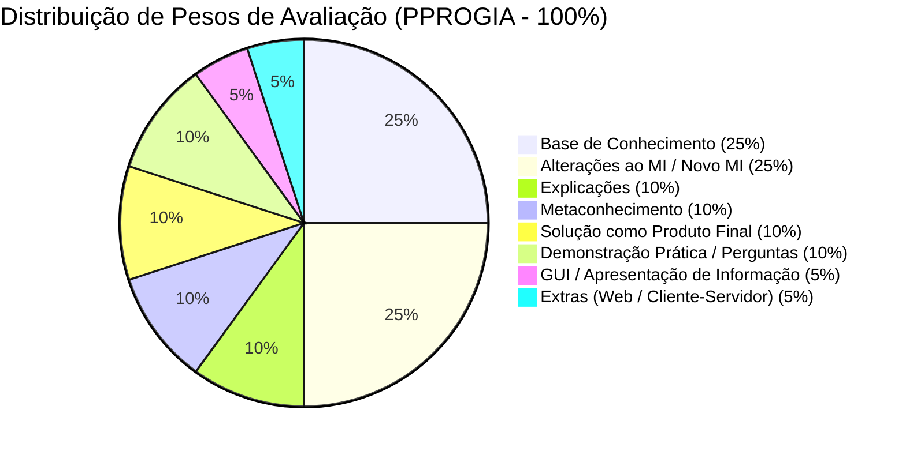

# Critérios de Avaliação · PPROGIA
### *Mestrado em Engenharia de Inteligência Artificial (MEIA 2026/2027) — ISEP / GECAD*
#### *Desafio 1 (Challenges 4Teams) · Paradigmas da Programação em Inteligência Artificial*

---

> [!NOTE]  
> Este documento formaliza os **critérios e percentagens oficiais de avaliação** para a unidade curricular de **PPROGIA** (*Paradigmas da Programação em Inteligência Artificial*), transcrevendo e detalhando a grelha de classificação (rubrica) fornecida pelo corpo docente.  
> Inclui ainda o mapeamento de conformidade da implementação da **Equipa 3 (*SmartCloth AI*)** face a cada critério.

---

## 1. Grelha Oficial de Avaliação (Ponderações)

A avaliação da componente prática e de desenvolvimento em **PPROGIA** é composta por **8 critérios ponderados**, totalizando **100%**:

| # | Critério de Avaliação | Ponderação (%) | Foco Principal |
| :-: | :--- | :-: | :--- |
| **1** | **Estrutura e complexidade da base de conhecimento** | **25%** | Modelação do domínio, riqueza ontológica, granularidade e cobertura das regras de negócio. |
| **2** | **Alterações ao MI ou novo MI** | **25%** | Adaptação do Motor de Inferência (interrogação dinâmica ACM, precedência, resolução de conflitos). |
| **3** | **Explicações** | **10%** | Mecanismos de explicabilidade (*Como / How*, *Porquê / Why*, justificações dedutivas). |
| **4** | **Metaconhecimento** | **10%** | Conhecimento sobre o conhecimento, meta-regras, controlo e ordenação heurística de inferência. |
| **5** | **Solução como produto final** | **10%** | Maturidade da engenharia de software, robustez, tratamento de erros e integração global. |
| **6** | **Demonstração prática / perguntas** | **10%** | Desempenho na defesa oral em direto, execução de cenários e domínio técnico individual e de grupo. |
| **7** | **GUI / Informação apresentada ao utilizador** | **5%** | Clareza, legibilidade e usabilidade na apresentação dos diagnósticos e diálogos ao operador. |
| **8** | **Extras (Interface Web / Arq. Cliente-Servidor)** | **5%** | Arquitetura de micro-serviços (REST/API), Dashboard Web, orquestração e motor duplo. |
| **TOTAL** | **Avaliação Global de PPROGIA** | **100%** | **Classificação Final da UC** |

---

## 2. Detalhe e Especificação dos Critérios

Abaixo descreve-se detalhadamente o âmbito esperado para cada componente de avaliação e como o projeto da **Equipa 3** (*Sistema Pericial de Elegibilidade de Devoluções e Trocas — Levi Strauss & Co.*) satisfaz e excede cada requisito.

---

### 2.1. Estrutura e Complexidade da Base de Conhecimento (25%)
* **Objetivo Curricular:** Avaliar a fidelidade da representação de conhecimento face ao domínio real, a organização das regras de produção, a riqueza dos conceitos, a tipologia de factos e a capacidade de capturar restrições operacionais complexas.
* **Aspetos Avaliados:**
  * Modelação formal de regras *Se-Então* (*If-Then*).
  * Cobertura de cenários normativos, restrições e exceções da política de negócio.
  * Modularidade, taxonomia de classes e hierarquias de conceitos.
  * Separação estrita entre factos observáveis/iniciais, factos perguntáveis e factos inferidos.
* **Conformidade no Projeto (Equipa 3):**
  * **71 Regras Normativas em Prolog** estruturadas em 9 famílias operacionais:
    * `HS` (6 regras): *Hard Stops* e elegibilidade inicial.
    * `PC` (8 regras): Condição física do produto e integridade de etiquetas.
    * `PT` (8 regras): Prazos de devolução (30 dias) e comprovativos de compra.
    * `CH` (10 regras): Políticas por canal (Mainline, Outlet, Online US/CA, Franquia).
    * `TN` (12 regras): Regras de meios de pagamento e reembolso (*Tender*).
    * `EP` (7 regras): Regras de trocas e manutenção de promoções.
    * `EX` (8 regras): Exceções e autorizações de chefia (*Manager Override*).
    * `CT` (8 regras): Controlos de autorização e retenção documental.
    * `BW` (4 regras): Disposição sanitária de roupa interior (*Bodywear*).
  * **98 Regras Homólogas em Drools** demonstrando paridade e expressividade multiplataforma.
  * Ficheiros normativos: [`retail_rules.pl`](file:///c:/Users/santi/Desktop/meia-equipa3-challenge1-26_27/prolog_engine/retail_engine/retail_rules.pl) e [`Returns & Exchanges Knowledge Base.md`](file:///c:/Users/santi/Desktop/meia-equipa3-challenge1-26_27/docs/material_aulas/Returns%20&%20Exchanges%20Knowledge%20Base.md).

---

### 2.2. Alterações ao Motor de Inferência (MI) ou Novo MI (25%)
* **Objetivo Curricular:** Avaliar as extensões ao algoritmo padrão de inferência fornecido nas aulas (`sp_exp2.pl`), transformando um motor meramente dedutivo-estático num motor avançado e interativo.
* **Aspetos Avaliados:**
  * Interrogação dinâmica ao utilizador em tempo de inferência quando faltam factos para validar premissas (`obtem_facto/2` vs `facto/2`).
  * Mecânica de resolução de conflitos e estratégias de encadeamento (*Forward Chaining* orientado a objetivos).
  * Gestão de respostas "não sei" (`nao_sei`) sem bloquear o raciocínio nem repetir perguntas.
  * Preservação da memória de trabalho e consistência transacional.
* **Conformidade no Projeto (Equipa 3):**
  * Implementação estrita do modelo pedagógico do Professor ACM ([`MI_Perguntas_ACM.md`](file:///c:/Users/santi/Desktop/meia-equipa3-challenge1-26_27/docs/material_aulas/MI_Perguntas_ACM.md)).
  * **Hierarquia estrita de 7 níveis de precedência** para resolução determinística de conflitos.
  * Suporte nativo para paragem antecipada quando uma condição de recusa terminal (*Hard Stop*) é satisfeita, poupando passos de inferência.
  * Ficheiros centrais do motor: [`motor_inferencia.pl`](file:///c:/Users/santi/Desktop/meia-equipa3-challenge1-26_27/prolog_engine/inference/motor_inferencia.pl) e [`engine_core.pl`](file:///c:/Users/santi/Desktop/meia-equipa3-challenge1-26_27/prolog_engine/retail_engine/engine_core.pl).

---

### 2.3. Explicações (10%)
* **Objetivo Curricular:** Capacidade do sistema pericial de justificar as suas conclusões e o seu comportamento, garantindo transparência e auditabilidade (requisito fundamental de Sistemas Periciais em IA).
* **Aspetos Avaliados:**
  * **Explicação *Como* (*How*):** Apresentar a árvore de derivação dedutiva (que factos e regras fundamentaram a decisão tomada).
  * **Explicação *Porquê* (*Why*):** Justificar ao utilizador por que razão o sistema está a solicitar determinado dado antes de o pedir.
  * Rastreabilidade completa da cadeia de raciocínio.
* **Conformidade no Projeto (Equipa 3):**
  * **Modelo de Explicabilidade em 5 Vias:**
    1. *Como* (*How*): Árvore completa de prova com lista ordenada de regras disparadas e premissas validadas.
    2. *Porquê da Pergunta* (*Why-Ask*): Exposição da regra ativa que requer o facto antes de interrogar o operador.
    3. *Porquê da Decisão* (*Why-Decision*): Vetor de justificação normativo com artigo de política interna Levi's aplicável.
    4. *Porque Não* (*Why-Not*): Rastreio contrafactual de por que razão uma hipótese alternativa (ex: `PERMITIR`) foi descartada.
    5. *E Se Sandbox* (*What-If*): Simulação hipotética em memória isolada para avaliar impacto de mudanças de factos.
  * Documentação de referência: [`explainability.md`](file:///c:/Users/santi/Desktop/meia-equipa3-challenge1-26_27/docs/domain/explainability.md).

---

### 2.4. Metaconhecimento (10%)
* **Objetivo Curricular:** Avaliar a modelação de "conhecimento sobre o próprio conhecimento", permitindo ao motor controlar dinamicamente a inferência e evitar perguntas redundantes ou inválidas.
* **Aspetos Avaliados:**
  * Definição explícita de atributos perguntáveis (`perguntavel/1` ou equivalentes) vs. factos exclusivamente inferidos.
  * Heurísticas de ordenação e seleção de objetivos.
  * Prevenção de perguntas desnecessárias (ex.: não perguntar estado da etiqueta se a fatura já é inválida).
  * Registo e controlo de histórico (`ja_perguntado/1`).
* **Conformidade no Projeto (Equipa 3):**
  * Tabela declarativa de atributos perguntáveis com tipos de dados e domínios de resposta permitidos.
  * Filtro de relevância: o sistema só questiona factos que pertençam a regras candidatas cujas premissas anteriores já sejam verdadeiras.
  * Deteção de ciclo e controlo de redundância com marcação de perguntas já formuladas.
  * Regras de precedência meta-lógicas orientadas a minimizar a fadiga do operador de balcão.

---

### 2.5. Solução como Produto Final (10%)
* **Objetivo Curricular:** Avaliar o grau de acabamento, fiabilidade, arquitetura de software, ausência de bugs e robustez perante dados inválidos ou imprevistos.
* **Aspetos Avaliados:**
  * Estabilidade e fiabilidade em tempo de execução.
  * Tratamento defensivo de erros e validações de esquema na fronteira de entrada.
  * Modularidade, legibilidade de código e respeito por boas práticas de engenharia (*Clean Code* / *Clean Architecture*).
* **Conformidade no Projeto (Equipa 3):**
  * **Clean Architecture** com desacoplamento rigoroso entre motor de inferência, orquestração e adaptadores de rede.
  * Validação tipada via modelos **Pydantic V2** no orquestrador Python.
  * Suíte automatizada de testes de paridade cobrindo os 10 cenários reais do perito (`test_parity_*.py`).
  * Gestão de dependências isoladas e scripts de arranque e encerramento automatizados (`start_all.sh` e `stop_all.sh`).

---

### 2.6. Demonstração Prática / Perguntas (10%)
* **Objetivo Curricular:** Avaliar o domínio individual e coletivo dos elementos da equipa sobre a totalidade do projeto, a capacidade de demonstrar o sistema a funcionar ao vivo e a precisão técnica nas respostas.
* **Aspetos Avaliados:**
  * Apresentação fluida e sem falhas dos cenários de teste perante o júri/docente.
  * Capacidade de alterar regras ou factos em direto para demonstrar o comportamento do motor.
  * Domínio de conceitos de IA Simbólica, Lógica de Predicados, resolução SLD e regras de produção.
* **Conformidade no Projeto (Equipa 3):**
  * Bateria de 10 cenários de teste representativos documentados e verificados com o perito do retalho (Dustin Hopper): [`validacao_motores_drools_prolog.md`](file:///c:/Users/santi/Desktop/meia-equipa3-challenge1-26_27/docs/domain/validacao_motores_drools_prolog.md).
  * Guião de defesa e respostas orais preparado em [`comparativo_regras_vs_redes_semanticas.md`](file:///c:/Users/santi/Desktop/meia-equipa3-challenge1-26_27/docs/domain/comparativo_regras_vs_redes_semanticas.md).

---

### 2.7. GUI / Informação Apresentada ao Utilizador (5%)
* **Objetivo Curricular:** Avaliar a qualidade visual e a ergonomia da informação transmitida ao utilizador (operador de caixa ou cliente), tornando compreensíveis as perguntas, decisões e explicações.
* **Aspetos Avaliados:**
  * Apresentação clara do diagnóstico e dos próximos passos recomendados.
  * Exibição das perguntas interativas de forma intuitiva, indicando opções válidas.
  * Formatação legível das justificações (sem despejar código Prolog em bruto ao utilizador final).
* **Conformidade no Projeto (Equipa 3):**
  * Dashboard interativo Web (HTML5/CSS3/Vanilla JS) com modo escuro profissional e badges visuais por canal, decisão (`PERMITIR`, `RECUSAR`, `REVER`, `ENCAMINHAR`) e famílias de regras.
  * Tradução das árvores de dedução Prolog para linguagem natural estruturada e cartões interativos de explicação.

---

### 2.8. Extras: Interface Web / Arquitetura Cliente-Servidor (5%)
* **Objetivo Curricular:** Valorizar implementações que ultrapassem os requisitos mínimos de consola/terminal, adotando arquiteturas modernas distribuídas.
* **Aspetos Avaliados:**
  * Arquitetura Cliente-Servidor funcional (APIs REST / HTTP).
  * Integração de múltiplos serviços ou tecnologias heterogéneas.
  * Facilidade de empacotamento, orquestração e execução (ex: contentorização).
* **Conformidade no Projeto (Equipa 3):**
  * **Arquitetura de Micro-serviços Desacoplada:**
    * *Engine Prolog:* Micro-serviço SWI-Prolog com servidor HTTP embutido (`prolog_engine`).
    * *Engine Drools:* Micro-serviço empresarial Java 21 / Spring Boot 3 (`drools-engine`).
    * *Orquestrador FastAPI:* Gateway assíncrono em Python com pooling HTTP e tradução de esquemas.
    * *Dashboard Web:* Frontend reativo para interação com o operador.
  * **Orquestração Completa com Docker Compose** (`docker-compose.yml`) com arranque via comando único.
  * **Motor Duplo com Paridade Cruzada:** Capacidade de comparar respostas de Prolog e Drools em tempo real via REST.

---

## 3. Matriz Resumo de Auto-Avaliação da Equipa 3

| Componente da Grelha | Peso | Estado no Repositório | Documentos & Código de Suporte |
| :--- | :-: | :-: | :--- |
| **1. Base de Conhecimento** | **25%** | ✅ **Excelente** | 71 regras em [`retail_rules.pl`](file:///c:/Users/santi/Desktop/meia-equipa3-challenge1-26_27/prolog_engine/retail_engine/retail_rules.pl) e [`expert_knowledge.md`](file:///c:/Users/santi/Desktop/meia-equipa3-challenge1-26_27/docs/domain/expert_knowledge.md). |
| **2. Alterações ao MI / Novo MI** | **25%** | ✅ **Excelente** | Mecânica ACM completa em [`motor_inferencia.pl`](file:///c:/Users/santi/Desktop/meia-equipa3-challenge1-26_27/prolog_engine/inference/motor_inferencia.pl) e precedência de 7 níveis. |
| **3. Explicações** | **10%** | ✅ **Excelente** | 5 vias (*How, Why-Ask, Why-Decision, Why-Not, What-If*) em [`explainability.md`](file:///c:/Users/santi/Desktop/meia-equipa3-challenge1-26_27/docs/domain/explainability.md). |
| **4. Metaconhecimento** | **10%** | ✅ **Excelente** | Controlo `perguntavel/1`, ordenação heurística e memória `ja_perguntado/1`. |
| **5. Solução como Produto Final** | **10%** | ✅ **Excelente** | Clean Architecture, testes de regressão automatizados e robustez perante erros. |
| **6. Demonstração / Perguntas** | **10%** | ✅ **Preparado** | 10 cenários de teste validados em [`validacao_motores_drools_prolog.md`](file:///c:/Users/santi/Desktop/meia-equipa3-challenge1-26_27/docs/domain/validacao_motores_drools_prolog.md). |
| **7. GUI / Apresentação de Informação** | **5%** | ✅ **Excelente** | Dashboard com visualização clara de decisões, diálogos e justificações. |
| **8. Extras (Web / Cliente-Servidor)** | **5%** | ✅ **Excelente** | Micro-serviços REST, FastAPI, Docker Compose e motor duplo (Prolog + Drools). |
| **TOTAL** | **100%** | **Pontuação Máxima Almejada (20/20)** | **Plena conformidade com a rubrica oficial de PPROGIA** |

---

## 4. Relação com Outros Documentos do Módulo

* [Desafios em Equipa MEIA (Calendário e Ponderações Globais)](file:///c:/Users/santi/Desktop/meia-equipa3-challenge1-26_27/docs/material_aulas/Challenges4Teams-26-27.md)
* [Guia Pedagógico de Motor de Inferência e Perguntas ACM](file:///c:/Users/santi/Desktop/meia-equipa3-challenge1-26_27/docs/material_aulas/MI_Perguntas_ACM.md)
* [Relatório de Aquisição de Conhecimento (RPAC-Team3)](file:///c:/Users/santi/Desktop/meia-equipa3-challenge1-26_27/docs/material_aulas/RPAC-Team3.md)
* [Base de Conhecimento Normativa Levi's](file:///c:/Users/santi/Desktop/meia-equipa3-challenge1-26_27/docs/material_aulas/Returns%20&%20Exchanges%20Knowledge%20Base.md)
* [Diretrizes de Agente para Materiais de Aula](file:///c:/Users/santi/Desktop/meia-equipa3-challenge1-26_27/docs/material_aulas/agente.guidelines)
