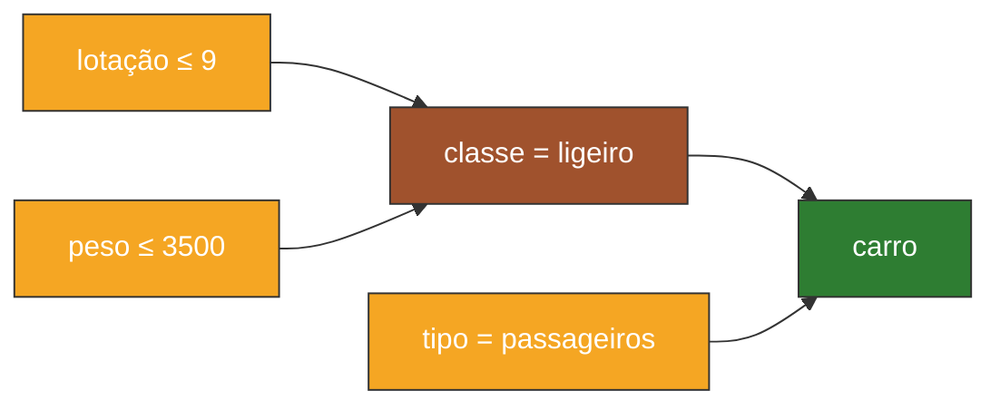
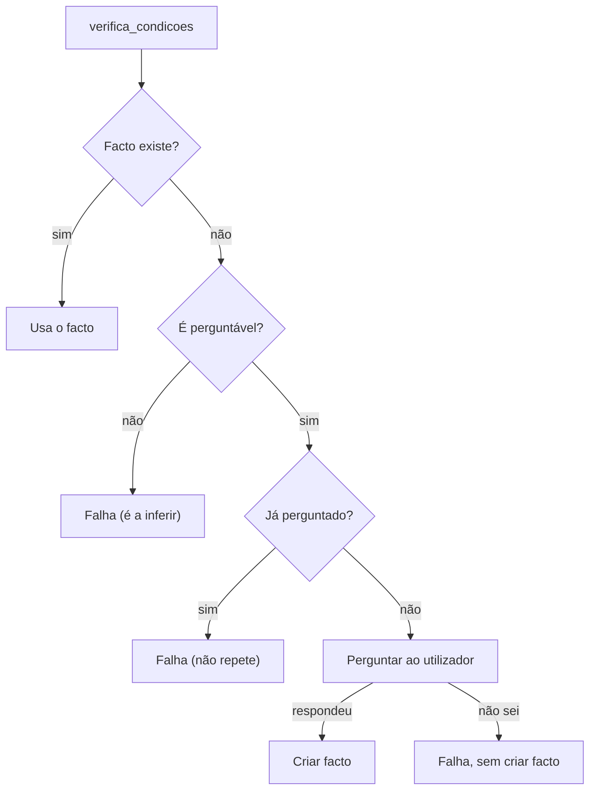

# PPROGIA · Motor de Inferência
## Que perguntas pode um sistema pericial fazer ao utilizador?
*E com que objetivo. E porque é que a solução do sp_exp2 não pergunta nada.*

**Mestrado em Engenharia de Inteligência Artificial · ISEP · GECAD**

---

### 1. Quando deve um sistema pericial perguntar?

Um **Sistema Pericial (SP)** pergunta quando necessita de um facto que não conhece e que é necessário para decidir se uma regra pode ser aplicada.

* A informação não está na memória de trabalho.
* O sistema não a consegue inferir através de outras regras.
* A informação pode ser fornecida/observada pelo utilizador.
* **Consequência:** A resposta é transformada num novo facto e a inferência continua.

> **Como um perito humano:** não pede tudo à partida, pergunta à medida que o raciocínio precisa.

---

### 2. O Ponto de Partida: O sistema fornecido não faz perguntas

```prolog
% veiculos2.txt: tudo escrito à partida
facto(1, lotação(meu_veículo,3)).
facto(2, peso(meu_veículo,4500)).
facto(3, tipo(meu_veículo,mercadorias)).

?- arranca_motor.
Foi concluído o facto nº 4 ->
 classe(meu_veículo,pesado)
Foi concluído o facto nº 5 ->
 pesado(meu_veículo,camião)
```

1. **Todos os factos** estão na base de conhecimento antes de o motor arrancar.
2. O `arranca_motor` só combina factos que já existem na memória de trabalho.
3. Se falta um facto, a regra simplesmente **não dispara**.

---

### 3. Como trabalha um perito humano

**Não pede tudo à partida? Pergunta à medida que o raciocínio precisa?**

> **Exemplo:** O médico formula uma hipótese e pergunta o sintoma que a confirma ou a exclui.

---

### 4. Arquitetura: Onde entram as perguntas


> A arquitetura de três partes da primeira aula não muda: é a **interface** que pergunta, mas é o **motor** que decide quando e o quê.

---

### 5. Exemplo: Que perguntas fazer sobre um veículo?

**Interação / Perguntas ao utilizador:**
```text
Qual é a lotação do veículo?
> 5

Qual é o peso do veículo em kg?
> 2800

Qual é o tipo do veículo?
(passageiros/mercadorias/misto)
> passageiros
```

**Geração de novos factos a partir da resposta:**
```prolog
facto(..., lotação(novo_veículo, 5)).
facto(..., peso(novo_veículo, 2800)).
facto(..., tipo(novo_veículo, passageiros)).
```

*O novo facto passa a integrar a memória de trabalho.*

---

### 6. O Objetivo: Obter evidência para continuar a inferência



* **Laranja:** Dados perguntados
* **Castanho:** Facto inferido
* **Verde:** Conclusão

> **As perguntas não são a conclusão:** fornecem os dados necessários para que as regras produzam a conclusão.

---

### 7. Quatro tipos de perguntas

1. **Recolha de dados em falta**
   * *“Qual o peso do veículo (kg)?”*
   * **Objetivo:** Obter só a informação necessária, quando é necessária.
2. **Confirmação (sim / não / não sei)**
   * *“Transporta mercadorias?”*
   * **Objetivo:** Verificar a condição de uma regra que está quase a disparar.
3. **Escolha limitada**
   * *“Tipo: passageiros / mercadorias / misto?”*
   * **Objetivo:** Garantir que a resposta encaixa no vocabulário das regras.
4. **A resposta “não sei”**
   * *“Tipo? ... nao_sei”*
   * **Objetivo:** Não obrigar o utilizador a inventar, e permitir que o motor siga por outro caminho.

---

### 8. “Não sei” não é o mesmo que “não”

```prolog
alarme_real(on) :- alarme(on), nao modo_manutencao.
```

| Abordagem | Descrição | Consequência |
| :--- | :--- | :--- |
| **Errado** | “não sei” cria um facto negativo | Uma regra com `nao` dispara indevidamente. |
| **Certo** | Registar que já se perguntou, não criar facto | Deixar o motor seguir por outras regras. |

> *No caso do MI disponibilizado, desconhecido equivale a falso.*

---

### 9. Factos perguntáveis vs. factos inferíveis

| Factos Perguntáveis | Factos Inferíveis |
| :--- | :--- |
| `perguntavel(lotação(_, _)).` | `classe(_, ligeiro)` |
| `perguntavel(peso(_, _)).` | `classe(_, pesado)` |
| `perguntavel(tipo(_, _)).` | `ligeiro(_, carro)` |
| | `pesado(_, camião)` |

> **“Regra” de ouro:** Perguntar evidências observáveis; inferir classificações e conclusões.

* O utilizador consegue responder sem conhecer as regras?
  * **Se sim:** é perguntável.
  * **Se precisa do conhecimento do perito:** é inferível.

---

### 10. Nem tudo o que pode ser perguntado deve ser perguntado

*Exemplos:*
* *“O veículo é ligeiro?”*
* *“O veículo é um carro?”*

* Estas perguntas podem ser tecnicamente possíveis, mas “ligeiro” e “carro” são precisamente **conclusões que queremos que o sistema obtenha**.
* Se perguntarmos diretamente a conclusão, estamos a contornar o raciocínio pericial.

> **Perguntar dados $\rightarrow$ deixar o sistema raciocinar.**

---

### 11. O sistema deve perguntar tudo?

**NÃO.**

* Perguntar apenas informação relevante para as regras que estão a ser consideradas.
* Evitar perguntas redundantes: se o facto já existe, pode ser inferido ou já foi perguntado, não perguntar.
* Usar **metaconhecimento** para identificar que regras são relevantes para cada facto:
  ```prolog
  facto_dispara_regras(tipo(_, passageiros), [1,3,8]).
  facto_dispara_regras(lotação(_, _), [5,7]).
  facto_dispara_regras(peso(_, _), [6,7]).
  ```
* Uma boa estratégia reduz o número de perguntas e torna a interação mais eficiente.

---

### 12. Utilizador também pode questionar ao sistema

| Pergunta | Quando | O sistema mostra | No `sp_exp2` |
| :--- | :--- | :--- | :--- |
| **porquê?** | Durante, perante uma pergunta | A regra que está a tentar provar | *Não existe* |
| **como?** | Depois de concluir | A cadeia de regras e factos | `como/1` |
| **porque não?** | Depois de concluir | A condição que falhou | `whynot/1` |

> É o estilo clássico do **MYCIN**: quando o sistema pergunta, o utilizador pode responder *“porquê?”*. As explicações passam a funcionar nos dois sentidos, gerando maior confiança.

---

### 13. Forward vs Backward Chaining: Porque é que o nosso não pergunta?

| Forward Chaining (`arranca_motor`) | Backward Chaining (orientado a objetivos) |
| :--- | :--- |
| • Parte dos factos, dispara regras, gera novos factos. | • Parte de um objetivo e procura regras que o concluam. |
| • Condição sem facto = passa à combinação seguinte. | • Falta um dado? É o momento natural de perguntar. |
| • Nenhum ponto onde “falhar” signifique “vou perguntar”. | • Só pergunta o que é relevante para o objetivo. |
| • Com a memória de trabalho vazia, nem arranca. | |

> **Em forward chaining:** ou se pergunta tudo no início, ou se interceta a verificação das condições.

---

### 14. Duas estratégias para o `sp_exp2`

#### Estratégia A: Perguntar tudo no início
* Fase de recolha antes do `arranca_motor`.
* **Simples:** o motor fica igual.
* **Custo:** pergunta coisas que podem não ser precisas.

#### Estratégia B: Perguntar a pedido
* Interceta a verificação das condições das regras.
* Só pergunta quando uma regra precisa.
* **Custo:** mexer no motor e controlar o backtracking.

> **Na prática combinam-se:** **A** para os dados de partida (o motor precisa de pelo menos um facto), e **B** para os restantes.

---

### 15. Sugestão de como evoluir o motor de inferência



* Depois de criar o novo facto, o sistema volta a verificar a condição e pode continuar o encadeamento.
* No `verifica_condicoes` troca-se `facto(N,C)` por `obtem_facto(C,N)`. O resto do motor fica igual.

---

### 16. Esboço a adaptar ao `sp_exp2`: `obtem_facto/2`

```prolog
:- dynamic ja_perguntado/1.

perguntavel(peso(_,_)).
perguntavel(lotação(_,_)).
perguntavel(tipo(_,_)).

% 1. Já está na memória de trabalho?
obtem_facto(F, N) :- facto(N, F), !.

% 2. Senão, perguntar (uma única vez)
obtem_facto(F, N) :-
    perguntavel(F),
    \+ ja_perguntado(F),
    assertz(ja_perguntado(F)),
    pergunta(F, Resp),
    Resp \== nao_sei,
    regista_resposta(Resp),
    facto(N, F).
```

* `perguntavel/1` é **meta-conhecimento**: define que dados vêm do utilizador e quais são concluídos.
* `ja_perguntado/1` é marcado antes de perguntar, pelo que um *“não sei”* também fica registado.
* `avalia(peso(V,>,3500))`: obtém-se primeiro `peso(V,_)` e só depois se compara.

---

### 17. Esboço da Interface: `pergunta/2` e `regista_resposta/1`

```prolog
% Recolha, com validação numérica
pergunta(peso(V,_), peso(V,P)) :-
    format('Qual o peso de ~w (kg)? ', [V]),
    read(P),
    number(P), !.

% Escolha limitada, com "não sei"
pergunta(tipo(V,_), R) :-
    format('Tipo de ~w (passageiros/mercadorias/misto/nao_sei)? ', [V]),
    read(T),
    ( T == nao_sei -> R = nao_sei
    ; memberchk(T, [passageiros,mercadorias,misto]), R = tipo(V,T) ).

% Novo facto na memória de trabalho, com origem "utilizador"
regista_resposta(F) :-
    retract(ultimo_facto(N1)),
    N is N1 + 1,
    asserta(ultimo_facto(N)),
    assertz(facto(N, F)),
    assertz(justifica(N, utilizador, [])). % adaptar ao como/1
```

> Uma resposta fora da lista faz a pergunta falhar: o facto fica desconhecido e o motor continua.

---

### 18. Exemplo Ilustrativo: Como deve ficar uma consulta

*Base de factos inicial contendo apenas:* `lotação(novo_veículo, 5)`

```text
?- arranca_motor.
Qual o peso de novo_veículo (kg)? 2800.
Foi concluído o facto nº 3 -> classe(novo_veículo,ligeiro)
Tipo de novo_veículo (passageiros/mercadorias/misto/nao_sei)? passageiros.
Foi concluído o facto nº 5 -> ligeiro(novo_veículo,carro)

?- como(5).
Conclui o facto nº 5 -> ligeiro(novo_veículo,carro) ...
O facto nº 4 -> tipo(novo_veículo,passageiros)
foi fornecido pelo utilizador
```

> Cada pergunta aparece uma vez, no momento em que uma regra precisa dela, e o `como/1` continua a explicar tudo.

---

### 19. Ideia-Chave

> **Perguntar não substitui a inferência, fornece evidência para a inferência.**
