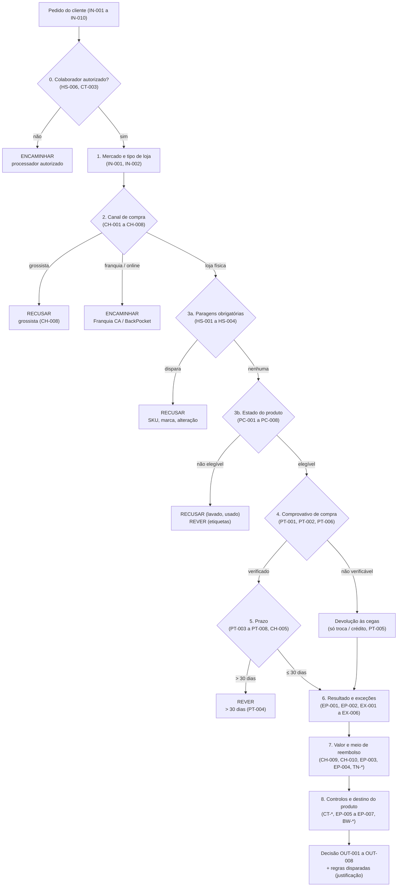
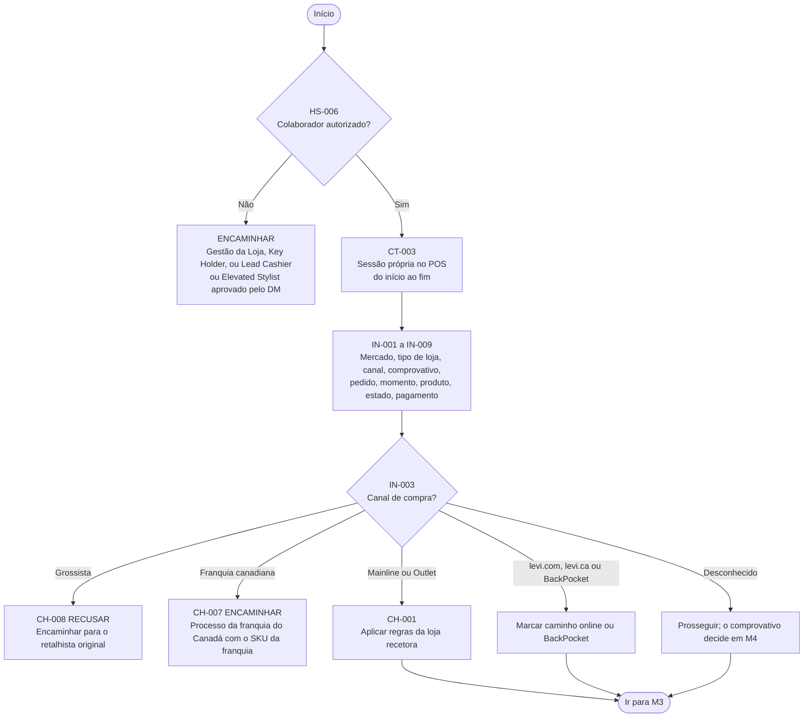
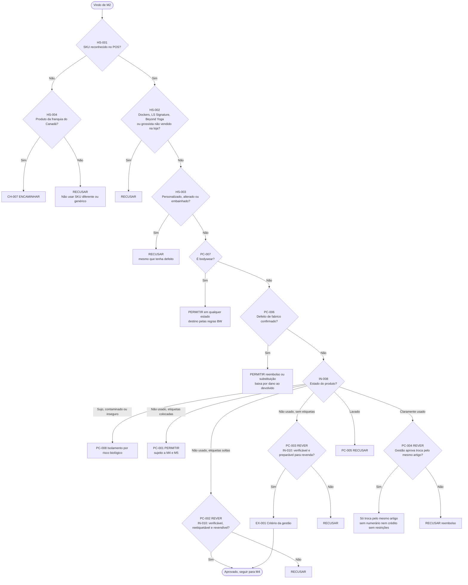
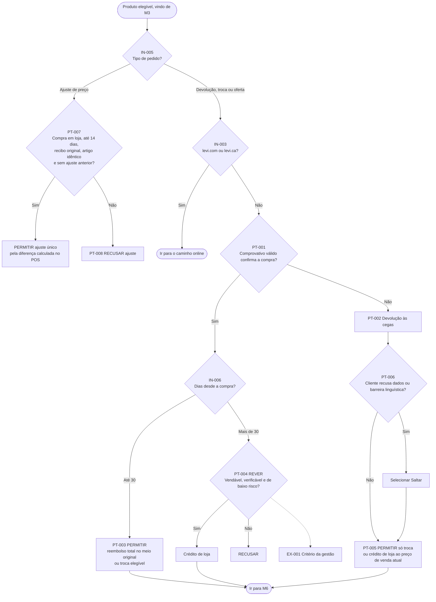
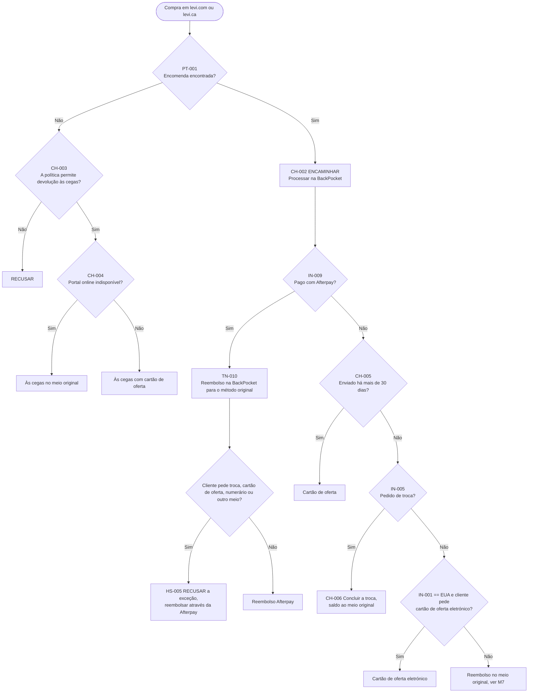
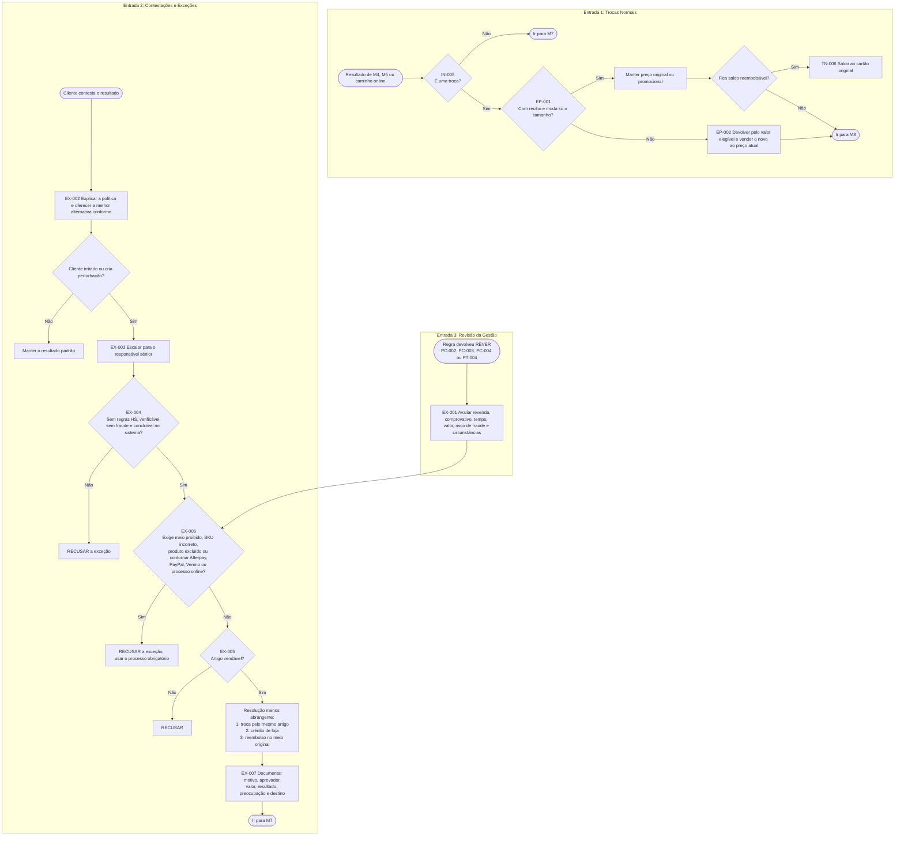
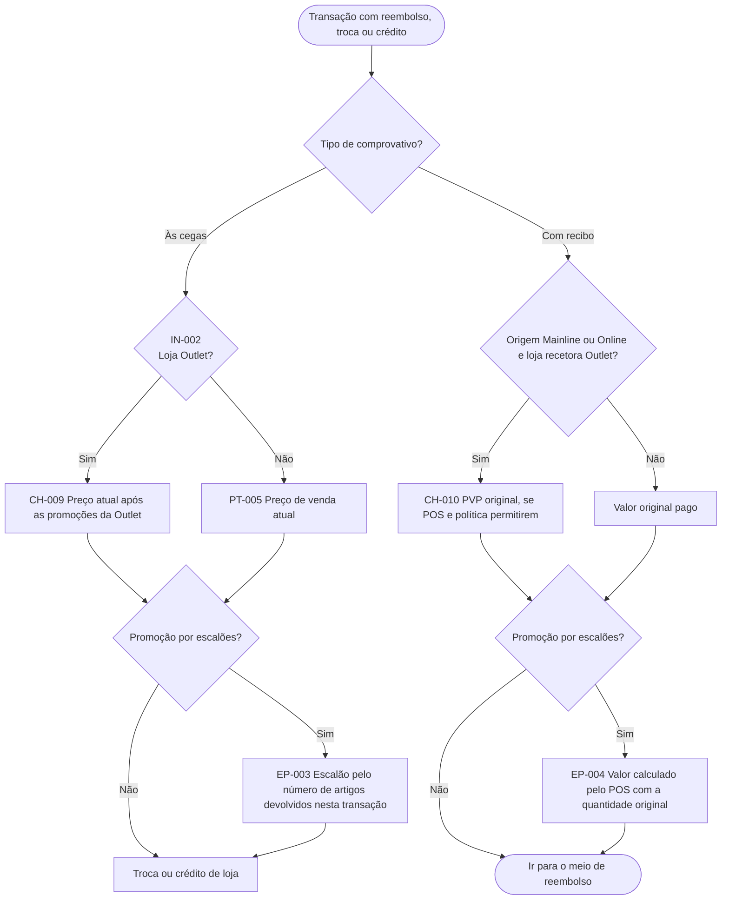
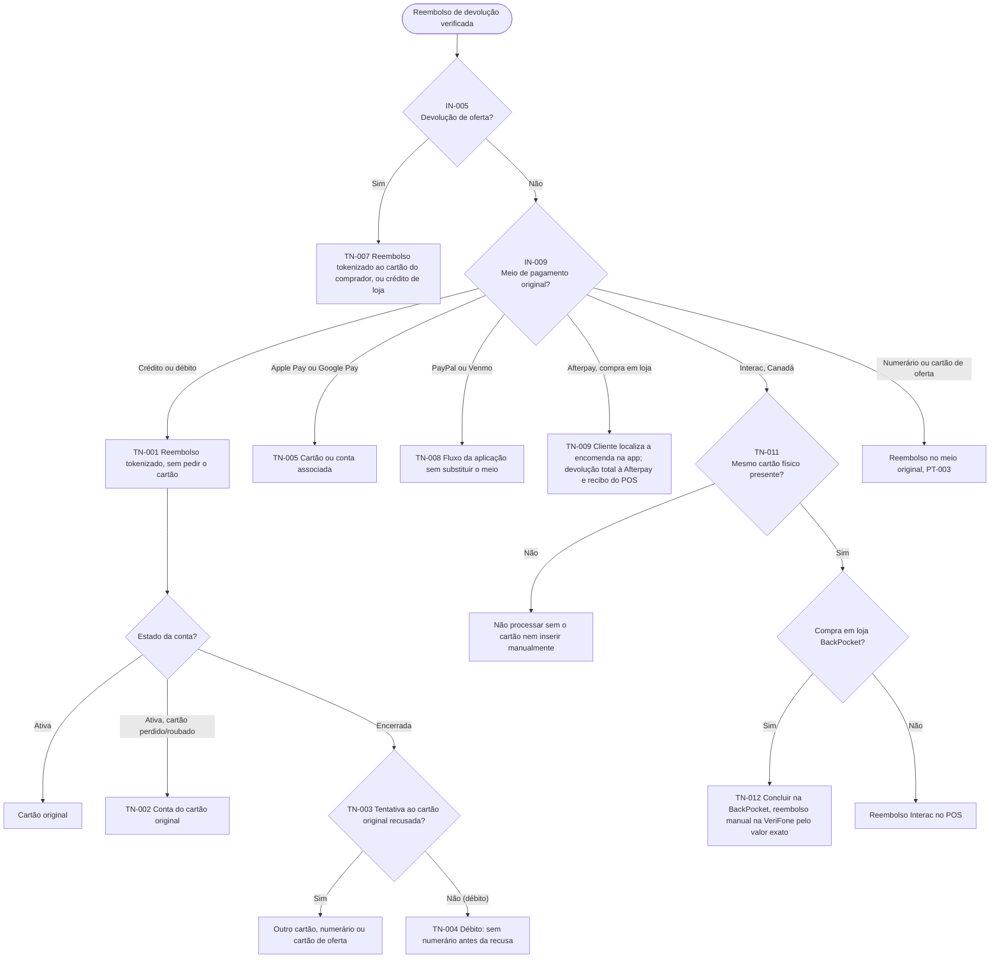
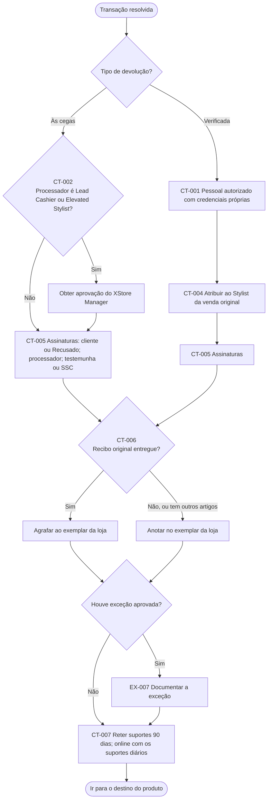
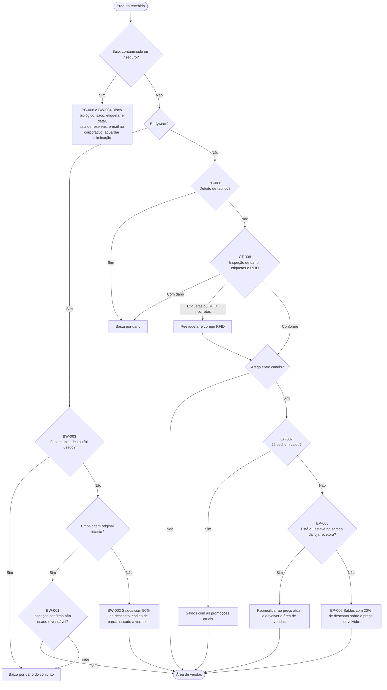

# Sistema Pericial de Avaliação da Elegibilidade de Devoluções
### Lojas Levi’s — Estados Unidos e Canadá
**Relatório Prévio de Aquisição de Conhecimento**

**ISEP - MEIA – Engenharia do Conhecimento (2026/2027)**  
**Grupo 3 – SmartCloth AI**

* **Alexandre Teixeira** — nº 1230946
* **Álvaro Cardoso** — nº 1940052
* **Fernando Granjo** — nº 1260430
* **João Moreira** — nº 1260436
* **Rômulo Arantes** — nº 1260446
* **Santiago da Mata Bossa** — nº 1211173

**Data:** 07/10/2026

---

## Índice Geral

* [1. Objetivos do trabalho](#1-objetivos-do-trabalho)
  * [1.1. O problema](#11-o-problema)
  * [1.2. Objetivo geral e objetivos específicos](#12-objetivo-geral-e-objetivos-específicos)
  * [1.3. Estrutura do Relatório](#13-estrutura-do-relatório)
* [2. Fontes de conhecimento](#2-fontes-de-conhecimento)
  * [2.1. Fontes documentais](#21-fontes-documentais)
  * [2.2. Perito](#22-perito)
    * [2.2.1. Percurso e Responsabilidades](#221-percurso-e-responsabilidades)
    * [2.2.2. Adequação ao problema](#222-adequação-ao-problema)
    * [2.2.3. Papel no Projeto](#223-papel-no-projeto)
  * [2.3. Critério de seleção das fontes](#23-critério-de-seleção-das-fontes)
* [3. Sessões de aquisição de conhecimento](#3-sessões-de-aquisição-de-conhecimento)
* [4. Representação do conhecimento](#4-representação-do-conhecimento)
  * [4.1. Formalismo](#41-formalismo)
  * [4.2. Factos de entrada](#42-factos-de-entrada)
  * [4.3. Base de Regras](#43-base-de-regras)
  * [4.4. Estratégia de Inferência](#44-estratégia-de-inferência)
    * [4.4.1. Fluxo geral detalhado - Autorização, dados e canal](#441-fluxo-geral-detalhado---autorização-dados-e-canal)
    * [4.4.2. Elegibilidade do produto](#442-elegibilidade-do-produto)
    * [4.4.3. Comprovativo e prazo](#443-comprovativo-e-prazo)
    * [4.4.4. Caminho online da levi.com e levi.ca](#444-caminho-online-da-levicom-e-levica)
    * [4.4.5. Resultado, troca e exceções](#445-resultado-troca-e-exceções)
    * [4.4.6. Valor da devolução](#446-valor-da-devolução)
    * [4.4.8. Meio de reembolso](#448-meio-de-reembolso)
    * [4.4.9. Controlos e documentação](#449-controlos-e-documentação)
    * [4.4.10. Destino do produto](#4410-destino-do-produto)
  * [4.5. Exemplos de formalização](#45-exemplos-de-formalização)
  * [4.6. Prioridade entre regras](#46-prioridade-entre-regras)
* [5. Bibliografia](#5-bibliografia)
* [6. Terminologia específica](#6-terminologia-específica)

---

### Índice de Tabelas
* **Tabela 1:** Âmbito do sistema de avaliação de devoluções e justificações de exclusão.
* **Tabela 2:** Identificação das fontes estruturadas e do seu respetivo papel no sistema.
* **Tabela 3:** Perfil de atuação e adequação do perito ao domínio.
* **Tabela 4:** Resumo das sessões de recolha de conhecimento e de levantamento de requisitos e regras.
* **Tabela 5:** Tipos de desfecho possíveis no sistema e os respetivos significados.
* **Tabela 6:** Identificação dos factos de entrada e respetivos domínios de valores.
* **Tabela 7:** Estrutura da base de conhecimento e distribuição das categorias de regras.
* **Tabela 8:** Terminologia específica aplicada no contexto das devoluções.

### Índice das Figuras
* **Figura 1:** Fluxo sequencial das etapas de decisão para devoluções e trocas.
* **Figura 2:** Fluxograma da fase inicial: autorização do colaborador e tratamento do canal de compra.
* **Figura 3:** Processo de verificação de paragens obrigatórias e estado físico da peça.
* **Figura 4:** Fluxograma de validação de comprovativos, prazos e ajustes de preço.
* **Figura 5:** Tratamento de devoluções de compras online (levi.com e levi.ca) em loja física.
* **Figura 6:** Fluxo integrado para regras de troca, resolução de contestações e aprovação de exceções.
* **Figura 7:** Fluxograma de determinação do valor de reembolso conforme o tipo de comprovativo e promoções.
* **Figura 8:** Fluxograma de determinação do meio de reembolso com base no método de pagamento original.
* **Figura 9:** Fluxograma de controlos, aprovações e documentação da transação.
* **Figura 10:** Fluxograma de encaminhamento e destino do produto após devolução.

---

## 1. Objetivos do trabalho

### 1.1. O problema
Nas lojas Levi’s dos Estados Unidos e do Canadá, cada pedido de devolução obriga o colaborador a cruzar oito dimensões em simultâneo: mercado, tipo de loja, canal de compra, marca e SKU, estado físico da peça, comprovativo, prazo e meio de pagamento original [1] [2]. A política admite quatro desfechos (**PERMITIR**, **RECUSAR**, **REVER** e **ENCAMINHAR**) [3] e contém dezenas de casos particulares, como o *bodywear*, que é aceite em qualquer estado, as compras Afterpay, que não admitem exceções, ou os produtos da franquia canadiana, que seguem um processo próprio [2].

Este conhecimento está disperso entre a política formal, o texto do recibo e decisões operacionais que só os gestores de loja conhecem [1] [2] [4]. O resultado é uma decisão ao balcão que varia entre lojas, turnos e colaboradores, com três custos diretos: reembolsos indevidos e risco de fraude, recusas incorretas que prejudicam a relação com o cliente, e exceções mal documentadas que não resistem a auditoria [1].

Trata-se, por isso, de um problema adequado a um sistema pericial [5] [6]. As regras existem e são, na sua maioria, explícitas, mas estão fragmentadas, não têm uma ordem de prioridade definida e dependem, nos casos-limite, do critério de quem as aplica. O que falta é reuni-las, ordená-las e torná-las consultáveis e justificáveis no momento da decisão.

### 1.2. Objetivo geral e objetivos específicos
O **objetivo geral** do projeto é desenvolver um sistema pericial que, a partir dos dados de uma transação, determine se uma peça é elegível para devolução ou troca de forma consistente com a política e explicável, e que justifique cada decisão com as regras que a sustentam [1].

Surgem também alguns **objetivos específicos** que devem ser alcançados:
* Adquirir e validar o conhecimento junto do perito e da base documental (política de devoluções e trocas, texto do recibo e decisões operacionais confirmadas).
* Formalizar as **71 regras de decisão** identificadas, organizadas em nove famílias, numa base de conhecimento separada do motor de inferência.
* Determinar, como núcleo do sistema, a elegibilidade (**OUT-001**) e o tipo de transação (**OUT-002**). O valor, o meio de reembolso, as aprovações e o destino do produto (**OUT-003** a **OUT-008**) ficam como extensão.
* Apresentar em cada decisão os identificadores das regras disparadas, para que o colaborador a possa explicar ao cliente e a gestão a possa auditar.
* Detetar e resolver, com o perito, os conflitos e lacunas da política atual, definindo uma ordem de prioridade entre regras.
* Implementar a base de conhecimento em dois motores, **Drools** e **Prolog**, e validá-los com um conjunto de casos de teste partilhado.
* Disponibilizar uma interface web para introdução do caso e consulta do resultado.

#### Tabela 1: Âmbito do sistema de avaliação de devoluções e justificações de exclusão
| Dimensão | Dentro do âmbito | Fora do âmbito | Justificação |
| :--- | :--- | :--- | :--- |
| **Mercado** | Estados Unidos e Canadá, em lojas Mainline e Outlet e nos canais levi.com, levi.ca, BackPocket, franquia canadiana e grossista | Portugal e outros mercados | As políticas portuguesas diferem significativamente das dos EUA e do Canadá, e o perito só domina estas duas regiões. Limitar o âmbito garante a validação mútua entre a documentação e o perito. |
| **Decisão** | Elegibilidade e tipo de transação (núcleo); valor, meio de reembolso, aprovações e destino do produto (extensão) | Execução do reembolso ou da troca e integração com os sistemas de loja (POS/XStore, BackPocket) | O sistema apoia a decisão e não a executa. Não temos acesso a estes sistemas e a sua integração não faz parte do objetivo de aquisição e formalização do conhecimento. |
| **Juízos percetivos** | Perguntas fechadas ao colaborador sobre o estado da peça; devolução de REVER quando a política exige critério da gestão | Avaliação automática de termos como "lavado", "claramente usado" ou "vendável" | Estes juízos dependem de observação humana. O objetivo não é substituir o gestor, mas garantir que só lhe chegam as decisões que realmente precisam dele. |
| **Comportamento do cliente** | Escalonamento quando previsto na política | Modelar a agitação ou a atitude do cliente como facto de entrada | Por EX-003, a atitude do cliente não altera a elegibilidade, apenas desencadeia o escalonamento. |

### 1.3. Estrutura do Relatório
O relatório está organizado em seis capítulos:
* **Objetivos do trabalho:** Apresenta o problema, o objetivo geral e os objetivos específicos, e delimita o âmbito do sistema.
* **Fontes de conhecimento:** Identifica as fontes documentais, caracteriza o perito e explica o critério de seleção das fontes.
* **Sessões de aquisição de conhecimento:** Descreve as sessões realizadas, as técnicas usadas e os resultados de cada uma.
* **Representação do conhecimento:** Apresenta o formalismo, os factos de entrada, a base de regras, a estratégia de inferência, exemplos de formalização e a prioridade entre regras.
* **Bibliografia:** Reúne as referências que sustentam o trabalho.
* **Terminologia específica:** Define os termos técnicos e de domínio usados ao longo do relatório.

---

## 2. Fontes de conhecimento

O conhecimento necessário ao desenvolvimento do sistema foi obtido através de duas fontes que se complementam: a análise de documentos estruturados, nomeadamente uma adaptação da política de devoluções e trocas [2] [3], e do conhecimento geral do perito [1].

Esta combinação permitiu conciliar regras formalmente definidas internamente pela empresa com a forma como elas são efetivamente aplicadas em loja, sobretudo nas exceções e nos casos ambíguos que a documentação não resolve [1].

### 2.1. Fontes documentais

#### Tabela 2: Identificação das fontes estruturadas e do seu respetivo papel no sistema
| Fonte | Tipo | Contributo para a base de conhecimento |
| :--- | :--- | :--- |
| **Política de Devoluções e Trocas, EUA e Canadá (Levi Strauss & Co.)** | Documental, normativa | Fonte principal: paragens obrigatórias, estado do produto, prazos, meios de reembolso e controlos. |
| **Texto do recibo do cliente** | Documental | Condições comunicadas ao cliente, que delimitam o que lhe pode ser exigido (prazo, comprovativo). |
| **Decisões operacionais confirmadas** | Perito | Práticas de loja que complementam a política e clarificação dos casos que exigem critério. |
| **Proposta 1, versão EUA e Canadá 1.3, e documento de sequência por etapas** | Documentos de trabalho do grupo | Formalização das regras com identificadores e ordenação da inferência em etapas. |

### 2.2. Perito

#### Tabela 3: Perfil de atuação e adequação do perito ao domínio
| Campo | Descrição |
| :--- | :--- |
| **Nome** | Dustin Hopper |
| **Função e local** | Gerente da Produtividade Geral do Retalho |
| **Experiência em Retalho** | Mais de 20 anos: 16 anos em liderança de terreno (gestão de loja e de distrito) e cerca de 6 anos em funções corporativas |
| **Mercados e Lojas** | EUA e Canadá; Mainline e Outlet |
| **Disponibilidade** | Semanal ou Quinzenal |

#### 2.2.1. Percurso e Responsabilidades
O perito construiu a carreira de forma ascendente, das operações de loja à gestão regional e daí para funções corporativas em operações, logística e estratégia. No terreno, geriu diretamente transações de devolução e troca, exceções à política e cenários complexos ao balcão [1]. Como gestor de distrito, foi o ponto de escalonamento para as decisões que as lojas não conseguiam resolver sozinhas. Participou ainda, como especialista no assunto, na elaboração de políticas formais de devoluções e trocas, processos, materiais de formação e procedimentos operacionais normalizados.

#### 2.2.2. Adequação ao problema
O perito conhece a política em dois níveis distintos [2], que correspondem a três partes da base de conhecimento:
* **Como foi desenhada:** Por ter participado na escrita de políticas e procedimentos, consegue distinguir uma regra intencional de uma lacuna de redação.
* **Como é aplicada no terreno:** A experiência de loja e de escalonamento regional cobrem as decisões REVER e as regras de exceção (EX-001 a EX-006). É aí que está o conhecimento tácito que a política não escreve.
* **Que riscos envolve:** A perspetiva de prevenção de perdas e fraude permite operacionalizar critérios vagos como "baixo risco" (PT-004, EX-004) e definir indícios de fraude (EX-008). A perspetiva de experiência do cliente informa a ordem das alternativas oferecidas (EX-002, EX-005).

#### 2.2.3. Papel no Projeto
O perito validou as regras da proposta, confirmando que cada uma reflete tanto a política como a prática, e valida a hierarquia de prioridades [1]. Cabe-lhe também esclarecer as ambiguidades, resolvendo os conflitos e lacunas e traduzir termos vagos como "vendável", "claramente usado" ou "baixo risco" em critérios observáveis que o colaborador consiga avaliar [1] [3].

Fornece ainda casos reais que encontrou ou escalou, sobretudo exceções e cenários ambíguos ou únicos, indicando a decisão que considera correta em cada um [1]. Estes casos servem para testar o sistema e constituem o conjunto de casos de teste partilhado pelos motores Drools e Prolog [7] [8]. Por fim, participa na validação final, avaliando as decisões e explicações produzidas pelo sistema em casos que não foram usados no desenvolvimento.

### 2.3. Critério de seleção das fontes
Antes da primeira reunião com o especialista, a equipa analisou as políticas da Levi Strauss para Portugal [2] [4]. Durante o encontro, verificou-se que estas diferem significativamente das dos EUA e do Canadá. Dado que o especialista domina apenas as políticas destas duas regiões, e considerando as particularidades do contexto português, decidiu-se limitar o âmbito do projeto aos EUA e ao Canadá [1] [2]. Desta forma, assegura-se a validação mútua entre a documentação e o especialista.

---

## 3. Sessões de aquisição de conhecimento

A aquisição de conhecimento decorreu ao longo de várias sessões com o perito, realizadas através reuniões via Microsoft Teams e troca de e-mails [1]. Apesar das sessões terem decorrido num ambiente informal, a troca de informação foi colaborativa e estruturada: a equipa preparava previamente as questões e os casos a discutir, e cada sessão partia dos resultados da anterior. Este processo permitiu transformar o conhecimento prático do perito, em grande parte baseado na experiência e não documentado, num conjunto de regras estruturadas e formalizadas, que constitui a base de conhecimento do sistema.

#### Tabela 4: Resumo das sessões de recolha de conhecimento e de levantamento de requisitos e regras
| N.º | Data | Participantes | Técnica | Objetivo | Resultado |
| :--- | :--- | :--- | :--- | :--- | :--- |
| **1** | 09/09/26 | Equipa | Análise documental | Obter as documentações para análise inicial e identificação de regras | Obtido as políticas da Levi's Strauss Portugal |
| **2** | 18/09/26 | Equipa + perito | Introdução do projeto ao perito | Explicar objetivo do projeto ao perito e apresentar propostas de tema | Buy-in do perito e tema escolhido – Sistema diagnóstico de devolução e trocas |
| **3** | 23/09/26 | Equipa + perito | Entrevista estruturada | Obter esclarecimento sobre o processo de devolução e esclarecer dúvidas | Obtenção do documento de Especificação de Regras de Negócio para Trocas e devoluções |

---

## 4. Representação do conhecimento

### 4.1. Formalismo
O conhecimento é representado em sua maioria pela regra **Se-Então** [5] [6], das regras de produção, organizado em nove etapas. Os quatro desfechos a seguir irão concluir as nove etapas.

#### Tabela 5: Tipos de desfecho possíveis no sistema e os respetivos significados
| Desfecho | Significado |
| :--- | :--- |
| **PERMITIR** | Processar segundo a regra padrão. |
| **RECUSAR** | Não processar. |
| **REVER** | É necessário critério ou aprovação da gestão, ou seja, o sistema não decide sozinho. |
| **ENCAMINHAR** | Usar um processo obrigatório separado (BackPocket, franquia do Canadá, aplicação de pagamento). |

### 4.2. Factos de entrada

#### Tabela 6: Identificação dos factos de entrada e respetivos domínios de valores
| ID | Facto | Domínio de valores |
| :--- | :--- | :--- |
| **IN-001** | Mercado | EUA, Canadá |
| **IN-002** | Tipo de loja | Mainline, Outlet |
| **IN-003** | Canal de compra | Mainline, Outlet, levi.com, levi.ca, BackPocket, franquia canadiana, grossista, desconhecido |
| **IN-004** | Comprovativo | Recibo impresso ou digital, confirmação de encomenda, recibo de oferta, consulta da transação, fotografia do recibo, consulta BackPocket, nenhum |
| **IN-005** | Pedido | Devolução, troca, troca pelo mesmo artigo, devolução de oferta, ajuste de preço |
| **IN-006** | Momento | Dias desde a compra ou o envio (numérico) |
| **IN-007** | Produto | Marca, SKU, personalização ou alteração, bodywear, estado no sortido |
| **IN-008** | Estado | Não usado com etiquetas, com etiquetas soltas, sem etiquetas, usado, lavado, defeituoso, sujo, contaminado, inseguro |
| **IN-009** | Meio de pagamento | Numerário, cartão de oferta, crédito, débito, contactless, PayPal, Venmo, Afterpay, Interac |
| **IN-010** | Revenda | Pode ser verificado, reetiquetado e revendido (sim/não) |

### 4.3. Base de Regras

#### Tabela 7: Estrutura da base de conhecimento e distribuição das categorias de regras
| Família | Prefixo | N.º | Função na inferência |
| :--- | :--- | :--- | :--- |
| **Paragens obrigatórias** | HS | 6 | Terminam o processo: SKU inválido, marca excluída, peça alterada, falta de autorização. |
| **Estado do produto** | PC | 8 | Avaliam a condição física, com regime especial para bodywear e para artigos insalubres. |
| **Comprovativo e prazo** | PT | 8 | Distinguem devolução verificada de às cegas e aplicam os prazos de 30 e 14 dias. |
| **Canal e tipo de loja** | CH | 10 | Tratam devoluções entre canais, online, franquia e grossista. |
| **Meio de reembolso** | TN | 12 | Determinam para onde vai o dinheiro, consoante o meio de pagamento original. |
| **Troca e promoção** | EP | 7 | Fixam o preço em trocas e promoções por escalões e o destino entre canais. |
| **Revisão pela gestão** | EX | 8 | Delimitam as exceções e o escalonamento de clientes. |
| **Autorização e conclusão** | CT | 8 | Definem quem processa, assinaturas, atribuição e retenção. |
| **Destino do bodywear** | BW | 4 | Decidem revenda, saldos, baixa por dano ou isolamento. |
| **Total** | | **71** | |

### 4.4. Estratégia de Inferência
No fluxo da aplicação, o motor de inferência irá percorrer cada etapa em sequência. Em cada posição do fluxo, o motor irá avaliar as memórias de trabalho e a base de conhecimento, podendo concluir imediatamente sem a necessidade de percorrer o fluxo completo.

#### Figura 1: Fluxo sequencial das etapas de decisão para devoluções e trocas



---

### 4.4.1. Fluxo geral detalhado - Autorização, dados e canal

#### Figura 2: Fluxograma da fase inicial: autorização do colaborador e tratamento do canal de compra



Este fluxograma corresponde ao início do processo. Primeiro verifica se o colaborador está autorizado a processar devoluções (HS-006) [3]; se não estiver, o pedido é encaminhado para quem tenha essa autorização. De seguida recolhe os factos de entrada da transação e identifica o canal de compra. Os produtos grossistas são recusados, os da franquia canadiana seguem o processo próprio, e os restantes canais avançam para a avaliação do produto, com as compras online marcadas para o caminho específico da levi.com e levi.ca [3].

---

### 4.4.2. Elegibilidade do produto

#### Figura 3: Processo de verificação de paragens obrigatórias e estado físico da peça



Avalia se a peça pode ser aceite. Começa pelas paragens obrigatórias (SKU não reconhecido, marcas excluídas, peças personalizadas ou alteradas), que recusam o pedido de imediato. O bodywear é aceite em qualquer estado e os defeitos de fabrico confirmados dão direito a reembolso ou substituição [3]. Nos restantes casos, o estado físico da peça determina o desfecho: aceitação direta, recusa, isolamento por risco biológico ou revisão pela gestão quando a decisão depende de critério humano.

---

### 4.4.3. Comprovativo e prazo

#### Figura 4: Fluxograma de validação de comprovativos, prazos e ajustes de preço



Trata primeiro os pedidos de ajuste de preço, permitidos uma única vez em compras em loja até 14 dias. Para devoluções e trocas, verifica se existe comprovativo válido. Com comprovativo, aplica o prazo de 30 dias: dentro do prazo, o reembolso é total; fora dele, a decisão passa pela gestão [3]. Sem comprovativo, a devolução é feita às cegas e só dá direito a troca ou crédito de loja ao preço atual.

---

### 4.4.4. Caminho online da levi.com e levi.ca

#### Figura 5: Tratamento de devoluções de compras online (levi.com e levi.ca) em loja física



Define o tratamento das compras online devolvidas em loja. Se a encomenda for encontrada, é processada na BackPocket, com regras próprias para a Afterpay, que não admite exceções ao meio de reembolso. O meio de reembolso depende do tempo decorrido desde o envio, de se tratar de uma troca e do mercado [3]. Se a encomenda não for encontrada, a devolução às cegas só é aceite quando a política o permite.

---

### 4.4.5. Resultado, troca e exceções

#### Figura 6: Fluxo integrado para regras de troca, resolução de contestações e aprovação de exceções



Tem três entradas. Nas trocas, mantém o preço original quando só muda o tamanho e trata qualquer outra troca como devolução seguida de nova venda. Quando o cliente contesta o resultado, o fluxo começa por explicar a política e só escala para o responsável sénior em caso de perturbação [3]. Os casos marcados como REVER passam pelo critério da gestão. Qualquer exceção é recusada se violar controlos obrigatórios e, quando aprovada, segue a resolução menos abrangente e fica documentada [1].

---

### 4.4.6. Valor da devolução

#### Figura 7: Fluxograma de determinação do valor de reembolso conforme o tipo de comprovativo e promoções



Calcula o valor a devolver a partir do tipo de comprovativo. Nas devoluções às cegas, usa o preço atual, considerando as promoções da Outlet. Nas devoluções com recibo, usa o valor pago, ou o PVP original quando um artigo da Mainline ou online é devolvido numa Outlet [3]. Em ambos os casos, as promoções por escalões são recalculadas segundo regras próprias.

---

### 4.4.8. Meio de reembolso

#### Figura 8: Fluxograma de determinação do meio de reembolso com base no método de pagamento original



Determina para onde vai o dinheiro numa devolução verificada, consoante o meio de pagamento original. Os cartões são reembolsados por tokenização, sem o cliente ter de os apresentar, e um meio alternativo só é usado quando a conta está encerrada e a tentativa ao cartão original é recusada. PayPal, Venmo e Afterpay seguem obrigatoriamente o fluxo das respetivas aplicações [3]. O Interac, no Canadá, exige a presença do cartão físico.

---

### 4.4.9. Controlos e documentação

#### Figura 9: Fluxograma de controlos, aprovações e documentação da transação



Garante que a transação fica corretamente autorizada e registada. As devoluções às cegas processadas por Lead Cashier ou Elevated Stylist exigem aprovação do XStore Manager, e as devoluções verificadas são atribuídas ao Stylist da venda original [3]. Em todos os casos são recolhidas as assinaturas, tratado o recibo, documentadas as exceções aprovadas e retidos os suportes durante 90 dias.

---

### 4.4.10. Destino do produto

#### Figura 10: Fluxograma de encaminhamento e destino do produto após devolução



Decide o que acontece à peça depois de aceite. Os artigos sujos ou inseguros são isolados como risco biológico. O bodywear segue regras próprias, que vão da revenda à baixa por dano do conjunto [3]. Os restantes artigos são inspecionados antes de voltarem à venda. Os artigos de outros canais são reprecificados ou colocados em saldos, conforme estejam ou não no sortido da loja recetora.

---

### 4.5. Exemplos de formalização

```prolog
REGRA HS-003
  SE produto.personalizado = sim OU produto.alterado = sim
  ENTÃO elegibilidade ← RECUSAR ; PARAR
  justificação ← "Peça alterada não é devolvível, mesmo com defeito"

REGRA PC-002
  SE estado = não_usado E etiquetas = soltas
  ENTÃO elegibilidade ← REVER
  perguntar("A peça pode ser verificada, reetiquetada e revendida?")

REGRA PT-003
  SE comprovativo ∈ VÁLIDOS E dias ≤ 30 E produto.elegível = sim
  ENTÃO elegibilidade ← PERMITIR
  tipo ∈ {reembolso, troca} ; valor ← valor_pago ; meio ← original

REGRA PT-005
  SE comprovativo = nenhum E produto.elegível = sim
  ENTÃO elegibilidade ← PERMITIR
  tipo ∈ {troca, crédito_loja} ; valor ← preço_atual
```

### 4.6. Prioridade entre regras
A política fornecida pelo perito não define prioridades. No entanto, em caso de conflitos, prevalecerá o nível mais alto e, em casos do mesmo nível, será escolhida a regra mais específica [1]. Com isso, foi proposta a seguinte ordem:

1. **Pré-condição de autorização do colaborador** (`HS-006`).
2. **Encaminhamentos obrigatórios**, para o canal de execução da compra (`CH-002`, `CH-007`, `CH-008`).
3. **Regras de paragem obrigatória**, verificação da procedência e situação do produto a nível de sistema (`HS-001` a `HS-004`).
4. **Regras de segurança**, que disparam sempre, independente da elegibilidade (`PC-008`, `BW-004`).
5. **Regras específicas de categoria do produto** (`PC-007`, Bodywear) antes das regras gerais do estado do produto (`PC-001` a `PC-005`).
6. **Comprovativo de compra** (`PT-001` a `PT-008`, `CH-003`), e **prazo específico para método de reembolso** (`CH-005`).
7. **Regras de exceções da gestão** (`EX-001` a `EX-008`), que nunca anulam as regras de Paragens Obrigatórias, Estado do Produto e Comprovativo e Prazo (`EX-004`, `EX-006`).

> A agitação e atitude de um cliente não é modelada como facto de entrada (`EX-003`), e essa situação não altera a elegibilidade, apenas desencadeia o escalonamento.

---

## 5. Bibliografia

* **[1]** D. Hopper, *“Returns & Exchanges Knowledge Base 1,”* 2026.
* **[2]** L. S. & Co., *“Returns and Exchanges,”* setembro 2026. [Online]. Disponível em: `https://help.levi.com/hc/en-us/articles/360052069812-Levi-s-Return-Exchange-Policy`.
* **[3]** D. Hopper, Interviewee, *Entrevistas formais para aquisição e definição do conhecimento.* [Interview]. 18 e 23 Setembro 2026.
* **[4]** L. &. Co., *Documento Impresso - Texto do Recibo do Cliente.*
* **[5]** C. Martins, *“Material da unidade curricular (fichas de exercícios de Prolog e diapositivos das aulas), ISEP - MEIA, Paradigmas da Programação em Inteligência Artificial,”* 2026.
* **[6]** L. Faria, *“Material da unidade curricular e bibliografia indicada, ISEP - MEIA, Engenharia do Conhecimento,”* Porto, 2026.
* **[7]** SWI-Prolog, *“Swi-Prolog Reference manual,”* outubro 2026. [Online]. Disponível em: `https://www.swi-prolog.org/pldoc/doc_for?object=manual`.
* **[8]** Apache Kie, *“Drools Documentation, Vers. 10.2.0.,”* outubro 2026. [Online]. Disponível em: `https://kie.apache.org/docs/10.2.x/drools/drools/introduction/`.

---

## 6. Terminologia específica

#### Tabela 8: Terminologia específica aplicada no contexto das devoluções
| Termo | Definição |
| :--- | :--- |
| **Bodywear** | Roupa interior e peças de contacto direto com a pele, com regras próprias de aceitação e destino. |
| **Crédito de loja** | Valor atribuído ao cliente para compras futuras, em vez de reembolso. |
| **BackPocket** | Serviço omnicanal em loja física que permite a um colaborador encomendar diretamente um artigo para o cliente quando o stock não se encontra disponível na loja local. O pedido é processado através do sistema interno e expedido tal como uma encomenda habitual da Levi.com. |
| **AfterPay, Venmo, Interac** | Referem-se aos métodos e plataformas de pagamento digitais disponibilizados a clientes na América do Norte (EUA e Canadá), integrados nos pontos de venda físicos e no comércio eletrónico. |
| **Mainline / Outlet** | Referem-se aos dois principais formatos de lojas físicas no modelo de retalho (*retail*), diferenciados pela estratégia comercial, sortido de produto e posicionamento de preço:<br/>• **Mainline (Full-Price Retail):** Lojas de conceito principal e preço regular. Focam-se nas coleções atuais, lançamentos sazonais, linhas premium e na experiência completa da marca, servindo como a principal montra comercial e de imagem.<br/>• **Outlet (Value / Factory Store):** Lojas focadas em valor e preços reduzidos. O sortido é tipicamente composto por linhas desenhadas especificamente para este canal (*made-for-outlet*), excedentes de inventário (*clearance*) e artigos de coleções anteriores, com foco em rotação rápida e descontos permanentes. |
| **Lead Cashier** | Função operacional no piso de loja responsável por coordenar a área dos caixas (*cash wrap*) e apoiar as transações financeiras diárias, servindo de ponte entre os operadores de caixa (*cashiers*) e a equipa de gestão de loja. |
| **XStore Manager** | Refere-se ao módulo de gestão de retalho e back-office da solução de ponto de venda Oracle Retail Xstore (ou ao perfil de funções de gerência dentro da aplicação), utilizado pela equipa de gestão para controlar as operações diárias da loja. |
| **Stylist** | Função orientada para o serviço ao cliente e consultoria de produto no piso de loja, focada em proporcionar uma experiência de compra personalizada e aumentar a conversão de vendas. |
| **Elevated Stylist** | Nível avançado da função de Stylist no retalho, reservado a colaboradores com experiência consolidada e elevado domínio técnico, focados na fidelização de clientes e na condução de vendas de valor superior. |
| **SKU** | Código alfanumérico único atribuído internamente a cada produto para identificar e rastrear o inventário no sistema de retalho e na cadeia de abastecimento. |
| **PVP** | Valor final fixado para a comercialização de um produto diretamente ao consumidor final no retalho. |
