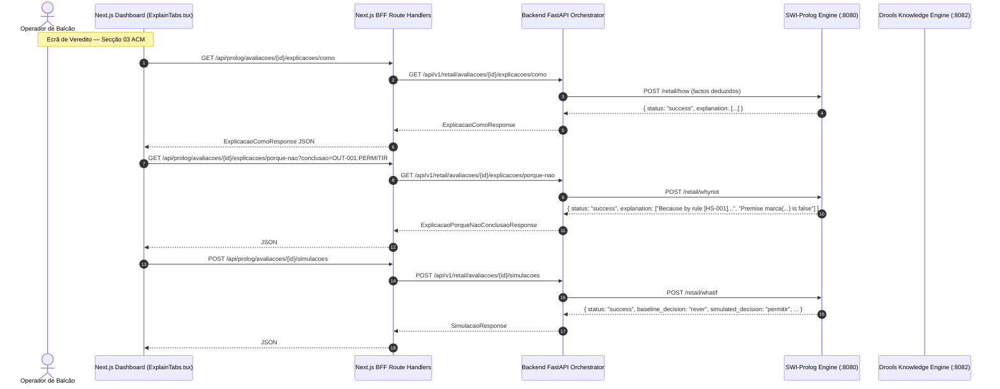
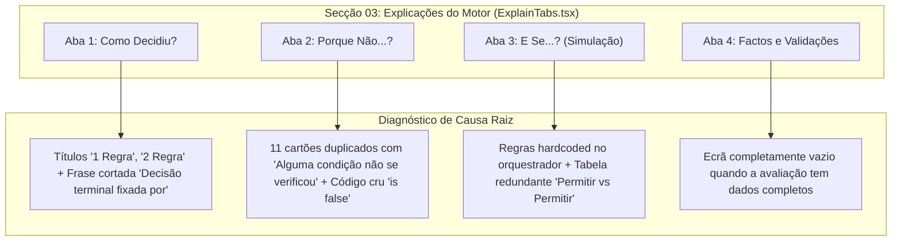
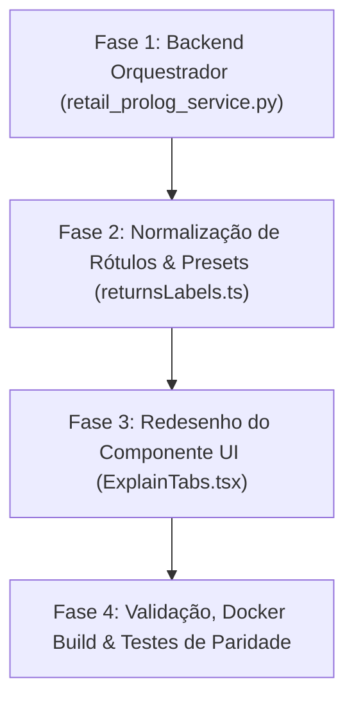

# Plano de Implementação: Reformulação, Eliminação de Hardcoding e Alinhamento Minimalista do Módulo de Explicações ACM

**Alvo:** Módulo 03 de Explicações do Motor de Inferência (ACM) no Ecrã de Veredito (`ExplainTabs.tsx`, `returnsLabels.ts`, `retail_prolog_service.py`, `VerdictScreen.tsx`)  
**Modelo Executor:** Antigravity AI Agent (Gemini 3.8 Flash High)  
**Objetivo:** Reformular integralmente a secção "03 / Explicações do Motor de Inferência (ACM)", eliminando todas as anomalias visuais, truncagens de texto, regras hardcoded, condições em inglês/código cru e inconsistências de interface identificadas nas capturas de ecrã do utilizador, assegurando 100% de coerência declarativa entre **Drools** e **SWI-Prolog** e harmonia com o design minimalista do RetailFlow.  
**Ficheiros de Referência:**
- [`ExplainTabs.tsx`](file:///c:/Users/santi/Desktop/meia-equipa3-challenge1-26_27/dashboard/src/components/returns/ExplainTabs.tsx)
- [`VerdictScreen.tsx`](file:///c:/Users/santi/Desktop/meia-equipa3-challenge1-26_27/dashboard/src/components/wizard/VerdictScreen.tsx)
- [`returnsLabels.ts`](file:///c:/Users/santi/Desktop/meia-equipa3-challenge1-26_27/dashboard/src/config/returnsLabels.ts)
- [`retail_prolog_service.py`](file:///c:/Users/santi/Desktop/meia-equipa3-challenge1-26_27/backend_orchestrator/app/services/retail_prolog_service.py)
- [`returns.ts`](file:///c:/Users/santi/Desktop/meia-equipa3-challenge1-26_27/dashboard/src/types/returns.ts)
- [`retail_rules.pl`](file:///c:/Users/santi/Desktop/meia-equipa3-challenge1-26_27/prolog_engine/src/core/retail_engine/kb/retail_rules.pl)
- [`engine.pl`](file:///c:/Users/santi/Desktop/meia-equipa3-challenge1-26_27/prolog_engine/src/core/retail_engine/engine.pl)
- [`test_parity_verdict.py`](file:///c:/Users/santi/Desktop/meia-equipa3-challenge1-26_27/test_parity_verdict.py)

---

## 1. Contexto Global e Diagnóstico Exaustivo do Módulo ACM

O módulo de explicações do RetailFlow implementa as 4 vias clássicas de explicabilidade dialógica da Arquitetura Causal de Metanível (ACM) desenvolvida para sistemas periciais:
1. **Via 1: Como Decidiu? (How / `como/1`)** — Rastreio dedutivo causal da cadeia de regras disparadas que conduziram à decisão.
2. **Via 2: Porque Não...? (Why Not / `whynot/1`)** — Diagnóstico contrafactual das razões pelas quais regras alternativas (ex.: recusa imediata, escalonamento para gerência ou encaminhamento) não dispararam.
3. **Via 3: E Se...? (What If / `whatif`)** — Simulação contrafactual em sandbox com alteração hipotética de premissas sem efeitos secundários na sessão.
4. **Via 4: Factos e Validações (Missing Data / `dados-em-falta`)** — Mecânica dialógica de apuramento da completude dos dados recolhidos no balcão face aos requisitos normativos do motor.

### Arquitetura de Comunicação e Fluxo de Dados


---

### 1.1. Inventário de Anomalias por Sub-Secção (Diagnóstico das Capturas de Ecrã)



#### A. Aba 1 — "Como Decidiu? (como/1)"
1. **Títulos Truncados ("1 Regra", "2 Regra", "3 Regra")**:
   - *Causa no Backend:* Em `retail_prolog_service.py` L721, o serviço preenchia o campo com `nomeRegra = f"Regra {rule_id}"` (ex.: `"Regra CT-003"`), ignorando o dicionário de títulos `PROLOG_RULE_DETAILS` já definido na linha 251.
   - *Causa no Frontend:* Em `ExplainTabs.tsx` L157, o componente executava `cleanRuleCodes(step.nomeRegra)`. A função `cleanRuleCodes` expurgava o código (`CT-003`), restando apenas a palavra literal **`"Regra"`**.
   - *Comportamento em Drools:* O motor Drools devolvia `nomeRegra = "CT-003 Mesmo colaborador do início ao fim com credenciais próprias"`, o que permitia ao `cleanRuleCodes` manter um título legível. Em Prolog, a ausência de título descritivo provocava a falha.
2. **Frase Incompleta no Alerta Amarelo ("O encadeamento concluiu em: Decisão terminal fixada por")**:
   - *Causa:* O backend gerava `paragem = f"Decisão terminal fixada por {passos[-1].codigoRegra}"` (ex.: `"Decisão terminal fixada por CT-001"`).
   - *Causa:* O frontend chamava `cleanRuleCodes(data.paragem)`, que removia o código `CT-001` do fim da string, deixando a preposição `"por"` pendurada no final.

#### B. Aba 2 — "Porque Não...? (whynot/1)"
1. **Cards Repetitivos e Idênticos ("Alguma condição não se verificou")**:
   - *Causa:* Em `ExplainTabs.tsx` L300, o título do cartão era renderizado com `{cause(rule.causa)}`. Como a causa devolvida pelo orquestrador era invariavelmente `"CONDICOES_FALHADAS"`, a tradução gerava `"Alguma condição não se verificou"` para os 11 cartões, omitindo o nome da regra candidata.
2. **Caixas Vazias e Falha de Parsing de Premissas**:
   - *Causa:* Em `retail_prolog_service.py` L778, o orquestrador apenas lia linhas que contivessem a palavra `"Condition"`, **ignorando todas as linhas com `"Premise"`** emitidas pelo motor SWI-Prolog (`engine.pl` L829 e L833). Consequentemente, 9 das 11 regras ficavam com a lista `condicoes: []` vazia, aparecendo cartões sem qualquer critério explicado.
3. **Código Cru e Termos em Inglês**:
   - O orquestrador repassava a string bruta do motor Prolog: `marca(in,[uma marca associada,signature,beyond_yoga,grossista_nao_vendido]) is false`, sem qualquer tradução ou formatação para a linguagem operacional de loja.

#### C. Aba 3 — "E Se...? (Simulação)"
1. **Regras Hardcoded no Orquestrador**:
   - Em `retail_prolog_service.py` L864-865, existiam regras fixadas estaticamente no código Python:
     ```python
     regrasNovas=["PT-003", "PC-001"],
     regrasRemovidas=["PC-002"],
     ```
2. **Mapeamento Falhado dos Presets do Frontend**:
   - O backend apenas verificava valores como `"intactas"` ou `"true"` para o campo `estado_produto`. Quando o frontend enviava `"COLOCADAS"` ou `"USADO"`, as alterações eram ignoradas e nenhuma premissa contrafactual era adicionada ao Prolog.
3. **Tabela de Diferenças Redundante e Contraditória**:
   - O orquestrador inseria incondicionalmente uma linha `DiferencaDto` (`Elegibilidade | elegibilidade | Permitir | Permitir`), mesmo quando a decisão simulada não sofria alteração (`base_dec == sim_dec`). O utilizador via a frase *"A decisão manteve-se inalterada em 'permitir'"* e, logo abaixo, uma tabela de "diferenças" com valores idênticos.

#### D. Aba 4 — "Factos e Validações"
1. **Ecrã Vazio após Validação Completa**:
   - Quando todos os dados obrigatórios foram preenchidos (`data.completo === true`), o endpoint devolve `dados: []`.
   - O frontend renderizava apenas a lista de dados em falta. Estando a lista vazia, a página ficava com um espaço em branco, sem apresentar o sumário dos **factos reais apurados e validados pelo motor**.

#### E. Consistência e Design Minimalista
1. **Aridades Técnicas Expostas nas Abas**:
   - As abas exibiam rótulos com aridades de programação em lógica (`(como/1)`, `(whynot/1)`), o que desvirtua a interface de balcão e confunde o operador de loja.
2. **Disparidade Visual**:
   - Elementos com alertas amarelos agressivos, bordas excessivas e caixas cinzentas que não seguiam o padrão minimalista de cartões brancos com tipografia limpa (`Inter`), badges contidos e separadores monocromáticos.

---

## 2. Plano de Implementação Dividido por Fases



---

### Fase 1: Enriquecimento Semântico e Correção do Orquestrador Backend
**Ficheiro alvo:** [`backend_orchestrator/app/services/retail_prolog_service.py`](file:///c:/Users/santi/Desktop/meia-equipa3-challenge1-26_27/backend_orchestrator/app/services/retail_prolog_service.py)

#### 1.1. Resolução dos Nomes das Regras em `explain_how`
- Utilizar o catálogo `PROLOG_RULE_DETAILS` (definido em L251) para obter o nome inteligível de cada regra:
  ```python
  rule_info = PROLOG_RULE_DETAILS.get(rule_id, {})
  rule_title = rule_info.get("nome", f"Critério {rule_id}")
  ```
- Formatar o campo `paragem` sem deixar preposições cortadas no fim:
  ```python
  last_rule_name = PROLOG_RULE_DETAILS.get(passos[-1].codigoRegra, {}).get("nome", passos[-1].codigoRegra)
  paragem = f"Decisão terminal fixada por: {last_rule_name}"
  ```

#### 1.2. Parsing Integral e Humanização em `explain_whynot`
- Suportar tanto linhas com `"Condition"` como com `"Premise"` emitidas pelo SWI-Prolog (`engine.pl` L829/L833).
- Definir `variante` e `resumo` a partir de `PROLOG_RULE_DETAILS`:
  ```python
  rule_info = PROLOG_RULE_DETAILS.get(current_rule, {})
  rule_name = rule_info.get("nome", current_rule)
  variante = f"{current_rule}: {rule_name}"
  resumo = f"A regra '{rule_name}' não disparou porque os critérios exigidos não se verificaram no pedido."
  ```
- Traduzir os predicados brutos de Prolog para português operacional:
  - `marca(in, [...]) is false` $\rightarrow$ `"Artigo pertence a uma marca não autorizada para devolução"`
  - `sku_reconhecido(false) is false` $\rightarrow$ `"Código SKU não reconhecido no catálogo do sistema POS"`
  - `estado_produto(sujo_contaminado_inseguro)` $\rightarrow$ `"Artigo com sujidade ou risco biológico de manuseamento"`
  - `comprovativo(nenhum)` $\rightarrow$ `"Ausência de comprovativo válido de compra"`
  - `dias_desde_compra(...)` $\rightarrow$ `"Prazo decorrido desde a compra superior ao limite regulamentar"`

#### 1.3. Erradicação de Hardcoding e Suporte Contrafactual em `simulate_whatif`
- Eliminar o hardcoding estático de `regrasNovas` e `regrasRemovidas`.
- Extrair as regras dinamicamente a partir de `baseline_justification` e `simulated_justification` retornadas pelo Prolog:
  ```python
  import re
  base_rules = set(re.findall(r"\[([A-Z]{2,4}-\d{3,4})\]", str(whatif_raw.get("baseline_justification", []))))
  sim_rules = set(re.findall(r"\[([A-Z]{2,4}-\d{3,4})\]", str(whatif_raw.get("simulated_justification", []))))
  regras_novas = sorted(list(sim_rules - base_rules))
  regras_removidas = sorted(list(base_rules - sim_rules))
  ```
- Mapear com precisão os parâmetros enviados pelos presets do frontend:
  - `"artigos[0].estado.etiquetas": "COLOCADAS"` $\rightarrow$ Adicionar `estado_produto(nao_usado_com_etiquetas)`, remover variantes soltas.
  - `"artigos[0].estado.condicaoUso": "USADO"` $\rightarrow$ Adicionar `estado_produto(claramente_usado)`, remover estados intactos.
  - `"portalOnlineDisponivel": true/false` $\rightarrow$ Adicionar/remover `portal_online_disponivel(...)`.
  - `"comprovativo.tipo": "SEM_COMPROVATIVO"` $\rightarrow$ Adicionar `comprovativo(nenhum)`, remover `tipo_verificacao(verificada)`.
- **Condição de Diferenças:** Só popular a lista `diferencas` se `base_dec.upper() != sim_dec.upper()`. Se forem iguais, manter `diferencas = []`.

---

### Fase 2: Normalização de Rótulos e Limpeza de Filtros
**Ficheiro alvo:** [`dashboard/src/config/returnsLabels.ts`](file:///c:/Users/santi/Desktop/meia-equipa3-challenge1-26_27/dashboard/src/config/returnsLabels.ts)

#### 2.1. Salvaguarda de `cleanRuleCodes`
- Evitar que a remoção de prefixos deixe a palavra solta `"Regra"` ou corte preposições no final:
  ```typescript
  // Limpeza de pontuação inicial e final residual
  cleaned = cleaned.replace(/^[:–—\-;,.]\s*/, "").replace(/\s*[:–—\-;,.]$/, "").trim();

  // Limpeza de preposições órfãs no final resultantes da remoção de código (ex: "fixada por")
  cleaned = cleaned.replace(/\s+(?:por|de|com|em|para|a)\s*$/i, "").trim();

  // Se o texto resultante for apenas "Regra" ou vazio, manter o texto original
  if (cleaned.toLowerCase() === "regra" || cleaned.length === 0) {
    return text.trim();
  }
  ```

#### 2.2. Otimização dos Presets de Simulação
- Alinhar os presets de simulação em `WHAT_IF_PRESETS` com as chaves reais aceites pelo backend.

---

### Fase 3: Redesenho Minimalista da Interface ACM
**Ficheiro alvo:** [`dashboard/src/components/returns/ExplainTabs.tsx`](file:///c:/Users/santi/Desktop/meia-equipa3-challenge1-26_27/dashboard/src/components/returns/ExplainTabs.tsx)

#### 3.1. Abas de Navegação Minimalistas
- Remover as aridades técnicas dos botões:
  - `Como Decidiu?` (Ícone `route`)
  - `Porque Não...?` (Ícone `help_outline`)
  - `Simulação E Se...` (Ícone `science`)
  - `Factos e Validações` (Ícone `fact_check`)
- Estilo: barra de navegação com pílulas minimalistas brancas, bordas subtis (`border-slate-200`) e transição suave.

#### 3.2. Aba "Como Decidiu" (Cadeia de Raciocínio)
- **Banner de Conclusão:** Substituir o alerta amarelo ruidoso por um resumo discreto com ícone `task_alt` verde e texto completo: *"Cadeia Dedutiva Concluída: Decisão estabelecida pela Regra [Código] — [Nome da Regra]"*.
- **Cartões da Linha Temporal:**
  - Badge monocromático com o código da regra (`font-mono text-xs font-bold`).
  - Título descritivo em `font-sans font-bold text-slate-900`.
  - Categoria do módulo (`moduleLabel`) e badge discreto de resultado (`CONFORME`, `PERMITIR`).
  - Explicação com tipografia fluida `text-xs sm:text-sm text-slate-600 leading-relaxed`.

#### 3.3. Aba "Porque Não" (Desfechos Alternativos)
- Pílulas de filtro de desfecho minimalistas (`Recusado`, `Requer Revisão`, `Encaminhar`).
- **Cartões de Regras Candidatas:**
  - Título do cartão: Nome da regra candidata (ex.: `HS-001: Recusar produto sem SKU reconhecido`).
  - Badge de desfecho evitado: `Teria resultado em: Recusado` (`bg-rose-50 text-rose-700`).
  - Lista de critérios com ícone `cancel` suave e explicação em português operacional.

#### 3.4. Aba "E Se" (Simulação Contrafactual)
- Presets em cartões brancos com hover suave e moldura verde ativa.
- Quando a decisão não muda: Nota explicativa discreta em vez de tabela vazia ou com valores iguais.
- Quando a decisão muda: Tabela de diferenças clara destacando campo alterado, valor original e valor simulado.

#### 3.5. Aba "Factos e Validações"
- Se `completo === true`:
  - Banner elegante de auditoria completa (`bg-emerald-50/60 border border-emerald-200/80 text-emerald-900`).
  - **Grelha de Factos Auditados pelo Motor:** Grelha de 2 colunas com os pressupostos apurados no atendimento (Canal, Loja, Estado da Peça, Comprovativo, Pagamento, Operador, Prazo), cada um com selo `✓ Validado`.
- Se existirem dados em falta (`dados.length > 0`): Listar os dados em falta com prioridade e justificação normativa.

---

### Fase 4: Validação, Docker Build & Testes de Paridade

#### 4.1. Verificação Estática de Tipos
```bash
cd dashboard && npx tsc --noEmit
```
Assegurar 0 erros de compilação TypeScript.

#### 4.2. Reconstrução dos Contentores Docker
```bash
docker compose up -d --build orchestrator dashboard
```

#### 4.3. Testes Funcionais e de Paridade
- Teste dos 4 endpoints de explicabilidade em **Drools** e **Prolog**:
  - `/api/returns/avaliacoes/{id}/explicacoes/como` vs `/api/prolog/avaliacoes/{id}/explicacoes/como`
  - `/api/returns/avaliacoes/{id}/explicacoes/porque-nao` vs `/api/prolog/avaliacoes/{id}/explicacoes/porque-nao`
  - `/api/returns/avaliacoes/{id}/simulacoes` vs `/api/prolog/avaliacoes/{id}/simulacoes`
  - `/api/returns/dados-em-falta` vs `/api/prolog/dados-em-falta`
- Execução da suite de paridade oficial:
  ```bash
  python test_parity_verdict.py
  ```

---

## 3. Critérios de Aceitação (Definition of Done)

1. **Zero Textos Truncados:** Nenhum passo de dedução exibe o título simplório `"Regra"`; todos mostram o identificador de regra e o nome inteligível da norma.
2. **Zero Frases Cortadas:** A conclusão do encadeamento dedutivo exibe a frase completa sem preposições órfãs no final.
3. **Zero Código Cru ou Inglês:** As pré-condições da aba "Porque Não" são expressas em linguagem de negócio portuguesa compreensível para operadores de loja, sem predicados Prolog expostos (`is false`).
4. **Zero Regras Hardcoded:** A simulação "E Se" obtém as regras novas e removidas dinamicamente a partir da execução do motor, e os presets produzem efeitos contrafactuais reais no estado do pedido.
5. **Aba de Factos Rica e Auditável:** Quando o atendimento está completo, a aba "Factos e Validações" apresenta a síntese dos pressupostos apurados pelo motor, eliminando o ecrã vazio.
6. **Design Consistente:** A secção 03 integra-se organicamente na linguagem estética do RetailFlow, com bordas subtis, tipografia uniforme e ausência de elementos ruidosos.
7. **Paridade Drools/Prolog Mantida:** Ambas as implementações (DRL e SWI-Prolog) devolvem estruturas perfeitamente compatíveis com o contrato da API.
