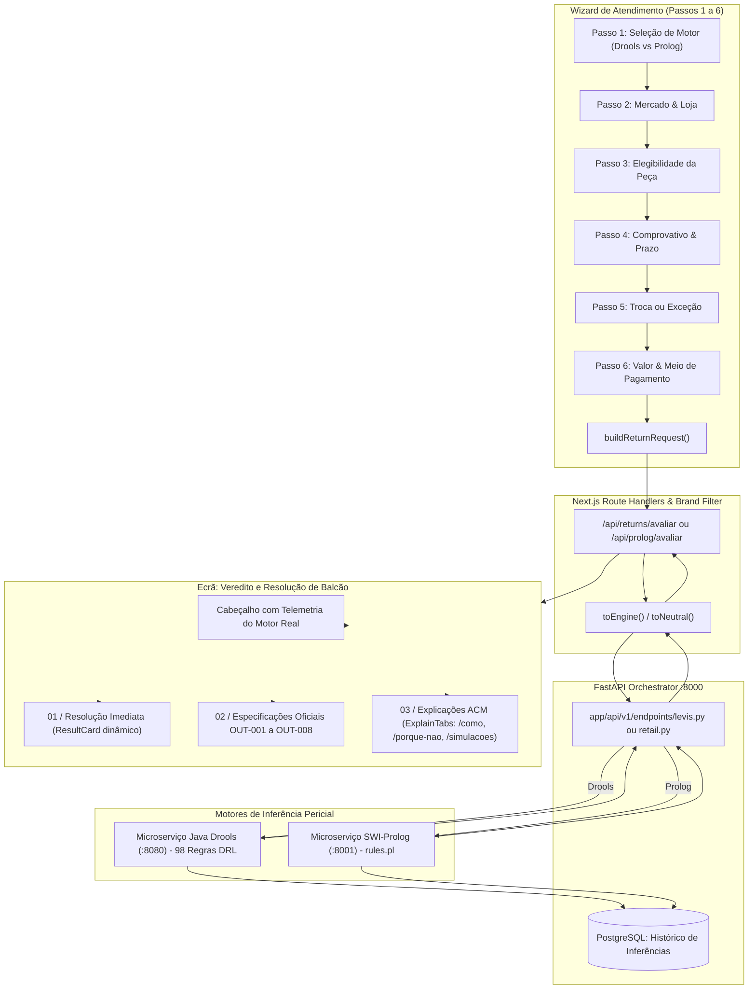

# Plano de Implementação: Eliminação de Hardcoding e Alinhamento Pericial no Ecrã "Veredito e Resolução de Balcão"

**Alvo:** Dashboard RetailFlow / Next.js (`VerdictScreen.tsx`, `ResultCard.tsx`, `returnsLabels.ts`)  
**Modelo Executor:** Antigravity AI Agent (Gemini 3.8 Flash High)  
**Objetivo:** Garantir que o ecrã de veredito final reflete com rigor e fidelidade de 100% a inferência real do motor selecionado no início do fluxo (**Drools** ou **Prolog**), erradicando qualquer texto hardcoded, subtítulos estáticos descontextualizados, lógicas que contradizem a decisão e atalhos de apresentação.  
**Referências do Projeto:**
- [`VerdictScreen.tsx`](file:///c:/Users/santi/Desktop/meia-equipa3-challenge1-26_27/dashboard/src/components/wizard/VerdictScreen.tsx)
- [`ResultCard.tsx`](file:///c:/Users/santi/Desktop/meia-equipa3-challenge1-26_27/dashboard/src/components/ui/ResultCard.tsx)
- [`WizardContext.tsx`](file:///c:/Users/santi/Desktop/meia-equipa3-challenge1-26_27/dashboard/src/components/wizard/WizardContext.tsx)
- [`returnsLabels.ts`](file:///c:/Users/santi/Desktop/meia-equipa3-challenge1-26_27/dashboard/src/config/returnsLabels.ts)
- [`returns.ts`](file:///c:/Users/santi/Desktop/meia-equipa3-challenge1-26_27/dashboard/src/types/returns.ts)
- [`levis.py`](file:///c:/Users/santi/Desktop/meia-equipa3-challenge1-26_27/backend_orchestrator/app/schemas/levis.py)
- [`test_parity_step6.py`](file:///c:/Users/santi/Desktop/meia-equipa3-challenge1-26_27/test_parity_step6.py)

---

## 1. Diagnóstico e Arquitetura de Comunicação

### 1.1. Comunicação do Wizard com os Motores
- **Passos 1 a 5:** A navegação é **puramente local** em memória React (`WizardContext`) e sincronizada em `sessionStorage` (`retailflow_wizard_state_v7`). Não há inferência de regras parcelar.
- **Passo 6 (Final):** O botão `"Calcular Veredito Final"` dispara `handleEvaluate()`, que invoca `buildReturnRequest()` para empacotar o JSON integral `PedidoAvaliacaoRequest` e envia um único `POST` para:
  - `/api/returns/avaliar` (se `engine === "returns"`, motor Drools)
  - `/api/prolog/avaliar` (se `engine === "prolog"`, motor Prolog)

---

## 2. Inventário de Anomalias e "Hardcoding" a Eliminar

| # | Componente | Localização | Problema Diagnosticado | Solução Pericial Alvo |
| :--- | :--- | :--- | :--- | :--- |
| **01** | `ResultCard.tsx` | Linhas 21-31, 36-62 | A prop `explanation` (justificação deduzida das regras do motor) é recebida mas **ignorada**. O subtítulo usa frases fixas hardcoded. | Exibir a `explanation` real calculada a partir do rasto de regras (`result.regras`). |
| **02** | `ResultCard.tsx` | Linhas 76-83, 149-154 | Card 02 (Transação): O subtítulo assume que tudo o que não seja `CARTAO_OFERTA` vai para a conta bancária, gerando a contradição: *"Crédito de loja - Creditado na conta de origem"*. | Subtítulo dinâmico derivado da combinação real de `tipoTransacao` e `meioReembolso`. |
| **03** | `ResultCard.tsx` | Linha 167 | Card 03 (Liquidação): Subtítulo fixo *"Estorno seguro por tokenização"*, mesmo para pagamentos em Numerário, Cartão-Oferta ou Devoluções de Presente. | Subtítulo contextualizado conforme o `meioReembolso` real do motor (Numerário, Cartão, Vale, etc.). |
| **04** | `VerdictScreen.tsx` & `ResultCard.tsx` | Linhas 186-193 | Card 04 (Ação Imediata): Ignora **OUT-006** (`result.processo`) e **OUT-005** (`result.aprovacao`), forçando sempre *"Processar no POS Regular"* se elegibilidade for `PERMITIR`. | Derivar a Ação Imediata diretamente de `result.processo`, `result.aprovacao` e `result.elegibilidade`. |
| **05** | `VerdictScreen.tsx` | Linha 180 | **OUT-008** (Documentação & Controlo): Reduzido a um ternário binário (`reciboAgrafado ? ... : "Assinatura e Reter 90 Dias"`), ignorando `retencaoAte`, `registoExcecao` e notas. | Criar formatador pericial que combine `retencaoAte`, `reciboAgrafado` e `registoExcecao`. |
| **06** | `VerdictScreen.tsx` | Linha 172 | **OUT-007** (Destino do Artigo): Fallback cego para `"Área de Vendas"` caso `firstArticle?.destino` seja nulo. | Se nulo e recusado, destino é `"Devolver ao Cliente"`; se permitido, refletir decisão do artigo ou inspeção. |
| **07** | `VerdictScreen.tsx` | Linhas 198-208 | Cabeçalho genérico que não informa qual motor produziu o veredito, a versão da base de conhecimento (`versaoBaseConhecimento`) nem a latência (`durationMs`). | Adicionar pill de telemetria no cabeçalho com identificação clara do motor (**Drools DRL** vs **SWI-Prolog**), latência e versão. |

---

## 3. Fases do Plano de Implementação

### Fase 1: Enriquecimento de Rótulos e Formatadores em `returnsLabels.ts`
**Ficheiro a alterar:** [`dashboard/src/config/returnsLabels.ts`](file:///c:/Users/santi/Desktop/meia-equipa3-challenge1-26_27/dashboard/src/config/returnsLabels.ts)  
**Objetivo:** Centralizar a lógica de transformação semântica das saídas do motor em linguagem natural rigorosa, semântica e sem códigos técnicos.

#### Tarefas Técnicas:
1. Adicionar mapeamentos completos para todos os enums do motor que possam chegar via `processo`, `meioReembolso`, `destino`, `baseValor` e `tipoTransacao`.
2. Criar a função `formatOperationalAction(processo?: string | null, aprovacao?: string | null, elegibilidade?: Elegibilidade | null): { action: string; hint: string }`:
   - Se `elegibilidade === "RECUSAR"`:
     - `action`: `"Devolver artigo ao cliente"`
     - `hint`: `"Emitir comprovativo oficial de recusa no balcão"`
   - Se `aprovacao && aprovacao !== "NENHUMA"`:
     - `action`: `Solicitar autorização de ${label(aprovacao)}`
     - `hint`: `"PIN ou assinatura obrigatória no terminal POS"`
   - Se `processo === "BACKPOCKET" || processo === "APLICACAO_BACKPOCKET"`:
     - `action`: `"Processar no Sistema BackPocket"`
     - `hint`: `"Aceder à aplicação dedicada de apoio à loja"`
   - Se `processo === "AFTERPAY"`:
     - `action`: `"Processar devolução Afterpay"`
     - `hint`: `"Seguir fluxo específico do terminal para BNPL"`
   - Se `processo === "VERIFONE_INTERAC"`:
     - `action`: `"Inserir cartão no terminal Verifone"`
     - `hint`: `"Exige presença de cartão físico Interac"`
   - Se `elegibilidade === "PERMITIR"`:
     - `action`: `"Concluir transação no POS Regular"`
     - `hint`: `"Executar no fluxo padrão de balcão"`
3. Criar a função `formatDocumentationDetails(doc?: DocumentacaoResponse | null): { label: string; subtext: string }`:
   - Extrair dinamicamente a data de retenção (`retencaoAte`), notas (`notaRecibo`), registo de exceção (`registoExcecao`) e indicação de recibo agrafado (`reciboAgrafado`).
   - Retornar uma descrição precisa em vez do texto genérico de 90 dias quando não aplicável.
4. Criar a função `formatTenderSubtext(meioReembolso?: string | null, tipoTransacao?: string | null, elegibilidade?: Elegibilidade | null): string`:
   - Eliminar a referência universal a "tokenização". Para numerário: `"Liquidação imediata em caixa físico"`. Para crédito de loja: `"Emitido em cartão-oferta físico ou digital"`. Para meio original: `"Estorno seguro processado via adquirente"`.

---

### Fase 2: Eliminação do Hardcoding em `ResultCard.tsx`
**Ficheiro a alterar:** [`dashboard/src/components/ui/ResultCard.tsx`](file:///c:/Users/santi/Desktop/meia-equipa3-challenge1-26_27/dashboard/src/components/ui/ResultCard.tsx)  
**Objetivo:** Fazer com que o cartão principal e os seus 4 mini-cards reflitam exclusivamente os factos deduzidos pelo motor pericial.

#### Tarefas Técnicas:
1. **Ativação da Justificação Real:**
   - Desestruturar a prop `explanation` em `ResultCard`.
   - Substituir o texto estático de `statusConfig.subtitle` pela `explanation` recebida (com fallback de segurança caso o motor não devolva texto explicativo).
2. **Correção do Card 02 (Transação):**
   - Eliminar a dependência simplista de `storeCredit`.
   - Renderizar o subtítulo dinâmico baseado na modalidade real da transação (crédito de loja, troca de tamanho, reembolso monetário).
3. **Correção do Card 03 (Liquidação):**
   - Substituir `"Estorno seguro por tokenização"` pelo subtítulo dinâmico retornado por `formatTenderSubtext`.
4. **Correção do Card 04 (Ação Imediata):**
   - Aceitar tanto a ação principal como a dica/hint operacional calculada a partir de `OUT-006` e `OUT-005`.

---

### Fase 3: Alinhamento de `VerdictScreen.tsx` com as Saídas Canónicas (OUT-001 a OUT-008)
**Ficheiro a alterar:** [`dashboard/src/components/wizard/VerdictScreen.tsx`](file:///c:/Users/santi/Desktop/meia-equipa3-challenge1-26_27/dashboard/src/components/wizard/VerdictScreen.tsx)  
**Objetivo:** Garantir a coerência total das 8 especificações oficiais, da explicabilidade ACM e da telemetria do motor.

#### Tarefas Técnicas:
1. **Telemetria e Identificação Visível do Motor no Cabeçalho:**
   - Adicionar badge no topo com o motor selecionado:
     - Se `engine === "returns"`: `"Motor Drools (DRL) • Regras M0-M9"` com ícone `bolt` (Emerald).
     - Se `engine === "prolog"`: `"Motor SWI-Prolog • Regras Declarativas"` com ícone `psychology` (Indigo).
   - Exibir a versão da base de conhecimento (`result.versaoBaseConhecimento`) e o tempo de inferência (`${durationMs} ms`).
2. **Atualização do `operationalAction`:**
   - Utilizar a função `formatOperationalAction(result.processo, result.aprovacao, result.elegibilidade)`.
3. **Correção de OUT-007 (Destino do Artigo):**
   - Remover o fallback cego para `"Área de Vendas"`.
   - Avaliar se o artigo tem destino explícito no motor (`firstArticle?.destino`); se nulo e o veredito for `RECUSAR`, exibir `"Devolver ao cliente"`.
4. **Correção de OUT-008 (Documentação & Controlo):**
   - Utilizar `formatDocumentationDetails(result.documentacao)` para extrair a data de retenção real e as instruções arquivísticas.
5. **Robustez no `ExplainTabs`:**
   - Assegurar que `evaluationId` (`result.avaliacaoId`) é sempre passado e, caso seja nulo, renderizar aviso claro sem disparar pedidos 404.

---

### Fase 4: Verificação de Paridade, Testes e Auditoria Visual
**Ficheiros a criar/executar:**
* [`test_parity_verdict.py`](file:///c:/Users/santi/Desktop/meia-equipa3-challenge1-26_27/test_parity_verdict.py) (script de paridade e integridade dos outputs)
* Verificação com subagente browser ou captura de tela

#### Tarefas Técnicas:
1. **Script de Teste de Paridade:**
   - Submeter os cenários 1, 2, 7 e 10 a ambos os motores (`/api/v1/levis/avaliar` e `/api/v1/retail/avaliar`).
   - Verificar se `OUT-001` a `OUT-008` estão presentes e preenchidos em conformidade com as regras.
   - Validar que a explicabilidade (`/explicacoes/como` e `/explicacoes/porque-nao`) devolve rastos coerentes para ambos os motores.
2. **Auditoria de Regressão Visual no Frontend:**
   - Simular um caso com devolução em numerário e validar que não aparece "tokenização".
   - Simular um caso de crédito de loja e validar que o subtítulo não diz "creditado na conta de origem".
   - Simular um caso que exija PIN do gestor (`REVER`) e validar que o Card 04 e o alerta operacional são acionados dinamicamente.
   - Simular com motor Drools e com motor Prolog, confirmando que o cabeçalho reflete com precisão o motor em execução.

---

## 4. Matriz de Rastreabilidade Pericial (Entradas -> Regras -> Ecrã)

| Passo do Wizard | Entrada no Pedido | Regras Envolvidas (Drools / Prolog) | Campo de Saída | Apresentação no Ecrã |
| :--- | :--- | :--- | :--- | :--- |
| **Passo 1** | `engine` | Seleciona o pipeline (`levis` vs `retail`) | Metadados | Badge de Motor, Versão e Duração no Cabeçalho |
| **Passos 2 & 3** | Artigo, Estado, Condição | M1-PRODUTO, M2-CANAIS, M3-ESTADO | `OUT-001`, `OUT-007` | Elegibilidade no ResultCard e Destino no Cartão OUT-007 |
| **Passo 4** | Comprovativo & Prazo | M4-COMPROVATIVO, M5-PRAZO | `OUT-001`, `OUT-003`, `OUT-008` | Valor, Base de Cálculo e Documentação / Arquivo |
| **Passo 5** | Troca & Exceção | M6-TROCAS, M6-EXCECOES | `OUT-002`, `OUT-005` | Tipo de Transação (Card 02) e Nível de Aprovação (OUT-005) |
| **Passo 6** | Valor, Pagamento & Tender | M7-LIQUIDACAO, M8-CONCLUSAO | `OUT-003`, `OUT-004`, `OUT-006` | Valor (Card 01), Liquidação (Card 03) e Ação Imediata (Card 04) |

---

## 5. Critérios de Aceitação da Implementação

1. **Zero Textos Fictícios:** Não existe qualquer string com afirmações categóricas genéricas que sobreponham o veredito real deduzido pelas regras do motor.
2. **Fidelidade Causal:** O texto do subtítulo do veredito principal provém diretamente da regra ativada que concluiu a transação ou dos factos verificados pelo motor pericial.
3. **Consistência Semântica:** É impossível que um cartão apresente um modo de resolução e um subtítulo que o contradiga (ex.: Crédito de loja com menção a liquidação bancária).
4. **Isomorfismo Drools/Prolog:** O ecrã de veredito funciona com idêntica completude e riqueza semântica quer o operador tenha escolhido o **Motor Drools** quer tenha escolhido o **Motor Prolog**.
5. **Conformidade com os 8 Outputs Oficiais:** Todos os campos `OUT-001` a `OUT-008` apresentam os seus valores canónicos e documentação associada.
