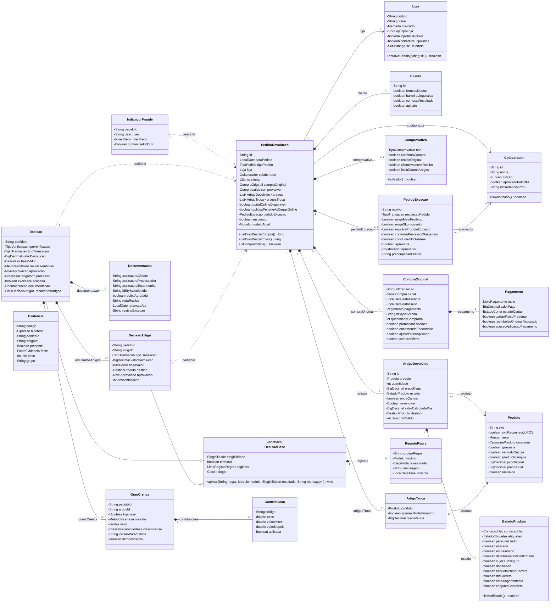

# 04 — Diagrama de classes e modelo de dados

> Modelo de objetos Java do sistema pericial (módulo `pericial-model`, pacote `com.levis.devolucoes.model`).
> 21 classes e 26 enumerações. As classes são factos Drools: os dados de entrada (IN) entram na sessão de regras e o resultado (OUT) é acumulado no facto `Decisao`.

## Visão geral

- **`PedidoDevolucao`** é o facto raiz. Agrega a loja, o colaborador, o cliente, a compra original, o comprovativo, os artigos devolvidos, os artigos de troca e o eventual pedido de exceção.
- **`Decisao`** é o facto de saída. Preenche os campos OUT-001 a OUT-008 e guarda o rasto das regras disparadas em `RegistoRegra`.
- **`DecisaoBase`** é a classe abstrata comum à `Decisao` (pedido) e à **`DecisaoArtigo`** (resultado de cada artigo): elegibilidade, paragem do fluxo e rasto das regras. A `Decisao` agrega os resultados por artigo em `resultadosArtigos`.
- **`IndicadorFraude`** é inserido à parte, para disparar a interrupção transversal EX-008.
- **`Evidencia`**, **`GrauCrenca`** e **`Contribuicao`** formam a camada de incerteza (`08-incerteza.md`): evidências com pesos dos parâmetros, graus calculados e os passos de cada cálculo.

### Convenções

- POJO com construtor vazio, getters e setters; atributos privados. Os booleanos usam `isX()`, que o Drools lê como a propriedade `x`.
- Os métodos auxiliares (`getDiasDesdeCompra()`, `isModificado()`, ...) ficam nas classes e não nas regras.
- `revendivel` e `aprovada` são `Boolean` e não `boolean`: o valor nulo significa "ainda não avaliado", diferente de "não".
- Valores monetários em `BigDecimal`, nunca `double`.
- Sem dependências de Spring ou JPA neste módulo.

## Diagrama de classes



## Relações

| Origem | Tipo | Multiplicidade | Destino | Atributo |
|---|---|---|---|---|
| PedidoDevolucao | Associação | 1 → 1 | Loja | `loja` |
| PedidoDevolucao | Associação | 1 → 1 | Colaborador | `colaborador` |
| PedidoDevolucao | Composição | 1 → 1 | Cliente | `cliente` |
| PedidoDevolucao | Composição | 1 → 1 | CompraOriginal | `compraOriginal` |
| PedidoDevolucao | Composição | 1 → 0..1 | Comprovativo | `comprovativo` |
| PedidoDevolucao | Composição | 1 → 1..* | ArtigoDevolvido | `artigos` |
| PedidoDevolucao | Composição | 1 → 0..* | ArtigoTroca | `artigosTroca` |
| PedidoDevolucao | Composição | 1 → 0..1 | PedidoExcecao | `pedidoExcecao` |
| IndicadorFraude | Referência por ID | 0..* → 1 | PedidoDevolucao | `pedidoId` |
| Decisao | Referência por ID | 1 → 1 | PedidoDevolucao | `pedidoId` |
| CompraOriginal | Composição | 1 → 1 | Pagamento | `pagamento` |
| ArtigoDevolvido | Associação | 0..* → 1 | Produto | `produto` |
| ArtigoDevolvido | Composição | 1 → 1 | EstadoProduto | `estado` |
| ArtigoTroca | Associação | 0..* → 1 | Produto | `produto` |
| PedidoExcecao | Associação | 0..* → 0..1 | Colaborador | `aprovador` |
| Decisao | Herança | — | DecisaoBase | — |
| DecisaoArtigo | Herança | — | DecisaoBase | — |
| DecisaoArtigo | Referência por ID | 0..* → 1 | PedidoDevolucao | `pedidoId` |
| Decisao | Composição | 1 → 0..* | DecisaoArtigo | `resultadosArtigos` |
| Decisao | Composição | 1 → 1 | Documentacao | `documentacao` |
| DecisaoBase | Composição | 1 → 0..* | RegistoRegra | `registos` |
| Decisao | Composição | 1 → 0..* | GrauCrenca | `grausCrenca` |
| GrauCrenca | Composição | 1 → 0..* | Contribuicao | `contribuicoes` |
| Evidencia | Referência por ID | 0..* → 1 | PedidoDevolucao / ArtigoDevolvido | `pedidoId`, `artigoId` |

## Classes e atributos

### PedidoDevolucao

Facto raiz. Representa o pedido apresentado pelo cliente na loja e agrega todos os dados de entrada.

| Atributo | Tipo Java | Descrição | Regras |
|---|---|---|---|
| `id` | `String` | Identificador único do pedido. | Todas |
| `dataPedido` | `LocalDate` | Data em que o pedido é apresentado na loja. | PT-003, PT-004, PT-007, CH-005 |
| `tipoPedido` | `TipoPedido` | Devolução, troca, ajuste de preço ou devolução de oferta (IN-005). | PT-007, PT-008, EP-001, CH-006, TN-007 |
| `loja` | `Loja` | Loja recetora onde o pedido é processado. | IN-001, IN-002 |
| `colaborador` | `Colaborador` | Colaborador que inicia e conclui a transação. | HS-006, CT-001 a CT-003 |
| `cliente` | `Cliente` | Dados e comportamento do cliente. | PT-006, EX-002, EX-003 |
| `compraOriginal` | `CompraOriginal` | Dados da compra que está a ser devolvida. | IN-003, IN-006, IN-009 |
| `comprovativo` | `Comprovativo` | Comprovativo apresentado; nulo se não houver (IN-004). | PT-001, PT-002 |
| `artigos` | `List<ArtigoDevolvido>` | Artigos devolvidos na transação (IN-007, IN-008). | HS-001 a HS-004, PC, BW, EP-003 |
| `artigosTroca` | `List<ArtigoTroca>` | Artigos que o cliente leva em troca. | EP-001, EP-002, TN-006 |
| `portalOnlineDisponivel` | `boolean` | Indica se o portal de devoluções online está operacional. | CH-004 |
| `politicaPermiteAsCegasOnline` | `boolean` | A política da loja permite a devolução às cegas de uma compra online sem encomenda encontrada. | Módulo ONLINE |
| `pedidoExcecao` | `PedidoExcecao` | Pedido de exceção do cliente; nulo se não existir. | EX-001 a EX-007, HS-005 |
| `suspenso` | `boolean` | Transação suspensa por indícios de fraude. | EX-008 |
| `moduloAtual` | `Modulo` | Módulo do fluxograma em avaliação. | Controlo de agenda |

Métodos auxiliares: `getDiasDesdeCompra() long`, `getDiasDesdeEnvio() long`, `isCompraOnline() boolean`

### Loja

Loja recetora e o seu contexto operacional.

| Atributo | Tipo Java | Descrição | Regras |
|---|---|---|---|
| `codigo` | `String` | Código da loja. | CT-007 |
| `nome` | `String` | Nome da loja. | — |
| `mercado` | `Mercado` | Estados Unidos ou Canadá (IN-001). | CH-002, CH-007, TN-011, TN-012 |
| `tipoLoja` | `TipoLoja` | Mainline ou Outlet (IN-002). | CH-001, CH-009, CH-010 |
| `lojaBackPocket` | `boolean` | A loja opera com BackPocket. | TN-012 |
| `coberturaLojaUnica` | `boolean` | Loja com um só colaborador em turno (testemunha SSC). | CT-005 |
| `skusSortido` | `Set<String>` | SKUs que estão ou estiveram no sortido da loja. | EP-005, EP-006 |

Métodos auxiliares: `estaNoSortido(String sku) boolean`

### Colaborador

Pessoa que processa a transação.

| Atributo | Tipo Java | Descrição | Regras |
|---|---|---|---|
| `id` | `String` | Identificador do colaborador. | CT-004 |
| `nome` | `String` | Nome do colaborador. | EX-007 |
| `funcao` | `Funcao` | Função na loja. | HS-006, CT-002 |
| `aprovadoPeloDM` | `boolean` | Lead Cashier ou Elevated Stylist aprovado pelo District Manager. | HS-006 |
| `idCredencialPOS` | `String` | Credencial própria e não partilhada no POS. | CT-001, CT-003 |

Métodos auxiliares: `isAutorizado() boolean`

### Cliente

Cliente que apresenta o pedido.

| Atributo | Tipo Java | Descrição | Regras |
|---|---|---|---|
| `id` | `String` | Identificador do cliente; opcional. | — |
| `forneceDados` | `boolean` | O cliente aceita dar dados pessoais. | PT-006 |
| `barreiraLinguistica` | `boolean` | Existe uma barreira linguística. | PT-006 |
| `contestaResultado` | `boolean` | O cliente contesta o resultado padrão. | EX-002 |
| `agitado` | `boolean` | O cliente fica irritado ou cria perturbação. | EX-003 |
| `explicaOrigemCompra` | `Boolean` | O cliente explica onde e quando comprou; `null` = "Não sei". | EF-04 (`08`) |
| `pedeNumerario` | `boolean` | O cliente pede o reembolso em numerário. | EF-05 (`08`) |

### CompraOriginal

Transação original a que o artigo pertence.

| Atributo | Tipo Java | Descrição | Regras |
|---|---|---|---|
| `idTransacao` | `String` | Número da transação ou da encomenda. | PT-001, CH-002 |
| `canal` | `CanalCompra` | Canal de compra (IN-003). | CH-001 a CH-010, TN-009, TN-010 |
| `dataCompra` | `LocalDate` | Data da compra (IN-006). | PT-003, PT-004, PT-007, PT-008 |
| `dataEnvio` | `LocalDate` | Data de envio da encomenda online. | CH-005 |
| `pagamento` | `Pagamento` | Meio de pagamento original (IN-009). | TN-001 a TN-012 |
| `idStylistVenda` | `String` | Stylist que fez a venda original. | CT-004 |
| `quantidadeComprada` | `int` | Número de artigos na compra original. | EP-004 |
| `promocaoEscaloes` | `boolean` | A compra teve promoção por escalões. | EP-003, EP-004 |
| `encomendaEncontrada` | `boolean` | A encomenda online foi localizada. | CH-002, CH-003 |
| `ajustePrecoAplicado` | `boolean` | Já houve um ajuste de preço nesta compra. | PT-007 |
| `compraOferta` | `boolean` | A compra foi uma oferta. | TN-007 |

### Comprovativo

Prova de compra apresentada pelo cliente (IN-004).

| Atributo | Tipo Java | Descrição | Regras |
|---|---|---|---|
| `tipo` | `TipoComprovativo` | Tipo de comprovativo. | PT-001 |
| `confirmaCompra` | `boolean` | O comprovativo confirma a compra do artigo. | PT-001, PT-002 |
| `reciboOriginal` | `boolean` | É o recibo original. | PT-007, PT-008, CT-006 |
| `clienteMantemRecibo` | `boolean` | O cliente fica com o recibo. | CT-006 |
| `incluiOutrosArtigos` | `boolean` | O recibo inclui outros artigos. | CT-006 |

Métodos auxiliares: `isValido() boolean`

### Pagamento

Meio de pagamento usado na compra original.

| Atributo | Tipo Java | Descrição | Regras |
|---|---|---|---|
| `meio` | `MeioPagamento` | Meio de pagamento (IN-009). | TN-001 a TN-012, HS-005 |
| `valorPago` | `BigDecimal` | Valor efetivamente pago. | OUT-003 |
| `estadoConta` | `EstadoConta` | Estado da conta associada ao cartão. | TN-002, TN-003 |
| `cartaoFisicoPresente` | `boolean` | O cliente apresenta o mesmo cartão físico. | TN-011, TN-012 |
| `reembolsoOriginalRecusado` | `boolean` | O reembolso ao meio original foi recusado. | TN-003, TN-004 |
| `acessoAplicacaoPagamento` | `boolean` | O cliente tem acesso à aplicação de pagamento (PayPal ou Venmo). | TN-008 |

### Produto

Dados de catálogo do artigo.

| Atributo | Tipo Java | Descrição | Regras |
|---|---|---|---|
| `sku` | `String` | SKU do produto. | HS-001, HS-004 |
| `skuReconhecidoPOS` | `boolean` | O POS reconhece o SKU. | HS-001 |
| `marca` | `Marca` | Marca do produto. | HS-002 |
| `categoria` | `CategoriaProduto` | Categoria; distingue bodywear. | PC-007, BW-001 a BW-004 |
| `grossista` | `boolean` | Produto de canal grossista. | HS-002, CH-008 |
| `vendidoNaLoja` | `boolean` | O produto é vendido na loja. | HS-002 |
| `produtoFranquia` | `boolean` | Produto da franquia do Canadá. | HS-004, CH-007 |
| `pvpOriginal` | `BigDecimal` | Preço de venda ao público original. | CH-010 |
| `precoAtual` | `BigDecimal` | Preço de venda atual, após promoções ativas. | PT-005, CH-009, EP-002, EP-005 |
| `emSaldo` | `boolean` | O produto já está em saldo. | EP-007 |
| `defeitoConhecido` | `boolean` | Defeito de fabrico conhecido para o SKU (catálogo). | ED-04 (`08`) |

### ArtigoDevolvido

Uma linha do pedido: um produto devolvido e o seu estado.

| Atributo | Tipo Java | Descrição | Regras |
|---|---|---|---|
| `id` | `String` | Identificador da linha. | — |
| `produto` | `Produto` | Produto devolvido. | HS-001 a HS-004 |
| `quantidade` | `int` | Unidades devolvidas. | EP-003 |
| `precoPago` | `BigDecimal` | Preço pago por este artigo. | PT-003, EP-001 |
| `estado` | `EstadoProduto` | Estado físico do artigo (IN-008). | PC-001 a PC-008 |
| `entreCanais` | `boolean` | Comprado noutro canal ou loja. | EP-005 a EP-007 |
| `revendivel` | `Boolean` | IN-010; nulo até à inspeção. | PC-002, PC-003, PT-004, EX-005 |
| `valorCalculadoPos` | `BigDecimal` | Valor calculado pelo POS, quando disponível (A-21). | CH-010, EP-004 |
| `destino` | `DestinoProduto` | Destino final do artigo (OUT-007). | EP-005 a EP-007, BW, PC-008 |
| `descontoSaldo` | `int` | Percentagem de desconto em saldos. | EP-006, BW-002 |

### EstadoProduto

Resultado da inspeção física do artigo.

| Atributo | Tipo Java | Descrição | Regras |
|---|---|---|---|
| `condicaoUso` | `CondicaoUso` | Não usado, usado ou lavado. | PC-001, PC-004, PC-005 |
| `etiquetas` | `EstadoEtiquetas` | Etiquetas colocadas, soltas ou ausentes. | PC-001 a PC-003 |
| `personalizado` | `boolean` | O artigo foi personalizado. | HS-003 |
| `alterado` | `boolean` | O artigo foi alterado. | HS-003 |
| `embainhado` | `boolean` | O artigo foi embainhado. | HS-003 |
| `defeitoFabricoConfirmado` | `boolean` | Defeito de fabrico confirmado. | PC-006 |
| `sujoOuInseguro` | `boolean` | Sujo, contaminado ou inseguro de manusear. | PC-008, BW-004 |
| `danificado` | `boolean` | Dano detetado na inspeção. | CT-008 |
| `etiquetaPrecoCorreta` | `boolean` | Etiqueta de preço correta. | CT-008 |
| `rfidCorreto` | `boolean` | Etiqueta RFID correta. | CT-008 |
| `embalagemIntacta` | `boolean` | Bodywear com embalagem original intacta. | BW-001, BW-002 |
| `conjuntoCompleto` | `boolean` | Bodywear sem unidades em falta. | BW-002, BW-003 |
| `grauUso` | `Integer` | Grau de uso de 0 (nenhum) a 4 (intenso); `null` se desconhecido. | EF-03, IU-30 (`08`) |
| `alegaDefeito` | `boolean` | O cliente alega um defeito. | IU-20 (`08`) |
| `inspecaoDefeito` | `Map<String, Boolean>` | Respostas da inspeção: ED-xx → presente, ausente ou `null` ("Não sei"). | ED-01..ED-07 (`08`) |

Métodos auxiliares: `isModificado() boolean`

### ArtigoTroca

Artigo que o cliente leva numa troca.

| Atributo | Tipo Java | Descrição | Regras |
|---|---|---|---|
| `produto` | `Produto` | Produto novo. | EP-002 |
| `apenasMudaTamanho` | `boolean` | Mesmo modelo e cor, só muda o tamanho. | EP-001 |
| `precoVenda` | `BigDecimal` | Preço aplicado ao artigo novo. | EP-001, EP-002 |

### PedidoExcecao

Pedido de exceção à política e a sua avaliação.

| Atributo | Tipo Java | Descrição | Regras |
|---|---|---|---|
| `motivo` | `String` | Motivo apresentado. | EX-001, EX-007 |
| `resolucaoPedida` | `TipoTransacao` | Resolução que o cliente pede. | EX-005, HS-005 |
| `exigeMeioProibido` | `boolean` | Exige um meio de pagamento proibido. | EX-006, HS-005 |
| `exigeSkuIncorreto` | `boolean` | Exige um SKU diferente ou genérico. | EX-006 |
| `envolveProdutoExcluido` | `boolean` | Envolve um produto excluído. | EX-006 |
| `contornaProcessoObrigatorio` | `boolean` | Contorna Afterpay, PayPal, Venmo ou online. | EX-006 |
| `concluivelNoSistema` | `boolean` | A exceção pode ser concluída no sistema. | EX-004 |
| `aprovada` | `Boolean` | Decisão sobre a exceção; nulo se pendente. | EX-004, EX-005 |
| `aprovador` | `Colaborador` | Quem aprovou a exceção. | EX-007 |
| `preocupacaoCliente` | `String` | Preocupação registada do cliente. | EX-007 |

### IndicadorFraude

Facto inserido quando há indícios de fraude; dispara a interrupção transversal.

| Atributo | Tipo Java | Descrição | Regras |
|---|---|---|---|
| `pedidoId` | `String` | Pedido a que se refere. | EX-008 |
| `descricao` | `String` | Descrição da inconsistência. | EX-008 |
| `nivelRisco` | `NivelRisco` | Baixo, significativo ou confirmado. | EX-004, EX-008 |
| `comunicadoGSS` | `boolean` | Comunicado à Global Safety and Security. | EX-008 |

### Decisao

Facto de saída. Acumula o resultado das regras e preenche os campos OUT.

| Atributo | Tipo Java | Descrição | Regras |
|---|---|---|---|
| `pedidoId` | `String` | Pedido a que se refere. | Todas |
| `elegibilidade` | `Elegibilidade` | OUT-001. | Todas as regras de decisão |
| `tipoVerificacao` | `TipoVerificacao` | Verificada ou às cegas. | PT-001, PT-002 |
| `tipoTransacao` | `TipoTransacao` | OUT-002. | PT, CH, EP, EX-005 |
| `valorDevolucao` | `BigDecimal` | OUT-003, valor calculado. | PT-003, PT-005, CH-009, CH-010, EP-003, EP-004 |
| `baseValor` | `BaseValor` | Base usada para o valor. | OUT-003 |
| `meioReembolso` | `MeioReembolso` | OUT-004. | TN, CH-002 a CH-005 |
| `aprovacao` | `NivelAprovacao` | OUT-005. | CT-002, EX-001 a EX-005 |
| `processo` | `ProcessoObrigatorio` | OUT-006. | Regras ENCAMINHAR |
| `excecaoRecusada` | `boolean` | O pedido de exceção do cliente foi recusado, sem alterar a elegibilidade. | HS-005, EX-006 |
| `documentacao` | `Documentacao` | OUT-008. | CT-004 a CT-007, EX-007 |
| `resultadosArtigos` | `List<DecisaoArtigo>` | Resultados por artigo, agregados no fim da avaliação. | M9 |
| `grausCrenca` | `List<GrauCrenca>` | Graus calculados pela camada de incerteza. | IU-10, IU-20, IU-30, IU-40 (`08`) |
| `versaoParametrosIncerteza` | `String` | Versão do ficheiro de parâmetros de incerteza. | Auditoria (`08`) |

`elegibilidade`, `terminal` e `registos` vêm da `DecisaoBase`. Métodos auxiliares: `aplicar(...)` e `agregarArtigos(...)`.

### DecisaoBase

Classe abstrata comum à `Decisao` e à `DecisaoArtigo`.

| Atributo | Tipo Java | Descrição | Regras |
|---|---|---|---|
| `elegibilidade` | `Elegibilidade` | OUT-001; nunca desce de severidade. | Todas as regras de decisão |
| `terminal` | `boolean` | Uma paragem obrigatória encerrou o fluxo. | HS, CH-007, CH-008, EX-008 |
| `registos` | `List<RegistoRegra>` | Rasto das regras disparadas. | Auditoria |
| `relogio` | `Clock` | Relógio usado para o instante de cada registo; substituível nos testes. | Auditoria |

Métodos auxiliares: `aplicar(String regra, Modulo modulo, Elegibilidade resultado, String mensagem) void`, `resolverRevisao(...)` e `registar(...)`.

### DecisaoArtigo

Resultado de um artigo devolvido; uma paragem num artigo não termina os restantes.

| Atributo | Tipo Java | Descrição | Regras |
|---|---|---|---|
| `pedidoId` | `String` | Pedido a que se refere. | Todas |
| `artigoId` | `String` | Artigo a que se refere. | Todas |
| `tipoTransacao` | `TipoTransacao` | Transação do artigo. | PT, CH, EP |
| `valorDevolucao` | `BigDecimal` | Valor calculado para o artigo. | CH-009, CH-010, EP-003, EP-004 |
| `baseValor` | `BaseValor` | Base usada para o valor. | OUT-003 |
| `destino` | `DestinoProduto` | Destino final do artigo (OUT-007). | EP-005 a EP-007, BW, PC-008 |
| `aprovacao` | `NivelAprovacao` | Aprovação exigida pelo artigo; nunca desce. | IU-21, IU-22 (`08`) |
| `descontoSaldo` | `int` | Percentagem de desconto em saldos. | EP-006, BW-002 |

### Documentacao

Controlos documentais da transação (OUT-008).

| Atributo | Tipo Java | Descrição | Regras |
|---|---|---|---|
| `assinaturaCliente` | `String` | Assinatura ou "Recusado". | CT-005 |
| `assinaturaProcessador` | `String` | Assinatura de quem processou. | CT-005 |
| `assinaturaTestemunha` | `String` | Assinatura ou "SSC". | CT-005 |
| `idStylistAtribuido` | `String` | Stylist a quem a devolução é atribuída. | CT-004 |
| `reciboAgrafado` | `boolean` | Recibo agrafado ao exemplar da loja. | CT-006 |
| `notaRecibo` | `String` | Anotação sobre o recibo. | CT-006 |
| `retencaoAte` | `LocalDate` | Data até à qual os suportes são guardados (90 dias). | CT-007 |
| `registoExcecao` | `String` | Registo completo da exceção aprovada. | EX-007 |

### RegistoRegra

Uma entrada do rasto de auditoria: que regra disparou e com que resultado.

| Atributo | Tipo Java | Descrição | Regras |
|---|---|---|---|
| `codigoRegra` | `String` | ID da regra, por exemplo HS-003. | Auditoria |
| `modulo` | `Modulo` | Módulo onde disparou. | Auditoria |
| `resultado` | `Elegibilidade` | Resultado produzido. | Auditoria |
| `mensagem` | `String` | Explicação para o colaborador. | Auditoria |
| `instante` | `LocalDateTime` | Momento em que disparou. | Auditoria |

### Evidencia (camada de incerteza, `08`)

Evidência a favor ou contra uma hipótese. O peso vem do ficheiro de parâmetros, nunca do código.

| Atributo | Tipo Java | Descrição | Regras |
|---|---|---|---|
| `codigo` | `String` | EF-xx (fraude) ou ED-xx (defeito de fabrico). | IU-01..IU-07 |
| `hipotese` | `Hipotese` | Hipótese a que se refere. | IU-10, IU-20 |
| `pedidoId` | `String` | Pedido. | — |
| `artigoId` | `String` | Artigo; `null` nas evidências do pedido. | IU-20 |
| `presente` | `Boolean` | Observada presente (TRUE), ausente (FALSE) ou desconhecida (`null`). | IU-10, IU-20 |
| `fonte` | `FonteEvidencia` | Origem. | Explicações |
| `peso` | `double` | CF ou LR, lido dos parâmetros. | IU-10, IU-20 |
| `grupo` | `String` | Grupo de correlação (ex.: USO). | IU-20 |
| `descricao` | `String` | Texto para as explicações. | Explicações |

### GrauCrenca (camada de incerteza, `08`)

Grau calculado para uma hipótese, com a classe dos limiares e os passos do cálculo.

| Atributo | Tipo Java | Descrição | Regras |
|---|---|---|---|
| `pedidoId` | `String` | Pedido. | — |
| `artigoId` | `String` | Artigo; `null` para FRAUDE e RECOMENDACAO_CREDITO. | — |
| `hipotese` | `Hipotese` | Hipótese avaliada. | IU-11..IU-50 |
| `metodo` | `MetodoIncerteza` | Técnica usada. | Explicações |
| `valor` | `double` | CF em [−1, 1], probabilidade ou grau em [0, 1], recomendação em [0, 100]. | IU-11..IU-50 |
| `classificacao` | `ClassificacaoIncerteza` | Classe resultante dos limiares. | IU-11..IU-50, PC-004, PC-005 |
| `contribuicoes` | `List<Contribuicao>` | Passos do cálculo. | Explicações, auditoria |
| `versaoParametros` | `String` | Versão do ficheiro de parâmetros. | Auditoria |
| `demonstrativo` | `boolean` | Os parâmetros são demonstrativos. | Interface |

### Contribuicao (camada de incerteza, `08`)

Um passo do cálculo: uma evidência ou uma regra fuzzy.

| Atributo | Tipo Java | Descrição |
|---|---|---|
| `codigo` | `String` | EF, ED, RV ou CR. |
| `descricao` | `String` | Texto legível. |
| `peso` | `double` | CF, LR ou força da regra fuzzy. |
| `valorAntes` | `double` | Valor antes do passo. |
| `valorDepois` | `double` | Valor depois do passo. |
| `aplicada` | `boolean` | Falso quando não foi aplicada. |
| `motivoNaoAplicada` | `String` | Ex.: "grupo USO", "desconhecida". |

O mapeamento das etiquetas para a revendibilidade (COLOCADAS 1,0; SOLTAS 0,6; AUSENTES 0,0) é um parâmetro
(`integridadeEtiquetas` no ficheiro de parâmetros) e não um método do modelo (ADR 0012).

## Enumerações

| Enumeração | Valores |
|---|---|
| `Mercado` | `EUA`, `CANADA` |
| `TipoLoja` | `MAINLINE`, `OUTLET` |
| `CanalCompra` | `MAINLINE`, `OUTLET`, `LEVI_COM`, `LEVI_CA`, `BACKPOCKET`, `FRANQUIA_CANADA`, `GROSSISTA`, `DESCONHECIDO` |
| `TipoPedido` | `DEVOLUCAO`, `TROCA`, `AJUSTE_PRECO`, `DEVOLUCAO_OFERTA` |
| `TipoComprovativo` | `RECIBO_IMPRESSO`, `RECIBO_DIGITAL`, `CONFIRMACAO_ENCOMENDA`, `RECIBO_OFERTA`, `CONSULTA_TRANSACAO`, `FOTOGRAFIA_RECIBO`, `CONSULTA_BACKPOCKET` |
| `Marca` | `LEVIS`, `DOCKERS`, `LS_SIGNATURE`, `BEYOND_YOGA`, `OUTRA` |
| `CategoriaProduto` | `VESTUARIO`, `ACESSORIO`, `BODYWEAR` |
| `CondicaoUso` | `NAO_USADO`, `USADO`, `LAVADO` |
| `EstadoEtiquetas` | `COLOCADAS`, `SOLTAS`, `AUSENTES` |
| `MeioPagamento` | `CREDITO`, `DEBITO`, `APPLE_PAY`, `GOOGLE_PAY`, `PAYPAL`, `VENMO`, `AFTERPAY`, `INTERAC`, `NUMERARIO`, `CARTAO_OFERTA` |
| `EstadoConta` | `ATIVA`, `ATIVA_CARTAO_PERDIDO`, `ENCERRADA` |
| `Funcao` | `STYLIST`, `ELEVATED_STYLIST`, `LEAD_CASHIER`, `KEY_HOLDER`, `GESTAO_LOJA`, `XSTORE_MANAGER` |
| `NivelRisco` | `BAIXO`, `SIGNIFICATIVO`, `CONFIRMADO` |
| `Elegibilidade` | `PERMITIR`, `RECUSAR`, `REVER`, `ENCAMINHAR` |
| `TipoVerificacao` | `NAO_DETERMINADA`, `VERIFICADA`, `AS_CEGAS` |
| `TipoTransacao` | `REEMBOLSO`, `TROCA`, `TROCA_MESMO_ARTIGO`, `CREDITO_LOJA`, `AJUSTE_PRECO`, `NENHUMA` |
| `BaseValor` | `VALOR_PAGO`, `PRECO_ATUAL`, `VALOR_PROMOCIONAL`, `VALOR_ESCALAO`, `VALOR_POS`, `PVP_ORIGINAL` |
| `MeioReembolso` | `MEIO_ORIGINAL`, `CARTAO_OFERTA`, `CARTAO_OFERTA_ELETRONICO`, `MEIO_ALTERNATIVO`, `APLICACAO_PAGAMENTO`, `CREDITO_LOJA` |
| `NivelAprovacao` | `NENHUMA`, `XSTORE_MANAGER`, `RESPONSAVEL_SENIOR`, `DISTRICT_AREA` |
| `ProcessoObrigatorio` | `POS`, `BACKPOCKET`, `AFTERPAY`, `PAYPAL_VENMO`, `VERIFONE_INTERAC`, `FRANQUIA_CANADA`, `DANO`, `RISCO_BIOLOGICO` |
| `DestinoProduto` | `AREA_VENDAS`, `SALDOS`, `REETIQUETAR`, `BAIXA_DANO`, `RISCO_BIOLOGICO`, `DEVOLUCAO_CLIENTE` |
| `Modulo` | `M0`, `M1`, `M2`, `EVIDENCIA`, `INCERTEZA`, `M3`, `M4`, `M5`, `ONLINE`, `M6`, `M7`, `M8`, `M9` |
| `Hipotese` | `FRAUDE`, `DEFEITO_FABRICO`, `REVENDIBILIDADE`, `RECOMENDACAO_CREDITO` |
| `MetodoIncerteza` | `FATOR_CERTEZA`, `BAYES`, `FUZZY` |
| `FonteEvidencia` | `SISTEMA`, `COLABORADOR`, `POS`, `CATALOGO` |
| `ClassificacaoIncerteza` | `RISCO_ALTO`, `RISCO_MEDIO`, `RISCO_BAIXO`, `PROPOR_PC006`, `REVER_DEFEITO`, `DESGASTE`, `REVENDIVEL`, `REVENDIBILIDADE_INDETERMINADA`, `NAO_REVENDIVEL`, `CREDITO_RECOMENDADO`, `CREDITO_A_CRITERIO`, `CREDITO_NAO_RECOMENDADO` |

## Integração com Drools

- Inserir no `KieSession`: o `PedidoDevolucao`, cada `ArtigoDevolvido` e uma `Decisao` vazia com o mesmo `pedidoId`. Os restantes objetos são lidos a partir do pedido com `from` ou OOPath. Inserir um `IndicadorFraude` apenas quando houver inconsistências.
- Cada módulo do fluxograma é um `agenda-group` com o nome do enum `Modulo`. O código Java empilha o foco de M9 até M0, para que M0 seja avaliado primeiro.
- Dentro de cada grupo, a `salience` implementa as precedências (por exemplo, PC-007 acima de PC-004 e PC-005).
- Todas as regras incluem `Decisao( terminal == false )`. `aplicar()` marca `terminal = true` quando o resultado de uma paragem obrigatória é RECUSAR ou ENCAMINHAR.
- EX-008 e PC-008 usam `auto-focus true` e salience elevada para interromper qualquer módulo.

### Exemplo de regras DRL

```drl
package com.levis.devolucoes.regras;

import com.levis.devolucoes.modelo.*;

rule "HS-003 Produto personalizado, alterado ou embainhado"
    agenda-group "M3"
    salience 90
when
    $d : Decisao( terminal == false )
    $p : PedidoDevolucao( id == $d.pedidoId )
    $a : ArtigoDevolvido( estado.modificado == true ) from $p.artigos
then
    modify( $d ) {
        aplicar( "HS-003", Elegibilidade.RECUSAR,
                 "Produto alterado: não pode ser devolvido nem trocado, mesmo com defeito." )
    }
end

rule "PT-003 Devolução verificada até 30 dias"
    agenda-group "M5"
when
    $d : Decisao( terminal == false,
                  tipoVerificacao == TipoVerificacao.VERIFICADA,
                  elegibilidade != Elegibilidade.REVER )
    $p : PedidoDevolucao( id == $d.pedidoId, diasDesdeCompra <= 30,
                          tipoPedido == TipoPedido.DEVOLUCAO )
then
    modify( $d ) {
        setTipoTransacao( TipoTransacao.REEMBOLSO ),
        setMeioReembolso( MeioReembolso.MEIO_ORIGINAL ),
        aplicar( "PT-003", Elegibilidade.PERMITIR,
                 "Reembolso total no meio de pagamento original." )
    }
end

rule "EX-008 Indícios de fraude"
    auto-focus true
    salience 1000
when
    $f : IndicadorFraude()
    $p : PedidoDevolucao( id == $f.pedidoId, suspenso == false )
    $d : Decisao( pedidoId == $f.pedidoId )
then
    modify( $p ) { setSuspenso( true ) }
    modify( $d ) {
        setAprovacao( NivelAprovacao.DISTRICT_AREA ),
        aplicar( "EX-008", Elegibilidade.REVER,
                 "Transação suspensa. Envolver a Gestão da Loja." )
    }
end
```
