# 09 — Arquitetura do backend Java/Drools

> Descrição da arquitetura do backend do sistema pericial de devoluções e trocas Levi's
> (`drools-engine-levis-devolucoes-java/backend`) e diagramas de classes de todos os módulos Maven.
> Pacote base: `com.levis.devolucoes`. O frontend Angular está fora do âmbito deste documento.
>
> Documentos relacionados: `04-diagrama-classes.md` (detalhe do modelo de factos), `05-estrutura-projeto.md`
> (estrutura de pastas), `08-incerteza.md` (camada de incerteza) e `adr/` (decisões de arquitetura).

## 1. Visão geral

O backend é um **sistema pericial baseado em regras de produção**. Um colaborador de loja submete um pedido de
devolução, troca ou ajuste de preço; o sistema converte-o em **factos**, executa a **base de conhecimento Drools**
(117 regras em 13 ficheiros DRL) e devolve uma **decisão** (elegibilidade, tipo de transação, valor e meio de
reembolso, aprovação, processo obrigatório, destino do produto e documentação), por pedido e por artigo.

Cada decisão é **explicável** (Como? Porquê? Porque não? E se? O que falta?) e **auditável** (versão do kjar,
versão dos parâmetros de incerteza e rasto completo das regras disparadas ficam gravados em PostgreSQL).
Uma **camada de incerteza** (fatores de certeza, Bayes e lógica difusa) calcula graus de crença que as regras
usam para recomendar ou tornar a decisão mais cautelosa, sem nunca transformar um RECUSAR num PERMITIR.

### Stack

| Área | Tecnologia |
|---|---|
| Linguagem | Java 25 LTS (`record`, `List.reversed()`, ...) |
| Motor de regras | Drools 8.44 (kjar com `kmodule.xml`, sessão stateful por pedido) |
| Aplicação | Spring Boot 3.5 (Web, Security/OAuth2 Resource Server com JWT HMAC, Actuator, Validation) |
| Persistência | Spring Data JPA, PostgreSQL, Flyway |
| Mapeamento | MapStruct 1.6 (DTO ↔ modelo), Jackson (JSON/YAML) |
| Incerteza | jFuzzyLogic 3.3 (FCL), implementações próprias de MYCIN e razões de verosimilhança |
| Documentação da API | springdoc-openapi (OpenAPI 3 + Swagger UI) |
| Qualidade | JUnit 5, AssertJ, MockMvc, Testcontainers, ArchUnit, JaCoCo, Checkstyle, Spotless |

### Princípios de arquitetura

1. **Separação estrita entre conhecimento e código.** As regras de negócio vivem só nos ficheiros DRL; os
   parâmetros de incerteza só em `parametros-incerteza.yml` e nos ficheiros FCL. O Java fornece factos,
   orquestração, explicações e infraestrutura.
2. **Modelo de factos puro.** `pericial-model` são POJO sem Spring, JPA nem Drools; é o vocabulário partilhado
   pelas regras, pela incerteza, pelas explicações e pelo serviço.
3. **Dependências numa só direção** (`api → service → {explanation, rules, persistence, dto} → model`),
   verificadas por ArchUnit.
4. **Contratos externos separados do modelo interno.** A API só expõe DTO (`record` com Bean Validation);
   as entidades JPA são distintas dos factos Drools.
5. **Integrações atrás de portas.** POS, catálogo, BackPocket e meios de pagamento são interfaces com um
   adaptador simulado para desenvolvimento e testes.
6. **Reprodutibilidade.** Cada avaliação guarda o pedido e os indícios de fraude em JSON e a versão do kjar, o
   que permite reexecutar a avaliação para as explicações e as simulações "E se".

## 2. Módulos Maven

O POM pai (`levis-devolucoes`) agrega oito módulos em `backend/`:

| Módulo | Pacote | Classes (main) | Responsabilidade |
|---|---|---|---|
| `pericial-model` | `model` | 48 (22 classes, 26 enums) | Factos Drools: pedido, produto, decisão, incerteza |
| `pericial-uncertainty` | `incerteza` | 14 | Graus de crença: fatores de certeza, Bayes, fuzzy; parâmetros |
| `pericial-rules` | `regras` | 1 + 13 DRL + 1 de consultas | Base de conhecimento (kjar): 117 regras em agenda-groups |
| `pericial-explanation` | `explicacao` | 40 | Execução rastreada e explicações Como/Porquê/Porque não/E se/O que falta |
| `pericial-dto` | `dto` | 65 | Contratos da API REST (records, enums espelho) |
| `pericial-persistence` | `persistencia` | 6 + 2 migrações | Histórico e auditoria em PostgreSQL |
| `pericial-service` | `service` | 26 | Casos de uso, motor, mapeamento, integrações, auditoria |
| `pericial-api` | `api` | 18 | Controllers REST, segurança JWT, erros, observabilidade |

### Grafo de dependências

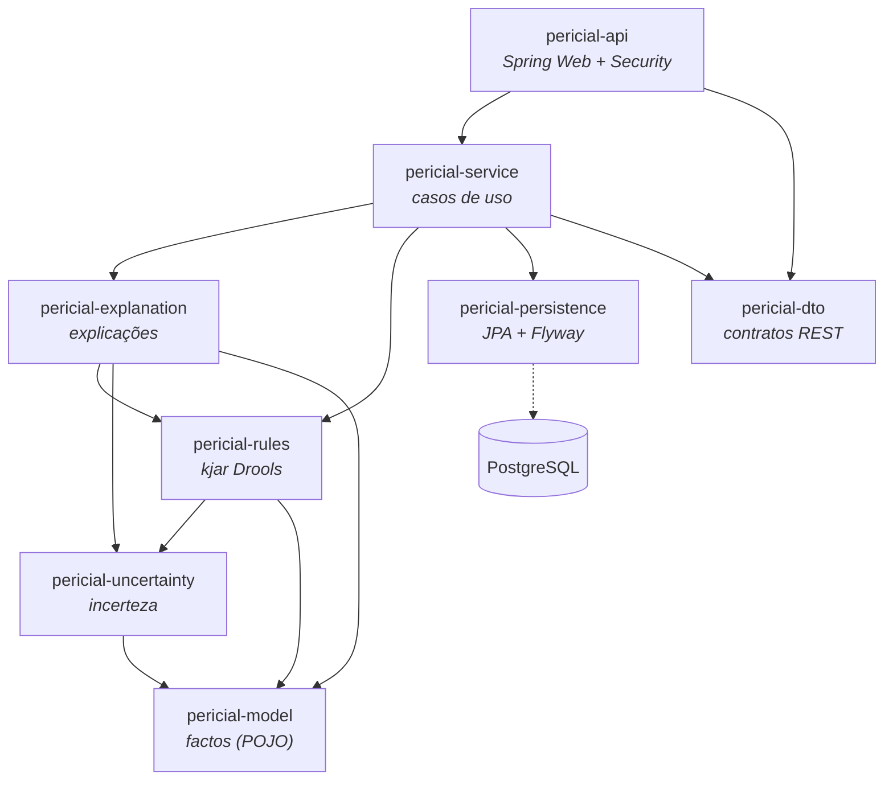

`pericial-model`, `pericial-dto` e `pericial-persistence` não dependem de nenhum outro módulo interno.
`pericial-rules` depende de `pericial-model` e `pericial-uncertainty` porque as regras usam as classes do
modelo e o global `incerteza` (`ServicoIncerteza`).

## 3. Camadas e responsabilidades

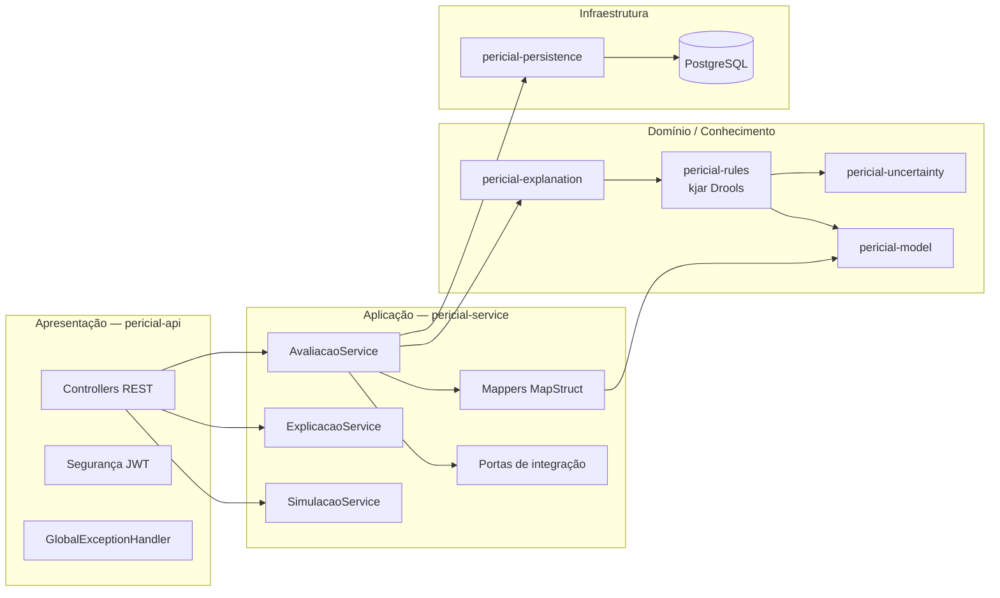

| Camada | O que pode usar | Garantido por |
|---|---|---|
| API | Serviço e DTO; **nunca** o modelo nem o Drools | `ArquiteturaTest` |
| Serviço | Explicação, Regras, Persistência, DTO, Modelo | `ArquiteturaTest` (só acedida pela API) |
| Explicação | Regras, Incerteza, Modelo | `ArquiteturaTest` (só acedida pelo Serviço) |
| Regras | Modelo, Incerteza | `ArquiteturaTest` (acedida por Explicação e Serviço) |
| Incerteza | Só o Modelo; jFuzzyLogic só dentro de `incerteza.fuzzy` | `ArquiteturaIncertezaTest` |
| Modelo | Nada (sem Spring, JPA, Drools); enums não dependem das classes | `ArquiteturaModelTest` |

## 4. Fluxo de uma avaliação

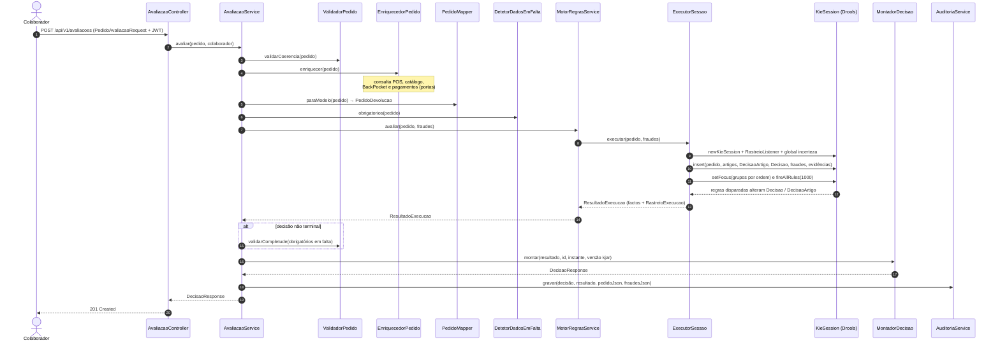

As explicações e as simulações não guardam a sessão Drools: o `ReavaliacaoService` carrega o pedido gravado em
JSON, verifica que a versão do kjar é a mesma da avaliação original (senão lança
`VersaoBaseConhecimentoDiferenteException`) e reexecuta o motor para obter um `ResultadoExecucao` novo, sobre o
qual trabalham os explicadores.

## 5. Base de conhecimento Drools (`pericial-rules`)

### kjar e sessões

`META-INF/kmodule.xml` declara uma kbase `pericial` (pacote `com.levis.devolucoes.regras`) com duas sessões:

| Sessão | Tipo | Uso |
|---|---|---|
| `sessaoPericial` | stateful | Avaliações e simulações: uma sessão nova por pedido, descartada no fim |
| `sessaoPericialStateless` | stateless | Declarada, mas não usada pelo código atual (as simulações também usam a `sessaoPericial`) |

A reatividade por propriedade está em `ALLOWED` (ADR 0004): as regras alteram as decisões por métodos de domínio
(`aplicar`, `registar`, `suspender`, ...), e os ciclos são evitados pela guarda `disparou(...)` e por
`Decisao( terminal == false )` em todas as regras.

### Ordem de avaliação (agenda-groups)

A classe `OrdemAgenda` define a pilha de foco, usada pelo `ExecutorSessao` e pelos testes:

```mermaid
flowchart LR
  T[TRANSVERSAL<br/>auto-focus] --> M0[M0<br/>autorização] --> M1[M1<br/>dados de entrada] --> M2[M2<br/>canal]
  M2 --> EV[EVIDENCIA] --> IN[INCERTEZA] --> M3[M3<br/>elegibilidade]
  M3 --> M4[M4<br/>comprovativo] --> M5[M5<br/>prazo] --> ON[ONLINE] --> M6[M6<br/>resultado/exceções]
  M6 --> M7[M7<br/>valor e meio] --> M8[M8<br/>controlos] --> M9[M9<br/>destino]
```

| Ficheiro DRL | Agenda-group | Regras | Conteúdo |
|---|---|---:|---|
| `transversais.drl` | TRANSVERSAL | 2 | EX-008 (fraude) e PC-008, com `auto-focus true` |
| `m0-autorizacao.drl` | M0 | 2 | Autorização do colaborador |
| `m2-canal.drl` | M2 | 4 | Canal de compra (inclui IN-003 canal desconhecido) |
| `evidencia.drl` | EVIDENCIA | 6 | Derivação de evidências para a incerteza |
| `incerteza.drl` | INCERTEZA | 7 | Cálculo dos graus de crença (IU-xx) e seus efeitos |
| `m3-elegibilidade.drl` | M3 | 22 | Elegibilidade do produto (HS, PC, defeito IU-20..23) |
| `m4-m5-comprovativo-prazo.drl` | M4, M5 | 13 | Comprovativo e prazos (PT-001..PT-008, IU-40) |
| `online.drl` | ONLINE | 9 | Compras levi.com/levi.ca |
| `m6-resultado-excecoes.drl` | M6 | 10 | Tipo de transação e pedidos de exceção |
| `m7-valor.drl` | M7 | 6 | Valor da devolução (OUT-003); função `valorDaBase` |
| `m7-meio-reembolso.drl` | M7 | 15 | Meio de reembolso; função `precoDosArtigosDeTroca` |
| `m8-controlos.drl` | M8 | 8 | Aprovações e controlos (IU-50) |
| `m9-destino.drl` | M9 | 13 | Destino do produto e documentação |
| `consultas.drl` | — | 2 queries | `decisaoDoPedido`, `decisoesDosArtigos` |

M1 não tem regras: os dados IN-001..IN-010 são verificados pelo `DetetorDadosEmFalta` e pelo `ValidadorPedido`
(ADR 0001). Cada regra declara os metadados `@id`, `@modulo`, `@descricao`, `@condicoes` e `@conclusoes`, que
alimentam o `CatalogoRegras` e as explicações (ADR 0006).

### Factos na working memory

| Facto | Origem | Papel |
|---|---|---|
| `PedidoDevolucao` | `PedidoMapper` | Dados de entrada (raiz) |
| `ArtigoDevolvido` | do pedido | Um por artigo devolvido |
| `DecisaoArtigo` | `ExecutorSessao` | Resultado por artigo |
| `Decisao` | `ExecutorSessao` | Resultado do pedido (OUT-001..OUT-008) |
| `IndicadorFraude` | pedido / incerteza | Dispara EX-008 |
| `Evidencia` | `FabricaEvidencias` e `evidencia.drl` | Entrada dos cálculos de incerteza |
| `GrauCrenca` | `incerteza.drl` | Graus calculados (acrescentados à `Decisao`) |
| global `incerteza` | `ServicoIncerteza` | Cálculo e classificação dos graus |

## 6. Diagrama de classes global

Vista de todos os módulos com as classes principais e as dependências entre módulos. O detalhe de atributos e
métodos de cada módulo está na secção 7.

```mermaid
classDiagram
direction TB

namespace pericial_api {
  class AvaliacaoController
  class ExplicacaoController
  class SimulacaoController
  class RegraController
  class IncertezaController
  class SecurityConfig
  class GlobalExceptionHandler
}

namespace pericial_service {
  class AvaliacaoService
  class ExplicacaoService
  class SimulacaoService
  class ReavaliacaoService
  class CatalogoRegrasService
  class ParametrosIncertezaService
  class MotorRegrasService
  class MotorRegrasConfig
  class AuditoriaService
  class Explicadores
  class MontadorDecisao
  class PedidoMapper
  class EnriquecedorPedido
  class IntegracoesSimuladas
}

namespace pericial_dto {
  class PedidoAvaliacaoRequest
  class DecisaoResponse
  class ExplicacaoComoResponse
  class SimulacaoResponse
}

namespace pericial_persistence {
  class AvaliacaoEntity
  class RegistoRegraEntity
  class AvaliacaoRepository
}

namespace pericial_explanation {
  class ExecutorSessao
  class ResultadoExecucao
  class RastreioListener
  class CatalogoRegras
  class ExplicadorComo
  class ExplicadorPorque
  class ExplicadorPorqueNao
  class ExplicadorIncerteza
  class SimuladorCenario
  class DetetorDadosEmFalta
}

namespace pericial_rules {
  class OrdemAgenda
  class kjar_DRL
}

namespace pericial_uncertainty {
  class ServicoIncerteza
  class FabricaEvidencias
  class ParametrosIncerteza
}

namespace pericial_model {
  class PedidoDevolucao
  class ArtigoDevolvido
  class Decisao
  class DecisaoArtigo
  class IndicadorFraude
  class Evidencia
  class GrauCrenca
}

AvaliacaoController --> AvaliacaoService
ExplicacaoController --> ExplicacaoService
SimulacaoController --> SimulacaoService
RegraController --> CatalogoRegrasService
IncertezaController --> ParametrosIncertezaService
AvaliacaoController ..> PedidoAvaliacaoRequest
AvaliacaoController ..> DecisaoResponse

AvaliacaoService --> EnriquecedorPedido
AvaliacaoService --> PedidoMapper
AvaliacaoService --> MotorRegrasService
AvaliacaoService --> MontadorDecisao
AvaliacaoService --> AuditoriaService
AvaliacaoService --> DetetorDadosEmFalta
AvaliacaoService --> Explicadores
ExplicacaoService --> ReavaliacaoService
ExplicacaoService --> Explicadores
SimulacaoService --> ReavaliacaoService
SimulacaoService --> Explicadores
ReavaliacaoService --> AuditoriaService
ReavaliacaoService --> MotorRegrasService
CatalogoRegrasService --> CatalogoRegras
ParametrosIncertezaService --> ServicoIncerteza
EnriquecedorPedido --> IntegracoesSimuladas : portas
MotorRegrasConfig ..> ExecutorSessao : cria
MotorRegrasConfig ..> CatalogoRegras : cria
MotorRegrasService --> ExecutorSessao
AuditoriaService --> AvaliacaoRepository
AvaliacaoRepository ..> AvaliacaoEntity
AvaliacaoEntity "1" *-- "*" RegistoRegraEntity
PedidoMapper ..> PedidoDevolucao
MontadorDecisao ..> DecisaoResponse

Explicadores --> ExplicadorComo
Explicadores --> ExplicadorPorque
Explicadores --> ExplicadorPorqueNao
Explicadores --> ExplicadorIncerteza
Explicadores --> SimuladorCenario
SimuladorCenario --> ExecutorSessao
ExplicadorIncerteza --> ServicoIncerteza
ExecutorSessao ..> kjar_DRL : KieContainer
ExecutorSessao --> FabricaEvidencias
ExecutorSessao --> ServicoIncerteza
ExecutorSessao ..> RastreioListener
ExecutorSessao ..> ResultadoExecucao
MotorRegrasConfig ..> OrdemAgenda
ResultadoExecucao --> PedidoDevolucao
ResultadoExecucao --> Decisao
ResultadoExecucao --> DecisaoArtigo

kjar_DRL ..> PedidoDevolucao : factos
kjar_DRL ..> Decisao : altera
kjar_DRL ..> ServicoIncerteza : global incerteza
ServicoIncerteza --> ParametrosIncerteza
ServicoIncerteza ..> GrauCrenca
FabricaEvidencias ..> Evidencia
PedidoDevolucao "1" *-- "*" ArtigoDevolvido
Decisao "1" o-- "*" DecisaoArtigo
Decisao "1" o-- "*" GrauCrenca
```

## 7. Diagramas de classes por módulo

Convenções: `<<record>>` para records Java, `<<interface>>`, `<<enum>>` e `<<abstract>>`; getters e setters
omitidos. Associações com losango cheio (`*--`) indicam composição; seta tracejada (`..>`) indica uso.

### 7.1 `pericial-model` — factos do domínio

Pacotes `pedido`, `produto`, `decisao`, `incerteza` e `enums`. Descrição detalhada de cada atributo em
`04-diagrama-classes.md`.

```mermaid
classDiagram
direction LR

class PedidoDevolucao {
  -String id
  -LocalDate dataPedido
  -TipoPedido tipoPedido
  -boolean portalOnlineDisponivel
  -boolean politicaPermiteAsCegasOnline
  -boolean suspenso
  -Modulo moduloAtual
  +getDiasDesdeCompra() Long
  +getDiasDesdeEnvio() Long
}
class Loja {
  -String codigo
  -String nome
  -Mercado mercado
  -TipoLoja tipoLoja
  -boolean lojaBackPocket
  -boolean coberturaLojaUnica
  -Set~String~ skusSortido
  +estaNoSortido(String sku) boolean
}
class Colaborador {
  -String id
  -String nome
  -Funcao funcao
  -boolean aprovadoPeloDM
  -String idCredencialPOS
}
class Cliente {
  -String id
  -boolean forneceDados
  -boolean barreiraLinguistica
  -boolean contestaResultado
  -boolean agitado
  -Boolean explicaOrigemCompra
  -boolean pedeNumerario
}
class CompraOriginal {
  -String idTransacao
  -CanalCompra canal
  -LocalDate dataCompra
  -LocalDate dataEnvio
  -String idStylistVenda
  -int quantidadeComprada
  -boolean promocaoEscaloes
  -boolean encomendaEncontrada
  -boolean ajustePrecoAplicado
  -boolean compraOferta
}
class Pagamento {
  -MeioPagamento meio
  -BigDecimal valorPago
  -EstadoConta estadoConta
  -boolean cartaoFisicoPresente
  -boolean reembolsoOriginalRecusado
  -boolean acessoAplicacaoPagamento
}
class Comprovativo {
  -TipoComprovativo tipo
  -boolean confirmaCompra
  -boolean reciboOriginal
  -boolean clienteMantemRecibo
  -boolean incluiOutrosArtigos
}
class PedidoExcecao {
  -String motivo
  -TipoTransacao resolucaoPedida
  -boolean exigeMeioProibido
  -boolean exigeSkuIncorreto
  -boolean envolveProdutoExcluido
  -boolean contornaProcessoObrigatorio
  -boolean concluivelNoSistema
  -Boolean aprovada
  -String preocupacaoCliente
}
class ArtigoDevolvido {
  -String id
  -int quantidade
  -BigDecimal precoPago
  -boolean entreCanais
  -Boolean revendivel
  -BigDecimal valorCalculadoPos
  -DestinoProduto destino
  -int descontoSaldo
}
class ArtigoTroca {
  -boolean apenasMudaTamanho
  -BigDecimal precoVenda
}
class Produto {
  -String sku
  -boolean skuReconhecidoPOS
  -Marca marca
  -CategoriaProduto categoria
  -boolean grossista
  -boolean vendidoNaLoja
  -boolean produtoFranquia
  -BigDecimal pvpOriginal
  -BigDecimal precoAtual
  -boolean emSaldo
  -boolean defeitoConhecido
}
class EstadoProduto {
  -CondicaoUso condicaoUso
  -EstadoEtiquetas etiquetas
  -boolean personalizado
  -boolean alterado
  -boolean embainhado
  -boolean defeitoFabricoConfirmado
  -boolean sujoOuInseguro
  -boolean danificado
  -boolean etiquetaPrecoCorreta
  -boolean rfidCorreto
  -boolean embalagemIntacta
  -boolean conjuntoCompleto
  -Integer grauUso
  -boolean alegaDefeito
  -Map~String,Boolean~ inspecaoDefeito
}

class DecisaoBase {
  <<abstract>>
  -Elegibilidade elegibilidade
  -boolean terminal
  -List~RegistoRegra~ registos
  -Clock relogio
  +aplicar(regra, modulo, resultado, mensagem)
  +resolverRevisao(regra, modulo, mensagem)
  +registar(regra, modulo, mensagem)
  +disparou(regra) boolean
  +disparouCom(regra, resultado) boolean
  +usarRelogio(Clock)
  #terminar()
}
class Decisao {
  -String pedidoId
  -TipoVerificacao tipoVerificacao
  -TipoTransacao tipoTransacao
  -BigDecimal valorDevolucao
  -BaseValor baseValor
  -MeioReembolso meioReembolso
  -NivelAprovacao aprovacao
  -ProcessoObrigatorio processo
  -boolean excecaoRecusada
  -String versaoParametrosIncerteza
  +suspender(regra, modulo, mensagem)
  +recusarExcecao(regra, modulo, mensagem)
  +agregarArtigos(regra, modulo, artigos)
  +terminarPorParagemDosArtigos()
  +exigirAprovacao(NivelAprovacao)
  +acrescentarGrau(GrauCrenca)
}
class DecisaoArtigo {
  -String pedidoId
  -String artigoId
  -TipoTransacao tipoTransacao
  -BigDecimal valorDevolucao
  -BaseValor baseValor
  -DestinoProduto destino
  -NivelAprovacao aprovacao
  -int descontoSaldo
  +exigirAprovacao(NivelAprovacao)
}
class Documentacao {
  -String assinaturaCliente
  -String assinaturaProcessador
  -String assinaturaTestemunha
  -String idStylistAtribuido
  -boolean reciboAgrafado
  -String notaRecibo
  -LocalDate retencaoAte
  -String registoExcecao
}
class RegistoRegra {
  -String codigoRegra
  -Modulo modulo
  -Elegibilidade resultado
  -String mensagem
  -LocalDateTime instante
}
class IndicadorFraude {
  -String pedidoId
  -String descricao
  -NivelRisco nivelRisco
  -boolean comunicadoGSS
}
class RegrasParagem {
  <<utility>>
  +Set~String~ IDS$
}

class Evidencia {
  -String codigo
  -Hipotese hipotese
  -String pedidoId
  -String artigoId
  -Boolean presente
  -FonteEvidencia fonte
  -double peso
  -String grupo
  -String descricao
}
class GrauCrenca {
  -String pedidoId
  -String artigoId
  -Hipotese hipotese
  -MetodoIncerteza metodo
  -double valor
  -ClassificacaoIncerteza classificacao
  -String versaoParametros
  -boolean demonstrativo
}
class Contribuicao {
  -String codigo
  -String descricao
  -double peso
  -double valorAntes
  -double valorDepois
  -boolean aplicada
  -String motivoNaoAplicada
  +aplicada(...)$ Contribuicao
  +naoAplicada(...)$ Contribuicao
}

class Elegibilidade {
  <<enum>>
  PERMITIR
  REVER
  ENCAMINHAR
  RECUSAR
  -int severidade
  +maisSeveroQue(Elegibilidade) boolean
}
class Modulo {
  <<enum>>
  M0
  M1
  M2
  EVIDENCIA
  INCERTEZA
  M3
  M4
  M5
  ONLINE
  M6
  M7
  M8
  M9
}

PedidoDevolucao "1" --> "1" Loja
PedidoDevolucao "1" --> "1" Colaborador
PedidoDevolucao "1" --> "1" Cliente
PedidoDevolucao "1" --> "0..1" CompraOriginal
PedidoDevolucao "1" --> "0..1" Comprovativo
PedidoDevolucao "1" *-- "1..*" ArtigoDevolvido
PedidoDevolucao "1" *-- "*" ArtigoTroca
PedidoDevolucao "1" --> "0..1" PedidoExcecao
CompraOriginal "1" --> "1" Pagamento
PedidoExcecao --> "0..1" Colaborador : aprovador
ArtigoDevolvido "1" --> "1" Produto
ArtigoDevolvido "1" --> "1" EstadoProduto
ArtigoTroca "1" --> "1" Produto

DecisaoBase <|-- Decisao
DecisaoBase <|-- DecisaoArtigo
DecisaoBase "1" *-- "*" RegistoRegra
Decisao "1" *-- "1" Documentacao
Decisao "1" o-- "*" DecisaoArtigo : resultadosArtigos
Decisao "1" *-- "*" GrauCrenca : grausCrenca
GrauCrenca "1" *-- "*" Contribuicao
DecisaoBase ..> Elegibilidade
RegistoRegra ..> Modulo
```

Enumerações restantes (26 no total): `BaseValor`, `CanalCompra`, `CategoriaProduto`, `ClassificacaoIncerteza`,
`CondicaoUso`, `DestinoProduto`, `EstadoConta`, `EstadoEtiquetas`, `FonteEvidencia`, `Funcao`, `Hipotese`, `Marca`,
`MeioPagamento`, `MeioReembolso`, `Mercado`, `MetodoIncerteza`, `NivelAprovacao`, `NivelRisco`,
`ProcessoObrigatorio`, `TipoComprovativo`, `TipoLoja`, `TipoPedido`, `TipoTransacao`, `TipoVerificacao`.

### 7.2 `pericial-uncertainty` — camada de incerteza

Três métodos, um por tipo de hipótese (docs/08, ADR 0011 e 0012):

| Hipótese | Método | Implementação |
|---|---|---|
| `FRAUDE` | Fatores de certeza (MYCIN) | `CombinadorFatoresCerteza` |
| `DEFEITO_FABRICO` | Bayes com razões de verosimilhança | `ModeloRazoesVerosimilhanca` (`ModeloBayesiano`) |
| `REVENDIBILIDADE`, `RECOMENDACAO_CREDITO` | Lógica difusa (FCL) | `MotorFuzzyFcl` (`MotorFuzzy`) com `revendibilidade.fcl` e `credito-pt004.fcl` |

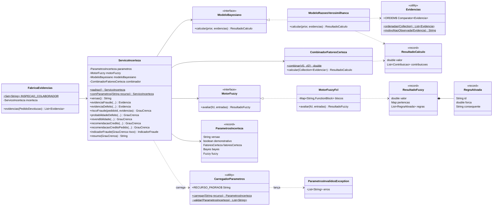

Os valores numéricos (pesos, razões de verosimilhança, priors, limiares) estão só em
`parametros/parametros-incerteza.yml` e nos ficheiros FCL; `SemParametrosNoCodigoTest` garante que não aparecem
no código Java.

### 7.3 `pericial-rules` — base de conhecimento (kjar)

O módulo é quase só recursos: 13 ficheiros DRL, `consultas.drl` e `kmodule.xml`. A única classe Java é
`OrdemAgenda`. Para o diagrama ficar legível, os ficheiros DRL estão agrupados em quatro fases pela ordem de avaliação
dos agenda-groups (cada linha indica o ficheiro, o agenda-group e o número de regras), e o `kmodule.xml` aparece
separado da kbase e das duas ksessions que declara.

O `kmodule.xml` declara duas sessões, mas **só a `sessaoPericial` (stateful) é usada**: o `ExecutorSessao` cria uma
`KieSession` nova a partir dela para cada pedido, tanto nas avaliações como nas simulações "E se?". A
`sessaoPericialStateless` está declarada (e tem uma constante em `OrdemAgenda`), mas nenhum código a usa; aparece a
tracejado.

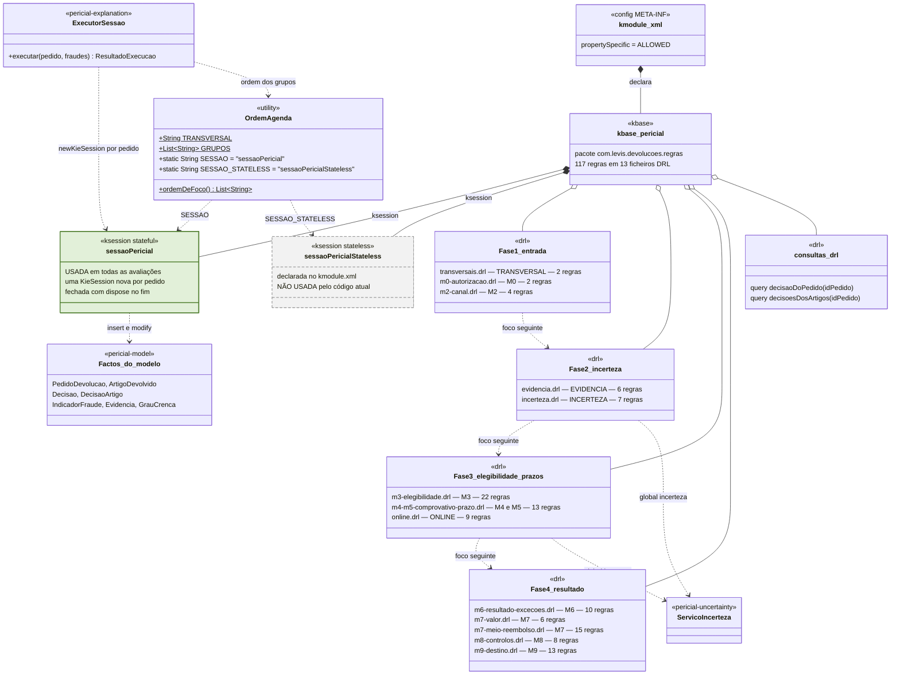

Os testes do módulo (23 classes) cobrem cada módulo de regras, as convenções DRL (`ConvencoesDrlTest`), os
metadados (`MetadadosRegrasTest`), a cobertura de IDs (`CoberturaRegrasTest`) e os 10 cenários de esforço
(`CenariosEsforcoTest`, a partir de `src/test/resources/cenarios/*.json`).

### 7.4 `pericial-explanation` — execução rastreada e explicações

Organizado por subpacotes: `motor` (execução), `rastreio` (eventos da agenda), `catalogo` (metadados das regras),
`como`, `porque`, `porquenao`, `esenao`, `emfalta`, `incerteza` e `texto` (i18n pt-PT/en).

```mermaid
classDiagram
direction LR

%% motor e rastreio
class ExecutorSessao {
  +int LIMITE_DISPAROS$ = 1000
  -KieContainer contentor
  -String nomeSessao
  -List~String~ gruposPorOrdem
  -Clock relogio
  -ServicoIncerteza incerteza
  -FabricaEvidencias evidencias
  +executar(PedidoDevolucao, List~IndicadorFraude~) ResultadoExecucao
  +incerteza() ServicoIncerteza
  +contentor() KieContainer
}
class ResultadoExecucao {
  <<record>>
  PedidoDevolucao pedido
  List~IndicadorFraude~ fraudes
  Decisao decisao
  Map~String,DecisaoArtigo~ artigos
  RastreioExecucao rastreio
  +instantaneo() InstantaneoDecisao
}
class RastreioListener {
  -Decisao decisao
  -Collection~DecisaoArtigo~ artigos
  -List~EventoRegra~ eventos
  -InstantaneoDecisao antesDoDisparo
  +matchCreated(MatchCreatedEvent)
  +matchCancelled(MatchCancelledEvent)
  +beforeMatchFired(BeforeMatchFiredEvent)
  +afterMatchFired(AfterMatchFiredEvent)
  +rastreio() RastreioExecucao
}
class DefaultAgendaEventListener {
  <<Drools>>
}
class RastreioExecucao {
  -List~EventoRegra~ eventos
  +disparos() List~EventoRegra~
  +idsDisparados() List~String~
  +disparou(codigoRegra, artigoId) boolean
  +eventosDe(codigoRegra, artigoId) List~EventoRegra~
  +disparoAnterior(int sequencia) Optional~EventoRegra~
}
class EventoRegra {
  <<record>>
  int sequencia
  TipoEvento tipo
  String codigoRegra
  String nomeRegra
  String modulo
  String artigoId
  Elegibilidade resultado
  String mensagem
  String causaCancelamento
  List~AlteracaoCampo~ alteracoes
}
class TipoEvento {
  <<enum>>
  CRIADA
  DISPARADA
  CANCELADA
}
class AlteracaoCampo {
  <<record>>
  String alvo
  String campo
  Object antes
  Object depois
}
class InstantaneoDecisao {
  -Map valores
  +capturar(Decisao, Collection~DecisaoArtigo~)$ InstantaneoDecisao
  +valor(alvo, campo) Object
  +diferencas(InstantaneoDecisao depois) List~AlteracaoCampo~
}

%% catálogo
class CatalogoRegras {
  -Map~String,MetadadosRegra~ porNome
  +de(KieBase)$ CatalogoRegras
  +ordemModulo(String)$ int
  +regras() List~MetadadosRegra~
  +variantes(String id) List~MetadadosRegra~
  +porNome(String) Optional~MetadadosRegra~
  +produtoras(CampoSaida, Object valor) List~MetadadosRegra~
}
class MetadadosRegra {
  <<record>>
  String id
  String nome
  String modulo
  String descricao
  List~String~ condicoes
  List~Conclusao~ conclusoes
  boolean semGuardaTerminal
  +produz(CampoSaida, Object) boolean
}
class Conclusao {
  <<record>>
  CampoSaida campo
  String valor
  +de(String)$ Conclusao
  +cobre(CampoSaida, Object) boolean
}
class CampoSaida {
  <<enum>>
  OUT_001 ... OUT_008
  +doCampo(String)$ Optional~CampoSaida~
}

%% porque não
class AvaliadorCondicoes {
  -RegistoPredicados predicados
  +avaliar(MetadadosRegra, ContextoAvaliacao) List~ResultadoCondicao~
}
class RegistoPredicados {
  -Map~String,Predicado~ predicados
  +predicado(String nome) Optional~Predicado~
  +nomes() Set~String~
}
class Predicado {
  <<record>>
  String nome
  String descricao
  boolean doArtigo
  boolean sobreEntrada
  Predicate teste
  Function valor
  +avaliar(ContextoAvaliacao) Boolean
}
class ContextoAvaliacao {
  <<record>>
  PedidoDevolucao pedido
  Decisao decisao
  Collection~DecisaoArtigo~ decisoesArtigos
  List~IndicadorFraude~ fraudes
  ArtigoDevolvido artigo
  DecisaoArtigo decisaoArtigo
  +doPedido(ResultadoExecucao)$
  +doArtigo(ResultadoExecucao, String)$
}
class ResultadoCondicao {
  <<record>>
  String nome
  String descricao
  Boolean cumprida
  String valor
  String artigoId
}
class ExplicadorPorqueNao {
  -CatalogoRegras catalogo
  -AvaliadorCondicoes avaliador
  -GeradorTexto texto
  +explicar(...) ExplicacaoPorqueNao
  +explicarConclusao(...) ExplicacaoPorqueNaoConclusao
}
class ExplicacaoPorqueNao {
  <<record>>
  String codigoRegra
  String artigoId
  CausaNaoDisparo causa
  String regraResponsavel
  String variante
  List~ResultadoCondicao~ condicoes
  String resumo
}
class ExplicacaoPorqueNaoConclusao {
  <<record>>
  CampoSaida campo
  String valor
  Object valorObtido
  boolean obtida
  List~ExplicacaoPorqueNao~ regras
  String resumo
}
class CausaNaoDisparo {
  <<enum>>
  DISPAROU
  MODULO_NAO_ALCANCADO
  ...
}

%% como
class ExplicadorComo {
  -CatalogoRegras catalogo
  -AvaliadorCondicoes avaliador
  -GeradorTexto texto
  +explicar(ResultadoExecucao) ExplicacaoComo
  +explicarConclusao(...) ExplicacaoConclusao
}
class ExplicacaoComo {
  <<record>>
  List~PassoExplicacao~ passos
  List~String~ modulosPercorridos
  String paragem
  String resumo
}
class PassoExplicacao {
  <<record>>
  int ordem
  String modulo
  String codigoRegra
  String nomeRegra
  String artigoId
  Elegibilidade resultado
  String mensagem
  boolean aValidar
}
class ExplicacaoConclusao {
  <<record>>
  CampoSaida campo
  String artigoId
  Map valores
  String regra
  List~ResultadoCondicao~ condicoes
  List~String~ caminho
  String resumo
}

%% porquê
class ExplicadorPorque {
  -CatalogoRegras catalogo
  -AvaliadorCondicoes avaliador
  -DependenciasDados dependencias
  -GeradorTexto texto
  +explicar(DadoEntrada, ResultadoExecucao) ExplicacaoPorque
  +explicar(DadoEmFalta, ResultadoExecucao) ExplicacaoPorque
}
class DependenciasDados {
  -Map porCondicao
  +dados(String condicao) Set~DadoEntrada~
}
class DadoEntrada {
  <<enum>>
  MERCADO (IN-001) ...
  -String codigo
  -String caminho
  -String pergunta
  -String racional
  +deCodigo(String)$ Optional~DadoEntrada~
}
class ExplicacaoPorque {
  <<record>>
  DadoEntrada dado
  String pergunta
  List~String~ regrasQueDependem
  List~RegraEmEspera~ regrasEmEspera
  String resumo
}
class RegraEmEspera {
  <<record>>
  String codigoRegra
  String nomeRegra
  String modulo
  String artigoId
  List~Conclusao~ conclusoes
  List~ResultadoCondicao~ condicoesDoDado
}

%% e se / o que falta / incerteza / texto
class SimuladorCenario {
  -ExecutorSessao executor
  -ClonadorFactos clonador
  -GeradorTexto texto
  +simular(...) ResultadoSimulacao
}
class ClonadorFactos {
  -ObjectMapper json
  +clonar(PedidoDevolucao) PedidoDevolucao
  +alterar(PedidoDevolucao, Map alteracoes) PedidoDevolucao
  +paraJson(Object) String
  +pedidoDeJson(String) PedidoDevolucao
  +fraudesDeJson(String) List~IndicadorFraude~
}
class ResultadoSimulacao {
  <<record>>
  Map alteracoes
  ResultadoExecucao simulado
  List~DiferencaSaida~ diferencas
  List~String~ regrasNovas
  List~String~ regrasRemovidas
  String resumo
}
class DiferencaSaida {
  <<record>>
  String alvo
  String campo
  Object original
  Object simulado
}
class DetetorDadosEmFalta {
  +detetar(PedidoDevolucao) List~DadoEmFalta~
  +obrigatorios(PedidoDevolucao) List~DadoEmFalta~
}
class DadoEmFalta {
  <<record>>
  String codigo
  String caminho
  String descricao
  boolean obrigatorio
}
class ExplicadorIncerteza {
  -ServicoIncerteza incerteza
  -GeradorTexto texto
  +como(ResultadoExecucao, Hipotese, artigoId) ExplicacaoGrau
  +porqueNao(...) ExplicacaoPorqueNaoGrau
  +hipoteseDe(ClassificacaoIncerteza)$ Hipotese
}
class ExplicacaoGrau {
  <<record>>
  Hipotese hipotese
  String artigoId
  boolean calculado
  MetodoIncerteza metodo
  Double valor
  ClassificacaoIncerteza classificacao
  List~Contribuicao~ contribuicoes
  List~String~ passos
  boolean demonstrativo
  String resumo
}
class ExplicacaoPorqueNaoGrau {
  <<record>>
  Hipotese hipotese
  ClassificacaoIncerteza perguntada
  ClassificacaoIncerteza obtida
  Double valor
  boolean conseguida
  List~String~ mudariam
  String resumo
}
class GeradorTexto {
  -Locale locale
  -ResourceBundle mensagens
  +portugues()$ GeradorTexto
  +formatar(chave, argumentos) String
}

ExecutorSessao ..> RastreioListener : regista na KieSession
ExecutorSessao ..> ResultadoExecucao : cria
DefaultAgendaEventListener <|-- RastreioListener
RastreioListener ..> InstantaneoDecisao
RastreioListener ..> RastreioExecucao : produz
RastreioExecucao *-- EventoRegra
EventoRegra --> TipoEvento
EventoRegra *-- AlteracaoCampo
InstantaneoDecisao ..> AlteracaoCampo
ResultadoExecucao *-- RastreioExecucao

CatalogoRegras *-- MetadadosRegra
MetadadosRegra *-- Conclusao
Conclusao --> CampoSaida

AvaliadorCondicoes --> RegistoPredicados
RegistoPredicados *-- Predicado
Predicado ..> ContextoAvaliacao
AvaliadorCondicoes ..> ResultadoCondicao
ContextoAvaliacao ..> ResultadoExecucao

ExplicadorComo --> CatalogoRegras
ExplicadorComo --> AvaliadorCondicoes
ExplicadorComo --> GeradorTexto
ExplicadorComo ..> ExplicacaoComo
ExplicadorComo ..> ExplicacaoConclusao
ExplicacaoComo *-- PassoExplicacao

ExplicadorPorqueNao --> CatalogoRegras
ExplicadorPorqueNao --> AvaliadorCondicoes
ExplicadorPorqueNao --> GeradorTexto
ExplicadorPorqueNao ..> ExplicacaoPorqueNao
ExplicadorPorqueNao ..> ExplicacaoPorqueNaoConclusao
ExplicacaoPorqueNao --> CausaNaoDisparo
ExplicacaoPorqueNaoConclusao *-- ExplicacaoPorqueNao

ExplicadorPorque --> CatalogoRegras
ExplicadorPorque --> AvaliadorCondicoes
ExplicadorPorque --> DependenciasDados
ExplicadorPorque --> GeradorTexto
ExplicadorPorque ..> ExplicacaoPorque
DependenciasDados ..> DadoEntrada
ExplicacaoPorque --> DadoEntrada
ExplicacaoPorque *-- RegraEmEspera

SimuladorCenario --> ExecutorSessao
SimuladorCenario --> ClonadorFactos
SimuladorCenario --> GeradorTexto
SimuladorCenario ..> ResultadoSimulacao
ResultadoSimulacao *-- DiferencaSaida

DetetorDadosEmFalta ..> DadoEmFalta
ExplicadorPorque ..> DadoEmFalta

ExplicadorIncerteza --> GeradorTexto
ExplicadorIncerteza ..> ExplicacaoGrau
ExplicadorIncerteza ..> ExplicacaoPorqueNaoGrau
```

| Explicação | Pergunta do colaborador | Classe | Base |
|---|---|---|---|
| Como? | "Como se chegou a esta decisão/conclusão?" | `ExplicadorComo` | Rasto `EventoRegra` + `CatalogoRegras` |
| Porquê? | "Porque me pedem este dado?" | `ExplicadorPorque` | `DadoEntrada` + `DependenciasDados` |
| Porque não? | "Porque não disparou a regra X / não deu a conclusão Y?" | `ExplicadorPorqueNao` | `AvaliadorCondicoes` sobre os predicados |
| E se? | "O que mudaria se o dado Z fosse outro?" | `SimuladorCenario` | Reexecução com `ClonadorFactos.alterar` |
| O que falta? | "Que dados faltam?" | `DetetorDadosEmFalta` | Inspeção do `PedidoDevolucao` |
| Incerteza | "Como foi calculado este grau? Porque não foi outro?" | `ExplicadorIncerteza` | `GrauCrenca.contribuicoes` |

O `RegistoPredicados` reimplementa em Java cada condição nomeada em `@condicoes` das regras;
`CoerenciaPredicadosTest` e `CoerenciaConclusoesTest` garantem que os nomes e as conclusões coincidem com os DRL.

### 7.5 `pericial-dto` — contratos da API

Todos os DTO são `record` com Bean Validation e anotações OpenAPI. Os enums do pacote `dto.enums` espelham os do
modelo (mais `Resposta` = SIM/NAO/NAO_SEI), para que a API não exponha o modelo interno.

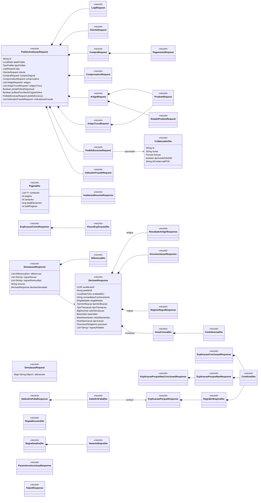

### 7.6 `pericial-persistence` — auditoria e histórico

Esquema gerido pelo Flyway (`V1__esquema_inicial.sql`, `V2__versao_parametros_incerteza.sql`). A avaliação guarda
os campos de resultado em colunas (para listagem e relatórios) e os JSON completos do pedido, dos indícios de
fraude e da decisão (para reexecução e consulta).

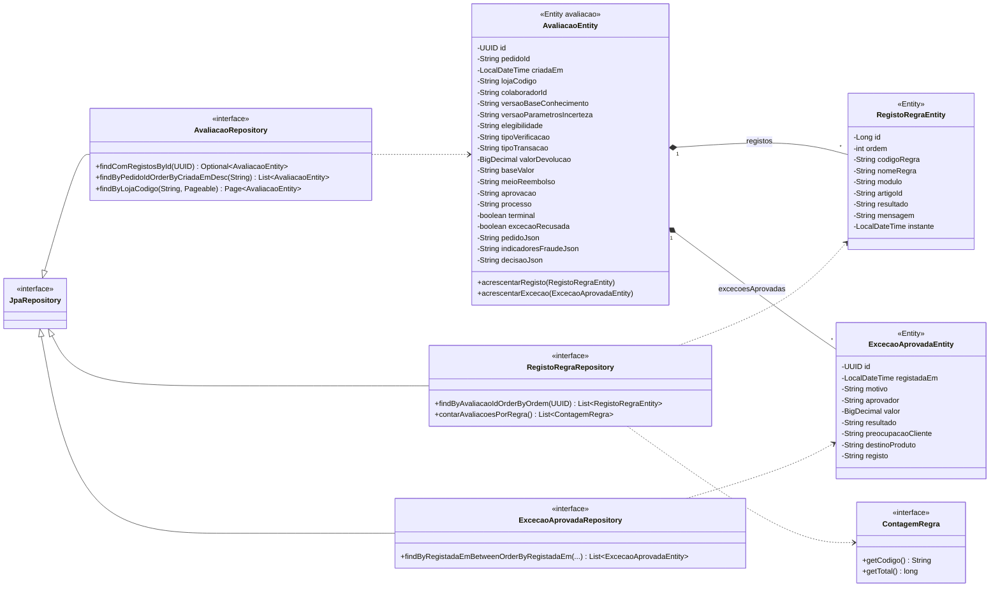

### 7.7 `pericial-service` — casos de uso

Fachadas usadas pela API (`AvaliacaoService`, `ExplicacaoService`, `SimulacaoService`, `CatalogoRegrasService`,
`ParametrosIncertezaService`) e componentes de suporte. `MotorRegrasConfig` é a configuração Spring que cria o
`KieContainer` (classpath), o `ServicoIncerteza`, o `ExecutorSessao` e os objetos de explicação como beans.

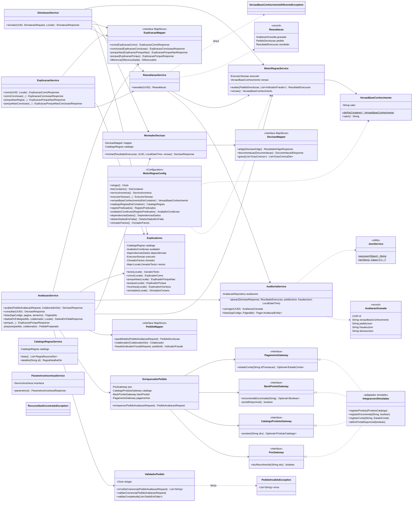

Dependências externas ao módulo (não desenhadas acima): `MotorRegrasService` usa `ExecutorSessao` e
`ResultadoExecucao` (`pericial-explanation`); `AuditoriaService` usa `AvaliacaoRepository` e as entidades
(`pericial-persistence`); `MontadorDecisao` e `CatalogoRegrasService` usam `CatalogoRegras`.

### 7.8 `pericial-api` — camada REST

```mermaid
classDiagram
direction LR

class PericialApplication {
  <<SpringBootApplication>>
  +main(String[])$
}
class AvaliacaoController {
  <<RestController>>
  -AvaliacaoService avaliacoes
  +avaliar(PedidoAvaliacaoRequest, Jwt) ResponseEntity~DecisaoResponse~
  +consultar(UUID) DecisaoResponse
  +listar(loja, pagina, tamanho) PaginaDto
  +dadosEmFalta(...) DadosEmFaltaResponse
  +porque(...) ExplicacaoPorqueResponse
}
class ExplicacaoController {
  <<RestController>>
  -ExplicacaoService explicacoes
  +como(id, conclusao, artigoId, Locale) Object
  +porqueNao(id, regra, conclusao, artigoId, Locale) Object
}
class SimulacaoController {
  <<RestController>>
  -SimulacaoService simulacoes
  +simular(UUID, SimulacaoRequest, Locale) SimulacaoResponse
}
class RegraController {
  <<RestController>>
  -CatalogoRegrasService catalogo
  +listar() List~RegraResumoDto~
  +detalhe(String codigo) RegraDetalheDto
}
class IncertezaController {
  <<RestController>>
  -ParametrosIncertezaService parametros
  +parametros() ParametrosIncertezaResponse
}
class DesenvolvimentoController {
  <<RestController>>
  -EmissorTokens emissor
  +colaboradores() List~ColaboradorDto~
  +token(ColaboradorDto) TokenResponse
}
class SecurityConfig {
  <<Configuration>>
  ~String[] PAPEIS_GESTAO$
  ~String[] TODOS_OS_PAPEIS$
  +filtrosSeguranca(HttpSecurity) SecurityFilterChain
  +descodificadorHmac(PropriedadesSeguranca) JwtDecoder
  +emissorTokens(PropriedadesSeguranca, Clock) EmissorTokens
}
class CorsConfig {
  <<Configuration>>
  +corsConfigurationSource(PropriedadesSeguranca)
}
class OpenApiConfig {
  <<Configuration>>
  +documentoOpenApi() OpenAPI
}
class PersistenciaConfig {
  <<Configuration>>
}
class PropriedadesSeguranca {
  <<record ConfigurationProperties>>
}
class EmissorTokens {
  -JwtEncoder codificador
  -Clock relogio
  +emitir(ColaboradorDto) TokenResponse
}
class ConversorJwtPapeis {
  +convert(Jwt) AbstractAuthenticationToken
}
class ClaimsColaborador {
  <<utility>>
  +funcao(Jwt)$ Optional~Funcao~
  +colaborador(Jwt)$ ColaboradorDto
}
class ChaveHmac {
  <<utility>>
  +de(String chave)$ SecretKey
}
class GlobalExceptionHandler {
  <<RestControllerAdvice>>
  +pedidoInvalido(PedidoInvalidoException) ProblemDetail
  +naoEncontrado(RecursoNaoEncontradoException) ProblemDetail
  +versaoDiferente(VersaoBaseConhecimentoDiferenteException) ProblemDetail
  +argumentoInvalido(IllegalArgumentException) ProblemDetail
}
class ResponseEntityExceptionHandler {
  <<Spring>>
}
class CorrelationIdFilter {
  +CABECALHO$ = "X-Correlation-Id"
  #doFilterInternal(...)
}
class OncePerRequestFilter {
  <<Spring>>
}
class Converter {
  <<interface Spring>>
}

DesenvolvimentoController --> EmissorTokens
SecurityConfig ..> EmissorTokens : cria
SecurityConfig ..> ConversorJwtPapeis
SecurityConfig ..> ChaveHmac
SecurityConfig ..> PropriedadesSeguranca
CorsConfig ..> PropriedadesSeguranca
EmissorTokens --> PropriedadesSeguranca
ConversorJwtPapeis ..> ClaimsColaborador
AvaliacaoController ..> ClaimsColaborador : colaborador do JWT
Converter <|.. ConversorJwtPapeis
ResponseEntityExceptionHandler <|-- GlobalExceptionHandler
OncePerRequestFilter <|-- CorrelationIdFilter
```

#### Endpoints

| Método | Caminho | Controller | Descrição | Papéis |
|---|---|---|---|---|
| POST | `/api/v1/avaliacoes` | Avaliacao | Avalia um pedido e grava a avaliação | todos |
| GET | `/api/v1/avaliacoes` | Avaliacao | Histórico paginado por loja | gestão (GESTAO_LOJA, XSTORE_MANAGER, KEY_HOLDER) |
| GET | `/api/v1/avaliacoes/{id}` | Avaliacao | Consulta uma avaliação gravada | todos |
| POST | `/api/v1/avaliacoes/dados-em-falta` | Avaliacao | O que falta? (com o Porquê de cada dado) | todos |
| POST | `/api/v1/avaliacoes/porque` | Avaliacao | Porquê? para um dado de entrada | todos |
| GET | `/api/v1/avaliacoes/{id}/explicacoes/como` | Explicacao | Como? (decisão completa ou uma conclusão) | todos |
| GET | `/api/v1/avaliacoes/{id}/explicacoes/porque-nao` | Explicacao | Porque não? (regra ou conclusão) | todos |
| POST | `/api/v1/avaliacoes/{id}/simulacoes` | Simulacao | E se? | todos |
| GET | `/api/v1/regras`, `/api/v1/regras/{codigo}` | Regra | Catálogo da base de conhecimento | todos |
| GET | `/api/v1/incerteza/parametros` | Incerteza | Parâmetros de incerteza em vigor | todos |
| GET/POST | `/api/v1/dev/colaboradores`, `/api/v1/dev/tokens` | Desenvolvimento | Emissão de tokens de teste | público (perfil dev) |

Autenticação: JWT assinado com HMAC (OAuth2 Resource Server); o papel vem do claim `funcao` (`ConversorJwtPapeis`).
Erros devolvidos como `ProblemDetail` (RFC 9457). Cada pedido tem um `X-Correlation-Id` propagado para o MDC dos logs.

## 8. Testes e qualidade

| Nível | Onde | Ferramentas |
|---|---|---|
| Unitários do modelo | `pericial-model` | JUnit 5, AssertJ (`ContratoJavaBeanTest` valida o contrato JavaBean exigido pelo Drools) |
| Regras | `pericial-rules` | Sessão Drools real (`MotorTeste`), um teste por módulo, cenários JSON |
| Incerteza | `pericial-uncertainty` | Cálculos, carregamento e validação dos parâmetros, FCL |
| Explicações | `pericial-explanation` | Coerência predicados/conclusões com os DRL, rastreio |
| Integração | `*IT` em persistence, service e api | Testcontainers (PostgreSQL), MockMvc, Failsafe |
| Arquitetura | `ArquiteturaTest`, `ArquiteturaModelTest`, `ArquiteturaIncertezaTest` | ArchUnit |
| Estilo e cobertura | todos | Checkstyle, Spotless (google-java-format), JaCoCo |

## 9. Decisões de arquitetura

| ADR | Tema |
|---|---|
| 0001 | Estrutura de módulos e ficheiros DRL, grupo TRANSVERSAL, `OrdemAgenda` |
| 0002 | Decisão por artigo (`DecisaoArtigo`) e agregação na `Decisao` |
| 0003 | Ambiguidades da base de conhecimento |
| 0004 | Semântica de `aplicar` e de decisão terminal; `propertySpecific=ALLOWED` |
| 0005, 0006 | Explicações e metadados das regras (`@condicoes`, `@conclusoes`) |
| 0007 | Serviço pericial (reexecução, versão do kjar) |
| 0008 | API REST e segurança |
| 0009 | Frontend |
| 0010 | Java 25 LTS |
| 0011, 0012 | Metodologia bayesiana e camada de incerteza |
